# R14（39〜47秒）目で見る評価 v15a → v15b — 2026-11-24

> DM資料。動画本体はPC `C:\VideoStudio\projects\ruosuen\renders\R14_a\`（v15a）と `R14_b\`（v15b）。ここには小さなjpgだけ置く。
> 前回の [R14_compare_v15a.md](R14_compare_v15a.md) は数値だけで判断していた。今回は実際のフレーム（0.5・2・3.5・4.5秒）と比較シートを、原画 `CUT05_KEY_whale_emerges` / `CUT09_KEY_climax` と鯨の設定 `WH01_identity_sheet` に並べて見た。
> 判断基準（作者）：プレイヤーの感情の動きを制御して感動させること。動き・タイミング・カメラはプリヴィズ v14.9b が唯一の正。

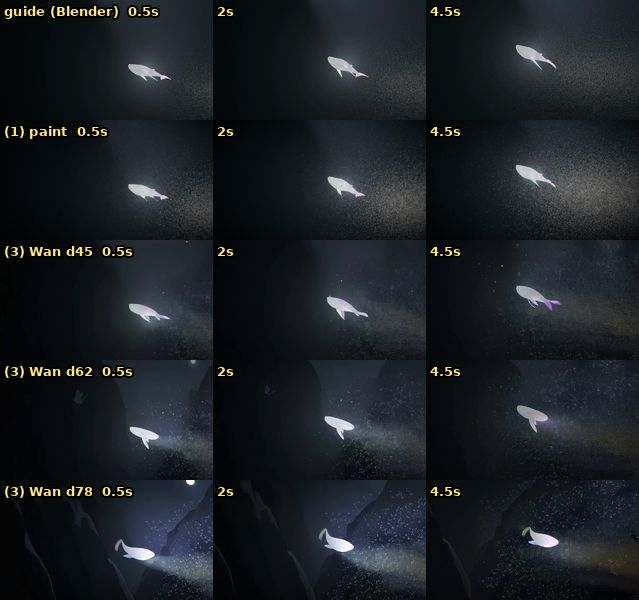
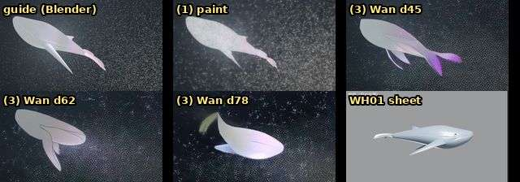

## 見た観点
(a) 鯨の位置・大きさ・向きがガイドと同じか　(b) 原画の鯨と同じ生き物に見えるか　(c) 花弁の雪が「流れ」として美しいか、ちらつかないか　(d) 原画と並べて違和感がないか　(e) 夜の暗さと月光柱

## 版ごとの所見

| 版 | 良い点 | 悪い点 |
|---|---|---|
| ガイド（Blender） | (a) 正。鯨の形は設定どおり（長い胸びれ・小さな背びれ・頭が左）。雪の帯が鯨の後ろへ斜めに流れる構図はプリヴィズのまま | (b) **尾が桃色、胸びれが黄緑**に染まっている（原因は下記、v15bで修正）。鯨は発光だけで陰影がなく、切り抜きのように平たい。(c) 花弁は約170m先で1画素以下になり、**花弁ではなく砂嵐・粉塵に見える**。(d)(e) 全体が灰色で、原画の深い青と明暗の差がない。月光柱は上部にうっすら見える程度 |
| ① 絵画調（paint.py） | (a) 正（ガイドと同じ）。夜の暗さは保っている | (b) 雪の「粒」が鯨の上にも乗り、**鯨が砂糖菓子・砂の像のようにざらつく**。ひれの輪郭も削れる。(c) 粉塵が灰色のまだら模様になり、ガイドよりちらつく（数値でも 0.0142 > ガイド 0.0102）。(d) 絵筆の感じは出ておらず「CGに柔らかいフィルタ」の印象は数値の所見どおり |
| ③ Wan d45 | (a) ほぼ正。雪は少し柔らかくなる | ほとんどガイドのまま。ガイドの尾の色の誤りを**紫のグラデーションに強めて**しまう |
| ③ Wan d62 | (e) 夜空らしい青みが出る。雪が星のようにきらめき、静止画では一番きれい | (b) 胸びれが脚のように垂れ、体が卵形になり、鯨らしさが崩れる。(a) **ガイドにない岩壁と月の円盤**を描き足す（カメラの見え方が変わる）。雪に網目状の模様（圧縮のような規則的な点）が出る |
| ③ Wan d78 | (e) 月光の青白さはいちばん強い | (a)(b) **鯨が逆向き（頭が右）になり、黄色い尾のシロイルカのような別の生き物**になる。岩壁・月を描き足す。使えない |

## 原因が分かったもの（v15bで修正済み）
- 尾の桃色・胸びれの黄緑：鯨の本番モデル `wh01_v20_hero.glb` の頂点色 `COLOR_0` は**リグ用のデータ**（R=頭→尾、G=ひれの範囲）で、色ではない。Blender の glTF 読み込みがこれを Base Color に掛けていた。`render_cut.py` の `Whale._drop_vertex_tint` で頂点色を外し、テクスチャ（gouache albedo）だけにした。鯨以外の画素は変わらない（変化は鯨の約7,000画素だけ）。
- 全192フレームを再描画して `renders/R14_b/`（ガイド・①）を作った。尾と胸びれは設定どおりの真珠白になった。Wan の各版はこの誤りを引き継いでいるので、作り直すときは v15b のガイドから。

## 追加：③制御つき（Wan 2.2 Fun-Control 5B、作者許可 2026-11-24）

Blender から奥行きの制御映像（`render_cut.py --control depth`：鯨・地形・洞窟の距離を白→黒。花弁・空気・光は入れない）を出し、`wan/vid2vid_control.py` で描かせた。960×544、121フレーム、1本約8分半（RTX 3060、VRAM約8.6GB）。

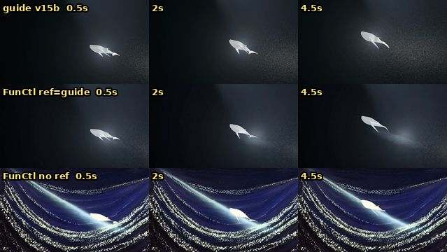

| 版 | 良い点 | 悪い点 |
|---|---|---|
| 制御つき・初めの絵=ガイド | (a) 鯨の位置・大きさ・向きがガイドと一致（0.5〜4.5秒）。(b) 鯨は設定どおりの形と真珠白。ちらつきは少ない | 見た目がガイドの CG のまま（初めの絵に引っぱられる）。花弁はガイドの帯ではなく、鯨の後ろに柔らかい光の尾として描かれる |
| 制御つき・初めの絵なし | (a)(b) 鯨の位置・向き・形は保ったまま、**画面が一気に絵になる**：深い青紫の夜、斜めに差す月光の筋、花弁が何本もの白い川になって流れる。(c) 流れはなめらかで、連続4フレームでも粒がちらつかない。(e) 夜の暗さと光の柱は全版でいちばん原画に近い | **花弁の流れと月光の向きはモデルの創作**（プリヴィズの花弁シミュレーション・月光柱の位置とは違う）。洞窟の壁や地面は消え、布のひだのような抽象的な背景になる。花弁は近くで見ると小石のように塊っぽい。鯨は陰影のない白い切り抜き |

制御つきなら**動きを固定したまま強く描き直せる**ことは確かめられた。残る問題は「プリヴィズにない花弁・光を描き足す」ことで、これは制御映像に入っていないものをモデルが自由に描いた結果。

## 推薦
**本命は「Blender で動きを決め、Fun-Control で絵にする」組み合わせ（③制御）。** ①（Blenderガイド＋後処理）は確実に動く控えとして残す。制御なしの Wan（d45〜d78）はやめる。

理由：
1. 感情の流れを決めているのはプリヴィズのタイミングと鯨の動き。制御つきは鯨とカメラをガイドどおりに保ったまま、原画にいちばん近い夜の色と「流れる花弁」を出せた唯一の版。プレイヤーの感情を動かす絵の力は、いまのところこれだけが届いている。
2. 制御なしの Wan は描き直しを強めるほど鯨の向きと形が崩れ（d78）、構図にない岩や月まで足すので使えない。
3. ①は位置は完全に正しいが、ガイドそのものが弱い（鯨が平たい、花弁が粉塵に見える、画面が灰色）。後処理（paint.py）は今の形では鯨をざらつかせて逆効果。原画と並べると不合格。
4. ただし制御つきの花弁・月光はプリヴィズと違う。プリヴィズが唯一の正なので、採用には次の試験（下の★1）が要る。

## 制御つき（③）の次の試験（★は作者の判断が要る）— 2026-11-24 作者承認、1・2・4 は下の「v15b 続き」で実施
1. ★花弁と月光柱を制御に入れる：Blender の花弁を白い点として奥行き映像に重ねる、または月光柱の形を別の層で渡す。モデルがプリヴィズの流れに沿って花弁を描くか確かめる。どこまでモデルの「川のような花弁」を許すかは作者の判断。
2. 花弁をあとから重ねる案：制御つきの絵に、Blender の花弁層（プリヴィズどおり）を加算で重ねる。流れはプリヴィズのまま確実に保てる。
3. 洞窟が消える件：プロンプトに岩壁・地面を入れる、奥行きの範囲（`--depth-near/far`）を広げて壁の形を強く渡す。
4. 他の区間：Fun-Control は 121フレーム（5秒）単位。R14 は 8秒なので、残り（121〜191）は2本目を重ねてつなぐ必要がある。

## ①（控え）で次に直すとよい順（作者の判断が要るものに★）
1. paint.py：鯨の上に雪の粒・もやを乗せない（鯨の明るい塊をマスクして除外）。ざらつきとちらつきが減る見込み。
2. ガイドの色と明暗：黒を沈め、影を青に、月光柱を少し強める（`LOOK` の `bg`・`vol_density`・`moon_strength`・露出）。灰色の膜を取る。
3. 鯨の陰影：発光だけでなく、月光の当たる上側を明るく・腹側を青く（原画の塗り）。
4. ★花弁が遠すぎて粉塵に見える件：プリヴィズの花弁は変えずに、描き方（大きさの下限 `petal_min_px`、明るさ）で「粒」を見せるか、手前に大きな花弁の層を足すか。後者はプリヴィズの花弁シミュレーションに手を入れることになるので、作者の判断が要る。

---

## v15b 続き（作者承認 2026-11-24：本命＝Blenderで動き＋Fun-Controlで絵、花弁はプリヴィズどおりに、8秒は2本つなぐ）

### 花弁をプリヴィズどおりにする2案

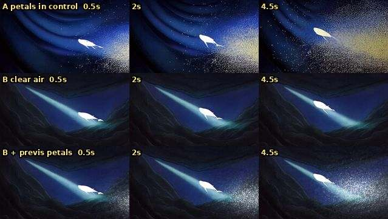

| 案 | 中身 | 見た結果 |
|---|---|---|
| A 花弁を制御に入れる | `render_cut.py --control depth_petals --set petal_min_px=1.5`（奥行き映像に花弁を光の点で重ねる）→ Fun-Control | 花弁はプリヴィズの帯の位置に描かれ、ちらつきも少ない。ただし**4.5秒で鯨が花弁の模様をかぶって黄ばみ**、鯨らしさが落ちる。背景は渦のような筆跡で洞窟らしくない。月光は出ない |
| B 花弁なしで描かせて、あとからプリヴィズの花弁を重ねる | `vid2vid_control.py --clear-air`（雪を描かせないプロンプト）→ `render_cut.py --control petals`（花弁だけの層。鯨・岩は黒で隠す）→ `post/overlay_petals.py` | 絵は**洞窟の岩壁が戻り、月光の筋が鯨に当たる**、全版でいちばん原画（CUT05）に近い。鯨は真珠白のまま。花弁は**プリヴィズと完全に同じ流れ**。そのまま重ねると細かい砂嵐に見えたので、`overlay_petals.py` の 'paint' で「流れに沿った淡いもや＋明るい花弁だけ小さな点」に描き直した。原画 CUT09 のきらめく帯に近い |

**採用：B**（プリヴィズの花弁を正確に保てて、鯨も崩れない）。

### 8秒をつなぐ
- 1本目：プリヴィズ 0〜120フレーム（初めの絵なし、`--clear-air`）。
- 2本目：71〜191フレーム。初めの絵に1本目の71フレーム目を渡し（`--start 71 --ref`）、同じ絵から始めた。
- 重なり（71〜120、約2秒）を `post/join_segments.py` で直線のクロスフェード → 192フレーム。前後のフレーム差を測ると、つなぎ目に跳びはない（重なりの前後で 2.8〜4.4、全体の中央値 3.4）。
- 鯨の位置：完成版の鯨の重心は、奥行き制御映像の鯨と全区間で 480幅あたり5画素以内（約1%）で一致。
- 最後に `overlay_petals.py` でプリヴィズの花弁を全192フレームに重ねた。

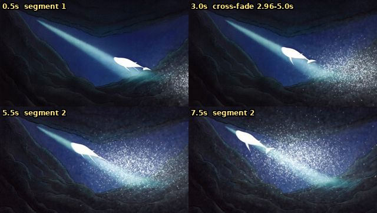

完成版：PC `renders/R14_b/R14_functl_petals_v15b.mp4`（960×544、8.0秒）。

### 方式①（控え）も1つ直した
`post/paint.py`：鯨の大きな明るい塊をマスクして、筆面（Kuwahara）と雪の点を鯨に乗せないようにした。ひれの形が戻り、砂の像のようなざらつきが減った。`renders/R14_b/paint` と `R14_paint.mp4` を全192フレーム描き直し済み。

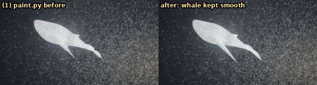

### 残っていること
1. **月光の向き**：B の月光の筋はモデルが描いたもので、プリヴィズの月光柱（ほぼ真上から）とは向きが違う（左上から斜め）。直すなら月光柱も Blender の層で重ねる（花弁と同じやり方）か、制御映像に入れる。★作者の判断：今の斜めの筋を許すか。
2. 鯨は陰影のない白い切り抜き。月光の当たる上側を明るく、腹側を青くする層を Blender から足すとよい。
3. 解像度は 960×544。本番の 1280×720 以上にする方法（アップスケール、または区間を分けて高解像度で描かせる）は未定。
4. 他のカットへの展開（R13→R15→R17b→R18 の「雪の山場」から）。

---

## v15c（2026-11-25）プリヴィズと照合し直した → 本命を Blender の作り込みに戻す

作者の指摘：「洞窟の形、月の有無、鯨の形がプリヴィズと違う」。プリヴィズ v14.9b の映像（`previs/v14-director-rebuild/artifacts/v14-full/`）の R14（39〜47秒）と同じ時刻で並べて確かめた。**指摘どおりだった。**

| 項目 | プリヴィズ v14.9b（正） | Fun-Control 版（v15b 本命としていたもの） | Blender ガイド v15b |
|---|---|---|---|
| 洞窟 | 岸から見上げた暗い空気だけ。岩壁は画面に入らない | V字の岩壁を描き足す（**創作**） | 一致 |
| 月・月光 | 月は映らない。上にうっすら光のもや | 左上から斜めの強い月光の筋（**創作**） | 一致 |
| 鯨 | 輪郭ほど暗い陰影、頭→尾で氷青・白・薄紫、黒い目 | 陰影のない白い切り抜き、目なし | 同じく白い切り抜き、目なし、**尾の打ち方の位相がずれていた** |

→ **上の「v15b 続き」の推薦（Fun-Control を本命）は取り下げる。** AI は奥行きで動きを固定できても、制御に入っていないもの（岩壁・光）を勝手に描く。プリヴィズが唯一の正なので、本命は **Blender をプリヴィズどおりに作り込み、その上で絵を上げる** 路線に戻す。Fun-Control は「プリヴィズにないものを描かない」と確かめられるまで保留。

### v15c で直したこと（`blender/render_cut.py`、`bridge/export_cut.py`）
1. **尾の打ち方の位相**：プリヴィズは鯨の経路を `PATH.retime(phase0, fast_tau)` で打ち直しているのに、Blender 側は打ち直していない経路で尾を動かしていた（尾の位置と光の脈動がずれる）。`export_cut.py` が `stroke_phase0`・`fast_stroke_tau` を書き出し、`render_cut.py` が同じ retime をかけるようにした（R14 の既存キャッシュには値を足した）。鯨の輪郭の一致（IoU）は 0.77〜0.92 → 0.92 前後に。
2. **鯨の描き方をプリヴィズの式に**：発光 × 頭→尾の opal 色（氷青・白・薄紫・温白）× 立体感（正面ほど明るく輪郭ほど暗い：0.4＋0.6×正面度）。
3. **鯨の光が鯨自身を照らさない**（ライトリンク）：体の中の点光源がひれと尾を真っ白に焼いていた。プリヴィズでは鯨の光は空気・花弁・岩だけを照らす。
4. **目**：本番モデルの目は眼窩の約0.1 m 奥にあり、R14 の距離では体に隠れていた。目だけ皮膚の位置まで出した（`eye_out`）。
5. **空気と花弁**：空気を紺に、花弁は白く硬い点に（プリヴィズは遠くの花弁を硬い点で描く）。実の暖色は控えめに。画面の明るさを領域ごとにプリヴィズと合わせた（平均の明るさ 毎秒 29〜45 ／ プリヴィズ 32〜43）。

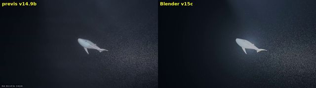

並べた動画：PC `renders/R14_c/R14_previs_vs_v15c.mp4`。ガイド：`renders/R14_c/R14_guide.mp4`（1280×720、8秒）。

### 残る差・次の作り込み（絵を原画に近づける）
- 鯨の周りの光のにじみがプリヴィズより強い（プリヴィズはほとんど無い）。左側の空気がやや暗い。
- **ここから先が「絵」の作り込み**：プリヴィズは配置と動きの正で、絵の質は原画（CUT05・CUT09）が目標。Blender の中で、(1) 鯨に描いた質感（設定のガッシュ地のテクスチャ・腹の畝・月光の当たる背の明るさ）、(2) 花弁と光の粒に筆の点の形、(3) 画面全体の筆致（後処理①を Blender の出力に合わせて）を足していく。どれもプリヴィズの配置・動きは変えない。

---

## v15d（2026-11-25）R14 完成版候補：Blender で作り込み、AI なしで仕上げ（作者承認：Blender の作り込みで完成版を目指す）

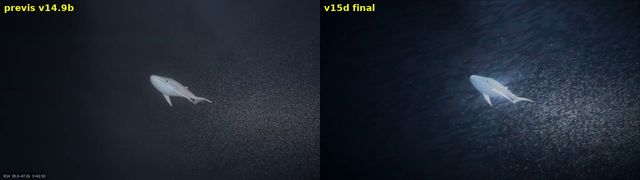

完成版候補：PC `renders/R14_d/R14_final_v15d.mp4`（1280×720、8.0秒、192フレーム）。並べた動画 `R14_d/R14_previs_vs_final_v15d.mp4`。

### 作り方（どれもプリヴィズの配置・動きを変えない）
1. **Blender（`render_cut.py`）**：v15c（プリヴィズに合わせた版）に加えて、鯨の発光にガッシュ地のテクスチャを掛け（腹の畝・筆の跡が光の中に見える）、空を向く背を明るく、腹側を青く（`whale_tex`・`whale_top`・`whale_belly`）。
2. **層に分けて描く**：`--control base`（花弁なしの本描画）、`--control petals`（花弁だけ。鯨の後ろの花弁は隠れる）、`--control whale_matte`（鯨の形）。
3. **仕上げ（`post/finish.py`、AI なし・毎回同じ結果）**：
   - 空気：流れの向き（-22°）に短く幅のあるナイフの筆跡、薄紫と水色の筆の色むら。R14 はカメラ固定なので筆跡は画面に固定（背景がうごめかない）
   - 鯨：Blender のテクスチャをそのまま使い、画面固定の筆跡は乗せない（動く体の上を筆跡が滑るため）。影の側だけ冷たく
   - 花弁：流れに沿った淡い光のもや＋明るい花弁だけ流れの向きの短い筆の点＋プリヴィズの細かいきらめき。実の光は温かい金に
   - にじみ（bloom）、紺の影・温かい白の明部、彩度を少し上げて原画の青へ、紙の粒、周辺減光

### 確かめたこと
- 構図・鯨・花弁の位置：Blender の層をそのまま使うので v15c と同じ（プリヴィズと一致）。
- 明るさ：平均 35.9 ／ プリヴィズ 37.6（夜の暗さを保つ）。
- ちらつき（細部の前フレームとの差）：4.02 ／ プリヴィズ 4.27 ／ v15c ガイド 5.47。粗い明るさの変化はプリヴィズの約2倍だが、前後で符号が交互にならない（点滅ではない）ので、鯨と花弁の動きによるもの。
- 連続4フレームを拡大して、花弁の筆の点がなめらかに流れること、鯨の上で筆跡が滑らないことを見た。

### 作者に見てほしいところ
- 花弁の流れが「細かいきらめき」から「流れの向きの筆の点」になった。原画 CUT09 の金のきらめきに寄せるか、プリヴィズの細かさに戻すか（`finish.py` の `--dab`・`--fine`・`--mist`）。
- 夜の暗さはプリヴィズに合わせている。原画はもっと明るい青。明るくするなら `--sat` と露出で。

---

## v15e（2026-11-25）明るく、花弁を増やし、近景の花吹雪（作者：「もう少し明るく。花弁をもっと増やし、自然な花吹雪も。見せ場の一つ」）

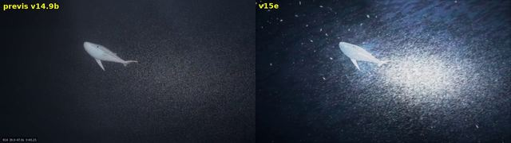

完成版候補：PC `renders/R14_e/R14_final_v15e.mp4`（1280×720、8秒）。並べた動画 `R14_e/R14_previs_vs_v15e.mp4`。

### 美しさの組み立て
- **明るさ**：夜のまま一段明るく（露出 +0.35、空気のもや・月光を強め、仕上げで 1.12 倍）。平均の明るさ 36 → **62**（毎秒 41→83、終わりに向けて花弁の川が明るくなる）。鯨の光のにじみは逆に抑え、鯨のまわりに薄い影の輪（`finish.py --ring`）を置いて、明るい川の前でも鯨が一番目立つように。
- **遠景の花弁を約3倍**：プリヴィズの花弁一枚ごとに番号（`idx`）を書き出し、番号から決まる位置のずれで2枚ずつ足した（半径 2.5 m 以内、同じ流れで動く、フレームごとに飛ばない）。プリヴィズ自身の「統計的な層」と同じ考え方。
- **近景の花吹雪（新規、`NearSnow`）**：本物の花弁の形（`petal_rgba`：白に根元が金）を 1,200 枚、カメラから 3〜30 m に。3軸でひらひら回転し、本流と同じ向き（右下から鯨の通った跡へ、昇りながら）に流れる。流れの帯のまわりに多く、左の暗い側は静かに残す。鯨の光を受けて透け、向きが変わるたびに光沢がきらっと返る（鯨の位置に近景専用の光、ライトリンク）。ピントは鯨（F8）。毎フレーム時間の式で決まるので、どのフレームも単独で描ける。
- **仕上げ（`finish.py`）**：近景の花弁は形を保って最後に重ね、少しだけにじませる。鯨は細部（畝・筆の跡）を少し立てる。

### プリヴィズからの変更（作者の指示による）
- プリヴィズ v14.9b は「R13・R14 では花弁がカメラに届かないので手前は澄んだまま」としている。**近景の花吹雪はこれを変える**（作者 2026-11-25 の指示）。鯨・カメラ・遠景の花弁の流れ（シミュレーション）は変えていない。
- 遠景の花弁の密度（約3倍）も見た目のための追加で、シミュレーション自体は同じ。

### 確かめたこと
- 細部の前フレームとの差 6.49（v15d 4.02、プリヴィズ 4.27）：花弁が増えて動くものが増えたぶん。粗い明るさの変化は前後で符号が交互にならない（交互率 0.03）ので点滅ではない。
- 連続4フレームの拡大で、近景の花弁が回転して丸→細い線に変わりながら流れること、鯨の上で筆跡が滑らないことを見た。
- 調整できる所：近景の数 `near_n`・大きさ `near_size`・ぼけ `fstop`（render_cut の `--set`）、川の明るさ `--mist`・`--fine`・`--dab`、全体 `--gain`（finish.py）。終わりの数秒は花弁の川の中心がかなり白くなる。

---

## v15f（2026-11-25）近景の花吹雪を主役に（作者：「近景の花吹雪の方が、鯨にまとわりつく花吹雪よりも明らかにばえる。こちらを中心に作り直して」）

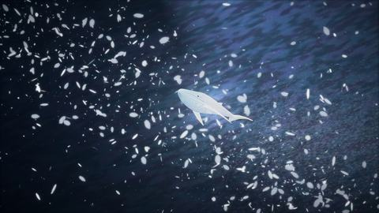

完成版候補：PC `renders/R14_f/R14_final_v15f.mp4`（1280×720、8秒）。並べた動画 `R14_f/R14_previs_vs_v15f.mp4`。`render_cut.py --look blizzard`。

- **主役は近景の花吹雪**：本物の花弁の形を 3,500 枚、カメラから 3〜60 m に（3〜25 m、花弁の形が読める距離に多め）。大きいものから小さいものまで奥行きが途切れない。突風の波で速さがゆっくり揺れる。
- **奥の空気に溶ける**：20 m より遠い花弁は 60 m で約 35% まで薄く（空気の遠近）。
- **鯨の窓**：鯨の前を通る花弁は薄く（`finish.py --whale-window`）。花吹雪の中でも鯨の形と目が読める。
- **鯨にまとわりつく川は引かせる**：遠景の花弁はプリヴィズの密度に戻し（×3 をやめる）、仕上げで粒と筆の点を控えて、鯨の後ろの光の帯に。
- 明るさは平均 61（毎秒 52→70）。v15e より始めから明るく、終わりの白飛びは抑えた。
- プリヴィズの変更の提案：[previs_proposal_near_blizzard.md](previs_proposal_near_blizzard.md)（R13〜R15 で手前の花吹雪を主役にするための、花弁の出どころ・量の決め方）。

---

## v15g（2026-11-25）桜色の鯨、少なくゆっくりした花弁、90 mm の試験（作者：「鯨が小さい」「鯨をピンク発光などエモーショナルに」「花吹雪は『秒速5センチメートル』では」）

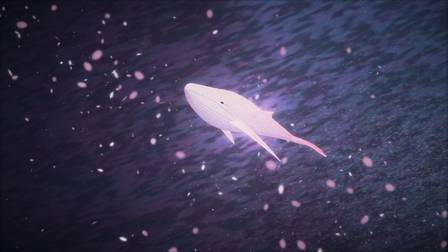

完成版候補：PC `renders/R14_g/R14_final_v15g.mp4`（1280×720、8秒）。並べた動画 `R14_g/R14_previs_vs_v15g.mp4`。`render_cut.py --look sakura --set lens_mul=1.636`。

- **鯨が小さく見えた理由**：カメラが遠い（約170 m、55 mm で画面の幅の約2割）うえに、近景の花弁が大きすぎた（4.5 cm＝プリヴィズの1.5倍）。両方を直した。
- **望遠（試験）**：同じ位置・向きで 90 mm。鯨は画面の幅の約3〜4割。**最初の約0.5秒は尾が画面の右へ少し出て、終わりは頭が上の縁に触れる**（向きを変えずに全身を収めるなら約 80 mm）。レンズはプリヴィズの変更なので作者の判断待ち（`previs_proposal_near_blizzard.md` 追記）。
- **桜色の鯨**：発光は尾が濃い桜色→頭が淡い真珠桃、影はすみれ色、鯨の光も桜色で周りの空気と花弁が桜色に染まる（`palette=sakura`）。夜の青と桜色の対比。
- **花吹雪（『秒速5センチメートル』の考え方）**：少なく（1,300 枚）、本来の大きさ（3 cm）、ゆっくり（v15f の 0.4 倍）、目で一枚ずつ追える。望遠の圧縮で手前の数枚だけ柔らかくぼける（F5.6）。鯨の光で透けて桜色に光る。
- 明るさ 平均 61（毎秒 49→71）。細部のちらつき 2.91（v15f より少ない。花弁が少なく遅いため）。
- 鯨の色を変えると、点灯（R09）以降の全カットの鯨の色が変わる（プリヴィズの点灯の色の設計の書き換えが要る）。

---

## v15h（2026-11-25）鯨と花弁の色を同じにするのはよいか（作者：「右の方が格段によくなった。その上で鯨と花弁の色を一緒にすることがいいことなのかは突き詰めて考えてほしい」）

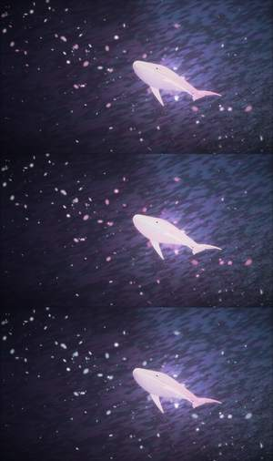

同じ時刻・同じ配置で3案を描いた（`--set palette=sakura|source|contrast`、`finish.py --near-tint`）。

| 案 | 見え方 | 問題 |
|---|---|---|
| A 同じ桜色（v15g） | 画面全体がひとつの桜色にまとまり、夢の中のよう | 主役（鯨）と空気（花弁）が同じ色で、目がどこを見ればよいか定まらない。桜色一色は甘く、かわいい方へ寄る。花弁が「桜」に見えて、題名の「空に降る**雪**」の比喩が消える |
| B 鯨が光源 | 鯨の芯がいちばん白く明るく、縁と、鯨の光が届いた花弁だけが桜色。遠い花弁は白い雪のまま | 鯨の縁の桜色はやや控えめ（強められる） |
| C 桜色の鯨と白銀の花弁 | 暖かいものが鯨だけなので、鯨がいちばん目立つ。花弁は雪に見える | 冷たく、さびしい。花弁が鯨の光を一度も受けていないように見え、両者の関係が描けない |

### 考えたこと
1. **主役と空気は、色ではなく「光の関係」で結ぶ**。鯨は光源。光源そのものは芯がいちばん白く強く、その色は光が当たったものに移る。花弁に色を「塗る」のではなく、鯨の光から色を「借りる」ようにすると、色の濃さがそのまま**鯨との近さ**を表す。
2. **色で物語が語れる**。プリヴィズの流れでは、花弁は鯨の光に呼ばれ（R13〜R15）、R15 で置いていかれ、R17b で魔法の解けた雪として降り、R18 で鯨は月に溶ける。B なら色がこれをなぞれる：
   - R13 離れたばかりの花弁は白（月の光だけ）
   - R14・R15 鯨の近くで桜色に染まる（呼ばれている）
   - R15 の終わり、置いていかれた花弁から色が抜ける
   - R17b 白い雪だけが降る（C の画）
   - R18 鯨の桜色が月の白へ溶ける
   台詞なしで「つながり → 別れ」を色が運ぶ。判断基準（プレイヤーの感情の動きを制御する）にいちばん合う。
3. **題名を守る**：花弁はふだん白い雪。桜色は鯨に触れたときだけ。
4. **C は捨てずに、別れの後の色として使う**（R17b）。A は鯨と花弁の区別が消えるので採らない。

### 推薦
**B（鯨が光源）**。8秒の全体：PC `renders/R14_h/R14_final_v15h.mp4`。鯨の縁の桜色の強さ（`whale_rim`）と、花弁が染まる範囲（`--near-tint-r`）は調整できる。

---

## v15i（2026-11-25）B（鯨が光源）＋ひと漕ぎごとの淡い金（作者：「Bで良い。鯨は時間によっては他の色合いも、淡い金色とか」）

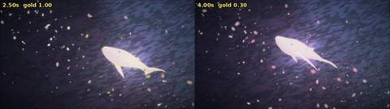

完成版候補：PC `renders/R14_i/R14_final_v15i.mp4`（1280×720、8秒）。`render_cut.py --look sakura --set lens_mul=1.636 --set palette=source`、`finish.py ... --near-tint 1.0,0.55,0.75 --near-tint-gold 1.0,0.82,0.48`。

- **金は鯨の動きから生まれる**：プリヴィズの光の脈（ひと漕ぎの後に頭→尾）と同じ時刻に、淡い金の帯が頭から尾へ走り、余韻を残して滑空の間に桜色へ戻る（R14 では 1.7〜3.5秒、6.8秒〜）。滑空中は体の上を色がゆっくり揺らぐ。
- 金の間は鯨の光・近くの花弁（`near-tint-gold`）・後ろの花弁の流れ（`gold_petal`）も金に寄る。プリヴィズの「脈は花雪の中へ伝わる」とも合う。空気のもやは桜すみれ色を保つ（金の光が青い空気に混ざると濁った灰緑になったので、空気へは 3 割だけ）。
- 色の意味（提案）：**金＝目覚め・いのち、桜色＝つながり、白＝別れ**。全編の流れは `previs_proposal_near_blizzard.md` の追記。
- 鯨の色ごとの金の強さは `render_cut.py` の `gold_pulse`（帯）・`gold_shimmer`（揺らぎ）・`gold_air_amt`（空気）で調整できる。
