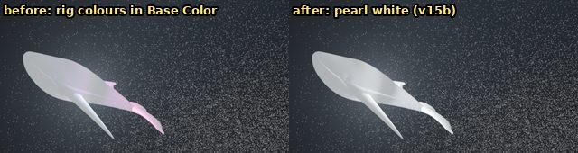

# R14（39〜47秒）目で見る評価 v15a → v15b — 2026-11-24

> DM資料。動画本体はPC `C:\VideoStudio\projects\ruosuen\renders\R14_a\`（v15a）と `R14_b\`（v15b）。ここには小さなjpgだけ置く。
> 前回の [R14_compare_v15a.md](R14_compare_v15a.md) は数値だけで判断していた。今回は実際のフレーム（0.5・2・3.5・4.5秒）と比較シートを、原画 `CUT05_KEY_whale_emerges` / `CUT09_KEY_climax` と鯨の設定 `WH01_identity_sheet` に並べて見た。
> 判断基準（作者）：プレイヤーの感情の動きを制御して感動させること。動き・タイミング・カメラはプリヴィズ v14.9b が唯一の正。

## 見た観点
(a) 鯨の位置・大きさ・向きがガイドと同じか　(b) 原画の鯨と同じ生き物に見えるか　(c) 花弁の雪が「流れ」として美しいか、ちらつかないか　(d) 原画と並べて違和感がないか　(e) 夜の暗さと月光柱

## 版ごとの所見

| 版 | 良い点 | 悪い点 |
|---|---|---|
| ガイド（Blender） | (a) 正。鯨の形は設定どおり（長い胸びれ・小さな背びれ・頭が左）。雪の帯が鯨の後ろへ斜めに流れる構図はプリヴィズのまま | (b) **尾が桃色、胸びれが黄緑**に染まっている（原因は下記、v15bで修正）。鯨は発光だけで陰影がなく、切り抜きのように平たい。(c) 花弁は約170m先で1画素以下になり、**花弁ではなく砂嵐・粉塵に見える**。(d)(e) 全体が灰色で、原画の深い青と明暗の差がない。月光柱は上部にうっすら見える程度 |
| ① 絵画調（paint.py） | (a) 正（ガイドと同じ）。夜の暗さは保っている | (b) 雪の「粒」が鯨の上にも乗り、**鯨が砂糖菓子・砂の像のようにざらつく**。ひれの輪郭も削れる。(c) 粉塵が灰色のまだら模様になり、ガイドよりちらつく（数値でも 0.0142 > ガイド 0.0102）。(d) 絵筆の感じは出ておらず「CGに柔らかいフィルタ」の印象は数値の所見どおり |
| ③ Wan d45 | (a) ほぼ正。雪は少し柔らかくなる | ほとんどガイドのまま。ガイドの尾の色の誤りを**紫のグラデーションに強めて**しまう |
| ③ Wan d62 | (e) 夜空らしい青みが出る。雪が星のようにきらめき、静止画では一番きれい | (b) 胸びれが脚のように垂れ、体が卵形になり、鯨らしさが崩れる。(a) **ガイドにない岩壁と月の円盤**を描き足す（カメラの見え方が変わる）。雪に網目状の模様（圧縮のような規則的な点）が出る |
| ③ Wan d78 | (e) 月光の青白さはいちばん強い | (a)(b) **鯨が逆向き（頭が右）になり、黄色い尾のシロイルカのような別の生き物**になる。岩壁・月を描き足す。使えない |

## 原因が分かったもの（v15bで修正済み）
- 尾の桃色・胸びれの黄緑：鯨の本番モデル `wh01_v20_hero.glb` の頂点色 `COLOR_0` は**リグ用のデータ**（R=頭→尾、G=ひれの範囲）で、色ではない。Blender の glTF 読み込みがこれを Base Color に掛けていた。`render_cut.py` の `Whale._drop_vertex_tint` で頂点色を外し、テクスチャ（gouache albedo）だけにした。鯨以外の画素は変わらない（変化は鯨の約7,000画素だけ）。
- 全192フレームを再描画して `renders/R14_b/`（ガイド・①）を作った。尾と胸びれは設定どおりの真珠白になった。Wan の各版はこの誤りを引き継いでいるので、作り直すときは v15b のガイドから。

## 追加：③制御つき（Wan 2.2 Fun-Control 5B、作者許可 2026-11-24）

Blender から奥行きの制御映像（`render_cut.py --control depth`：鯨・地形・洞窟の距離を白→黒。花弁・空気・光は入れない）を出し、`wan/vid2vid_control.py` で描かせた。960×544、121フレーム、1本約8分半（RTX 3060、VRAM約8.6GB）。

| 版 | 良い点 | 悪い点 |
|---|---|---|
| 制御つき・初めの絵=ガイド | (a) 鯨の位置・大きさ・向きがガイドと一致（0.5〜4.5秒）。(b) 鯨は設定どおりの形と真珠白。ちらつきは少ない | 見た目がガイドの CG のまま（初めの絵に引っぱられる）。花弁はガイドの帯ではなく、鯨の後ろに柔らかい光の尾として描かれる |
| 制御つき・初めの絵なし | (a)(b) 鯨の位置・向き・形は保ったまま、**画面が一気に絵になる**：深い青紫の夜、斜めに差す月光の筋、花弁が何本もの白い川になって流れる。(c) 流れはなめらかで、連続4フレームでも粒がちらつかない。(e) 夜の暗さと光の柱は全版でいちばん原画に近い | **花弁の流れと月光の向きはモデルの創作**（プリヴィズの花弁シミュレーション・月光柱の位置とは違う）。洞窟の壁や地面は消え、布のひだのような抽象的な背景になる。花弁は近くで見ると小石のように塊っぽい。鯨は陰影のない白い切り抜き |

制御つきなら**動きを固定したまま強く描き直せる**ことは確かめられた。残る問題は「プリヴィズにない花弁・光を描き足す」ことで、これは制御映像に入っていないものをモデルが自由に描いた結果。

## 推薦
**本命は「Blender で動きを決め、Fun-Control で絵にする」組み合わせ（③制御）。** ①（Blenderガイド＋後処理）は確実に動く控えとして残す。制御なしの Wan（d45〜d78）はやめる。

理由：
1. 感情の流れを決めているのはプリヴィズのタイミングと鯨の動き。制御つきは鯨とカメラをガイドどおりに保ったまま、原画にいちばん近い夜の色と「流れる花弁」を出せた唯一の版。プレイヤーの感情を動かす絵の力は、いまのところこれだけが届いている。
2. 制御なしの Wan は描き直しを強めるほど鯨の向きと形が崩れ（d78）、構図にない岩や月まで足すので使えない。
3. ①は位置は完全に正しいが、ガイドそのものが弱い（鯨が平たい、花弁が粉塵に見える、画面が灰色）。後処理（paint.py）は今の形では鯨をざらつかせて逆効果。原画と並べると不合格。
4. ただし制御つきの花弁・月光はプリヴィズと違う。プリヴィズが唯一の正なので、採用には次の試験（下の★1）が要る。

## 制御つき（③）の次の試験（★は作者の判断が要る）
1. ★花弁と月光柱を制御に入れる：Blender の花弁を白い点として奥行き映像に重ねる、または月光柱の形を別の層で渡す。モデルがプリヴィズの流れに沿って花弁を描くか確かめる。どこまでモデルの「川のような花弁」を許すかは作者の判断。
2. 花弁をあとから重ねる案：制御つきの絵に、Blender の花弁層（プリヴィズどおり）を加算で重ねる。流れはプリヴィズのまま確実に保てる。
3. 洞窟が消える件：プロンプトに岩壁・地面を入れる、奥行きの範囲（`--depth-near/far`）を広げて壁の形を強く渡す。
4. 他の区間：Fun-Control は 121フレーム（5秒）単位。R14 は 8秒なので、残り（121〜191）は2本目を重ねてつなぐ必要がある。

## ①（控え）で次に直すとよい順（作者の判断が要るものに★）
1. paint.py：鯨の上に雪の粒・もやを乗せない（鯨の明るい塊をマスクして除外）。ざらつきとちらつきが減る見込み。
2. ガイドの色と明暗：黒を沈め、影を青に、月光柱を少し強める（`LOOK` の `bg`・`vol_density`・`moon_strength`・露出）。灰色の膜を取る。
3. 鯨の陰影：発光だけでなく、月光の当たる上側を明るく・腹側を青く（原画の塗り）。
4. ★花弁が遠すぎて粉塵に見える件：プリヴィズの花弁は変えずに、描き方（大きさの下限 `petal_min_px`、明るさ）で「粒」を見せるか、手前に大きな花弁の層を足すか。後者はプリヴィズの花弁シミュレーションに手を入れることになるので、作者の判断が要る。
