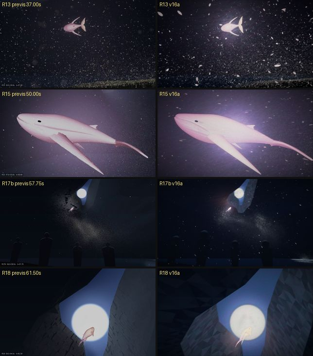

# 雪の山場 v16（R13・R15・R17b・R18）— 目視レビュー

> DM資料（ネタバレ）。Pages・SECTIONS・llms.txt に載せない。
> 正はプリヴィズ v14.10。尺・カメラ・鯨・花弁の動きはプリヴィズの書き出しのまま（`bridge/export_cut.py`）。作り方は README の 3.2b。

## カットごと

| カット | 本番 | 作り方の要点 | 確かめたこと |
|---|---|---|---|
| R13 花畑から花弁が離れる（33.0–39.0 s、24 mm、首を上へ振る） | `renders/R13_v16a/` | 花の群落は本物の花（`FlowerField`：FL-01 モデルをプリヴィズの花 6,777 株の位置に。離れた花弁の数で花びらが減る）。レンズの5 m以内を通る花弁は本物の花弁の形（`PetalsNear`）。地面は鯨の光を受けない（プリヴィズどおり暗い） | 構図・群落・離脱の波・鯨の位置はプリヴィズと一致。舞い上がる雪の明るさを測って合わせた（花弁の層を約0.5倍） |
| R15 最接近（47.0–53.0 s、18 mm、首を振って追う、0.6倍のスロー） | `renders/R15_v16a/` | 手前の花吹雪を空間に置く形（`NearSnow` world mode）、筆致は景色の側に乗る（`finish.py --cam-json`）、最接近で空気が明るむ（`climax`）、スローの金のきらめき | 明るさの山がプリヴィズと同じ形（平均 30→88→47、プリヴィズ 27→80→46）。コマ間の変化に跳ねなし |
| R17b 4人が見送る白い雪（56.0–59.5 s、20 mm） | `renders/R17b_v16a/` | 4人は Blender で作った人影（`Party`）。白い雪はシミュレーションの落ちる雪に乗る。暗い洞窟を残して人影が読める（`--floor`） | 離れた雪の雲の明るさ・屋根の暗さをプリヴィズと測って合わせた |
| R18 月へ溶ける（59.5–64.5 s、100 mm） | `renders/R18_v16a/` | 開口部をプリヴィズの輪郭どおりに切り、岩は三角の面。夜空・星・月はプリヴィズと同じ位置と大きさ。鯨は尾から月の色になり透けて溶ける | 月 212/201、暈 (65,88,137)/(65,85,127)、空 (39,61,99)/(38,53,88)、岩壁 (30,40,55)/(32,38,48)、天井 (6,12,23)/(7,11,18)。溶けた部分は月と同じ明るさで、光らずに月に入る |

通しの確認用：`renders/climax_v16/climax_previs_vs_v16a.mp4`（33.0–64.5 s。R17 はまだ本番がないのでプリヴィズ）。

## カット点のつながり（本番で変わったところ）

カメラ・鯨・花弁の動きはプリヴィズのままなので、つながりの差は明るさと手前の雪の見え方だけ。平均の明るさ（0〜255）の跳ね：

| カット点 | 本番 | プリヴィズ |
|---|---|---|
| R13→R14（39.0 s） | 27.8→48.0（+20） | 25.6→31.7（+6） |
| R14→R15（47.0 s） | 61.4→28.7（−33） | 38.6→26.8（−12） |
| R15→R17（53.0 s、R17 はプリヴィズ） | 32.5→23.5（−9） | 26.7→23.5（−3） |
| R17→R17b（56.0 s） | 27.4→17.6（−10） | 27.4→19.4（−8） |
| R17b→R18（59.5 s） | 16.7→50.8（+34） | 19.5→50.1（+31） |

R14 v15i（作者の「もっと明るく」）が両隣よりずっと明るく、前後で大きく跳ねる。カット内の跳ねはない（最大 2.6）。

## Claude が決めたこと（作者に確認したい）

0. **R14 の明るさ（作者の判断）。** 案A：R14 を仕上げだけやり直して少し落とす（`finish.py --gain` 1.1→0.85 で平均 48–61→約 38–48、跳ねは +10/−19 程度）。案B：R14 はそのままで、R13 の終わりと R15 の始まりを持ち上げる（R15 の山はさらに明るくなる）。Claude は A を勧める（R15 の最接近を全編で一番明るい瞬間として残せる）。

1. **R15 の手前の花吹雪の速さ。** プリヴィズの手前の雪（統計的な層）はゆっくり漂うだけだが、同じプリヴィズの花弁シミュレーションでは、カメラのまわり30 mの雪が鯨に連れられて約7.5 m/sで流れている。手前だけ漂うと奥の流れと食い違うので、本番では手前の花弁をその流れに一枚ずつ違う割合（0.35〜0.85倍）で乗せた。押し寄せる感じは強くなる。漂う方がよければ戻せる（`near_couple=0,0`）。
2. **R13 の花の形。** FL-01 のモデルはプリヴィズの花（茎 7.5 cm に花弁 2 cm）より花の頭がずっと大きいので、頭を横に半分に細めた（`flower_sxy=0.5`）。モデル自体は変えていない。
3. **明るいカットの筆致。** 光った空気の上では R14 と同じ強さの筆致が雨のように見えたので、R15 は 0.025、R18 は 0、R17b は 0.05 に下げた（R14 は 0.18）。
4. **R18 の月の海。** プリヴィズの式どおりの海（暗い模様）が本番では少し見える。プリヴィズは明部の圧縮で見えにくくなっている。消すなら `MOON_FACE` の模様を薄くする。

## 次

- R17（月へ一直線、53.0–56.0 s）を本番に（雪の山場がつながる）。
- 残りのカット（R01〜R12, R19）。R10〜R12 は `FlowerField` がそのまま使える（書き出しが `flowers.npz` を出す）。
