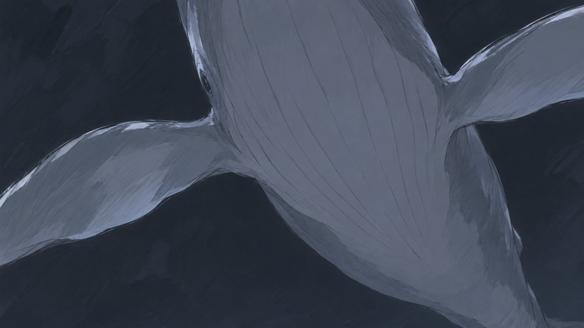

# N06「頭上通過」構図検証ラフ v01（2026-11-22）
> **DM専用・プレイヤー閲覧禁止。作者未承認の検証用。** 『空に降る雪』v12仮決定／v12.1未承認監督レビューから独立させた新N06ラフ。旧C06・C07の作者採用・原本・借り置きには一切手を加えない。Pages非公開・main未マージ。

- 画像ファイル：[`n06-e05-first-composition-v01.jpg`](n06-e05-first-composition-v01.jpg)（960×540、16:9。初期生成原画1672×941からトリミング縮小した確認用JPEG）
- 生成記録：2026-11-22、生成ID `cad4a145-a9e7-4644-adb5-38125cb9971a`。このJPEGは新しい構図検証用であって、完成原画・作者採用画ではない。
- 参照正本：[`current/storyboard-v12-70s-provisional-2026-11-22.md`](../../storyboard-v12-70s-provisional-2026-11-22.md)、[`current/storyboard-v12-1-redraw-director-review-2026-11-22.md`](../../storyboard-v12-1-redraw-director-review-2026-11-22.md)、[`v8/overhead-moonbeam-flight-camera-review-v04-2026-11-22.md`](../../../v8/overhead-moonbeam-flight-camera-review-v04-2026-11-22.md)、[`v8/whale-setting-current.md`](../../../v8/whale-setting-current.md)、[`flower.md`](../../../flower.md)、[`v8/keyframe-contact-2026-11-22.md`](../../../v8/keyframe-contact-2026-11-22.md)。

## ショットの意図と機能

- **情動**：N05の接近を受け、鯨に悪意がないまま、その絶大なスケールゆえに緊張の頂点となる。
- **見せる**：下から見た頭部の一部、喉から腹、左右一対の胸びれの正しい接続。全長24mの身体の一部分でフレームを覆う。
- **見せない**：頭から尾までの全身、冒険者の固有の姿、月面、花吹雪、S1花の開花、自発光、威嚇、一瞥、背面ロール、不要な洞窟装飾。
- **光**：月光をまだ直接浴びないPhase 0。陰影は暗い洞窟環境からのわずかな反射と水面由来の冷たい間接反射だけ。自発光のリムを描かない。

## カメラ／空間パラメータ（検証用仮値・未確定）

| 項目 | 仮値 | 保留点 |
|---|---|---|
| カメラB座標 (X,Y,Z) | (-58,-84,4.1)m | 冒険者代表地点(-58,-84,2.5)m＋眼高1.6m。実PCの姿勢と身長は固定しない |
| 方位／仰角 | -60°／50° | 固定。フルサイズ相当36×20.25mmセンサー。鯨をパンで追わない |
| レンズ／画角 | 16mm／水平96.73°・垂直64.65° | 最終レンズをロックしない |
| 鯨の仮寸法 | 全長24m・全幅14.8m・胴最大幅4.5m | WH-01に忠実な3D実メッシュが必要 |
| 軌道／観測 | 第一陸側円弧R70m・中心(-20,-25)m | 鯨胴中心軌道はPC鉛直線の水平0.18m程度を通過する代理計算 |
| N06時間 | v12 14.0–17.5秒 ／v12.1 14.0–18.0秒 | 尺・ステーション時刻とも制作仮値 |

座標系はX=湖に向いた右、Y=湖方向、Z=鉛直上。月はB画角の投影上入ることがあっても**天井岩盤の遮蔽で見せない**。湖面・花の岬もこの高い仰角では画外。

### 前後の運動を三時点で検証する

| 代理地点 | 時刻 | 鯨中心の仮XYZ | カメラBでの中心の画素（1920×1080） | 映像上の役割 |
|---|---:|---|---|---|
| E04 | 14.5s | (-73.623,-69.995,15)m | (1131,885) | 下方から迫る。N05の接近と繋ぐ |
| **E05：今回の画** | **16.5s** | **(-60.15,-82.341,11.5)m** | **(1002,229)** | 腹と胸びれが視界を覆う、中心がほぼ天頂 |
| E06 | 18.0s | (-49.583,-88.442,16)m | (1063,-3704)：画面外 | 鯨が固定カメラから抜け、N07の背後側切り返しへ |

上表は**鯨中心点のみ**の2.5D投影であり、生成ラフ画像そのものを厳密な画素投影とみなさない。映像中の頭先・腹・尾・左右胸びれの境界、表面の近接距離は実メッシュで検証する。

## 第一ラフの評価：採用未定

### 意図に近い点
- 巨体の一部分が16:9の視界を大きく覆い、フルシルエットを見せずに巨大感が出る。
- 暗い環境、見上げる視点、鯨の非発光の青灰の体表が表現できている。
- 胸びれを左右に一対描く方向性は維持。余計な鰭・月・花・攻撃的な表情を追加していない。

### 次の修正点・不合格リスク
- **最大課題：運動方向の読みに曖昧さ**。一枚だけでは、頭が先に抜け、胴・胸びれ・尾が順に通ることが十分確証できない。正しい向きと画面内の前後関係をE04/E05/E06で検証する。
- **造形**：腹側の畝が顔や吻先まで延長されたように見える箇所と、胸びれ左右の取り付け・奥行き関係をWH-01に沿って描き分ける。腰・尾側の形は誤って補わない。
- **照明**：輪郭の白いリムが強く、自発光あるいは実際には見えない月光に見えるリスクがある。暗い間接反射だけに整理。
- **空間証明**：背景に地面や尺度物を出す必要はないが、画内の巨体を16mm/50°の現実の正確な投影とはまだ照合できない。カメラeyeからの頭部近接／PCへの非接触を3D判定する。
- **衝突**：v0.4代理で頭部表面と代表地盤の最小約2.99m、長身PCを含めた安全距離は未確定。3Dの鯨メッシュ、左右胸びれとPC代表当たり判定を通す。

## 次の制作ゲート（作者レビュー前提）

1. このE05第一ラフを**仮採用するか描き直すか**作者に確認する。静止画としての巨体感と、解剖学の気になる箇所を分けて返答いただく。
2. N06の開始（E04）と終了（E06）を**各1枚ずつ独立した16:9ラフ**で作る。固定Bの座標、レンズ、背景方向を同じままにする。E06は鯨中心が画面外でも尾先まで完全に抜ける瞬間ではないことに注意。
3. E05→N07の接続を数秒のアニマティックで確認し、鯨が攻撃せず背後へ進み、陸地上空の月光へ向かう動きが継続することを確認する。
4. 可能ならBlender等で頭・腹・胸びれ・尾の**実3Dの投影シルエット・岩盤／PCとの離隔**を確認してから完成原画を作る。

**採用状態**：第一ラフ作成済み、作者の確認・承認待ち。v12の物語骨格は変更なし。v12.1のレンズ・時間は未ロック。スキルはリポジトリの`illustration-composition`とLottieFiles`motion-design`の主動作／環境動作・段取りを参照し、UI用の時間数値は転用していない。

## 2026-11-22: 低ポリゴンのプレビズへ制作方法を切り替え（作者指示）

> **この節は構図・撮影のワークフローを変更するものであり、完成原画の承認ではない。** 構図検証では画像生成を原則使わず、数値で調整可能な低ポリ代理モデルと固定カメラ投影を優先する。作者提供の「平面経路・凡例」図は**情報の出し方の参考**で、図中の旧C04〜C18経路そのものを現行v12の確定軌道にするものではない。

- **[ブラウザで動くN06低ポリ・プレビズ v01](previs/n06-lowpoly-previs-v01.html)** — HTML単体でオフライン動作。カメラBの16:9画面と上面地図が同期。時刻14〜18秒、レンズ10〜50mm、方位、仰角、カメラ位置、鯨の位置・ロール・方向・胸びれ角をスライダーで即時調整可能。外部ライブラリ・画像生成は不要。
- [ブラウザ画面の参考画像](previs/n06-lowpoly-interface-v01.png)／[E05=16.5sの独立したカメラ投影画像](previs/n06-e05-camera-v01.png)／[初期設定と元ステーション座標JSON](previs/n06-lowpoly-settings-v01.json)。
- カメラBの初期値は v0.4 候補XYZ=(-58,-84,4.1)、方位−60°、仰角50°、16mm、フルサイズ36×20.25mm。**時間を動かしてもカメラは動かない。**
- 鯨胴体中心はv0.4のE03〜E08（うちN06にE04/E05/E06）を滑らかに補間し、身体の前向きは軌道の接線から生成。全長24m・両胸びれ幅14.8m・胴幅約4.5mの**粗いポリゴン**であり、WH-01の実メッシュ・正確な外皮・衝突判定ではない。
- **N06は未発光**。カメラBから自然月は岩盤遮蔽で見えず、花群落は上向き画角の外にある。岩壁の黒い色面は演出背景の模式表現で正確な天井地形ではない。
- **プレビズから得た重要な観察**：E04=14.5sには鯨の頭が見え、E05=16.5sでは近さのため頭部はすでにフレーム上外に抜け腹と胸びれが画面を占め、E06=18.0sには胴体中心は完全にフレーム外、尾や胸びれの一部だけが残りうる。作者の好む「頭・腹・胸びれの見せ方」には、15秒台の別の静止瞬間も比較対象になる。
- **今後の検査順**：カメラB固定→E04/E05/E06の全像投影比較→胸びれ付け根／頭腹のプロキシ修正→PC頭上と頭部下端の3D安全距離→N07への動線を確認。カメラ画面の派手な装飾や光を先行制作しない。
- **状態**：作者の「構図ラフはポリゴンで、細かな修正が可能な方式」という作業指示を反映。プレビズ内の具体的数値・モデル造形・ラフの上映採否は**作者レビュー待ち**。旧手描きラフv01および既存採用原画は消さずに履歴・造形参考として保全。
