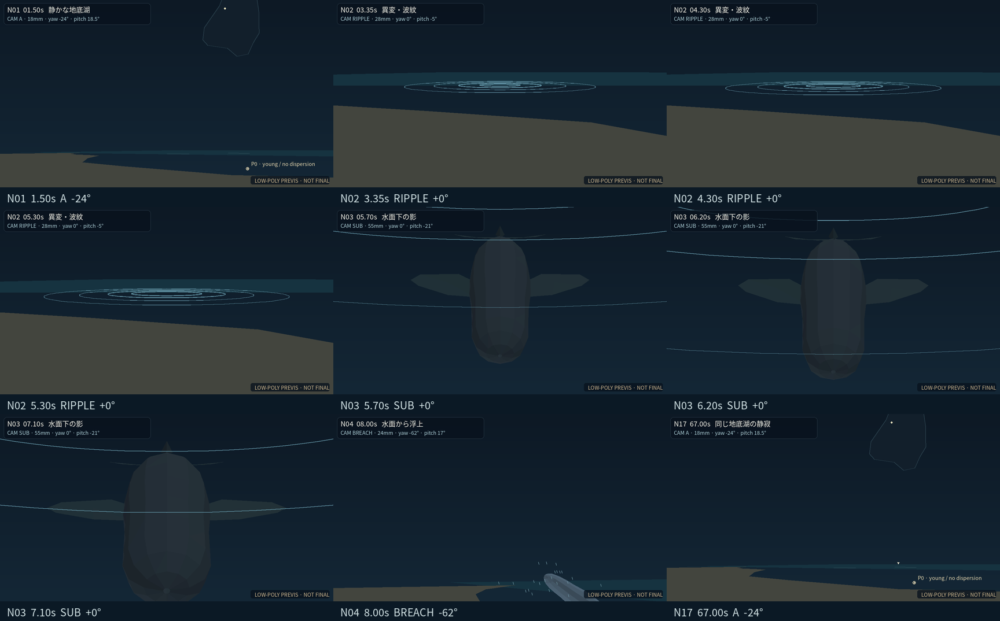
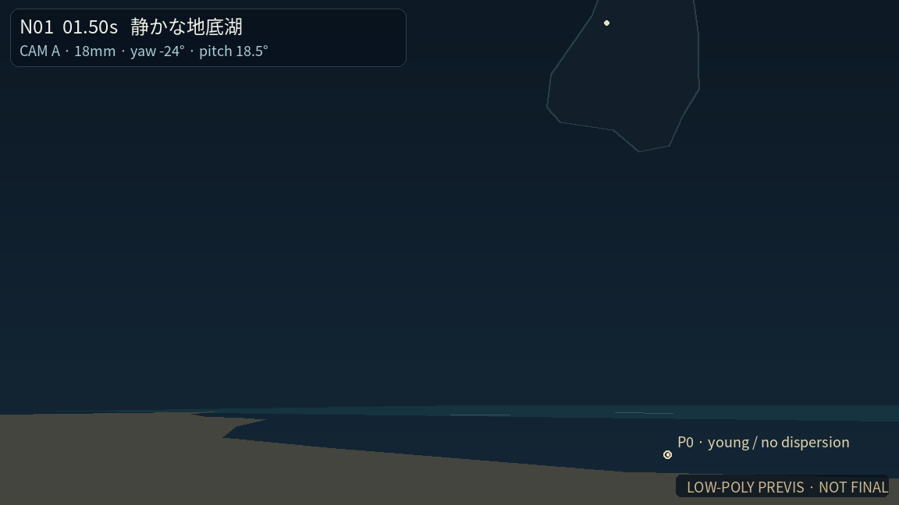
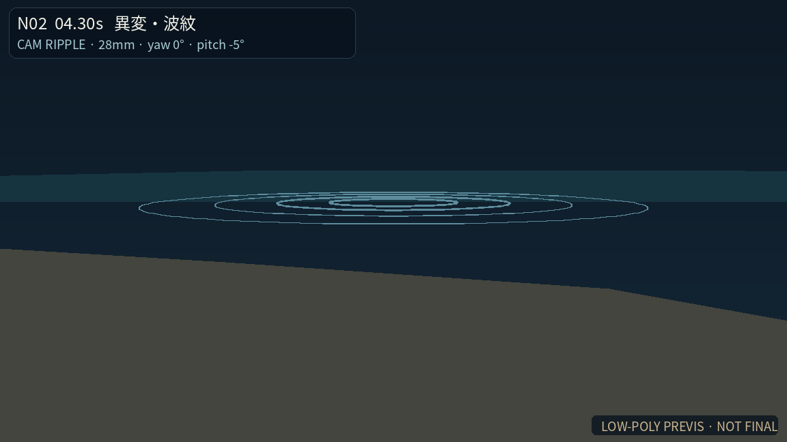
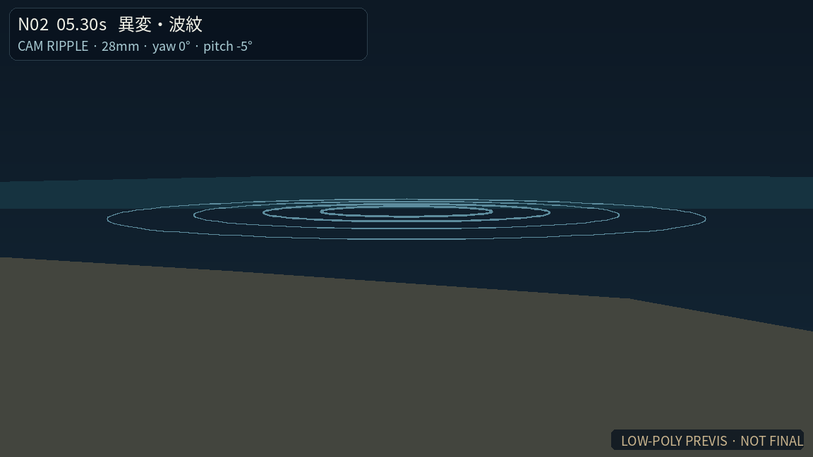
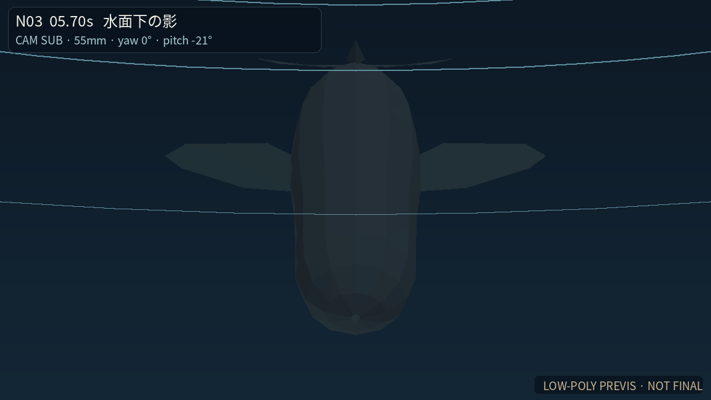
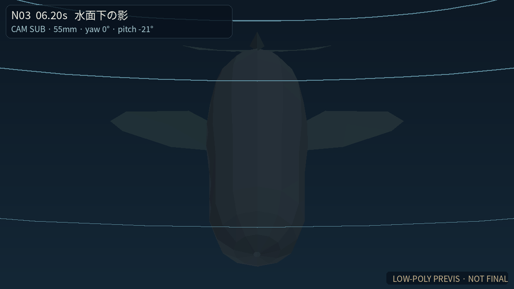
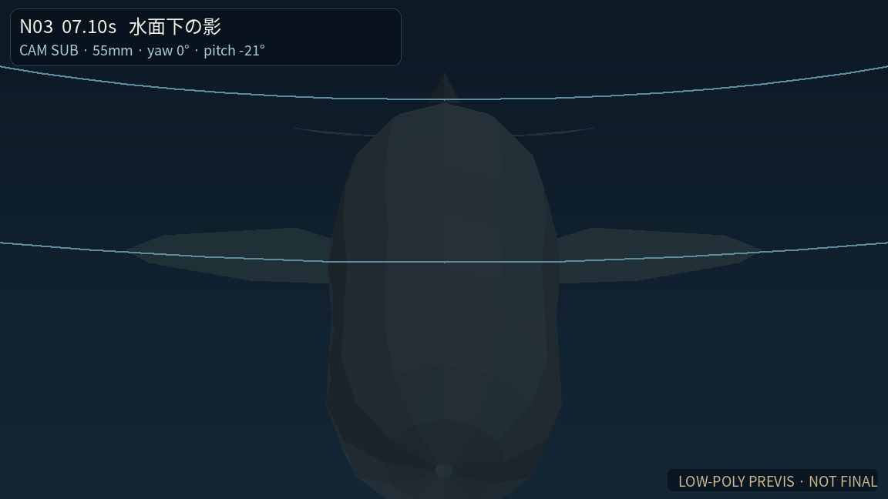
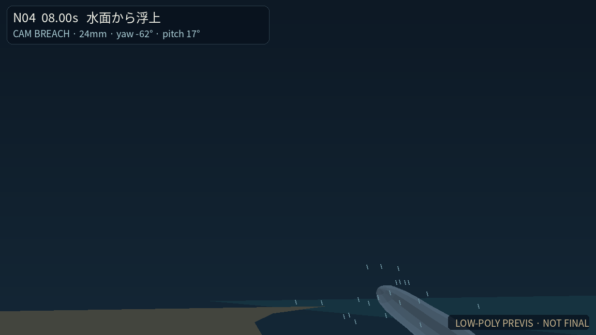
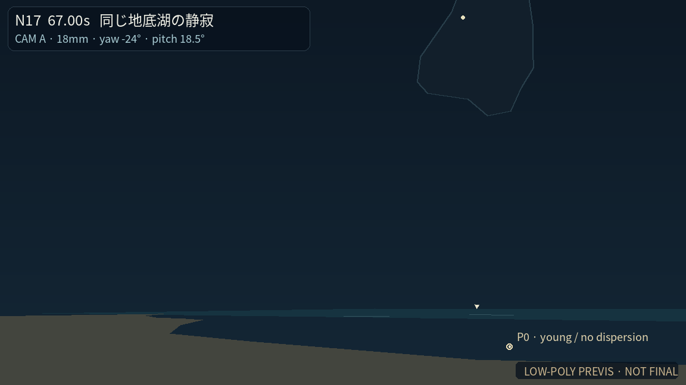

# 『空に降る雪』v12.4｜N01〜N03「正面から迫る鯨」低ポリ構図案（2026-11-22）

> **DM専用／作者未承認の撮影比較案。** v12/v12.1の物語、旧採用原画、v12.3の全17ショットはそのまま。今回の変更は**冒頭3ショットとN17の固定Aカメラの一致**を対象とする。N04は接続検査のための旧カメラ再投影。**PRを作者の指示なしにマージ／Pages公開しない。**

## 意図（作者コメントからの理解）

N01から湖の奥を見る視線を仕込み、N02はその真正面の水面に波紋が起こる。N03で**鯨が横切っていたのではなく、はじめから観客のいる岸へ正面から迫っていた**と気づく。邪悪な目配せ・威嚇ではなく、巨大な生物が進路を変えないことによる怖さ。N04以降の浮上〜N06頭上通過の動線は一続きに保つ。

## 低ポリ連続フレーム（各PNGは独立した16:9・1枚1瞬間）

[カメラと鯨の共通平面図](previs/v12-lowpoly-v12.4-front-approach/scene-front-axis-v12.4.png)／[XYZ・画角・投影QA JSON](previs/v12-lowpoly-v12.4-front-approach/camera-front-axis-v12.4.json)

### N01｜1.50秒：静湖・正面接近方向の仕込み

固定Aの座標(-18,-93,3)mと18mm・仰角18.5°を維持し、**方位0°→−24°候補**。まだ鯨は見せない。P0の一輪と小さな月は実際に画角に残る。終幕N17も**このAを完全に共有**（N17に勝手なカメラ変更を加えない）。

### N02｜波紋：進行経路を中央へ、同じ固定カメラで段階拡大

CAM RIPPLE候補：(-90,-40,2.8)m、28mm、方位0°、仰角−5°。既存の−25°斜め視点を改め、鯨の進路**X≈−90m**にカメラを置く。水面の同心波は検証用のラインで**発光体ではない**。中心は同じ進路上を岸方向へ少し移り、輪の半径を時間ごとに増やす。鯨本体はまだ見せない。

**3.35秒：波紋が目立ち始める**

**4.30秒：波紋の主軸を固定**

**5.30秒：輪が広がり、岸へ迫る圧力を予感させる**

### N03｜巨大な影：横顔ではなく正面から近づく

CAM SUB候補：(-90,-18,3.2)m、55mm、方位0°、仰角−21°。N02より水際近くの別固定カメラへ切り替え、正面の鯨を大きく見せる。鯨の水平進行は−Yで、正面軸との**水平偏差0°**の代理計算。頭は水中にあり、胸びれは左右一対。非発光の影で、見えやすさのため水中プロキシの**表示コントラストだけを補正**した。体表発光の設定変更ではない。

**5.70秒：進路の正面に暗い巨大な形が現れる**

**6.20秒：真正面から迫る頭部と胸びれ**

**7.10秒：さらに大きくなり、浮上直前に頭が上がり始める**

### 接続参照：N04 8.00秒／N17 67.00秒

N04は従来のBREACHカメラを**変更せず**同じ軌道で再投影。今回のN03の圧迫感からN04の横方向・小サイズへの急な切り替えは**まだ不合格候補**。今後N04のカメラ向き／浮上開始点を再検証する。

N17はN01と同じA座標・レンズ・方位・仰角のまま最後の静湖へ戻す。

## 空間・運動QAと判定

| 項目 | 今回の結果 | 採否 |
|---|---|---|
| 波紋、鯨、N02/N03の視線方向 | すべてX≈−90mの水平軸を参照 | **比較候補として成立** |
| N03鯨中心からカメラへの水平距離 | 5.7s：37.59m → 6.2s：34.94m → 7.1s：27.25m | **接近を確認** |
| N03の頭の向き | 水中では前方−Yを維持し、6.5〜7.7sで本来の浮上姿勢へ補間 | **比較候補** |
| N01・N17 | 固定Aを同一の−24°へ変更 | **一致を維持** |
| 4.5秒より前の鯨の位置 | 以前の実装の早期位置ジャンプを防ぎ、前方の海中から連続接近 | **コード上連続** |
| N03→N04 | 現在のN04固定カメラへ切り替えると正面の圧迫感が途切れる | **要修正** |
| 水面下の鯨の見え方 | 水面の屈折・水深による減衰・正確な遮蔽は未実装 | **未検証** |
| WH-01の頭・胸びれ解剖学 | 既存の低ポリ代理メッシュを使用、実装上の完全合格ではない | **未検証** |

### 再生成

同じフォルダに以下を置く。

- [ベース代理レンダラ](previs/v12-lowpoly-v12.4-front-approach/ruosuen_story_previs.py)
- [v12.3改訂パッチ](previs/v12-lowpoly-v12.4-front-approach/ruosuen_v12_camera_revision.py)
- [今回のv12.4前方接近パッチ](previs/v12-lowpoly-v12.4-front-approach/ruosuen_v12_4_front_axis.py)

`python ruosuen_v12_4_front_axis.py --out ./output`（Python + numpy + Pillow、外部画像生成なし）。

**監督判断**：正面から迫る軸としてv12.3より明瞭。ただしN01の−24°・N02の28mm・N03の55mmは**作者未承認**。これを最終ショットに採用したという意味ではなく、次の検討対象。旧採用原画、旧ラフ、全17ショットv12.3を上書きしない。
