# 『空に降る雪』新カットシーン v12｜17ショット・70秒第一編集案（2026-11-22 仮決定）

> **新しい構図検証**：[全17ショット・27枚の低ポリ連続絵コンテ](storyboard-v12-lowpoly-previs-review-2026-11-22.md)。このv12本文の旧採用原画・借り置きサムネイルは変更せず、別稿の未確定XYZ／レンズ／時刻を上書きしない。

> **後続の作画再点検（2026-11-22）**：**[v12.1監督レビュー・17ショットの画角と時間の赤入れ](storyboard-v12-1-redraw-director-review-2026-11-22.md)**を優先して比較する。こちらのv12は**作者が仮決定した演出の原点／既存原画の画像付き借り置き台帳**として保存し、画像・採否は変えていない。特に岬の先端への開花が35.7秒であるため、v12 N10終了35.0秒のままでは映らない点と、N14の旧24mm/5°案の被写体スケール問題を改善提案した。v12.1の修正値は**未承認**。

> **DM専用・プレイヤーは閲覧しないこと。** ここまでの作者による仮決定：**安堵→巨大さへの警戒→攻撃せず頭上通過→陸地上空の月光を受け自発光→S1岬開花→白金の空雪花が舞い鯨が裂け目から去る→静寂**。一瞥・フル背面ロールは**必須カットにしない**。カメラは静止主体、動くのは**N08の緩いパン**と**N14の小さな上向きティルト**の計2箇所。この方向性を**仮に制作基準として採用**するが、**70秒／17本という数字、各画角・実際の原画を上映に使うかは最終確定していない**。
>
> **旧C番号は画像素材のID、新N番号はこの物語の新ショットID**。原画の「作者採用済み」と「新ショットへの仮配置」は別の判定。以下のサムネイルは既存ファイルを借り置くものであり、採用済み世界設定・カット構図・時刻を画像に従って無断確定しない。
>
> 現行参照：[原画採否と実体の台帳](../v8/keyframe-contact-2026-11-22.md)／[v0.4空間・地上カメラ](../v8/overhead-moonbeam-flight-camera-review-v04-2026-11-22.md)／[鯨の造形](../v8/whale-setting-current.md)／[空雪花FL-01](../flower.md)／[差分監査](art-gap-audit-v12-2026-11-22.md)。

## 編集の感情設計

**0–20秒**：安堵→違和感→巨体に驚く→真上通過の警戒→攻撃せずに去る。**20–35秒**：鯨が陸地の月光を浴び、自ら光り始める→S1の基部から岬まで咲く。**35–51秒**：実際の白い花弁と小果実が離脱し、自然な白金の花吹雪が満ちる。**51–70秒**：見送る静かなカメラで退場→冒頭と同じ湖。

**撮影の原則**：地上の冒険者側から。PCの姿・台詞・行動を勝手に固定しない。非発光状態の鯨は断片だけで巨大さを見せ、鯨が月光で自発光するまではS1を咲かせない。P0は最初から自然月光で開く若い一輪で散布しない。**花・花弁は自発光せず、散布体の果実側だけが淡金微光。** 余計な大渦・鯨への集団追走・ピンク色を避ける。岩壁は最後まで暗く、一本の非対称な亀裂から完全退場。エンドカードなし。

## 全17ショットの一覧

| 新ID | 時刻（秒） | 尺 | 新ショット | カメラ | 既存原画の借り置き |
|---|---|---:|---|---|---|
| N01 | 0.0–2.0 | 2.0 | 安堵の継承／静かな地底湖 | 固定 A（N17と完全一致） | [旧C01](../v8/keyframe-test/results/C01-C16-2026-11-22/originals/C01.png) |
| N02 | 2.0–5.0 | 3.0 | 異変／波紋 | 固定・低い湖面視点 | [旧C02](../v8/keyframe-test/results/C01-C16-2026-11-22/originals/C02.png) / [旧C02.5](../v8/keyframe-test/results/C01-C16-2026-11-22/originals/C02.5.png) |
| N03 | 5.0–7.0 | 2.0 | 水面下の巨大な影 | 固定・岸側の暗い視点 | [旧C03](https://raw.githubusercontent.com/Makeinu1/DaD_Ruosuen/b0322124b9bedf5e3233934d4879148bac671d53/dm/episode-01/ending/v8/keyframe-test/results/C03-C08-2026-11-21/C03.png) |
| N04 | 7.0–10.5 | 3.5 | 浮上／水幕と巨体 | 固定・水面を低く見る | [旧C04](https://raw.githubusercontent.com/Makeinu1/DaD_Ruosuen/b0322124b9bedf5e3233934d4879148bac671d53/dm/episode-01/ending/v8/keyframe-test/results/C03-C08-2026-11-21/C04.png) |
| N05 | 10.5–14.0 | 3.5 | 離水／岸に迫る | 固定・地上からの別角度 | [旧C05](https://raw.githubusercontent.com/Makeinu1/DaD_Ruosuen/b0322124b9bedf5e3233934d4879148bac671d53/dm/episode-01/ending/v8/keyframe-test/results/C03-C08-2026-11-21/C05.png) / [旧C06](https://raw.githubusercontent.com/Makeinu1/DaD_Ruosuen/b0322124b9bedf5e3233934d4879148bac671d53/dm/episode-01/ending/v8/keyframe-test/results/C03-C08-2026-11-21/C06.png) |
| N06 | 14.0–17.5 | 3.5 | ほぼ真上の巨大な通過 | 固定 B：PC眼高・16mm・仰角50°候補 | [旧C07](https://raw.githubusercontent.com/Makeinu1/DaD_Ruosuen/b0322124b9bedf5e3233934d4879148bac671d53/dm/episode-01/ending/v8/keyframe-test/results/C03-C08-2026-11-21/C07.png) / [旧C06](https://raw.githubusercontent.com/Makeinu1/DaD_Ruosuen/b0322124b9bedf5e3233934d4879148bac671d53/dm/episode-01/ending/v8/keyframe-test/results/C03-C08-2026-11-21/C06.png) |
| N07 | 17.5–20.0 | 2.5 | 通過後／攻撃しなかった | 固定・岸からの切り返し | [旧C10](../v8/keyframe-test/results/C01-C16-2026-11-22/originals/C11.png) |
| N08 | 20.0–26.0 | 6.0 | 陸地の月光／鯨が自ら輝く | 緩い右パン C：約15°/4〜5秒、18mm・仰角40°候補 | [旧C10](../v8/keyframe-test/results/C01-C16-2026-11-22/originals/C11.png) / [旧C11](../v8/keyframe-test/results/C11-C19-2026-11-21/selected/C11.png) / [旧C11.5](../v8/keyframe-test/results/C11-C19-2026-11-21/selected/C11_5.png) |
| N09 | 26.0–31.0 | 5.0 | 鯨の光がS1基部を開花させる | 固定 D：岸側20mm・方位+50°候補 | [旧C12](../v8/keyframe-test/results/C11-C19-2026-11-21/selected/C12.png) |
| N10 | 31.0–35.0 | 4.0 | 開花が花の岬へ広がる | 固定・S1の花寄りインサート | [旧C12](../v8/keyframe-test/results/C11-C19-2026-11-21/selected/C12.png) / [旧C13](../v8/keyframe-test/results/C11-C19-2026-11-21/selected/C13.png) |
| N11 | 35.0–40.0 | 5.0 | 花弁と果実の離脱／一瞬の静止 | 固定・低い植物接写 | [旧C13](../v8/keyframe-test/results/C11-C19-2026-11-21/selected/C13.png) |
| N12 | 40.0–43.0 | 3.0 | 白金の花吹雪が空間へ広がる | 固定・広い岸の視点 | [旧C14](../v8/keyframe-test/results/C11-C19-2026-11-21/candidate/C14_latest_test.png) / [旧C16](../v8/keyframe-test/results/C01-C16-2026-11-22/originals/C16.png) |
| N13 | 43.0–47.0 | 4.0 | 光る鯨と花吹雪の全景 | 固定・高い空間を見渡す | [旧C15](../v8/keyframe-test/results/C11-C19-2026-11-21/selected/C15.png) |
| N14 | 47.0–51.0 | 4.0 | 花吹雪の中の自由遊泳 | 微ティルト E：約5°だけ上へ | [旧C16](../v8/keyframe-test/results/C01-C16-2026-11-22/originals/C16.png) / [旧C15](../v8/keyframe-test/results/C11-C19-2026-11-21/selected/C15.png) |
| N15 | 51.0–58.0 | 7.0 | 裂け目への上昇／別れの予感 | 固定・地上の高角 | [旧C17](../v8/keyframe-test/results/C11-C19-2026-11-21/selected/C17.png) |
| N16 | 58.0–64.0 | 6.0 | 裂け目から完全退場 | 固定 F：50mm・仰角37°候補 | [旧C18](../v8/keyframe-test/results/C11-C19-2026-11-21/selected/C18.png) |
| N17 | 64.0–70.0 | 6.0 | 静かな地底湖／最後の花弁 | 固定 A：N01と位置・レンズ・方向完全同一 | [旧C19](../v8/keyframe-test/results/C11-C19-2026-11-21/selected/C19.png) / [旧C01](../v8/keyframe-test/results/C01-C16-2026-11-22/originals/C01.png) |

## 全ショット：借り置き原画と理想との差分

### N01｜0.0–2.0秒（2.0秒） 安堵の継承／静かな地底湖

**感情**：安堵　**撮影**：固定 A（N17と完全一致）

**目標のショット**：月、P0の若い一輪、ほぼ暗い湖。任務達成の安堵を卓から引き継ぐ。

**仮配置した旧原画**：[旧C01](../v8/keyframe-test/results/C01-C16-2026-11-22/originals/C01.png)〈作者採用／提出PNGと採用画像の同一性未照合〉。

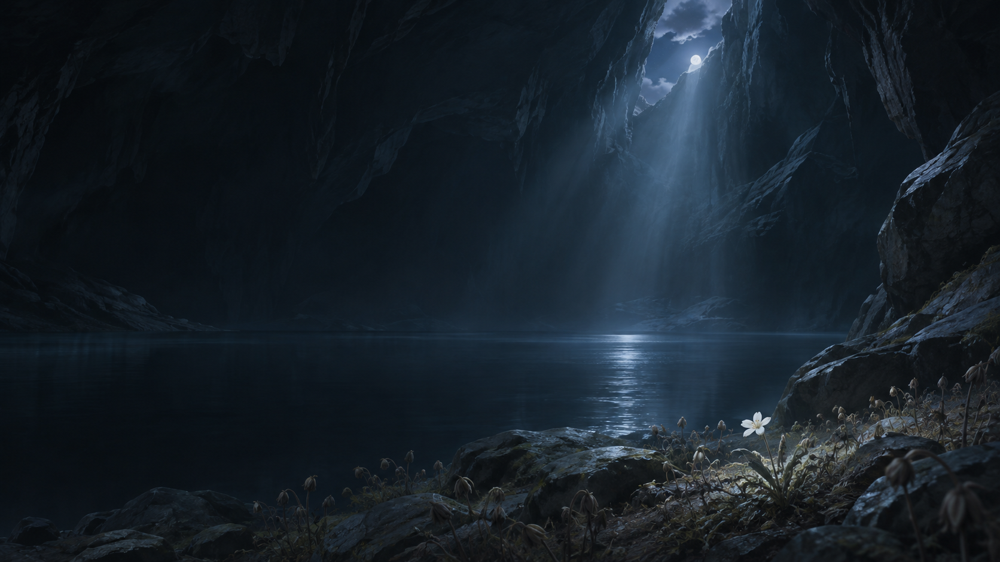

**現存画と理想の差分**：旧Aカメラと新18mm候補の位置が異なる。P0・小さな月・裂け目の共通形状・N17との背景完全一致を検証。

**再制作優先**：高。

---

### N02｜2.0–5.0秒（3.0秒） 異変／波紋

**感情**：違和感　**撮影**：固定・低い湖面視点

**目標のショット**：水面の小さな異常から円い波紋が広がる。

**仮配置した旧原画**：[旧C02](../v8/keyframe-test/results/C01-C16-2026-11-22/originals/C02.png)〈作者採用A/B対応未照合〉、[旧C02.5](../v8/keyframe-test/results/C01-C16-2026-11-22/originals/C02.5.png)〈追加候補・A/B対応未照合〉。

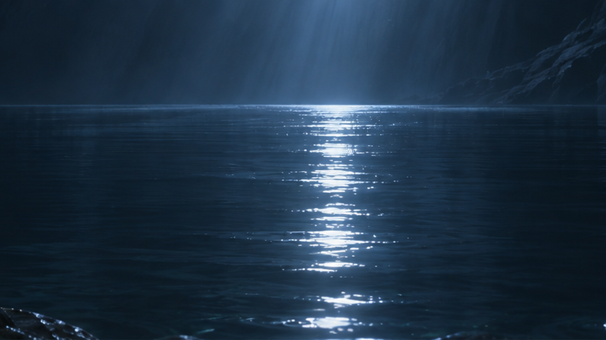

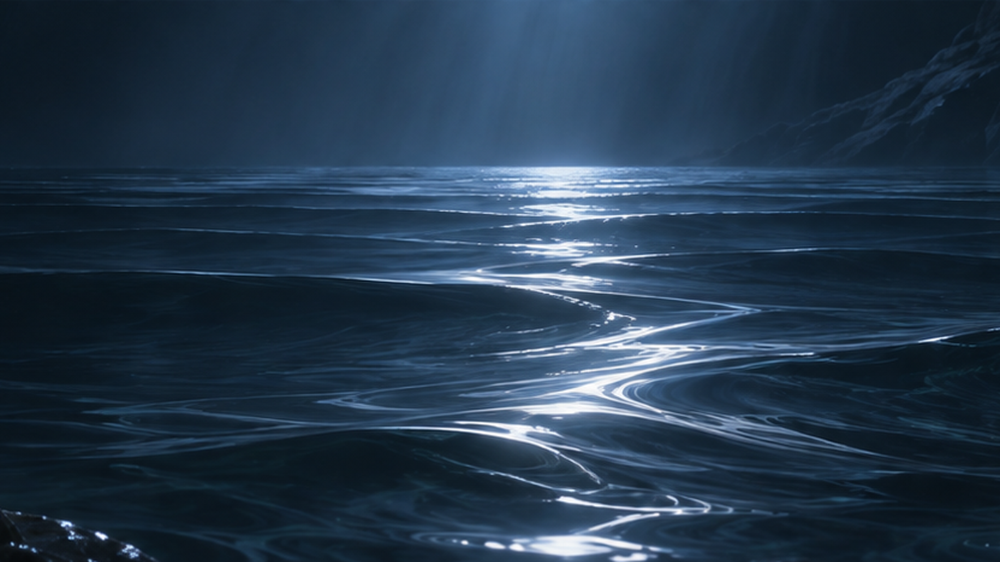

**現存画と理想の差分**：A/B2原画の実体・承認対応未照合。水面の光・距離感がN01と続くこと。

**再制作優先**：中。

---

### N03｜5.0–7.0秒（2.0秒） 水面下の巨大な影

**感情**：不安　**撮影**：固定・岸側の暗い視点

**目標のショット**：全貌を示さず、巨大な影だけを湖面下で見せる。

**仮配置した旧原画**：[旧C03](https://raw.githubusercontent.com/Makeinu1/DaD_Ruosuen/b0322124b9bedf5e3233934d4879148bac671d53/dm/episode-01/ending/v8/keyframe-test/results/C03-C08-2026-11-21/C03.png)〈作者確定／PR27固定SHA〉。

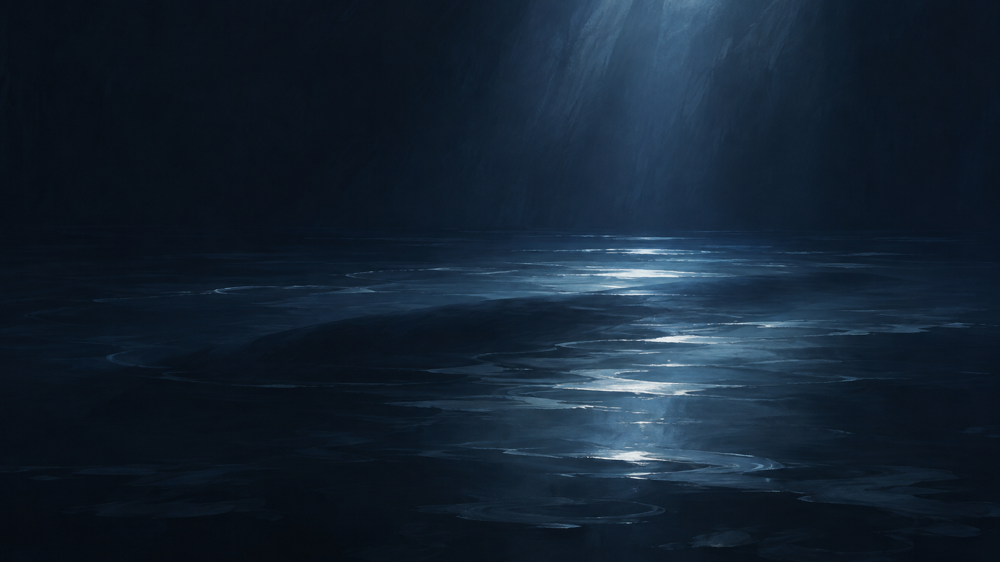

**現存画と理想の差分**：旧水中影を新しい湖→岸への進行方向へ合わせ、背中の早期水面突出を防ぐ。

**再制作優先**：中。

---

### N04｜7.0–10.5秒（3.5秒） 浮上／水幕と巨体

**感情**：驚愕　**撮影**：固定・水面を低く見る

**目標のショット**：巨大な身体が水を割り、水幕を落とす。非発光で威嚇しない。

**仮配置した旧原画**：[旧C04](https://raw.githubusercontent.com/Makeinu1/DaD_Ruosuen/b0322124b9bedf5e3233934d4879148bac671d53/dm/episode-01/ending/v8/keyframe-test/results/C03-C08-2026-11-21/C04.png)〈作者確定／PR27固定SHA〉。

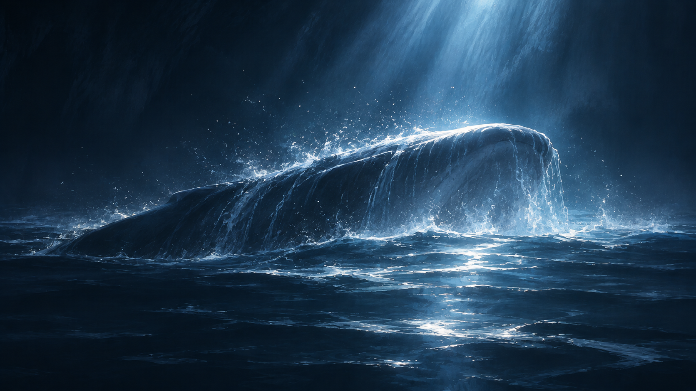

**現存画と理想の差分**：以前の浮上の月光・位置は旧案。今回の陸地側光路ではまだ受光せず、濡れ肌の反射のみ。

**再制作優先**：中。

---

### N05｜10.5–14.0秒（3.5秒） 離水／岸に迫る

**感情**：警戒上昇　**撮影**：固定・地上からの別角度

**目標のショット**：鯨が浮き上がり、自分たちに近づく。編集で距離を省略する。

**仮配置した旧原画**：[旧C05](https://raw.githubusercontent.com/Makeinu1/DaD_Ruosuen/b0322124b9bedf5e3233934d4879148bac671d53/dm/episode-01/ending/v8/keyframe-test/results/C03-C08-2026-11-21/C05.png)〈作者確定／PR27固定SHA〉、[旧C06](https://raw.githubusercontent.com/Makeinu1/DaD_Ruosuen/b0322124b9bedf5e3233934d4879148bac671d53/dm/episode-01/ending/v8/keyframe-test/results/C03-C08-2026-11-21/C06.png)〈作者確定／PR27固定SHA〉。

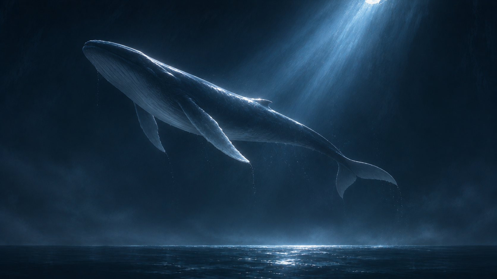

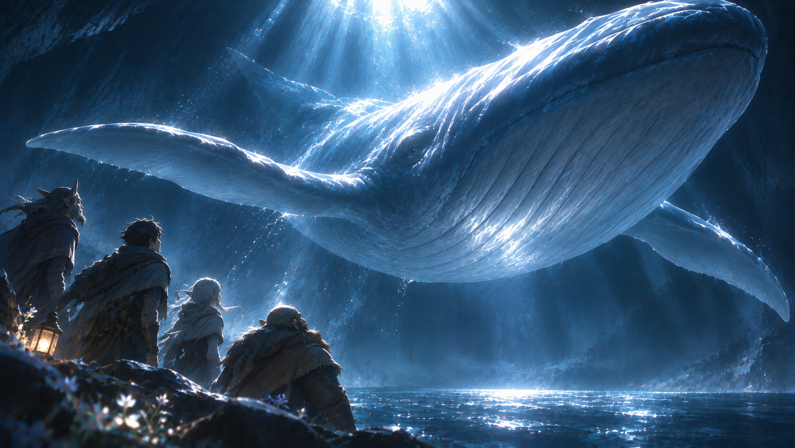

**現存画と理想の差分**：旧上昇画や接近画の視点では新R70m陸側円弧と位置関係が異なる。全身を早く見せ切らない。

**再制作優先**：高。

---

### N06｜14.0–17.5秒（3.5秒） ほぼ真上の巨大な通過

**感情**：緊張の頂点　**撮影**：固定 B：PC眼高・16mm・仰角50°候補

**目標のショット**：巨大頭部・腹・胸びれの一部が画面を覆い、自然に通過。フルシルエットは見せない。

**仮配置した旧原画**：[旧C07](https://raw.githubusercontent.com/Makeinu1/DaD_Ruosuen/b0322124b9bedf5e3233934d4879148bac671d53/dm/episode-01/ending/v8/keyframe-test/results/C03-C08-2026-11-21/C07.png)〈作者確定／PR27固定SHA〉、[旧C06](https://raw.githubusercontent.com/Makeinu1/DaD_Ruosuen/b0322124b9bedf5e3233934d4879148bac671d53/dm/episode-01/ending/v8/keyframe-test/results/C03-C08-2026-11-21/C06.png)〈作者確定／PR27固定SHA〉。

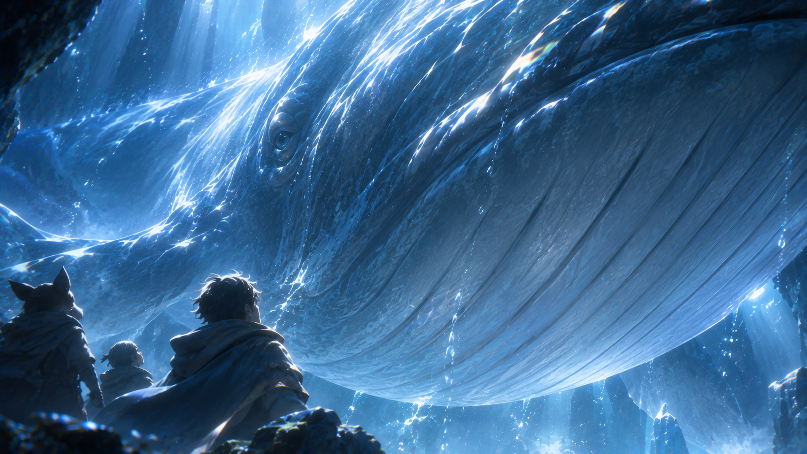

**現存画と理想の差分**：旧C07は巨大顔の近接、旧C06は接近。新軌道の見上げ角約88.8°と完全に合う原画はない。**新しいB画角の原画が必要**。一瞥を強制しない。

**再制作優先**：最優先。

---

### N07｜17.5–20.0秒（2.5秒） 通過後／攻撃しなかった

**感情**：不安が緩む　**撮影**：固定・岸からの切り返し

**目標のショット**：鯨の尾が横切り、何もせず進んでいく。観客の認識を少し変える。

**仮配置した旧原画**：[旧C10](../v8/keyframe-test/results/C01-C16-2026-11-22/originals/C11.png)〈旧保存名C11.png・作者はC10に割当〉。

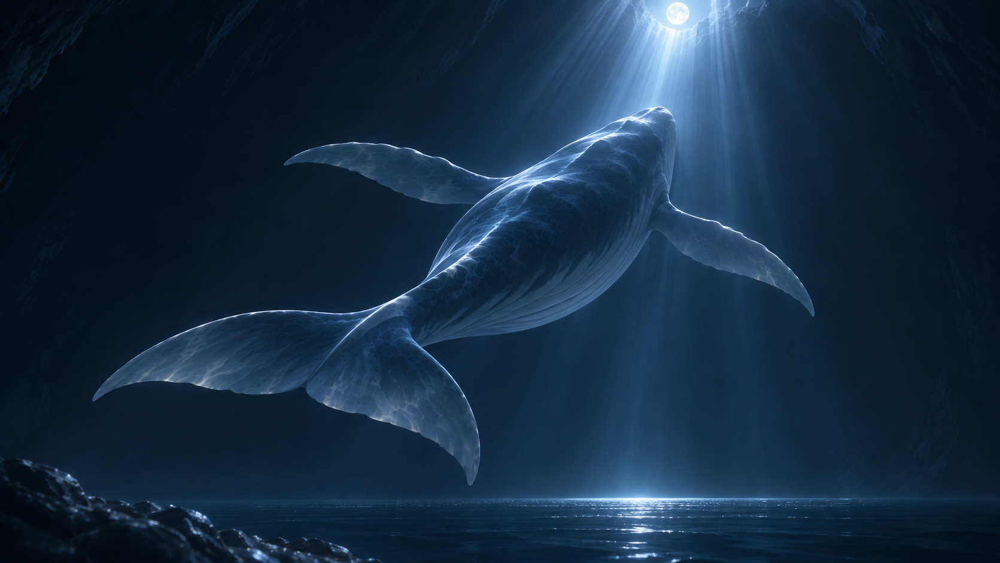

**現存画と理想の差分**：旧C10は遠ざかる背中の参考だけ。冒険者の頭上を通過したことが分かる新しい空間・鯨の向きの画が必要。

**再制作優先**：最優先。

---

### N08｜20.0–26.0秒（6.0秒） 陸地の月光／鯨が自ら輝く

**感情**：畏敬への反転　**撮影**：**緩い右パン C**：約15°/4〜5秒、18mm・仰角40°候補

**目標のショット**：陸地上空で頭の縁→吻先→全身、自然月光への受光から自発光へ。

**仮配置した旧原画**：[旧C10](../v8/keyframe-test/results/C01-C16-2026-11-22/originals/C11.png)〈旧保存名C11.png・作者はC10に割当〉、[旧C11](../v8/keyframe-test/results/C11-C19-2026-11-21/selected/C11.png)〈11/21暫定採用〉、[旧C11.5](../v8/keyframe-test/results/C11-C19-2026-11-21/selected/C11_5.png)〈11/21暫定採用〉。

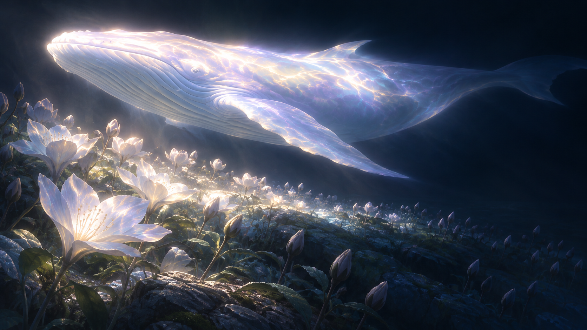

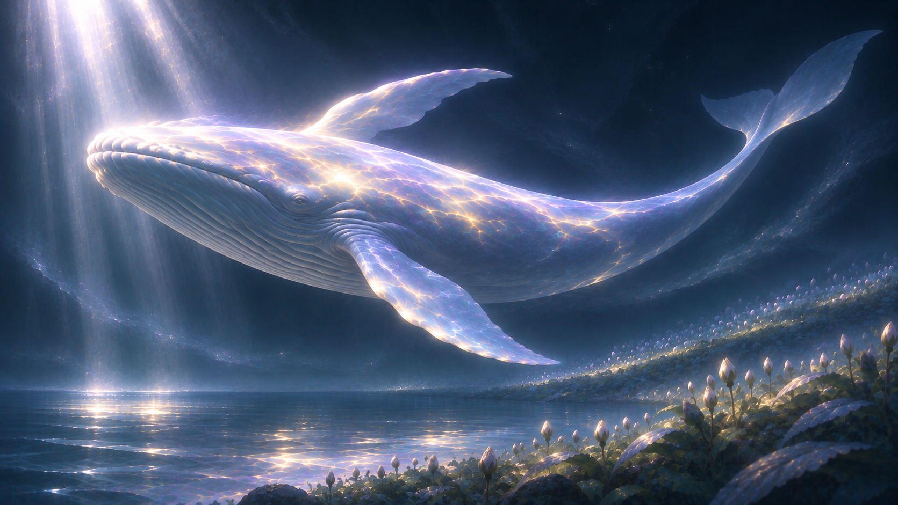

**現存画と理想の差分**：旧C11は旧光路の発光画。**陸地上空の受光・小さな月・頭→尾の光の順序**へ修正し、パン中の鯨の造形と背景を維持。

**再制作優先**：最優先。

---

### N09｜26.0–31.0秒（5.0秒） 鯨の光がS1基部を開花させる

**感情**：理解と驚き　**撮影**：固定 D：岸側20mm・方位+50°候補

**目標のショット**：自発光鯨と成熟花の基部を同じ画に配置、初めの花が開く。

**仮配置した旧原画**：[旧C12](../v8/keyframe-test/results/C11-C19-2026-11-21/selected/C12.png)〈暫定採用〉。

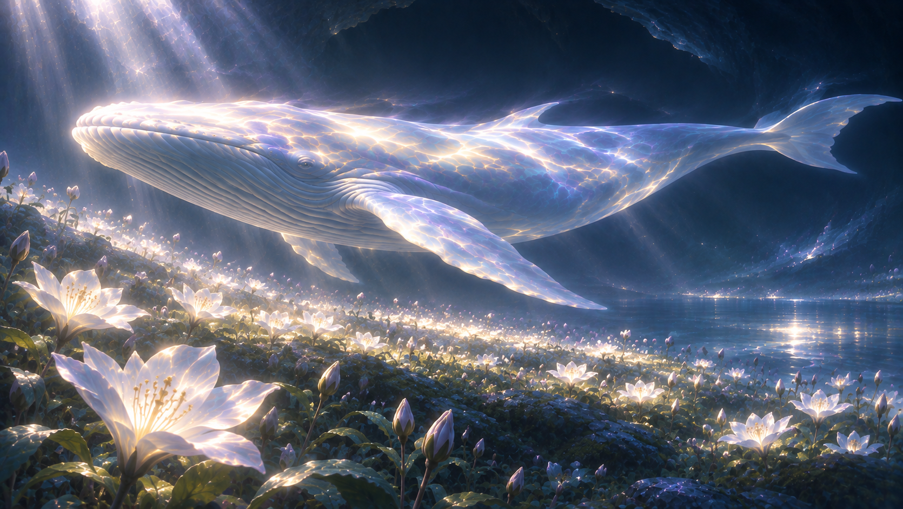

**現存画と理想の差分**：旧C12に新岬位置は未反映。自然月光でなく**鯨の光が届いた群落**から段階的に開花させる。

**再制作優先**：高。

---

### N10｜31.0–35.0秒（4.0秒） 開花が花の岬へ広がる

**感情**：奇跡の拡張　**撮影**：固定・S1の花寄りインサート

**目標のショット**：基部→中腹→岬先端へ開花の波。散布体の離脱前兆。

**仮配置した旧原画**：[旧C12](../v8/keyframe-test/results/C11-C19-2026-11-21/selected/C12.png)〈暫定採用〉、[旧C13](../v8/keyframe-test/results/C11-C19-2026-11-21/selected/C13.png)〈採用〉。

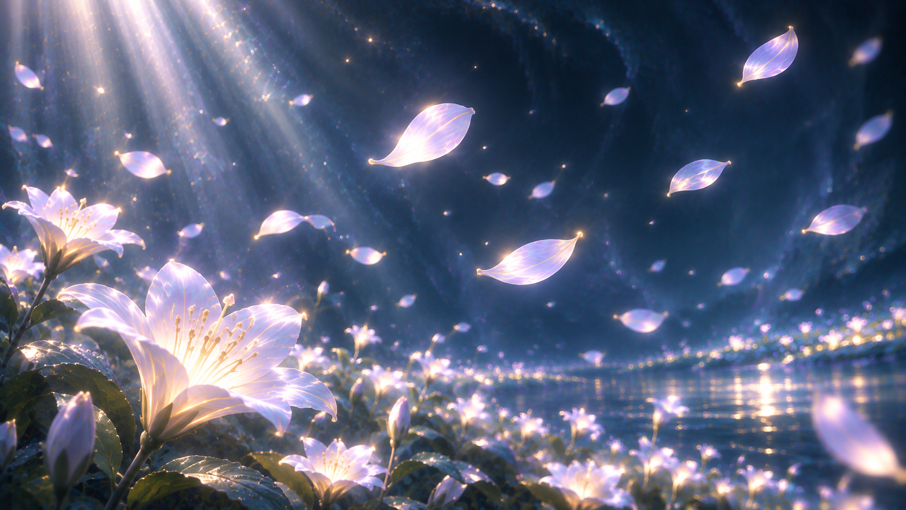

**現存画と理想の差分**：S1は右手の陸地がさらに湖へ突き出した岬。五弁・果実の位置を正本に合わせ、地形を人工的な花壇にしない。

**再制作優先**：高。

---

### N11｜35.0–40.0秒（5.0秒） 花弁と果実の離脱／一瞬の静止

**感情**：息をのむ静寂　**撮影**：固定・低い植物接写

**目標のショット**：成熟花の本物の花弁＋付け根の果実が離れ、最後の約1秒だけ止まる。

**仮配置した旧原画**：[旧C13](../v8/keyframe-test/results/C11-C19-2026-11-21/selected/C13.png)〈採用〉。

**現存画と理想の差分**：花全体を飛ばさない。別の透明な種翼や魔法の金粉ではない。果実だけ微光。

**再制作優先**：中。

---

### N12｜40.0–43.0秒（3.0秒） 白金の花吹雪が空間へ広がる

**感情**：感動の頂点へ　**撮影**：固定・広い岸の視点

**目標のショット**：広がる花吹雪。単なる追走ではなく自然で不均一な浮遊・拡散。

**仮配置した旧原画**：[旧C14](../v8/keyframe-test/results/C11-C19-2026-11-21/candidate/C14_latest_test.png)〈作者採用（candidateは旧フォルダ名）〉、[旧C16](../v8/keyframe-test/results/C01-C16-2026-11-22/originals/C16.png)〈11/22採用2枚目とPNGの同一性未照合〉。

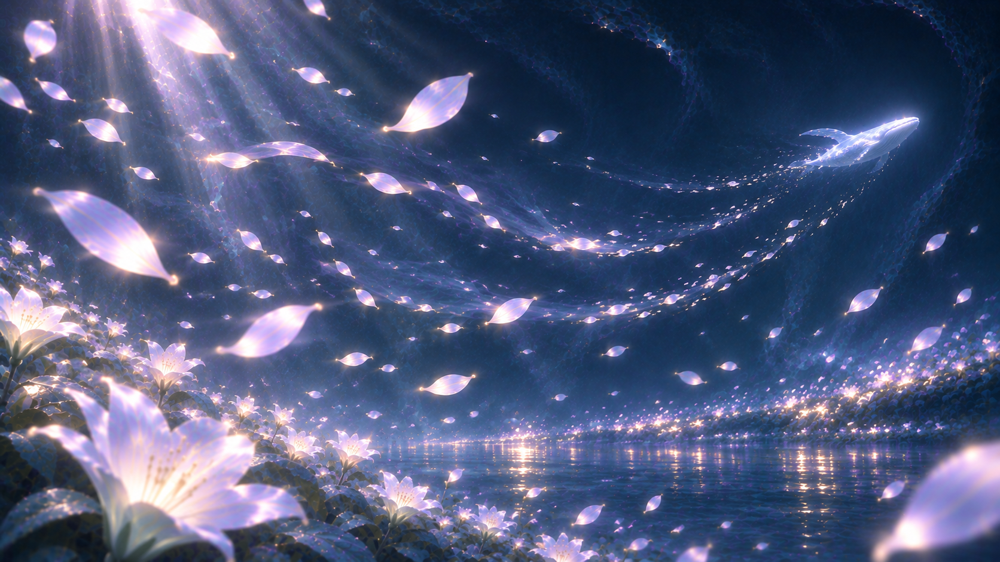

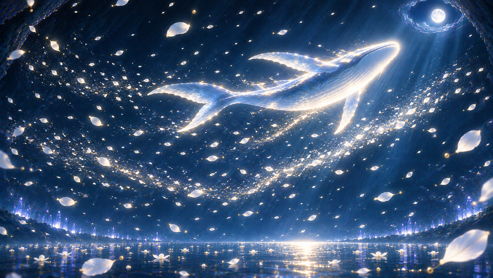

**現存画と理想の差分**：旧C14の**全花弁が一斉に鯨へ向き直りリボン化する芝居は不要**。白・淡金と密度だけを参考。

**再制作優先**：高。

---

### N13｜43.0–47.0秒（4.0秒） 光る鯨と花吹雪の全景

**感情**：陶酔　**撮影**：固定・高い空間を見渡す

**目標のショット**：花畑を画面に出さず、高い湖上を泳ぐ鯨を見せる。

**仮配置した旧原画**：[旧C15](../v8/keyframe-test/results/C11-C19-2026-11-21/selected/C15.png)〈採用〉。

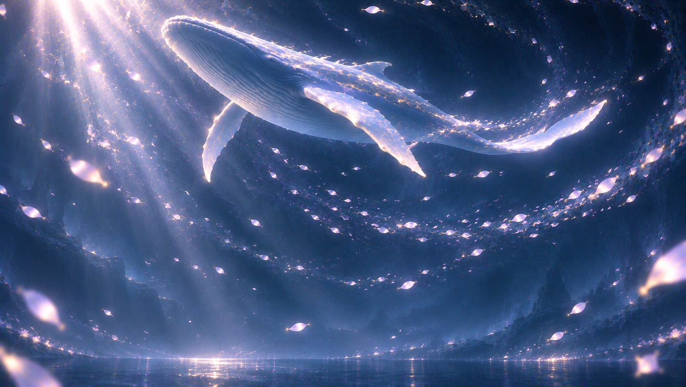

**現存画と理想の差分**：発光した鯨が主要光源。以前のショットのS1から花弁が飛んできたことと高度を接続する。

**再制作優先**：中。

---

### N14｜47.0–51.0秒（4.0秒） 花吹雪の中の自由遊泳

**感情**：美を味わう　**撮影**：**微ティルト E**：約5°だけ上へ

**目標のショット**：白金の高密度な花吹雪の中、ゆっくり泳ぐ鯨を見上げる。

**仮配置した旧原画**：[旧C16](../v8/keyframe-test/results/C01-C16-2026-11-22/originals/C16.png)〈11/22採用2枚目とPNGの同一性未照合〉、[旧C15](../v8/keyframe-test/results/C11-C19-2026-11-21/selected/C15.png)〈採用〉。

**現存画と理想の差分**：11/22作者採用『2枚目』とGitHub C16.pngの同一性未照合。花の形・白金花吹雪・鯨の光・カメラ運動を再検査。

**再制作優先**：高。

---

### N15｜51.0–58.0秒（7.0秒） 裂け目への上昇／別れの予感

**感情**：名残惜しさ　**撮影**：固定・地上の高角

**目標のショット**：白金花吹雪が自然に散る中、遠ざかる鯨が裂け目へ向かう。

**仮配置した旧原画**：[旧C17](../v8/keyframe-test/results/C11-C19-2026-11-21/selected/C17.png)〈採用〉。

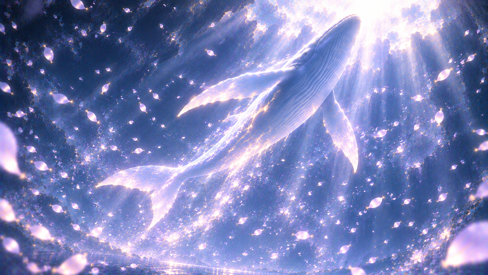

**現存画と理想の差分**：一本の非対称な亀裂へ。全粒子を鯨に追走させず、遠い壁まで明るくしない。

**再制作優先**：中。

---

### N16｜58.0–64.0秒（6.0秒） 裂け目から完全退場

**感情**：見送り　**撮影**：固定 F：50mm・仰角37°候補

**目標のショット**：小さな月の近くで全身が岩の裂け目を抜け、尾まで夜空へ。

**仮配置した旧原画**：[旧C18](../v8/keyframe-test/results/C11-C19-2026-11-21/selected/C18.png)〈採用〉。

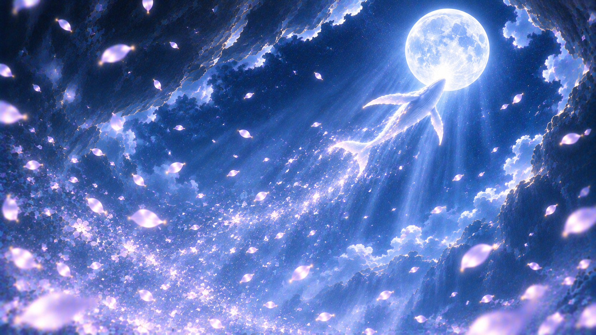

**現存画と理想の差分**：旧C18の裂け目形状と天井の厚みを修正。月の円盤を不自然に巨大化させない。**胸びれ・尾が岩と接触しない新原画／3D確認が必要**。

**再制作優先**：最優先。

---

### N17｜64.0–70.0秒（6.0秒） 静かな地底湖／最後の花弁

**感情**：余韻　**撮影**：固定 A：N01と位置・レンズ・方向完全同一

**目標のショット**：冒頭と同じ湖、P0は咲いたまま。花弁一片が残り、映像外の冒険へ返す。

**仮配置した旧原画**：[旧C19](../v8/keyframe-test/results/C11-C19-2026-11-21/selected/C19.png)〈月を小さくした採用画／背景修正課題あり〉、[旧C01](../v8/keyframe-test/results/C01-C16-2026-11-22/originals/C01.png)〈作者採用／提出PNGと採用画像の同一性未照合〉。

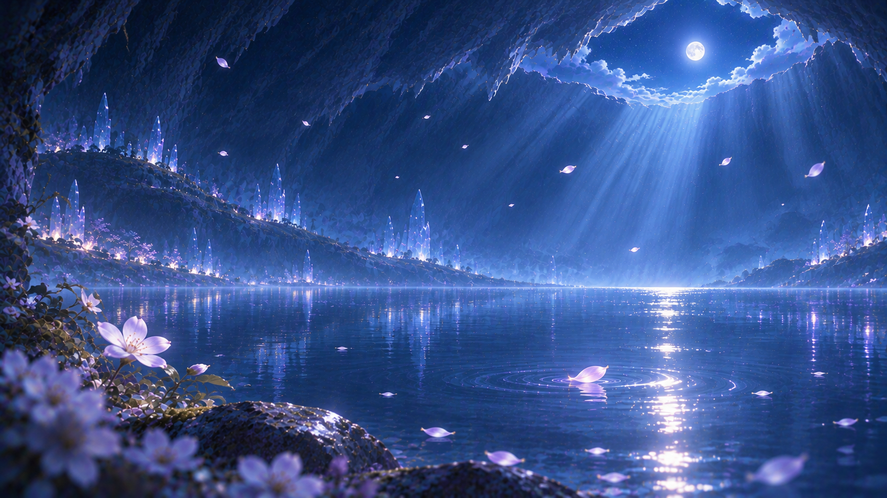

**現存画と理想の差分**：C19の対岸・多段の岩棚・水晶状の物体を削除。N01と同じ母版。小さな月を保ち、最後の果実の微光は弱く。エンドカード無し。

**再制作優先**：最優先。

## 上映版から一旦外す良い原画

- **旧C08 一瞥**：作者の採用判定とPNGは保持するが、新N01〜N17には独立カットを置かない。[原画](https://raw.githubusercontent.com/Makeinu1/DaD_Ruosuen/b0322124b9bedf5e3233934d4879148bac671d53/dm/episode-01/ending/v8/keyframe-test/results/C03-C08-2026-11-21/C08.png)。試写で頭上通過の緊張が不足した場合だけ再検討。
- **旧C09 背面ロール**：暫定採用のPNGを保持し、現編集ではフルロールを使わない。[原画](../v8/keyframe-test/results/C01-C16-2026-11-22/originals/C09.png)。自然な緩い旋回の中の腹・胸びれの参考としては使用可。
- **旧C14**：原画そのものの採用履歴を維持しつつ、花弁が一斉に鯨へ向き直る・リボン化する**旧演技を採用しない**。
- **旧C19の対岸・水晶等**：作者が修正を指定した背景要素はN17から取り除く。N01と完全同一背景に戻す。
- **旧C10の保存名問題**：旧C10の原本はC11.pngというファイル名である。旧C11本来の原画は別の selected/C11.png。二重割当しない。

## 再制作の順番

1. **N06/N07**：ほぼ真上を通過する16mm固定Bと、通過後の非攻撃的な去り方。恐怖→安堵の接続。
2. **N08**：陸地上空での月光接触と、自ら発光し始める鯨。約15°の緩いパン。
3. **N09/N10**：鯨がS1基部→岬へ光を届け、花が開くと分かる2段階の画。
4. **N16**：小さな月／一本の裂け目／鯨の尾まで完全退場。
5. **N01/N17とN14**：同一背景の始終と最新C16採用PNGの同一性照合。

**原画の現物**：このブランチで確認したC01/C02/C02.5/C09/保存名C11(旧C10)/C16、selectedのC11/C11.5/C12/C13/C15/C17/C18/C19、candidateのC14を参照。C03〜C08はPR #27のコミットSHA固定URLで参照しており、**この作業ブランチ自体にはPNGが存在しない**。N01/C02/C09/C16の11/22提出PNGと作者の選んだ版の同一性も未照合。未照合を「最新採用PNGと同一」と断言しない。

**資料整理**：旧カット割りと旧立体・画角試案は[旧稿アーカイブ](../archive/2026-11-22-pre-v12/README.md)へ保全。採用原画台帳・FL-01・WH-01は旧構成より優先する形態正本のため保存。
