# 『空に降る雪』v12｜低ポリ連続絵コンテ・全17ショット初回検証（2026-11-22）

> **DM専用・プレイヤー閲覧禁止・Pages非公開。作者レビュー待ち。** これは完成原画ではなく、カメラ位置、三次元配置、動線、光、隣接カットの連続性だけを検証する**撮影プレビズ**。既存採用画像・旧C番号の台帳とv12の作者仮決定は上書きしない。
>
> **タイミングの扱い**：画像の時刻はv12.1監督レビューの比較候補（17本・70秒）を利用。v12.1の秒数・レンズ・XYZは作者未確定。v12の借り置き原画やカット順を正式差し替えたものではない。

## 最初に見る全体図

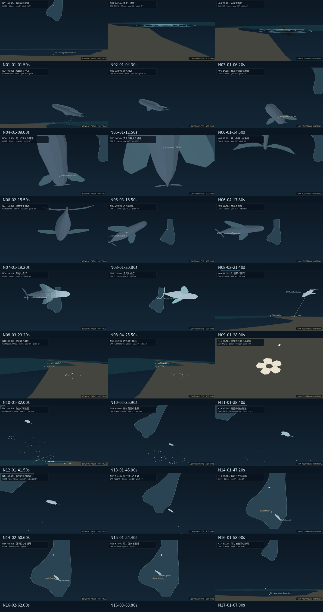

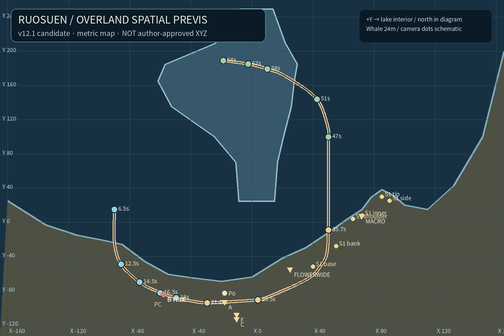

- [全フレームの座標・カメラ一覧JSON](previs/v12-lowpoly/frames.json)／[代理メッシュQA数値](previs/v12-lowpoly/qa-proxy.json)
- [再生成可能なPythonスクリプト](previs/v12-lowpoly/ruosuen_story_previs.py)／[検証・上面図スクリプト](previs/v12-lowpoly/ruosuen_validation_and_map.py)
- [旧N06単体のブラウザ編集用HTML](roughs/n06/previs/n06-lowpoly-previs-v01.html) は引き続き残す。今回のシーン一式はスクリプト・JSONで再作成できる。スクリプトのポリゴン形状はWH-01の原本GLBではない。

## 今回の判定

**全17カットに対して27枚の16:9フレームを作成・順序確認した。これは作品が完成した意味ではない。** 主題ごとの配置・向き・カメラの仮設定は比較できるが、次の条件は未解決。

1. **N06（要修正／未合格）**：14.5→15.5→16.5→17.8秒の順序は成立する。近接計算は本代理メッシュでは眼高最小約**4.29m**（15.5秒）。旧v0.4の球形頭部代理ではもっと近い値が出るため「安全」と判定しない。WH-01実メッシュの頭・腹・胸びれとPCとのクリアランスを再評価。
2. **N08（暫定）**：頭先接触の時刻は約21.17秒を基準にした演出スイッチ。厚みのある天井の月光射線、先に光る部位、実モデル上の進行は未検証。
3. **N09・N10（要構図改善）**：S1本来の花は小さく、ワイドでは開花因果の読みやすさが不足する。カメラを寄せるか、反応の始点・先端を編集で明瞭化する必要あり。特にN10は**岬先端35.7秒／候補終了36.5秒**が重要。
4. **N11（形態要照合）**：今回の5弁の模式花はFL-01の完成3Dではない。種子側の微光と「本物の花弁＋小果実」の区別を維持する。
5. **N13→N14（暫定）**：24mm環境ワイドと70mm鯨主役、N14約1.5°ティルトで役割は分離。被写体サイズと3D画角をWH-01で確認する。
6. **N16（要修正／未合格）**：63.8秒で代理メッシュの最低Zが約**213.3m**、天井の**薄いZ=190m**基準は上回る。しかし画面に鯨が残り、**一本の裂け目を尾まで通って視界から完全に消えたとは言えない**。岩盤厚さ・開口・尾と胸びれの干渉、退場終了時刻を要再設計。
7. **N01/N17（暫定）**：カメラXYZ・レンズ・方向と背景描画関数は同一。旧C01採用原画と背景画素が完全一致する検査は別。

**共通演出原則**：旧C08一瞥とC09フル背面ロールは復活させない。月光前は鯨自身は光らない。S1の花弁は乳白色＋淡金色の小果実、花全体や独立種翼を飛ばさない。N08のパンとN14の微ティルト以外は固定カメラ。無関係な大ドリー・追走・巨大月を加えない。

## 連続ショット（個別PNG・各1ショット1瞬間）

### N01｜0.0–3.0秒（v12.1候補）｜静かな地底湖

**感情**：安堵。**撮影**：A（各フレームに暫定レンズ・角度を表示）。

**今回確認できたこと**：固定AをN17と完全共通にした。P0は画面上で小さく、実寸のままでは読みづらい。

**残る問題**：旧C01との画素レベル背景一致は未比較。

**1/1　1.50秒**

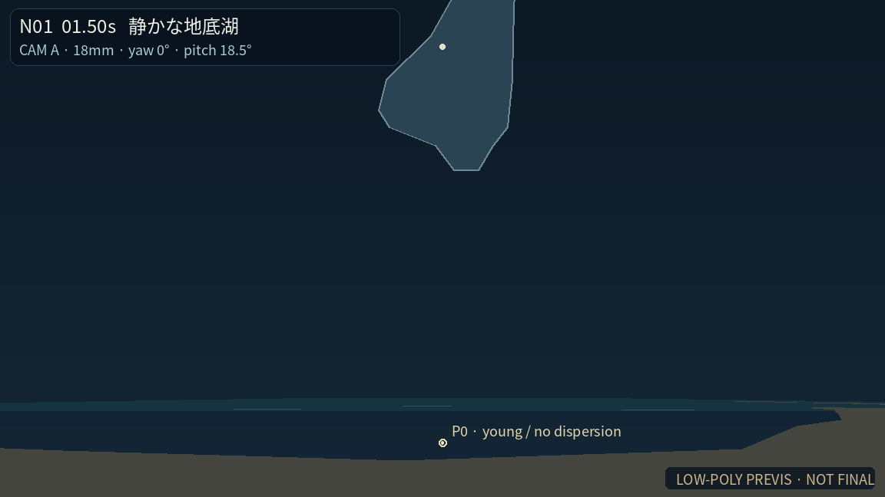

---

### N02｜3.0–5.5秒（v12.1候補）｜異変・波紋

**感情**：異変。**撮影**：RIPPLE（各フレームに暫定レンズ・角度を表示）。

**今回確認できたこと**：波紋が水面に現れる。鯨は映さない。

**残る問題**：湖上の波紋距離と浮上位置の見え方に再調整余地。

**1/1　4.30秒**

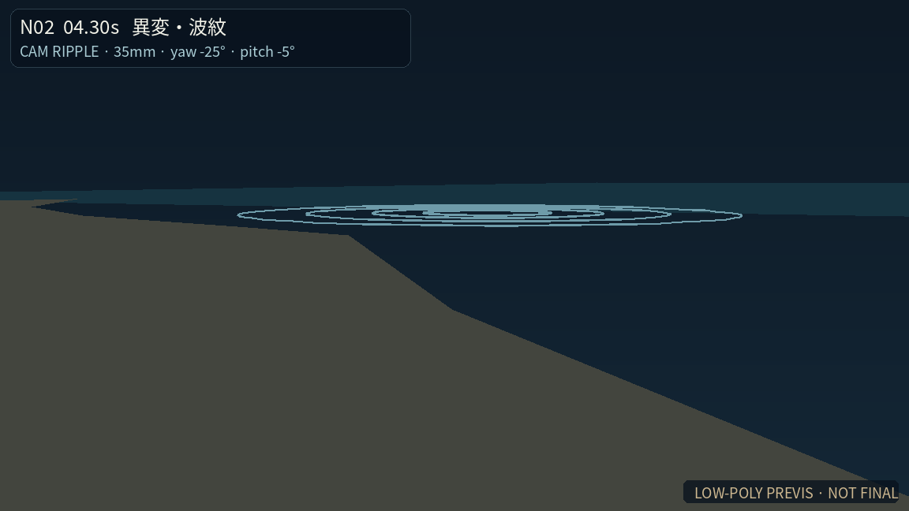

---

### N03｜5.5–7.5秒（v12.1候補）｜水面下の影

**感情**：警戒。**撮影**：SUB（各フレームに暫定レンズ・角度を表示）。

**今回確認できたこと**：鯨を水中影として抑制し、まだ全身を見せない。

**残る問題**：水面の実屈折・遮蔽は未実装。

**1/1　6.20秒**

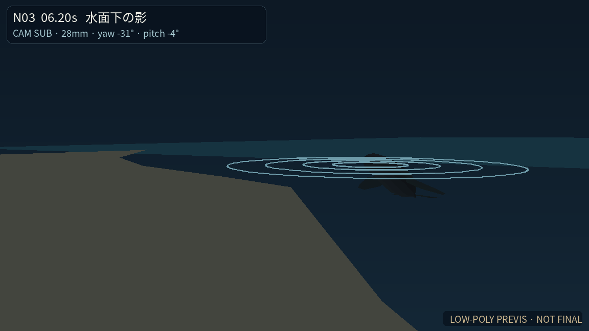

---

### N04｜7.5–11.0秒（v12.1候補）｜水面から浮上

**感情**：恐怖の始まり。**撮影**：BREACH（各フレームに暫定レンズ・角度を表示）。

**今回確認できたこと**：水面からの離水と水滴を低角度で表示。非発光。

**残る問題**：実際の水面衝突・水幕FXは簡易マーカー。

**1/1　9.00秒**

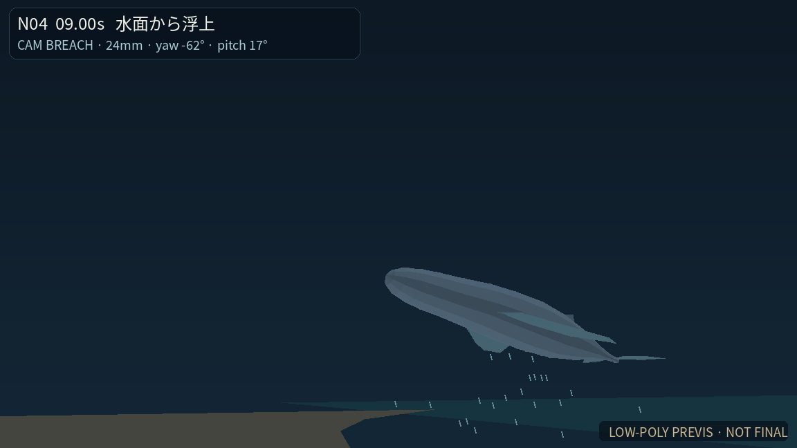

---

### N05｜11.0–14.0秒（v12.1候補）｜岸へ接近

**感情**：緊張上昇。**撮影**：APPROACH（各フレームに暫定レンズ・角度を表示）。

**今回確認できたこと**：湖から陸地への接近を横から確認。

**残る問題**：N06への画面内進行方向と頭部先端の軌跡はアニマティック判定。

**1/1　12.50秒**

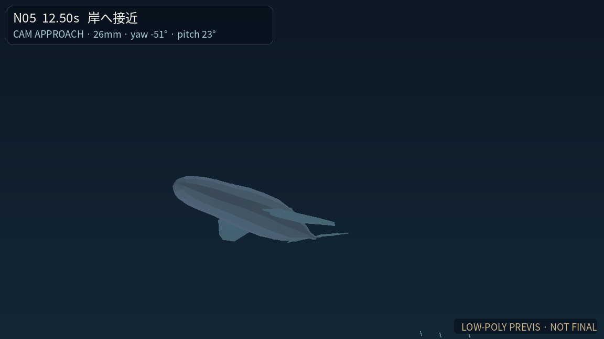

---

### N06｜14.0–18.0秒（v12.1候補）｜真上の巨大な通過

**感情**：恐怖の頂点。**撮影**：B（各フレームに暫定レンズ・角度を表示）。

**今回確認できたこと**：固定B・16mmのまま14.50→15.50→16.50→17.80秒を連続化。腹・胸びれ・尾がフレームを埋める。

**残る問題**：代理メッシュの最短眼高離隔約4.29m（15.5秒）。WH-01実メッシュ/長身PC/羽ばたき状態では未確認。頭と腹の解剖も本番未照合。

**1/4　14.50秒**

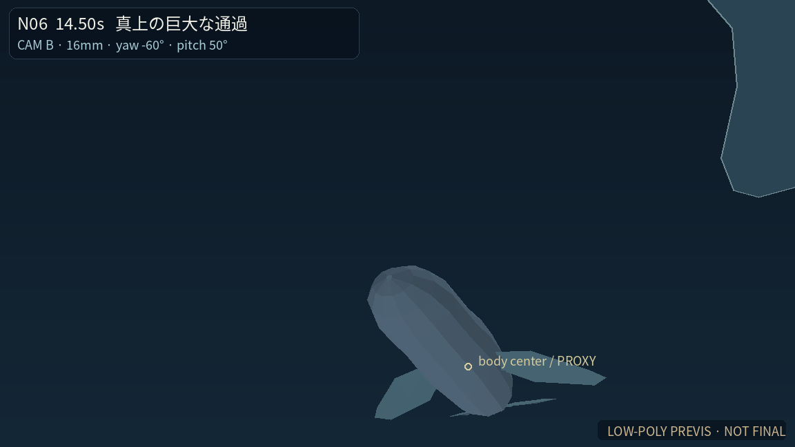

**2/4　15.50秒**

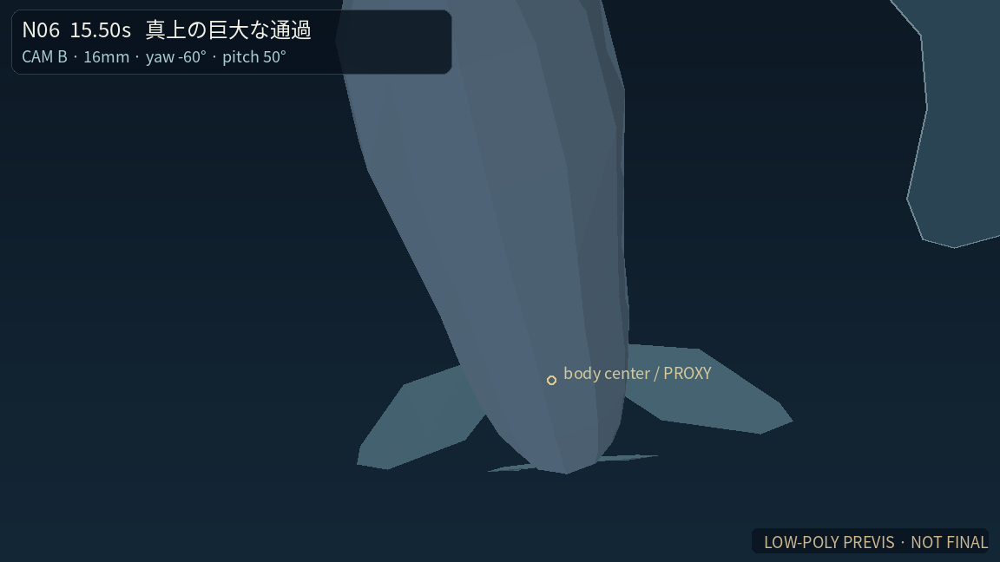

**3/4　16.50秒**

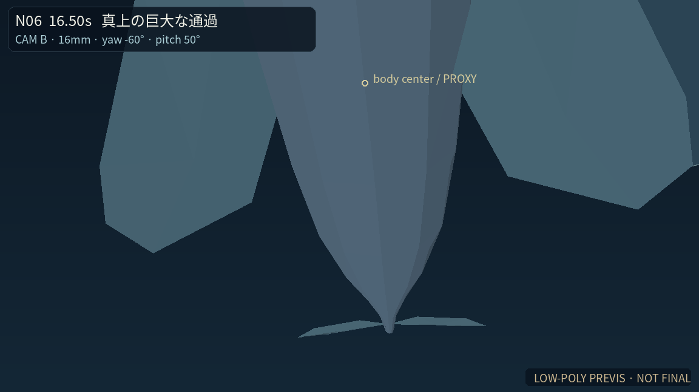

**4/4　17.80秒**

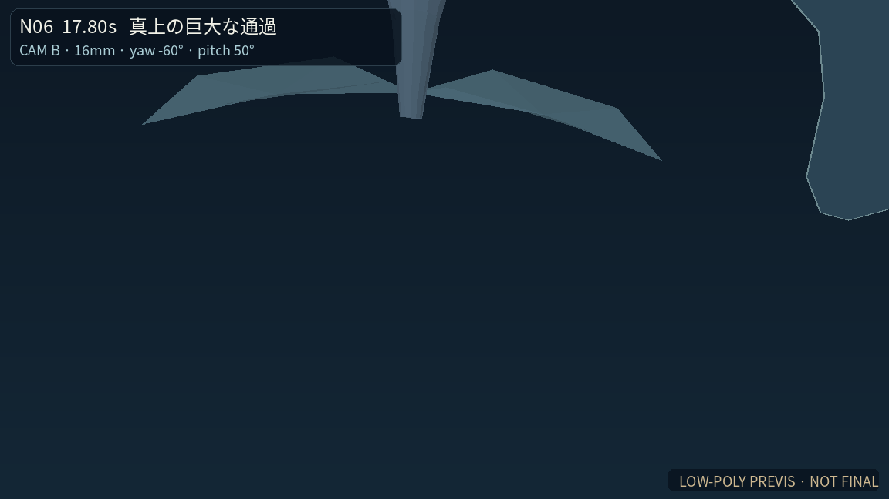

---

### N07｜18.0–20.5秒（v12.1候補）｜攻撃せず通過

**感情**：脅威が過ぎた理解。**撮影**：BEHIND（各フレームに暫定レンズ・角度を表示）。

**今回確認できたこと**：背後側への切り返しで鯨が停止せず去る。

**残る問題**：同一PC POVを瞬間移動させたものではなく、別の固定映画カメラ。

**1/1　19.20秒**

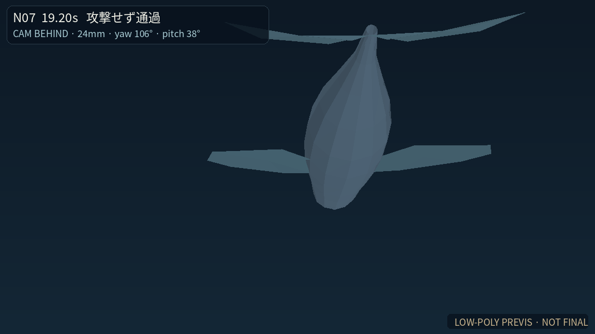

---

### N08｜20.5–26.0秒（v12.1候補）｜月光と点灯

**感情**：畏敬への反転。**撮影**：C（各フレームに暫定レンズ・角度を表示）。

**今回確認できたこと**：別の固定位置Cから15°のゆるいパン。20.80→21.40→23.20→25.50秒で未発光から自発光へ。

**残る問題**：点灯開始21.17秒は制御パラメータ。岩盤の厚みと月光射線・実際の初入射面は未検証。

**1/4　20.80秒**

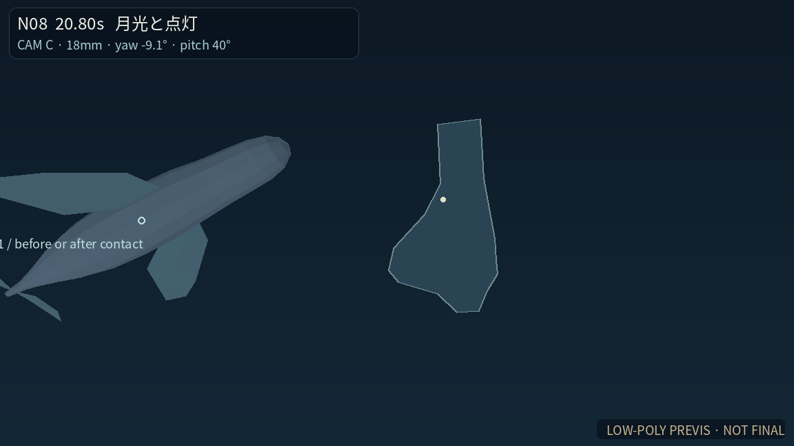

**2/4　21.40秒**

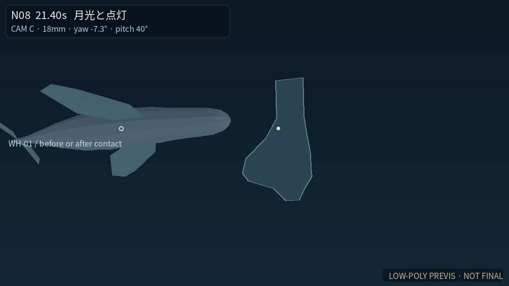

**3/4　23.20秒**

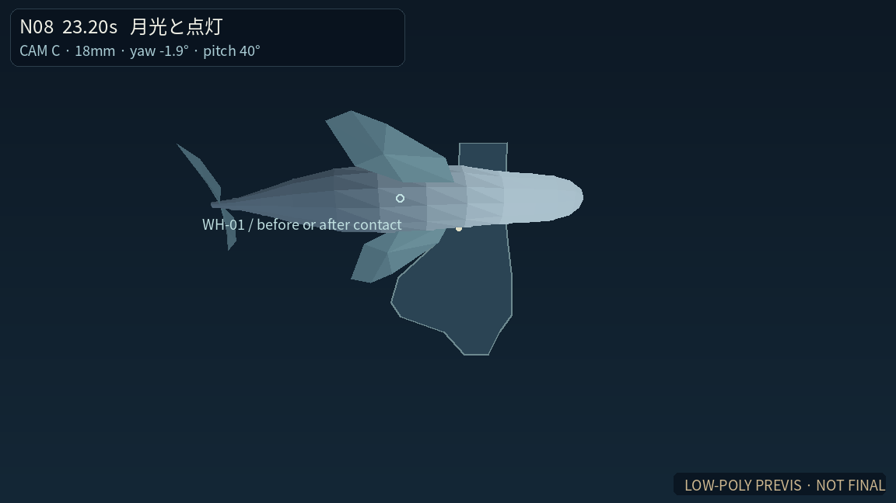

**4/4　25.50秒**

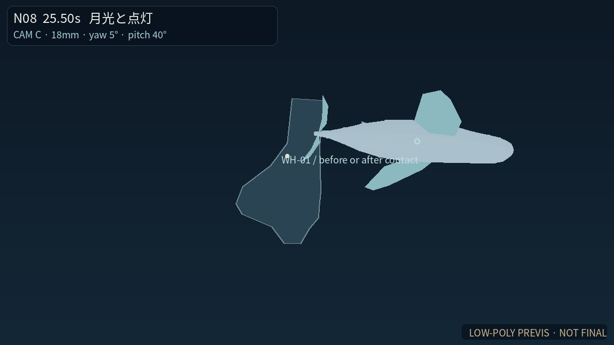

---

### N09｜26.0–31.0秒（v12.1候補）｜S1基部の開花

**感情**：開花の因果。**撮影**：D（各フレームに暫定レンズ・角度を表示）。

**今回確認できたこと**：固定Dで発光鯨からS1基部への照明関係を図示。

**残る問題**：発光鯨と4.5cmの群落が画面で十分に読めるかは弱い。光線は概念マーカーで物理的な実光束ではない。

**1/1　28.00秒**

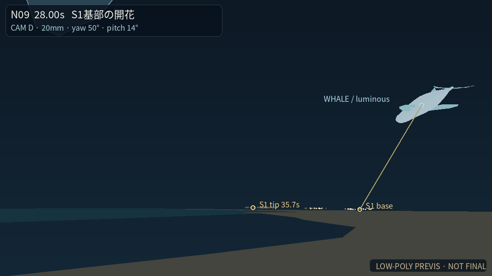

---

### N10｜31.0–36.5秒（v12.1候補）｜岬先端へ開花

**感情**：奇跡の広がり。**撮影**：FLOWERWIDE（各フレームに暫定レンズ・角度を表示）。

**今回確認できたこと**：S1基部から岬先端へ時間差。32.00秒と35.90秒の2枚を作成。

**残る問題**：v12では終了35.0秒で先端開花35.7秒を撮れない。v12.1の36.5秒案を採るか作者判断待ち。

**1/2　32.00秒**

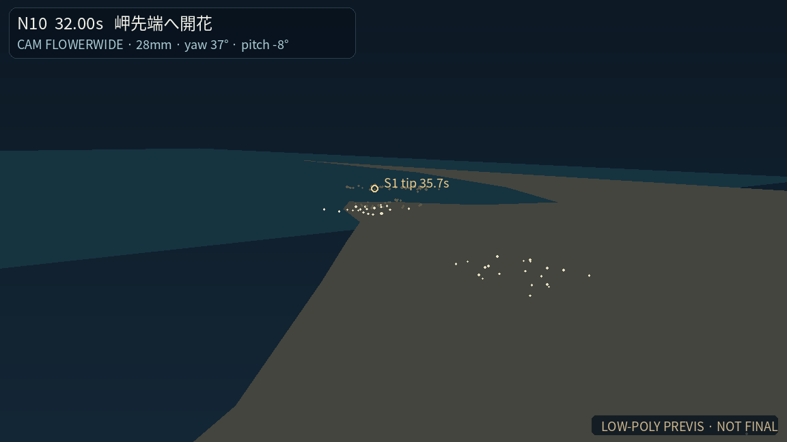

**2/2　35.90秒**

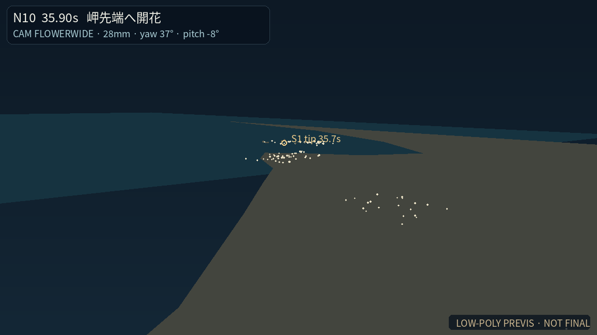

---

### N11｜36.5–40.0秒（v12.1候補）｜本物の花弁＋小果実

**感情**：息をのむ静けさ。**撮影**：MACRO（各フレームに暫定レンズ・角度を表示）。

**今回確認できたこと**：S1現場の映画用マクロ固定カメラ。5枚の本物の花弁と小果実を簡易表示。

**残る問題**：果実や雄しべの実寸形態はFL-01詳細モデルではない。PC肉眼ではなく独立カメラ。

**1/1　38.40秒**

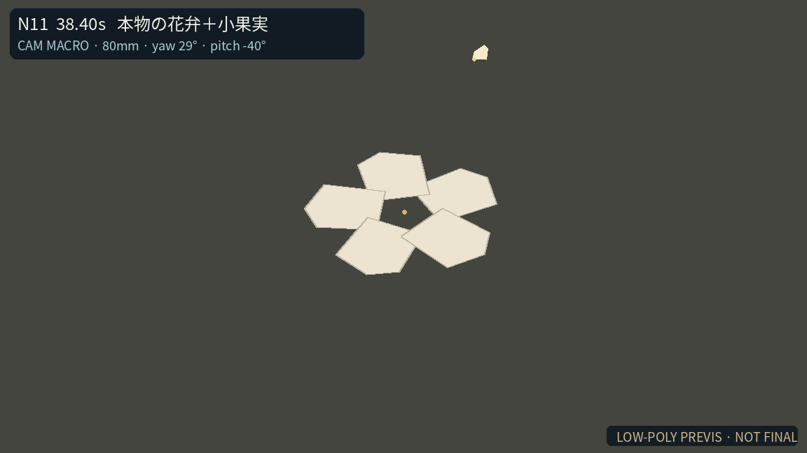

---

### N12｜40.0–43.0秒（v12.1候補）｜白金の花吹雪

**感情**：花雪への感動。**撮影**：PLUME（各フレームに暫定レンズ・角度を表示）。

**今回確認できたこと**：近・中・遠の白基調／淡金色の散布体を別層配置。

**残る問題**：実物の花弁と果実の3D剛体/布挙動と空気の流れは未実装。

**1/1　41.50秒**

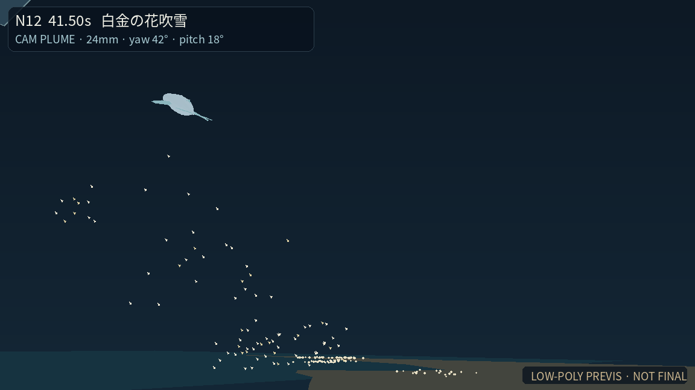

---

### N13｜43.0–47.0秒（v12.1候補）｜鯨と花雪の全景

**感情**：空間の広さ。**撮影**：E-WIDE（各フレームに暫定レンズ・角度を表示）。

**今回確認できたこと**：24mm環境ワイドで湖上高空と花雪を見せる。

**残る問題**：投影できる白金花吹雪量は未調整。花畑自体はフレーム外。

**1/1　45.00秒**

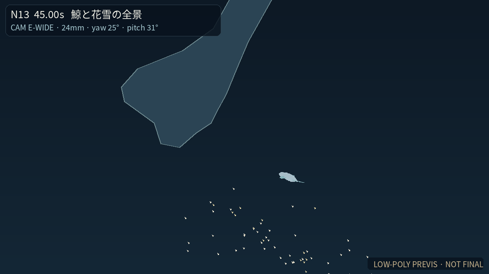

---

### N14｜47.0–51.0秒（v12.1候補）｜高空の自由遊泳

**感情**：美を味わう。**撮影**：E-TELE（各フレームに暫定レンズ・角度を表示）。

**今回確認できたこと**：70mm候補＋47.2秒から50.6秒まで約1.5°の微ティルトを同一場所で検証。

**残る問題**：実メッシュの画面占有率・花の形態と奥行きは要比較。数値は仮。

**1/2　47.20秒**

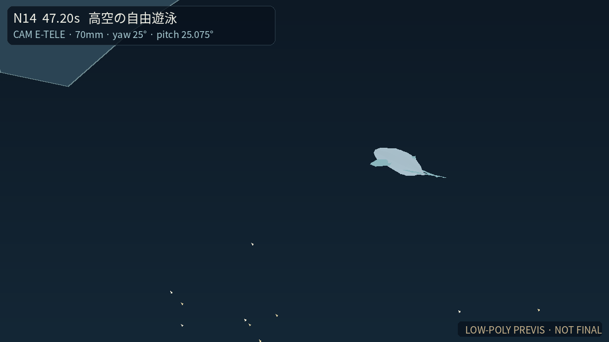

**2/2　50.60秒**

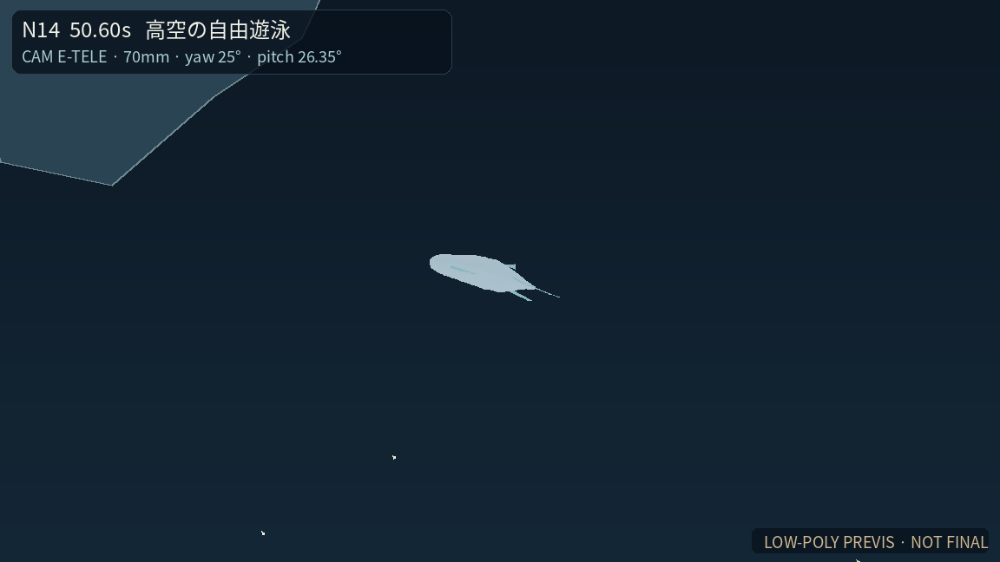

---

### N15｜51.0–57.5秒（v12.1候補）｜裂け目への上昇

**感情**：別れの予感。**撮影**：ASCENT（各フレームに暫定レンズ・角度を表示）。

**今回確認できたこと**：一本の非対称裂け目へ上がる鯨。固定の地上カメラ。

**残る問題**：天井と鯨の交差は未テスト。鯨は自発光したまま。

**1/1　54.40秒**

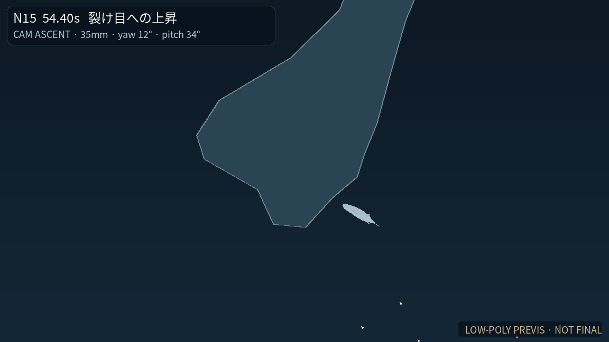

---

### N16｜57.5–64.0秒（v12.1候補）｜裂け目から退場

**感情**：見送り。**撮影**：F（各フレームに暫定レンズ・角度を表示）。

**今回確認できたこと**：固定F 50mmで裂け目入口→62秒→63.8秒を確認。

**残る問題**：薄いZ=190mの屋根では63.8秒に全頂点が上方だが、鯨は裂け目内にまだ可視。厚い岩盤・胸びれ尾の実3D判定は未完了。退場完了と判定しない。

**1/3　58.00秒**

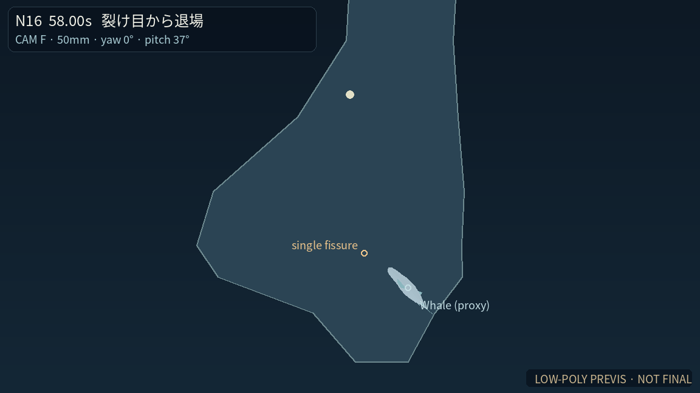

**2/3　62.00秒**

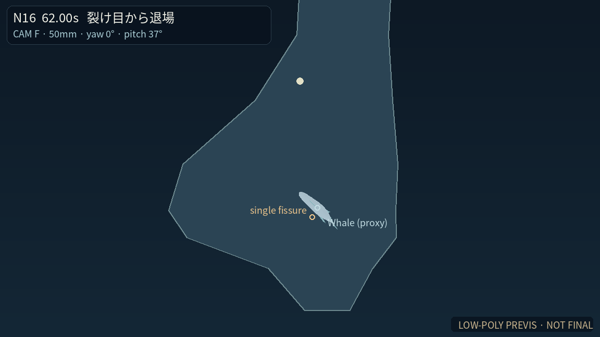

**3/3　63.80秒**

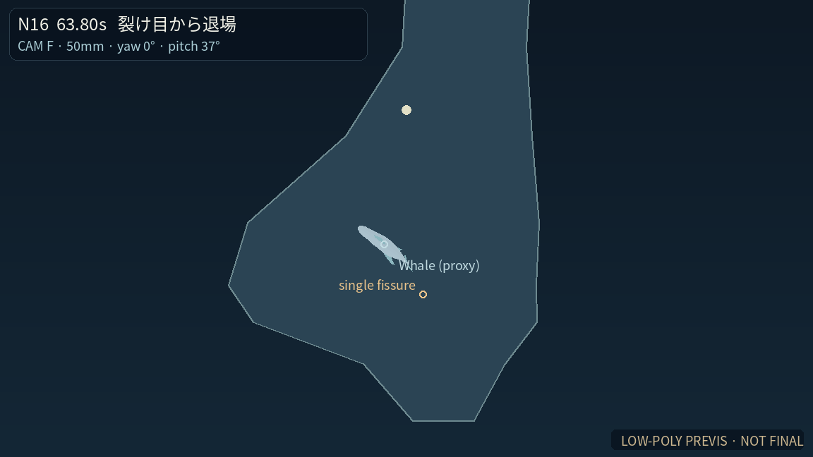

---

### N17｜64.0–70.0秒（v12.1候補）｜同じ地底湖の静寂

**感情**：静寂。**撮影**：A（各フレームに暫定レンズ・角度を表示）。

**今回確認できたこと**：N01とXYZ・画角・背景母版を一致。残る散布体を一つだけ示す。

**残る問題**：旧C01/C19に対する画素一致テストは未実施。

**1/1　67.00秒**

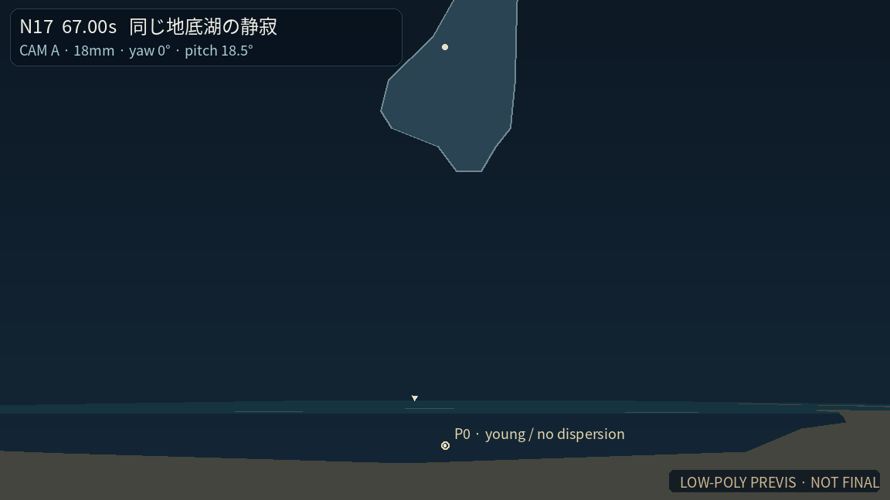

---

## 次に作者が評価する観点

- N05→N06→N07で、鯨の頭が前方から近づき、腹と胸びれが頭上を覆い、尾が背後に去ったことを**連続して**理解できるか。
- N07で「攻撃されなかった」と分かった**後に**、N08の月光→自発光が神秘への感情転換になるか。
- N08→N09は鯨の左右反転マッチを避け、**S1が鯨から光を受けた**反応が読み取れるか。
- N10の開花先端35.7秒を残す修正案が必要か。N11の花の寄りは突然のPC視点移動に見えないか。
- N13とN14で広角・望遠の主題が分かれているか。花雪の距離層が自然か。
- N16で尾が完全に去るまでの**明示的な退場完了ショット**を追加/延長するか。N17へ切る前に鯨がまだ裂け目に見えていないか。
- 最終的なWH-01形態、PC眼高クリアランス、厚い天井岩盤の遮蔽が成立するか。今回の簡易メッシュでは**合否を確定できない**。

## 設計値と実装上の注意

- 平面のXは湖を向いて右、Yは湖奥、Zは高さ(m)。地形・S1配置と鯨の経路は v0.4数値モデルを採り、**未承認の代理値**である。
- 鯨は全長24m／全幅14.8mの粗い12角断面メッシュ。頭・腹・左右1対の胸びれ・水平二葉尾・小背びれだけ。**WH-01 v2.0原本ではない**。
- 月光を受けたことと鯨が自ら輝き始めることは別の時刻で制御可能。現行プレビズは約21.17秒の自発光開始で描いているが、光路レイトレースではない。
- S1花は実際の寸法4.5cmをベースに、一部の遠距離群落位置を最低約1pxの画面マーカーで示した。正確な見かけサイズ・密度の証明ではない。
- 空雪花の散布体は本物の花弁＋小果実の構造を象徴化。上空の花弁群は別の奥行き層で配置し、全花弁が数秒で100m上昇したことを**設定化しない**。
- 裂け目は一本の非対称輪郭。現在のプレビズは天井の厚み・遮蔽・実鯨の貫通判定を欠く。描画上の通過完了と幾何学的な完了は区別する。
- **カメラに関する確定事項と仮値を混同しない**：固定主体・N08緩パン・N14微ティルトだけが仮決定、レンズの16/18/20/24/50/70mm、時刻、XYZは後続レビュー対象。

制作データの正本：[v12借り置き原画つき絵コンテ](storyboard-v12-70s-provisional-2026-11-22.md)、[v12.1監督レビュー](storyboard-v12-1-redraw-director-review-2026-11-22.md)、[差分監査](art-gap-audit-v12-2026-11-22.md)、[原画採用台帳](../v8/keyframe-contact-2026-11-22.md)、[鯨](../v8/whale-setting-current.md)、[空雪花](../flower.md)。

## アシスタント独立再点検（2026-11-22）

> **独立した監督レビュー草案／作者未承認。** 初回27枚のPNG・数値JSONに加えて、`ruosuen_story_previs.py`の3D代理頂点とレンダラを個別照合した結果。**この節を追記しても、画像を修正・正式採用したことにはならない。** 作者自身の評価は別に受け取って統合する。

### A：生成コード・物理連続性の不具合（優先度：最優先）

1. **N03→N04（6.5秒で高度が不連続）**：`interp(t)`は`t < 6.5`を中心Z=−3mで固定し、6.5秒の代表点をZ=+3mとしている。**6.5秒境界で中心が6m瞬間移動する**。この映像補間は連続モーションとして不合格。6.2秒の代理形状は最低Z=−7.4m・最高Z=+1.5mで、**N03「完全に水面下の影」にも一致しない**。現在の脚本・水面設定を勝手に変えず、浮上前と浮上開始の高度補間および姿勢を再設計する。
2. **N04（浮上というよりすでに飛行中）**：9.0秒は鯨中心Z約10.0m、全メッシュ最低Z約+6.8m。**水面から完全に離れた状態**で、N04「水を割り、水幕を落とす」という主役の瞬間を描けていない。レンダラの水滴だけで離水の運動を証明できない。N04のキーフレーム時点／固定カメラ／運動設計をセットで見直す。
3. **N16（遮蔽テストの未実装）**：描画コードは「屋根の裂け目パッチを描画」→「鯨を描画」の順で、岩盤との視線遮蔽を計算せず鯨の全身を前面に重ねる。63.8秒で鯨が見える事実は**完成映像の露出の証明ではなく、描画の遮蔽不備を含む**。厚い天井3D・実鯨の尾／胸びれクリアランスと、カメラFから見えなくなる退出条件を別々に確かめる。**N17へ移る前の実際の退出が未合格**という従来判定を維持。

### B：映像情報・編集上の弱さ（優先度：高）

4. **N02→N03の水面異変**：波紋の半径はコードで`[5,9,14,19]`mを時刻によらず描いている。N02→N03で**波紋が時間とともに拡大する運動を検証できていない**。N03の影と波紋の一致は画像1枚だけでは保証しない。
5. **N09→N10（開花の因果・基部→先端が伝わらない）**：N09の黄線は「鯨の発光→花」の説明用注釈で、光学的な光束ではない。N10の32.0sと35.9sは構図だけでなく花粒子表示もほぼ同じで、実際にPNGを比較すると画素差が10階調超の画素は全体の**約0.08%**しかない（タイムコードの文字変更を含む）。大地の奥行きはあるが**開花の波を視覚的に読めない**。S1の実寸は維持したまま、切り返しや距離・被写界深度・開花前後の形を設計する必要がある。35.7秒で岬先端を照らす時間の要件を守る。
6. **N11（五弁条件への明確な違反）**：現在の`draw_macro()`は取り付いた**五枚の花弁を残したまま、離れた花弁を1枚追加**している。画面では合計六枚相当。五弁から一枚が離脱した瞬間なら、残る四枚＋離脱した一枚で**合計五枚**にする。小果実の位置と付随関係もFL-01正本へ照合。
7. **N12→N14（花吹雪の密度と奥行き）**：カットの方向性は見えるが、現在の白金粒子が少なく、N12の拡散からN13全景、N14鑑賞への**感情的なピークが図からは弱い**。未確定の空力や100m瞬間上昇を物語設定にせず、前・中・遠景の空間分布と継続を撮影用プロキシで表せるようにする。
8. **N01/N13/N14/N16の裂け目表示**：一つの非対称裂け目という平面関係は保たれているが、2Dパッチがいずれのカメラでも**巨大で明るい閉じた図形として先に目につく**。天井の穴／外の空の関係と暗い岩盤を示すレンダラが未完成のため、実際の穴の寸法やレンズの誤りと断定しない。N01の安堵・N13の花雪・N16の別れの各主役から視線を奪わない映像表現へ調整。

### C：現時点で維持したい撮影上の長所（暫定・作者未採用）

- **N06の固定Bによる部分シルエットの通過**：14.5→15.5→16.5→17.8秒の順で頭・腹・胸びれ・尾がフレームを横切る構造は、巨大感を作る出発点として有効。ただし最短眼高離隔4.29mは**低ポリ代理**の測定値であり、WH-01の安全性・形態確認は未合格。
- **N08受光→発光**：受光と自己発光を別概念に分け、カメラCの15°緩パンを使う構造は維持候補。21.17秒は点灯パラメータで、岩盤の月光光路検証済みという意味ではない。
- **N01とN17の固定A一致**は守れている。**N13環境24mm→N14鑑賞70mm**の役割分離も比較軸として有効。ただしレンズ値・時刻は作者未承認。

### 作者とのレビュー照合時の推奨順（未決定）

まず**N03–N04の時間／水面破綻**、次に**N06近接と鯨の下腹・胸びれ**、**N09–N11開花の視覚化**、**N16退場**を合わせて評価する。残りのN12–N15の情動と花吹雪密度を全編再生で点検する。

この段階では、既存の27枚のPNG／既存原画は変更せず、**次の再生成に必要な修正指摘のみ**を追記している。
