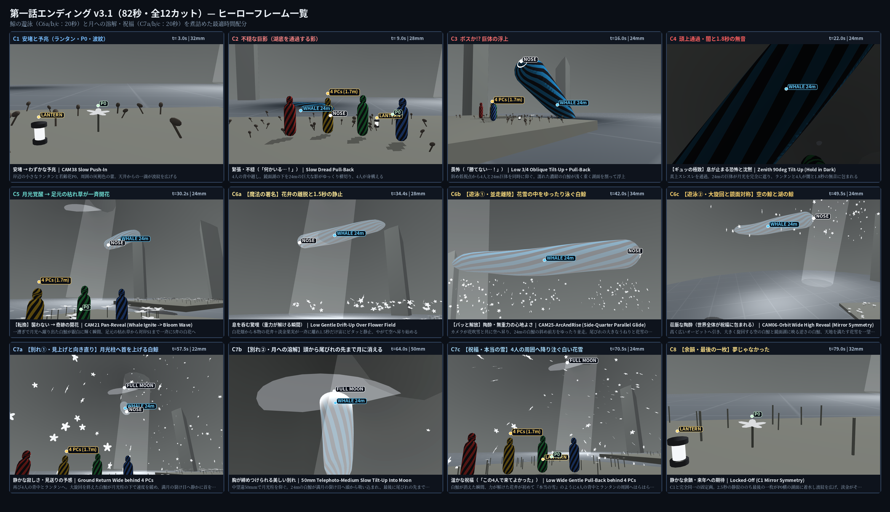
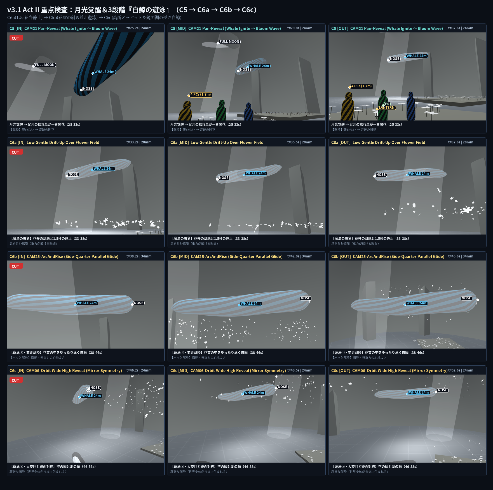
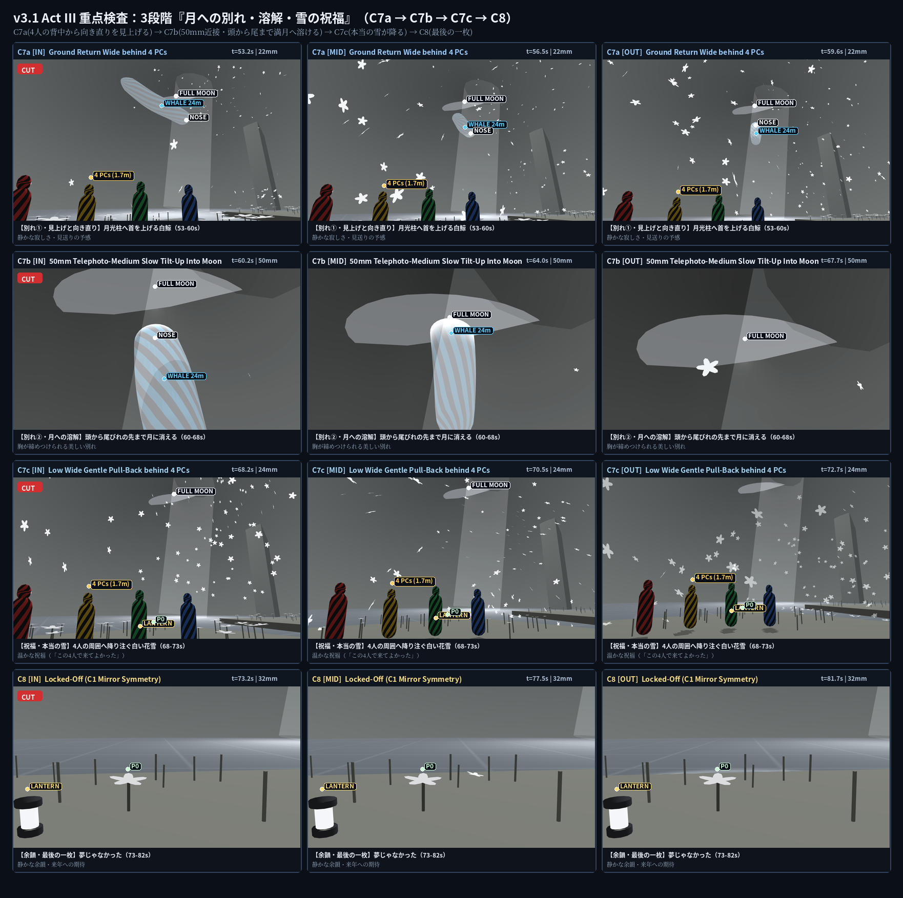
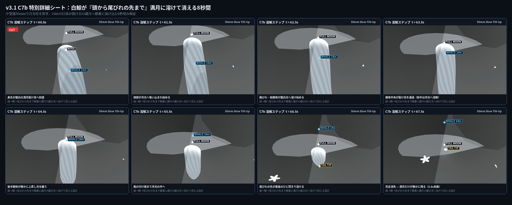

# 第一話エンディング『空に降る雪』v3.1 — 「白鯨の遊泳」と「月に消える別れ」深掘り設計（82秒・全12カット）

> **DM専用・ネタバレあり。GitHub Pages / `SECTIONS` / `llms.txt` には掲載しない。**
> **改訂理由**：v3.0（60秒固定）ではクライマックスの「白鯨の遊泳（C6：14秒）」と「月に消えていく別れ（C7：7秒）」に十分な間・質量感・余韻を取り切れなかったため、**60秒枠を外し、劇場アニメの呼吸に合った 82秒（1分22秒）・全12カット・Seedance 5クリップ構成**へ再設計しました。

---

## 1. なぜ「82秒（1分22秒）」が最適な時間配分か？

桜井Skills（`#004 遅さは罪`・`#009 ギュッとしてパッと解消`・`#063 スケール感は正しく合わせる`）の観点で、**「削るべき導入はタイトに保ち、最も味わわせたい『遊泳』と『月への別れ』だけに贅沢な時間を使う」**配分にしました。

| 幕 | 秒数（尺） | v3.0（60s）からの変化 | 感情と演出の狙い |
|---|---|---|---|
| **第1幕：安堵・不穏・畏怖（C1–C4）** | **0–25s（25秒）** | +2秒のみ（C1・C4に1秒ずつ余裕） | 導入は遅くしない。C4の「月光を遮る闇＋完全無音」を **1.8秒** までしっかりタメて『ギュッ』を極大化。 |
| **第2幕：覚醒・開花・白鯨の遊泳（C5–C6c）** | **25–53s（28秒）** | **遊泳を14秒→20秒（3カット）へ深化** | 24mの巨体が慌ただしく飛び去らないよう**巡航速度を ~2.9m/s のゆったりした無重力遊泳**へ落とし、①花弁1.5秒静止 → ②斜め並走で尾のうねりを味わう → ③高所オービットで「空の鯨と鏡面湖の逆さ鯨」を一望する3段階カタルシスへ。 |
| **第3幕：月への別れ・溶解・雪の祝福・余韻（C7a–C8）** | **53–82s（29秒）** | **別れを7秒→20秒（3カット）へ深化** | 「気づいたら消えていた」を根絶。①4人の背中から向き直りを見上げる → ②**中望遠50mmで「頭→胸びれ→胴→尾びれの先」が満月の銀白光へ1秒ずつ溶けて消える8秒間** → ③消えた瞬間に『本当の雪』が4人へ降り注ぐ祝福 → ④C1同一構図の最後の一枚（9秒）へ。 |

---

## 2. 煮詰めた2大シーンの詳細演出

### A. 「白鯨の遊泳」3段階構成（C6a + C6b + C6c ＝ 20秒）

1. **`C6a`（33–38s / 5s）—【魔法の署名】花弁の離脱と 1.5秒の静止**
   - 満開の白い5弁花畑のすぐ上から、本物の乳白花弁＋付け根の淡金小果実が一斉に離れ、**1.5秒だけ宙にピタッと静止**。奥の空では真珠白の白鯨がゆっくり旋回を始めている。
2. **`C6b`（38–46s / 8s）—【遊泳①・並走離陸】花雪の中をゆったり泳ぐ白鯨（`CAM25-ArcAndRise` / 34mm）**
   - カメラが初めて地上を離れ、上昇する花雪と一緒に舞い上がりながら **24m白鯨の斜め前方をゆったり並走**。
   - 急加速させず、**頭→尾へゆったり伝わる大きなS字のうねり**と、長い胸びれが光の帯（花雪）を静かにかき分ける「水のない深海を泳ぐような無重力の心地よさ」を8秒間じっくり見せる。
3. **`C6c`（46–53s / 7s）—【遊泳②・大旋回と鏡面対称】空の鯨と湖の鯨（`CAM06-Orbit Wide` / 24mm）**
   - カメラが高く広いオービットへ引き、**大きく緩やかに旋回する空の白鯨（上1/3）**と、**暗い鏡面湖の中で上下逆さまに並んで泳ぐ鏡像の白鯨（下1/3）**、そして天地を満たす花雪を一望する。ここで解放感と世界の広さが頂点に達する。

### B. 「月に消えていく別れ」3段階構成（C7a + C7b + C7c ＝ 20秒）

1. **`C7a`（53–60s / 7s）—【別れ①・見上げと向き直り】（地上帰還 22mm 広角）**
   - 再び**4人の背中シルエット＋足元の小さなランタン**へ戻る。大旋回を終えた白鯨が天井の月光柱の下でふっと速度を緩め、名残を惜しむように静かに頭を満月の裂け目へ向けて傾ける。
2. **`C7b`（60–68s / 8s）—【別れ②・満月への溶解】（新設：中望遠 50mm 緩やかなチルトアップ）**
   - 遠くの小さな点として消すのではなく、**中望遠50mmで月光柱と裂け目の満月へぐっと寄る**。
   - `t=60.5s` 鼻先が満月の輪郭へ到達 → `t=62.5s` 胸びれと前胴体が銀白の霧へ溶け始める → `t=64.0s` 胴体中央通過 → `t=66.5s` **最後に水平尾びれの先がひと閃き光って完全に満月へ溶け込む** → `t=67.2–68.0s` 満月だけが静かに残る0.8秒の余韻。
3. **`C7c`（68–73s / 5s）—【祝福・本当の雪が降る】（地上 24mm 緩やかな引き）**
   - 白鯨が消えた直後、再び4人の背中とランタンへ。上昇の魔法が解けた白い花弁が、初めて**本当の冬の雪のように**4人の周囲へはらはらと舞い降り、静かにパーティー全体を包み込む。
4. **`C8`（73–82s / 9s）—【余韻・最後の一枚】（C1と完全同一の固定画 / 32mm）**
   - 2.5秒の完全な静寂ののち、最後の一枚が `P0` の横の湖面に着水して銀の波紋を広げ、淡金微光がそっと消えて静かに暗転。

---

## 3. Seedance 2.5 向け 5クリップ分割（全クリップ 22秒以下で安全圏）

| Clip | ファイル名（Google Drive） | 収録カット | 尺 |
|---|---|---|---|
| **Clip 1** | `seedance_v3_1_clip1_C1_C2_fear_setup_12s.mp4` | C1 + C2 | **12s** |
| **Clip 2** | `seedance_v3_1_clip2_C3_C4_overhead_awe_13s.mp4` | C3 + C4 | **13s** |
| **Clip 3** | `seedance_v3_1_clip3_C5_C6ab_bloom_and_swim_21s.mp4` | C5 + C6a + C6b | **21s** |
| **Clip 4** | `seedance_v3_1_clip4_C6c_C7ab_orbit_and_moon_22s.mp4` | C6c + C7a + C7b | **22s** |
| **Clip 5** | `seedance_v3_1_clip5_C7c_C8_snow_and_petal_14s.mp4` | C7c + C8 | **14s** |
