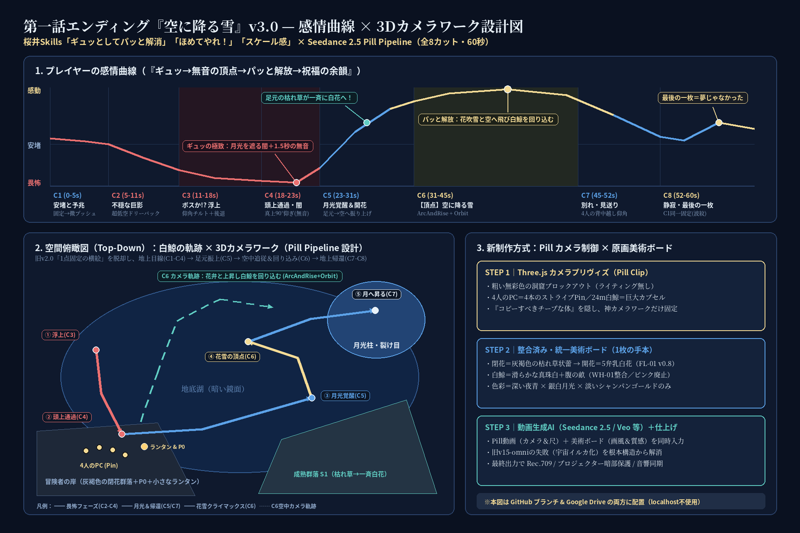

# 第一話エンディング『空に降る雪』— 桜井Skills評価・カメラワーク革命・まっさらからの新提案（v3.0）

> **DM専用・ネタバレあり。プレイヤー閲覧禁止。GitHub Pages / `SECTIONS` / `llms.txt` には掲載しない。**
> **検証対象**：現行プリヴィズ v14.10 / Blender v16a / AI PoC v15-omni / Reboot v2.0（絵画ハイブリッド）
> **参照スキル**：`kociden/sakurai-skill`（桜井政博のゲーム作るには 全257本原則）、`sirioberati/ai-filmmaking-camera-control-seedance-2-5`（Pill Pipeline & `cinematic-previs`）、`motion-art-direction`、`cinematic-camera-continuity`、`color-motion`

---

## 1. 桜井Skills（`kociden/sakurai-skill`）による厳格評価

桜井氏の最上位原則：**「最終目的はいつも『遊ぶ人（＝卓の4人のプレイヤー）を楽しませること』。作り手の都合や苦労は判断基準にしない」「ダメ出しは必ず改善案とセットで出す」**。
この物差しで、これまでの全案（旧 v14.10/v16 と Reboot v2.0 の両方）を点検した結果です。

| 点検軸（桜井動画出典） | 旧 v14.10 / v16（3Dプリヴィズ路線）の診断 | Reboot v2.0（2.5D絵画ハイブリッド）の診断 | どう直すか（改善案） |
|---|---|---|---|
| **#009「ギュッとしてパッと解消」** **#065「浮遊感は落ちてこそ生まれる」** | 頭上通過で「ギュッ」を作ろうとした意図は良い。しかし R05〜R06 の絵が暗く小さく、R13〜R15 も暗い虚無の宇宙で、解放の「パッ」が絵の力で届いていない。 | **最大の弱点。** 最初から最後まで優雅な絵画の連続で、カメラが安全な岸辺から横に見ているだけ。「ヤバい、ボスか!? 勝てない！」という **『ギュッ（圧迫・恐怖・闇）』が決定的に不足** しており、解放の落差が生まれない。 | **『月光を遮る頭上の完全な闇＋1.5秒の無音』まで一度ギュッと締め上げ**、次の瞬間に足元の枯れ草が一斉に白花へ爆発する「パッ」の落差を最大化する。 |
| **#016「モヤっとさせるな」** **#063「スケール感は正しく合わせる」** **#172「ミニチュア効果」** | ローポリのツルツル鯨・ピンク発光・望遠で背景ゼロのため、24mの巨獣ではなく「水槽のイルカ／おもちゃ」に見えてしまう。 | 絵の質感は抜群だが、**2D定点横絵のズーム・パン**にとどまり、立体空間の移動感・仰ぎの威圧感・4人とのスケール比較が死んでいる。 | **カメラワークを本物の3D設計に戻す**（後述の Seedance Pill Pipeline）。常に「4人の小さなシルエット／足元のランタン」など人間尺度の基準物を画面に残し、俯瞰・過剰なぼかし（ミニチュア化）を避ける。 |
| **#095「ほめてやれ！」** **#113「ゲームのシナリオは特異」** **#149「見返りを想定する」** | 本編でプレイヤーが苦労して「灰褐色の枯れ草から白い1輪を見つけた」体験との劇的な繋がりが希薄（依頼達成の『祝福』に見えにくい）。 | 同じく「綺麗な風景PV」に留まり、**直前まで4人がプレイしていた冒険への最大級のご褒美（祝福）**としての当事者性が弱い。 | 本編と直結する**「枯れ草の足元が一瞬で奇跡の花畑にひっくり返る」逆転劇**と、**4人の足元の小さなランタン／背中越しシルエット**を新モチーフに据える。 |
| **#004「遅さは罪」** **#044「大事と小事を見分ける」** | 70秒に18カットと「理屈の説明（4拍・二系統・3色）」を詰め込みすぎ、1カット平均3.9秒で忙しない割に何が起きているか分かりにくい。 | 冒頭 S01〜S03（13秒間）が静かな静止画寄りで導入が遅い。直前まで卓上で地底湖にいたプレイヤーには冗長。 | **全8カット・60秒**へ凝縮。冒頭5秒で安堵と予兆を済ませ、すぐ異変へ突入する。**「説明のカット」を全部削り、「感情を動かすカット」だけを残す。** |
| **#129/#136「タッチを合わせる（アニメと実写が戦うな）」** | ローポリ三角岩＋こけし4人＋ピンク鯨＋後処理筆致がケンカしている。 | 2Dガッシュ絵画の背景の上に3D板ポリ花弁が乗るため、静止画と3Dの境界がわずかに見える。 | **「1枚の統一イメージボード（美術基準）」**を先に確定し、カメラ制御（Pill動画）＋動画生成AIで**背景・鯨・花弁・光を同一の絵柄で丸ごと生成**する。 |
| **#006「待機→構え→発生→フォロースルー／やり過ぎてちょうどよい」** | 鯨の演技（ロール・40°傾き・22°目線）が細切れに分散し、一つ一つのタメと解放が弱い。 | 2Dの微変形のみのため、鯨が「尾を一漕ぎして空間を割る」質量感ある芝居ができない。 | 芝居を**「完全な静止・沈黙のタメ（頭上通過）」→「たった一度の力強い尾の一漕ぎ（発生）」→「花吹雪の中の優雅な旋回（フォロースルー）」**の1本線に絞り、カメラごと大きく動かす。 |

---

## 2. 参考リポジトリ `sirioberati/ai-filmmaking-camera-control-seedance-2-5` は参考にできるか？

**結論：極めて有効であり、まさにこれまでの失敗（v15-omni の宇宙イルカ化／Reboot v2.0 の2D紙芝居化）を同時に突破する最適解です。**

### このリポジトリが証明した核心の法則（`docs/failure-ladder.md` & `docs/why/why-capsules.md`）

> **「参照動画（プリヴィズ）には『①カメラの動き』と『②被写体の見た目・動き』の2つが乗っており、動画生成AIはその両方をコピーしてしまう。だからAIには『従うべき3Dカメラワーク・位置・大きさ・向き』だけを与え、『コピーすべきチープな体』は与えない。」**

- **なぜ旧 v15-omni（Gemini Omni）や Wan Fun-Control が失敗したのか**：
  - ローポリ鯨のモデル＋黒い宇宙＋白い菱形＋ピンク発光という「完成画もどき」を動画AIに渡したため、AIがチープな造形・硬い動き・黒い背景まで丸コピーしてしまった（Failure Ladder の Rung 1〜3 と完全一致）。
- **なぜ Reboot v2.0 では限界があるのか**：
  - 2D原画の美しさは100%守れたが、「3Dカメラが空間を回り込む・頭上を仰ぐ・花吹雪と空へ飛び上がる」映画的ダイナミズムが出せない。
- **Pill Pipeline を『空に降る雪』へ応用する設計**：
  1. **Three.js で「無彩色の粗い洞窟ブロックアウト＋ストライプのカプセル／ピン」の3Dカメラプリヴィズ（Pill Clip）を作る**。
     - **4人の冒険者** ＝ 4本の小さなストライプ Pin（高さ 1.6〜1.8m、白い向きドット付き）。顔・装備・種族をAIに固定させず、位置・身長差・スケール基準だけを伝える。
     - **24mの白鯨** ＝ 巨大な流線型ストライプ・カプセル（全長24m、先端に白い向きドット）。チープなローポリのヒレやピンク色を絶対に入れない。
     - **洞窟・湖・岸・裂け目** ＝ 粗いグレーの空間ブロックアウト（`MOOD_LIGHT = false`、細かい岩や円錐を置かない）。
  2. **137テンプレートの実証済みカメラ文法をそのまま流用**：
     - 全カットでカメラに意図ある動きを持たせる（完全固定は冒頭・終幕の象徴カットのみ）。
     - 各クリップは **29秒未満**（6〜14秒のカットまたは2カット連結単位で生成）＆1カット2秒以上のホールド。
     - `CAM38-PushToCloseUp` / `CAM21-PanReveal` / `CAM25-ArcAndRise` / `CAM06-Orbit` / `CAM22-PedestalUp` の映画的カメラ軌道を Three.js コードで数値固定。
  3. **動画生成AI（Seedance 2.5 on Tein / Google Flow 等）への同時入力**：
     - `@Video1`＝この Pill Clip（カメラ・構図・タイミング・被写体位置の唯一の正）
     - `@Image1`＝**整合済みの1枚の統一美術ボード（初期原画の深い夜青×銀白月光×淡金ガッシュ画風）**
     - **プロンプト**＝「`@Video1` は粗いブロックアウト参照であり、カメラ・構図・タイミングのみに従う。すべてのグレーのブロックとストライプ・カプセルを実在の劇場アニメ美術（洞窟・鏡面湖・24mの真珠白の鯨・灰褐色の蕾→満開の5弁空雪花・4人の背中のシルエット）に完全に置き換え、カプセルや縞模様は一切映さない」と明記。

---

## 3. 花・鯨・本編パートとの設定整合性 徹底監査

「変えてはいけないわけではないが、ムービーシーンと他のパートで整合が取れていないといけない」というご指摘に基づき、現行の正本（`dm/episode-01/README.md`、`flower.md` FL-01 v0.8、`whale-setting-current.md` WH-01）と初期原画／Reboot v2.0 を照合した結果、**5つの重要な整合ポイント**を抽出しました。

| # | 設定項目 | 本編・正本のルール | これまでのズレ | v3.0 での整合方針（ご判断ポイント） |
|---|---|---|---|---|
| **1** | **閉じた蕾の見た目（最重要）** | `FL-01 v0.5〜v0.8`：**灰褐色の萼に包まれ、うつむいて枯れ草に見える**（白い花弁は見えない）。本編でPCが最初に見つけられず、月光が動いて若い花が開く瞬間で正体に気づく遊びの核。 | 初期原画 `CUT01` / `CUT07_START` は「白く上向きの蕾」だった。 | **正本どおり「灰褐色のうつむいた枯れ草状の蕾」に統一する（強く推奨）。** 本編の探索と100%繋がり、一斉開花の「枯れ草→真っ白な花畑」の視覚的カタルシスも劇的に跳ね上がる。 |
| **2** | **花弁数・若齢/成熟の区別** | `FL-01 v0.8`＋2026-11-23補足：**五放射相称（5弁）**。若齢花（P0）は散布せず生花で長持ち。成熟花のみ「本物の花弁1枚＋付け根の2〜3mm小果実（淡金微光）」が一体で離脱。 | `CUT08` は4弁に見え、`CUT01`/`CUT02` は最初から多数咲いているように見えた。 | **5弁に統一。** 開幕は月光が差す若い数輪（PCが摘んだ場所の近く）だけが開き、周囲一帯はすべて閉じた灰褐色の蕾。鯨の自発光で初めて成熟群落が一斉開花・散布する。 |
| **3** | **白鯨の造形（WH-01）** | 全長24m、**突起・瘤・牙・斑のない滑らかな皮膚**、穏やかな腹の畝、小さく暗い眼、長い胸びれ一対、小さな背びれ、水平尾びれ。 | 初期原画 `CUT05`/`CUT07`/`CUT09` はザトウクジラ型の瘤とまだら模様がある。 | **要ご判断**：(A) 原画の迫力を尊重し「わずかな肌理と腹の畝を持つ神話的白鯨」へ設定側を微調整するか、(B) WH-01どおり「瘤・斑のない滑らかな白鯨」を維持し、光と陰影・濡れた水滴で巨大感を出すか（どちらも本編と整合可能。おすすめは **A寄り：瘤や斑は控えめ・腹の畝と濡れた質感はしっかり描く**）。 |
| **4** | **発光色とカラーパレット** | WH-01：非発光（濡れた濃紺〜真珠灰）→ 氷青・銀白の波 → 真珠オパール＋淡いシャンパンゴールド。ピンクの鯨は非正本。 | v14.10/v15iでピンク発光へ迷走。 | **「深い夜青 × 銀白・氷青の月光 × 真珠白の鯨 × 淡いシャンパンゴールドの果実微光」で完全統一**（本編描写・花設定・原画美のすべてと100%整合）。 |
| **5** | **本編の物語（旧パーティーの花便り・幸運はパーティーに）との接続** | 2026-11-23確定：初対面の4人が年末に協力して達成した直後。通常プレイで遭遇し、PCの容姿・反応・台詞は映像で固定しない。 | Reboot v2.0 では4人の存在感が消え、他人事の風景に見えた。 | **4人の存在を「顔・種族・装備の見えない背中シルエット＆足元の小さなランタン1つ」で象徴的に描く**（PC設定を一切固定せず、「自分たち4人がこの奇跡を一緒に見た」当事者体験とスケール基準を同時に成立させる）。 |

---

## 4. まっさらからの新提案：感情設計 × 新モチーフ × 全8カット（60秒）映画的カメラワーク

### プレイヤーに起こしたい感情のゴール（ただ1つ）
> **「『ヤバい、こんな化け物勝てない…！』と4人で息を呑んだ直後、さっきまで歩いていた枯れ草の足元から世界ごとひっくり返る奇跡に包まれ、『この4人でここに来てよかった。来年もみんなで冒険しよう』と胸が熱くなる」**

### 新たに提案する3つのモチーフ（本編と映像を1本に貫く）

1. **モチーフ①：「足元の小さなランタン」と「4人の背中シルエット」**
   - 岩棚に置かれた小さなランタンの暖かい灯り（人間サイズの尺度＝桜井 #063）。
   - 頭上通過の瞬間、その小さな灯りが巨大な影に飲み込まれて揺れることで「圧倒的な巨大さと恐怖（ギュッ）」が肌感覚で伝わる。
   - 終盤、4人が同じランタンのそばから見上げる姿が「この4人（パーティー）に翌年の幸運が訪れる」物語と無言で重なる。
2. **モチーフ②：「枯れ草の原 → 真っ白な花畑」の足元からの逆転劇（桜井 #095 ほめてやれ！）**
   - 本編でプレイヤーが苦労して探した「地味な灰褐色の枯れ草」が、鯨の光を受けた瞬間に**4人の足元から波のように一斉に茎を起こして白い5弁花へ開く**。
   - プレイヤーが直前まで体験していた「1輪だけの小さな達成」が、「世界規模の祝福」へ反転する瞬間。
3. **モチーフ③：「無音の闇（1.5秒のヒットストップ）」→「カメラが地上を離れて空へ飛ぶ解放（ArcAndRise + Orbit）」**
   - 頭上通過で月光を完全に遮り、**画面を暗転寸前の影と完全な無音に落とす（ギュッの極致）**。
   - そこから「たった一度の力強い尾の一漕ぎ」で月光へ躍り出ると同時に、**カメラが初めて地上から解き放たれ、舞い上がる花吹雪と一緒に大空へ駆け上がり、24mの白鯨の周囲を優美に回り込む**。
   - 地上（恐怖・ちっぽけな自分たち）→ 空へ飛び立つ（奇跡・解放）→ 地上へ戻る（余韻・夢じゃなかった）という**カメラの高さそのものが感情曲線になる設計**！

---

### 全8カット・60秒 映画的カメラワーク構成表（Seedance Pill Pipeline 対応）

| Cut | 秒数 | 尺 | プレイヤーの感情 | 起きること（芝居・モチーフ） | 3Dカメラワーク（Seedance 参照型） |
|---|---|---|---|---|---|
| **C1** | 0–5s | 5s | **安堵 → わずかな予兆** | 暗い地底湖の岸辺。小さなランタンのそば、月光が差す場所に咲く若い5弁の空雪花（P0）と、周囲を覆う灰褐色の枯れ草状の蕾。天井から一滴が湖面に落ち、波紋が広がる。直後、P0の葉の露が低く震える。 | **低空・緩やかプッシュイン**（`CAM38` 型、ランタンとP0の近景から湖面へ視線を誘導） |
| **C2** | 5–11s | 6s | **緊張・不穏（「何かいる…！」）** | 静かだった鏡面湖の下を、想像を絶する巨大な黒い影がゆっくり横切り、月光の反射が大きく歪む。4人の背中（シルエット）が思わず身構える。 | **4人の肩越し低空・極微ドリーバック**（恐怖で一歩引く体感、湖面の広さと影の巨大さを強調） |
| **C3** | 11–18s | 7s | **畏怖（「ボス戦か!?」）** | 湖面が静かに盛り上がり、24mの濡れた白鯨（非発光・濃紺〜真珠灰）が浅い角度で重く浮上。顎と長い胸びれから銀の水幕が滝のように落ちる。威嚇はしないが、ただ圧倒的に巨大。 | **超低アングル仰角チルトアップ＋後退**（`CAM22` 逆用、人間目線から巨体を見上げ続ける） |
| **C4** | 18–23s | 5s | **【ギュッの極致】息が止まる恐怖と沈黙** | 白鯨が4人の頭上スレスレを静かに通過。巨大な腹と胸びれが天井からの月光を完全に遮り、**4人とランタンが深い闇に包まれる**。水滴が一粒落ち、小さく暗い瞳に月光の一点が宿り、**約1.5秒の完全な無音（タメ）**。 | **真上90°仰ぎ・ゆっくり見送りティルト**（巨体がフレームを完全に覆い尽くし、圧迫感を最大化） |
| **C5** | 23–31s | 8s | **【転換】襲わない → 月光覚醒 → 足元からの一斉開花** | 頭上を抜けた白鯨が**たった一度だけ力強く尾を漕ぎ**、斜め上方の月光柱へ躍り出る。吻先が月光に触れた瞬間、氷青〜真珠白の光の波が頭→尾へ駆け抜ける。その光が落ちた瞬間、**4人の足元の灰褐色の枯れ草が一斉に茎を起こし、手前から対岸まで真っ白な5弁の花畑へ変わる！** | **足元の枯れ草から巨体と月光へ一気に振り上げるパン＆ティルト**（`CAM21-PanReveal`、因果を1カットで見せる） |
| **C6** | 31–45s | **14s** | **【唯一の Wow・パッと解放】陶酔『空に降る雪』** | 満開の花畑から本物の乳白花弁＋淡金に微光する果実が一斉に離れ、**約1秒だけ宙にピタッと静止（魔法の署名）**。直後、無数の白と淡金の「空に降る雪」が空へ舞い上がり、その只中を真珠光に輝く24mの白鯨がゆったりと旋回・遊泳する。鏡面湖にも逆さ雪と白鯨が映る。 | **カメラが地上を離れ、舞い上がる花吹雪と一緒に上昇しながら白鯨の脇を優美に回り込む**（`CAM25-ArcAndRise` + `CAM06-Orbit`、全編最大の映画的カタルシス！） |
| **C7** | 45–52s | 7s | **切ない別れ・見送り** | カメラが地上（4人の背中のシルエットと小さなランタン）へ戻る。白鯨は天井の一本の裂け目と満月へ向かって静かに昇り、月の銀白光へ溶けて消える。力が解けた花弁が、初めて「本当の雪」のように4人の周囲へはらはらと舞い降りる。 | **4人の背中越し・超広角仰ぎの緩やかな引き**（`CAM22` 静かな見送り。R06/C2と同じ4人の構図との対比） |
| **C8** | 52–60s | 8s | **余韻・「夢じゃなかった」→ 未来への期待** | C1と完全同一の静かな地底湖の固定画。最初の2.0秒は何も起きない（「夢だったのか…？」）。そこへ月光の中から**最後の一枚の花弁（淡金に微かに灯る果実付き）**が舞い降り、C1の一滴と同じ湖面に着水して静かな波紋を広げる。果実の灯りがそっと消え、1.5秒の余韻ののち静かに暗転（エンドカードなし）。 | **完全固定A（C1と同一構図）**（静寂と円環の美。余韻をそのまま卓上の「来年も一緒に冒険しよう」の会話へ手渡す） |

---

## 5. 次のアクション（最小リスクで最短に検証する進め方）

桜井氏の鉄則（**「決断を先送りせず、確信した一案をまず最小の動くプロトタイプで試す」**）と `cinematic-previs` の鉄則（**「静止画シートとカメラプリヴィズを承認してから動画生成に進む」**）に従い、以下の順で進めることを提案します：

1. **フェーズ1（今すぐ着手可能）**：上記 v3.0 の **感情曲線・3つの新モチーフ・設定整合（特に「灰褐色の蕾」「ランタン＆4人の背中」「鯨の質感」）** を作者と確定する。
2. **フェーズ2（Three.js Pill カメラプリヴィズ）**：全8カット・60秒の **Pill Clip（3Dカメラワーク動画）** と **静止画フレームシート** を Three.js で作成し、**Google Drive と GitHub** に置いてカメラワークとテンポだけを先に承認いただく。
3. **フェーズ3（統一美術ボード → 動画生成＆仕上げ）**：整合済みの1枚の統一美術ボードを用意し、承認された Pill Clip を使って **Seedance 2.5（Tein）または Google Flow / Veo** で本番映像を生成（必要に応じ `color-motion` 統一グレーディング・Rec.709・暗部保護・音響同期で仕上げ）。
