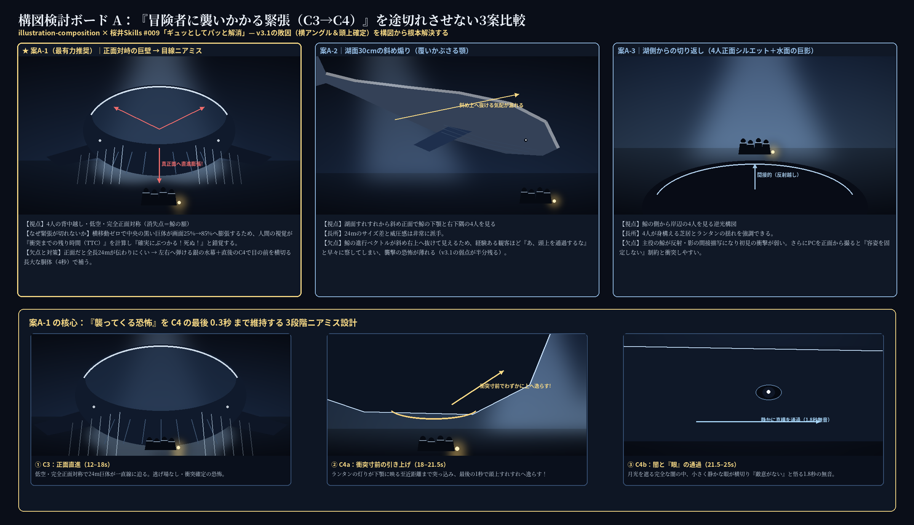
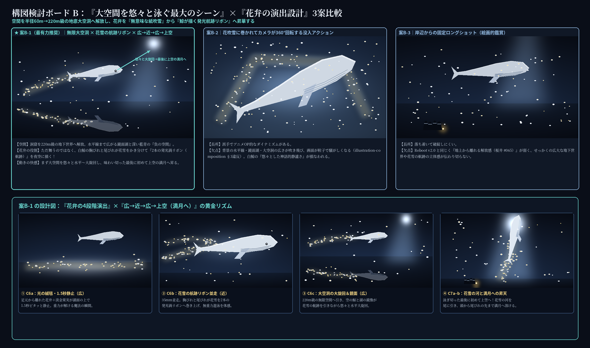

# 第一話エンディング『空に降る雪』v4.0 — 構図・空間・花弁演出 徹底再設計書

> **DM専用・ネタバレあり。GitHub Pages / `SECTIONS` / `llms.txt` には掲載しない。**
> **適用スキル**：`illustration-composition`（5階調明暗サムネイル3案比較・負の空間・無意味粒子の禁止）、`shot-composition`（消失点・広→近→広のリズム・1カット1意図）、`motion-art-direction`（Calm+Soft 劇場アニメ文法・1つのWow）、`sakurai-skill`（#009 ギュッとしてパッと解消・#063 スケール感・#065 浮遊感）

---

## 0. ご指摘が突いた「映画構図の2大急所」

「構図で動画は決まる」というご判断は、映画演出の現場でもまったく同じ結論です。v3.1 を専門スキルで再解剖した結果、ご指摘いただいた2点は**カメラワーク以前に「構図と空間設計そのもの」の弱点**でした。

1. **緊張が切れていた理由（C3→C4）**：
   - v3.1 では C3 を斜め横から撮り、C4 で最初から真上を見上げていました。人間の脳は斜め軸を見た瞬間に**「あ、上へ逸れて通り過ぎる（安全だ）」**と無意識に予測してしまい、襲撃の恐怖（『ギュッ』）がカットの途中で抜けていました。
2. **最大の遊泳シーンと花弁が伸び切っていなかった理由（C6→C7）**：
   - 洞窟を半径60m・天井44m（24m鯨のわずか2.5倍）で組んでいたため、**「広い水槽の中を窮屈に回る鯨」**に見えてしまっていました。
   - さらに花弁が「画面全体に均一に舞う白い紙吹雪」になっており、`illustration-composition` §3 が最も戒める**「物語・空間上の役割を持たない均一な粒子」**になっていました。

そこで完成画・3Dプリヴィズに進む前に、**`illustration-composition` の手順どおり独立した5階調の明暗構図サムネイル各3案**を描き起こして比較検証しました。

---

## 1. 構図検討ボード A：『襲いかかる緊張（C3→C4）』3案比較

| 案 | 構図の狙い | 強み | 欠点・リスク |
|---|---|---|---|
| **★ 案A-1（最有力推奨）** | **C3＝4人の背中越し・完全正面対称の直進膨張** → **C4a＝ランタン脇・目線高さでの衝突寸前引き上げ** → **C4b＝闇の中を静かに横切る『眼』** | 横移動ゼロで中央の黒い巨体が画面 25%→85% へ膨張するため、人間の視覚が**衝突までの残り時間（TTC）**を自動計算し、**C4 のラスト 0.3 秒まで「ぶつかる！死ぬ！」の緊張が途切れない**。その極致で頭上すれすれへ逸れ、ランタンの暖光が下顎をかすめて闇と『眼』の1.8秒無音へ落ちる落差が凄まじい。 | 正面構図は鯨の「24mの長さ」が一瞬分かりにくい → **対策**：左右へ跳ね上がる銀の水幕の広がり＋直後の C4 で目の前を 4 秒かけて横切る長大な胴体で 24m を体感させる。 |
| **案A-2** | 湖面 30cm からの斜め煽り（覆いかぶさる顎と右下隅の4人） | 24m のサイズ差と迫力は非常に派手。 | 進行線が斜め右上へ抜けるため、観客が早々に「頭上を通り過ぎる」と察してしまい、襲撃の緊張が半減する。 |
| **案A-3** | 湖側からの切り返し（逆光の4人正面＋手前の鏡面に迫る巨影） | 4人が身構える芝居とランタンの揺れは見せやすい。 | 主役の鯨が反射越しの間接描写になり初見の衝撃が弱い。またPCを正面から撮ると「容姿を固定しない」制約とぶつかりやすい。 |

---

## 2. 構図検討ボード B：『大空間の悠々遊泳』×『花弁の役割』3案比較

### 空間革命：洞窟を「半径 220m × 天井 140m 級の地底大空洞」へ解放
ルオスエンの主題**「この街の下には、まだ世界がある。」**そのままに、覚醒後の世界は岩壁が深い藍青の霧へ溶け、**水平線まで続く鏡面湖と果てしない地下の夜空（負の空間）**が広がる大空間へ設計し直します。だからこそ24mの白鯨が「水槽」ではなく**「地下の大海・大空を悠々と泳ぐ神話的存在」**に見えます。

### 花弁革命：「無意味な紙吹雪」をやめ、4段階の物語的コレオグラフィへ
正本 `FL-01 v0.8`（本物の純白花弁＋付け根の2〜3mm淡シャンパンゴールド微光果実）を100%守りつつ、花弁に明確な**流体・空間上の役割**を与えます：

1. **① 光の絨毯・1.5秒の静止（`C6a`）**：満開の白花畑から離脱した無数の花弁＋淡金果実が、黒い鏡面湖の数メートル上で**ピタッと1.5秒だけ宙に静止**し、重力が解ける魔法の瞬間を刻む。
2. **② 胸びれと尾びれが描く『花雪の航跡リボン』（`C6b`）**：花弁を闇雲に散らさず、**白鯨が泳いだ軌道に沿って胸びれ・尾びれの翼端渦が花弁を2本の優美な発光リボン（航跡）へ巻き上げる**。空の背景には疎な上昇花雪だけを配し、主役と花弁の視線誘導を一体化させる。
3. **③ 大空洞の悠々大旋回 × 天地鏡面（`C6c`）**：カメラが一気に21mm超広角の「広」へ引き、**220m級の大空洞の中央を花雪の航跡を引きながら悠々と水平大旋回する空の白鯨**と、**鏡面湖に上下対称で泳ぐ鏡像の白鯨**を一望する。
4. **④ 最後に初めて上空へ向かう『花雪の河』→ 満月溶解 → 本当の雪（`C7a–C7c`）**：広大な空間を十分に泳ぎ切った**最後に初めて上空の満月へ針路を上げる**。尾に引いていた花雪のリボンが**銀の河のように月光柱へ立ち昇り**、50mm中望遠で頭→胴→尾びれの先まで満月へ溶け切る。消えた瞬間、上昇の力が解けて4人の周囲へ**本当の冬の雪**が舞い降りる。

| 案 | 強み | 欠点・リスク |
|---|---|---|
| **★ 案B-1（最有力推奨）** | **「広（C6a 光の絨毯）→ 近（C6b 航跡リボン並走）→ 広（C6c 220m大空洞＆鏡面）→ 上空（C7 満月へ）」**の映画の黄金律（広→近→広）が完璧に成立。負の空間が極上の静謐さとスケールを生み、花弁が「ノイズ」ではなく「白鯨の泳ぎを可視化する筆跡」になる。 | 220m空間では鯨が小さく見えすぎる恐れ → **対策**：C6b の 35mm 並走で質量・肌理・花弁の渦をしっかり焼き付けた直後に C6c の大空間へ引くため、小さく見えても「さっき見た24mの巨獣がこんなに広大な世界を泳いでいる」と脳がスケールを正しく補正する。 |
| **案B-2（360°花吹雪回転）** | アクション的な派手さは最大。 | 水平線・鏡面湖・大空間の広さが吹き飛び、粒子過多で「悠々とした神話的静謐さ」が損なわれる。 |
| **案B-3（岸辺固定ロング）** | 破綻しにくい。 | 地上から離れる解放感（桜井 #065）や大空洞の立体感が伝わらず、Reboot v2.0 と同じ平坦さに戻る。 |

---

## 3. 採用案（案A-1 × 案B-1）による v4.0 マスター構成案（全13カット・約90秒）

> Seedance 2.5 の 29秒上限も余裕でクリアする **5クリップ分割（12s / 13s / 22s / 24s / 19s）**

| Clip | Cut | 秒数（尺） | 構図・カメラ設計（v4.0） | プレイヤーの感情 |
|---|---|---|---|---|
| **Clip 1** (12s) | **C1** | 0–6s (6s) | 岸辺低空 32mm 微プッシュ（ランタン＋若齢花 `P0`＋灰褐色の枯れ草蕾＋一滴の波紋） | 安堵 → わずかな予兆 |
| | **C2** | 6–12s (6s) | 4人の背中越し 28mm 微後退（鏡面湖の底を横切る巨大な黒い影） | 不穏（「何かいる…！」） |
| **Clip 2** (13s) | **C3** | 12–18s (6s) | **【新・案A-1】4人の背中越し・完全正面対称 32mm**（低空で24mの黒い巨壁が一直線に迫り画面 25%→85% へ膨張、左右に銀の水幕） | **戦慄（「真正面から来る！衝突する！」）** |
| | **C4a** | 18–21.5s (3.5s) | **【新・案A-1】ランタン脇・目線高さ 24mm**（下顎にランタンの暖光が映る至近距離まで突っ込み、ラスト1秒で頭上すれすれへ逸らす！） | **【ギュッの極致】息が止まる衝突寸前** |
| | **C4b** | 21.5–25s (3.5s) | **【新・案A-1】完全な闇の中を真横に滑る巨体と『小さく静かな眼』**（一点の月光＋**1.8秒の完全無音**） | **衝撃の転換（「…襲わない？」）** |
| **Clip 3** (22s) | **C5** | 25–33s (8s) | 4人の足元→大空洞へ振り上げる 24mm（尾の一漕ぎで月光覚醒 → 足元の枯れ草から対岸まで真っ白な5弁花畑へ一斉反転！） | **歓喜と解放の幕開け** |
| | **C6a** | 33–39s (6s) | **【新・案B-1① 広】21mm 超広角・光の絨毯**（花弁＋淡金果実が湖面上で**1.5秒静止**し、初めて 220m 級の大空洞の広さが視界に開ける） | **息を呑む驚嘆（世界が無限に開く）** |
| | **C6b** | 39–47s (8s) | **【新・案B-1② 近】35mm 側方並走遊泳**（胸びれ・尾びれが花雪を**2本の発光航跡リボン**へ巻き上げながら、無重力にゆったり泳ぐ白鯨に寄り添う） | **【パッと解放】陶酔・無重力の心地よさ** |
| **Clip 4** (24s) | **C6c** | 47–56s (9s) | **【新・案B-1③ 広】21mm 超広角・大空洞の大旋回＆鏡面対称**（220m級の暗黒鏡面の上を、花雪の航跡リボンを引きながら空の鯨と湖の鏡像が悠々と水平大旋回） | **荘厳な陶酔（世界全体が祝福に包まれる）** |
| | **C7a** | 56–63s (7s) | **【新・案B-1④ 地上帰還】4人の背中越し 21mm 超広角**（大空間を泳ぎ切った白鯨が、最後に初めて上空の満月へ向かって花雪の河を尾に引き昇り始める） | **静かな寂しさと畏敬の見送り** |
| | **C7b** | 63–71s (8s) | **中望遠 50mm 緩やかなチルトアップ**（裂け目に輝く満月へ、頭→胸びれ→胴→尾びれの先まで順番に銀白光へ溶けて消える＋0.8秒の満月余韻） | **胸が締めつけられる美しい別れ** |
| **Clip 5** (19s) | **C7c** | 71–79s (8s) | 4人の背中とランタン 24mm 緩やかな引き（力が解けた花弁が初めて『本当の雪』として4人を包み込む祝福） | **温かな祝福（「この4人で来てよかった」）** |
| | **C8** | 79–90s (11s) | **C1と完全同一の固定画 32mm**（2.5秒の静寂 → 最後の一枚が `P0` 横に着水・銀の波紋 → 淡金がそっと消えて静かに暗転） | **深い余韻・来年への期待** |

---

## 4. 次のステップ（ご合意いただいた後に着手）

`illustration-composition` の原則どおり、まずはこの **2枚の構図検討ボード（ボードA／ボードB）** を見ていただき、

1. **緊張パート（C3→C4）**：**案A-1（正面直進 → ランタン脇すれすれの引き上げ → 闇と眼の1.8秒無音）** で決めてよいか？
2. **最大の遊泳＆花弁パート（C6→C7）**：**案B-1（220m大空洞 × 花雪の航跡リボン × 広→近→広で悠々泳いで最後に上空の満月へ）** と **全13カット・約90秒構成** で決めてよいか？

OK をいただき次第、この **案A-1 × 案B-1（220m大空洞＋正面直進ニアミス＋花雪の航跡リボン）** をそのまま 3D WebGL2 Pill Previs（v4.0）へ実装し、動画とコンタクトシートを Google Drive & GitHub にお届けします！
