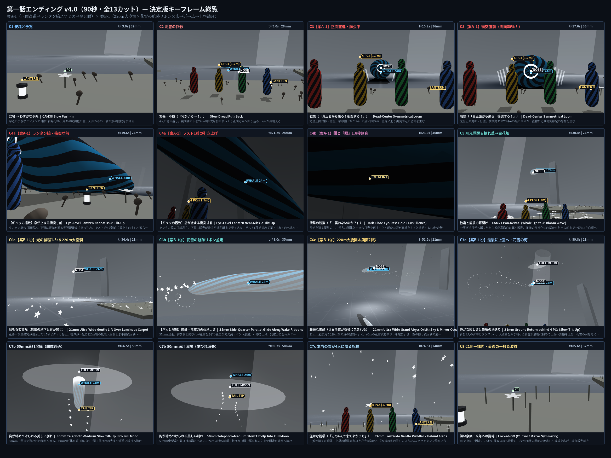

# 第一話エンディング『空に降る雪』v4.0 — 決定版 3D Pill カメラプリヴィズ（90秒・全13カット）

> **DM専用・ネタバレあり。GitHub Pages / `SECTIONS` / `llms.txt` には掲載しない。**
> **採用構図**：`../v4-composition-study/COMPOSITION_STUDY.md`（**案A-1 正面衝突ニアミス緊張 × 案B-1 220m大空洞＆花雪の航跡リボン**）

## 重点検証シート

- **[sheets/act1_tension_A1.png](sheets/act1_tension_A1.png)**：案A-1『正面直進膨張(C3) → ランタン脇すれすれの引き上げ(C4a) → 闇と眼の1.8秒無音(C4b)』
- **[sheets/act2_abyss_swimming_B1.png](sheets/act2_abyss_swimming_B1.png)**：案B-1『220m大空洞 × 光の絨毯1.5s静止(C6a) → 花雪の航跡リボン並走(C6b) → 大旋回＆鏡面対称(C6c)』
- **[sheets/act3_moon_dissolve_v4.png](sheets/act3_moon_dissolve_v4.png)**：『泳ぎ切った最後に上空の満月へ昇る花雪の河(C7a) → 50mm頭〜尾溶解(C7b) → 本当の雪(C7c) → 最後の一枚(C8)』

## Google Drive 収録動画（`Ruosuen_Render/ending_v4_pill_previs_20261125`）

1. `master_90s_preview_v4.mp4` — 90秒通しプレビュー（1280×720 / 24fps・スレート付き）
2. `seedance_v4_clip1_C1_C2_omen_and_shadow_12s.mp4`（12s・HUDなし）
3. `seedance_v4_clip2_C3_C4ab_headon_nearmiss_13s.mp4`（13s・HUDなし）
4. `seedance_v4_clip3_C5_C6ab_bloom_and_wake_22s.mp4`（22s・HUDなし）
5. `seedance_v4_clip4_C6c_C7ab_abyss_and_moon_24s.mp4`（24s・HUDなし）
6. `seedance_v4_clip5_C7c_C8_snow_and_petal_19s.mp4`（19s・HUDなし）

本番プロンプトは **[SEEDANCE_PROMPTS_V4.md](SEEDANCE_PROMPTS_V4.md)**、カメラ連続性検証は **[QA_CAMERA_CONTINUITY.md](QA_CAMERA_CONTINUITY.md)** を参照。
