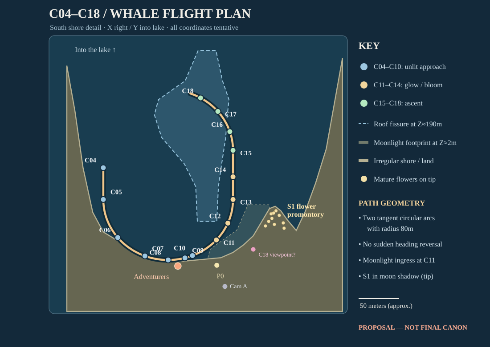
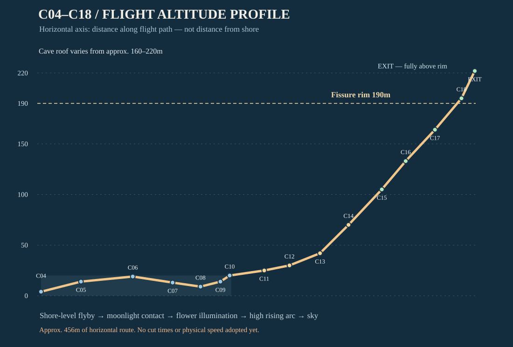
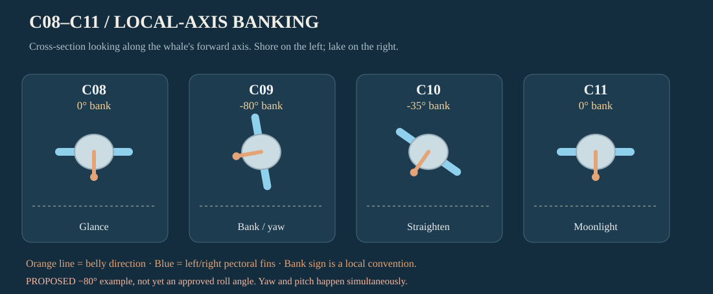

# 『空に降る雪』C04–C18 年渡の鯨：三次元飛行経路・地底湖岸・月光・空雪花　整合検証 v0.1

> **DM専用・プレイヤー閲覧禁止。2026-11-22。** 本資料はこれまでの作者採用事項を尊重した、**実際の空間で動くかを確認するための工学的ラフ**。図と数値の詳細は**作者未承認の検証モデル**であり、地形・カメラ・飛行座標・月角・尺を正史として確定しない。**既存の採用原画PNGを改変していない。**  
> 現行の意図と照合：[カメラ・運動の議論](camera-shot-review.md)／[洞窟・月光](cavern-moonlight-current.md)／[鯨設定](whale-setting-current.md)／[動線v10](whale-motion-v10.md)／[原画一覧](keyframe-contact-2026-11-22.md)。

## 結論

**一つの滑らかな飛行軌道として、地形配置・光の時間順・花の照射・天井通過を矛盾なく組み立てられる見込みが得られた。** ただしこの結論は**中心軌道と簡略化した鯨の体積モデル**に限定する。元の原画がすべて整合しているという意味でも、完成済みのアニメーションという意味でもない。

- **水平運動**：半径**80m**の二つの円弧と、それらに接する直線だけでC04→C18→完全退場までつなげる。**軌道の接線は連続**し、進路を一瞬で180°変える必要がない。水平中心線の最小曲率半径は80mで、既存の48m下限を超える。
- **接近の因果関係**：鯨は岸寄りの月光へ向かって助走・旋回しており、その経路のそばに**偶然冒険者がいた**。C08は停止も意図的な挨拶もしない、横目の一瞥。
- **月光の順序**：月の方向を一旦**仰角約42.2°、湖の奥から左へ約17.9°**とすると、試作座標ではC08・C09・C10の**代表中心点は月影**、C11が直射に入る。P0およびCam Aからも月が見え、岬先端の成熟S1は直接月光を避けられる。**月の角度は未承認**。
- **C12の花**：右手の湖岸は不規則に張り出し、その先端の**さらに突出した岬状の岩地にS1**がある。C12の鯨から岬先端の花までは**約63.9m**の試算。鯨が岸へUターンせず沖へ離れる動線のまま照射できる。ただし65mの撮影用明瞭照明距離に近いため余裕は小さい。
- **退場**：C18で裂け目の岩縁高度190mを横切り、さらに上昇した後に全身が屋根上へ抜ける。全長24m・胸びれ幅14.8mを簡易ボックスとして置いた平面通過は成立する。
- **残る撮影条件**：C18で**鯨を満月に正確に重ねる**には、Cam Aとは異なる岸辺の視点が必要になり得る。既存の「地上の冒険者側」という方針と両立させるカメラワークは、作者判断待ち。

## 図1：平面図（C04–C18、湖岸、S1、裂け目）

[図1を原寸で見る](diagrams/c04-c18-flight-plan-v01.svg)

**Xは冒険者から見て右、Yは湖の奥、Zは湖面からの高さ**。図1は地底湖の**南側の部分図**であって湖全体を一望させる図ではない。青い開口は天井高約190mにある裂け目、淡い月光帯は低地に投影した候補領域。これらは異なる高さの地物を平面上に重ねたもので、同じ地面上にあるわけではない。

陸地は**直線ではない**。左側には浮上・接近を可能にする水際の入り組みを設け、冒険者の右側、C12付近には岩地が湖側へ盛り出す。**S1主要群落の岬先端は、その盛り上がりからもう一段湖に突き出す**。対岸、多段の岩棚、結晶をC19に復活させる案ではない。

## 図2：高度の連続性（湖面Z=0基準）

[図2を原寸で見る](diagrams/c04-c18-altitude-profile-v01.svg)

※縦方向は高さ、横方向は**鯨が進んだ中心軌道の距離**であり、時間でも湖岸からの距離でもない。C08の**「頭部下面が地上2.5〜3m」**と、ここで示す**「胴体中心Z≈9m」**は別の量。岸の地面が湖面より約2m高いという追加仮定と頭部の下げ角・造形オフセットで照合する。

## 図3：C08→C11のロール／旋回の関係

[図3を原寸で見る](diagrams/c08-c11-roll-cross-section-v01.svg)

- **ヨー**：湖面に平行な平面で、進行方向を岸向き→右向き→湖の奥向きへ曲げる。ワールドZ軸まわりの方向変化。
- **ロール（バンク）**：その瞬間の**頭尾方向の身体長軸**まわりに身体を傾ける。体が右へ移ることとロール自体は同じ回転ではない。
- **ピッチ**：高度の上下と吻先の上げ下げ。月光を浴びた後の上昇も連動する。
- **例示ポーズ**：C08 0° → C09 −80° → C10 −35° → C11 0°。この符号なら、C08時点で身体が概ね右向きの場合、**冒険者に近い胸びれが上がり、湖側の胸びれが下がり、腹を岸側へ見せる**。これは**運動の動作例でありロール角を採用した記録ではない**。「約80°」と「完全に仰向けの180°」は数学的に異なるため、後で作者と画面の狙いを照合する。
- C09の暫定胴中心Z≈14mで、全幅14.8mの半翼幅7.4m・最大厚み半径2.85mを重ねた単純な最低高度は**湖面上約3.86m**。これは湖側へ下がる胸びれの概算。実際の鯨の胸びれ関節・尾のしなり・地面や岩との最短距離までは検証できていない。

## 軌道の厳密な作り方（暫定平面幾何）

- **C04→C05**：X=−125mを保ち、Y=95→53mへ進む直進の助走。
- **C05→C13**：中心(−45,53)、半径**80m**の円弧を180°→360°と進む。接線はC05では岸方向（−Y）、C08では右方向（+X）、C13では湖奥方向（+Y）へ連続的に変化。C09のロールは**この弧の途中**で行う。
- **C13→C15**：X=+35m、Y=53→118mで湖の奥へ直進しながら高度を得る。
- **C15→完全退場**：中心(−45,118)、半径**80m**の別の円弧を0°→70°進み、わずかに左へ寄りながら広い裂け目に入る。弧どうしを急な折れ線で直接つながず、途中に接線一致の直進区間を置く。

直線と円弧の継ぎ目では**位置と進行方向は連続（C1）**。曲率0と1/80mの変化そのものは不連続なので、動画化するときは曲率遷移を緩和したスプライン／クロソイドにする。その際、最小半径・月光の当たり方・地上との余裕を再評価する。

### 各カットを一つの座標系へ置いた試算

| カット | X m | Y m | 胴中心Z m | 飛行開始からの水平距離 m | 役割 |
|---|---:|---:|---:|---:|---|
| C04 | -125.0 | 95.0 | 4.0 | 0.0 | surface emergence |
| C05 | -125.0 | 53.0 | 14.0 | 42.0 | level flight / arc entry |
| C06 | -107.2 | 2.7 | 19.0 | 96.5 | left-front approach |
| C07 | -73.7 | -21.7 | 13.0 | 138.3 | lower, close head |
| C08 | -45.0 | -27.0 | 9.0 | 167.7 | glancing low pass |
| C09 | -24.3 | -24.3 | 14.0 | 188.6 | bank and yaw |
| C10 | -15.0 | -21.2 | 20.0 | 198.4 | away from camera, still unlit |
| C11 | 14.5 | -0.5 | 25.0 | 234.7 | entered moonlight / ignition |
| C12 | 28.6 | 21.7 | 30.0 | 261.2 | passing flower promontory |
| C13 | 35.0 | 53.0 | 42.0 | 293.3 | petal lift-off |
| C14 | 35.0 | 83.0 | 70.0 | 323.3 | upward glide |
| C15 | 35.0 | 118.0 | 105.0 | 358.3 | high flight |
| C16 | 31.1 | 142.7 | 133.0 | 383.5 | high flower flurry |
| C17 | 16.3 | 169.4 | 164.0 | 414.2 | approach fissure |
| C18 | -5.0 | 187.3 | 195.0 | 442.1 | cross fissure plane |
| EXIT | -17.6 | 193.2 | 222.0 | 456.1 | whole body clears roof later |

**EXIT**はC18の後、鯨の全身が屋根上へ出ることを示す補助点であり、**20番目の正式カットではない**。これにより「中心点が屋根高度に達した」ことを「全身が退場した」と誤認しない。水平ルート距離はC04からEXITまで約**456m**。Z値は胴体中心の高度の**仮のキーフレーム**で、上下動の滑らかさや速度・加速度はまだ保証していない。

## 月光とC11：直射・影の検証

### 月と開口の座標候補（**すべて未承認**）

- 天井の基準岩縁Z≈190m。開口は採用済みの「狭→広→狭・左側の岩縁が大きく後退する非対称の一本の裂け目」。その各断面の仮制御点は[座標JSON](diagrams/c04-c18-geometry-v01.json)に格納。
- 月光の逆方向の単位高度増分：**ΔX/ΔZ=−0.34、ΔY/ΔZ=+1.05**。仰角約**42.18°**、+Yから左へ約**17.94°**。旧案「仰角43°・+Y直進」とは異なる**新たな検証候補**であり、ユーザーが月角を確定したわけではない。
- P0若い花：**(15,−34,1.25)**、冒頭・終幕用固定Cam A：**(25,−62,5.2)**。**旧V7のP0=(2,−34,1.25)、Cam A=(−10,−62,5.2)を数値上置き換える試み**である。Cam AをC01/C19で共有する原則は維持するが、**この座標変更の採用には別途作者確認が必要**。
- 冒険者近接遭遇の検証用立ち位置：**(−33,−35,地面約2m)**。これは固定PC配置ではなく、C08の近接距離を確かめる代理点。

照射判定は各点の座標から逆光線を延ばし、**Z=190mで裂け目の平面内に到達するか**で簡略評価した。**岩盤の厚み・低い天井・突出した岩・光の散乱を通す3Dレイトレーシングではない。**

| 検証対象 | 天井面への逆投影（概数X,Y） | 判定 | 意味 |
|---|---|---|---|
| P0 | (−49.2,164.2) | 開口内 | 若い一輪には月光が差し込める |
| Cam A | (−37.8,132.0) | 開口内 | 開幕・終幕から同じ月が見える候補 |
| C08（胴中心） | (−106.5,163.1) | 開口外 | 近接通過の鯨は暗い |
| C09（胴中心） | (−84.1,160.5) | 開口外 | ロール中はまだ暗い |
| C10（胴中心） | (約−72.8,157.1) | 開口外 | 後ろ姿で月光へ接近中 |
| C11（胴中心） | (約−41.7,172.7) | 開口内 | 点火の場面に光が入る |
| S1岬先端 | (21.4,231.4) | 開口外 | 成熟花の先端は月光を直接受けない |

C10は中心だけでなく、進行方向に約11m先行する吻先の代理点でも確認した。**C10の代表地点（円弧角292°）ではまだ影**、円弧角**293〜295°付近から吻先が月光へ入り始める**計算となる。したがってC11の冒頭をこの位置へ配置し、吻先から尾への発光を開始すれば整合しやすい。**現行の秒数は固定しない。**

**脆弱な点**：S1岬先端は月光の直射境界から**約3.7mしか外れていない**。岩縁の実際の形状や花の群生範囲で一部が先に照らされ得る。岬のより奥の花が影にあるよう詳細な稜線・岩陰を調整するか、群落を少し横へ移して余裕を増す。**3D遮蔽検証までは「S1全体が暗い」と断言しない。**

## C08の近接・C12の照射・C18の通過の簡易クリアランス

| 項目 | モデル上の結果 | 適用範囲・注意 |
|---|---|---|
| C04浮上位置 | 検証用南岸形状では水域側 | 既存の単純楕円岸線だと水域外になる不整合を、不規則な南岸案で解消した |
| C08鼻先と冒険者 | 鼻先中心に11mの前方オフセット／鼻先外周の仮半径3.5mを置くと表面まで**約4.6m** | 既採用の3〜5mへ一致。ただし頭部形状は単純代理モデル |
| C08頭部下面・眼 | 岸の地面を湖面より2m高く、頭部下向き1.5mなどを仮定すると下面**約2.65m**、眼**約4m** | 採用済みの地上高に一致。実地形・WH-01リグによる再計算が必要 |
| C09の下がる胸びれ | 最低部を湖面上**約3.86m**とした粗い包絡 | 岩・岸・胸びれ関節の実接触判定ではない |
| C12→S1の先端 | 約**63.9m** | 既存の「明瞭な範囲約65m」をおおむね満たすが余裕が少ない。**65mは照度の開花しきい値ではなく映像上の目安** |
| C18の裂け目通過 | 24m長×14.8m幅の保守的な平面代理ボックスは開口内。開口横方向の余裕はサンプル点で最小**約22.9m** | Z=190mに達する時点では尾はまだ洞窟側に残り得る |
| EXITの全身退場 | さらに上昇して胴中心Z≈222mなら、代理全身の最低部はZ≈**208.5m**。水平開口との余裕は試算最小**約14.3m** | **岩盤の傾き・開口断面の厚み・鯨の実メッシュ形状は未検証** |

### C18の満月シルエットの撮影制約

前述の候補月方向とC18の鯨中心(約−5,187,Z=195)を重ねて観測する場合、**岸の右側の別カメラ位置(約60,−13,5.2)**なら、月への視線と鯨の位置差がZ=195面で**約1.1m**となり、満月との重なりを設計できる見込み。

ただしこの候補は、C08近接通過を目撃した冒険者の代理点から**平面で約96m**離れている。**冒険者の固定POVであると仮定すれば、瞬間移動して撮ったように見える**ため、そのまま採用しないこと。C18は地上側の切り返しカメラを使えるか、月との厳密な重なりを諦めるか、月の方位・出口位置・カメラ哲学を再検討する必要がある。なお**C01とC19は同じCam A**のままにする。

## 検証方法と再現性

- [入力座標と判定用JSON](diagrams/c04-c18-geometry-v01.json)
- [標準Pythonのみで走る確認スクリプト](scripts/verify_whale_c04_c18_v01.py) — 実行：`python3 dm/episode-01/ending/v8/scripts/verify_whale_c04_c18_v01.py`
- スクリプトは円弧半径、水面／陸地の符号、仮月光、C08の代理頭部、C09の胸びれ高さ、C12の岬先端距離、C18／EXITの代理ボックス、C18の別カメラ候補を検査する。**実レンダリング・リギング・レンズ較正を代替しない**。
- こちらで数値を独立に再計算した簡易幾何チェックは**14件すべて通過**。これは**このデータと簡略化した仮定に対してのみ**の結果である。

## 制作前に必須の未解決事項

1. **原画との見た目の照合**：C03〜C08の作者採用原画を保持したうえで、低空通過時の鼻先・眼・腹・尾の投影が図1・図2に一致するかチェック。C09・C10の原画は運動に合わせて修正可能。
2. **鯨の3Dリグ衝突**：岸の岬、胸びれ、尾、C18の岩縁の厚み、各時刻での自発光の見え方を検査。代理ボックスは実機体の形状・関節変形を証明しない。
3. **S1の本当の遮蔽**：未点灯時の成熟花はなるべく影。C12では鯨が沖へ離れながら先端から開花が広がる。光量の条件と地形影を3Dで再検証。
4. **月・固定Cam A**：仰角42.18°・左約17.94°、P0/Cam Aの位置変更と、C18の別カメラを採用するか。**月の見かけサイズを原画に合わせて天体自体は変形させない**。
5. **運動の時間変化**：円弧と直線の曲率遷移を丸め、3Dピッチ・バンク・尾の上下周期約6秒・スピード・加速度を付け、最後に**C04〜C18の尺を再分配**。C08の一瞥の4秒固定を前提にしない。
6. **上昇角**：C13以降は中心高度が比較的強く上がる初期案なので、自然な「ゆったり泳ぐ」運動と合わなければ湖の広さを利用して移動距離を増やし、傾斜を緩める。**現状の高度点を確定しない**。

### 採否の境界

**作者が採用済み**：空洞450×650m程度、湖300×500m程度、天井縁約190m／天蓋160〜220m、非対称の狭→広→狭の裂け目、C19の対岸・多段岩棚・結晶を後で削除、鯨が目前を左→右へ停止せず通る、C08の低空近接距離・高さ、C12の右岸が膨らみS1がさらに突出した岬に群生、鯨は偶然の遭遇後に低く月光を浴び沖へ離れる途中で花を照らし、旋回しながら裂け目へ上昇、**運動の決定後に尺を再検討**。

**今回新たに検証した未採用案**：二つのR80m円弧、全XYZ座標、南岸の輪郭制御点、Cam A/P0の座標変更、月光仰角と方位、C12先端への正確な距離、−80°バンクの例示、C18の別カメラ。作者確認まではすべて**検討モデル**。

**保存先**：本資料と図面・データはGitHubの`dm/`に置き、**Pagesへは公開しない**。GitHubが公開リポジトリである場合、DM閲覧禁止の警告はアクセス制御ではない。
