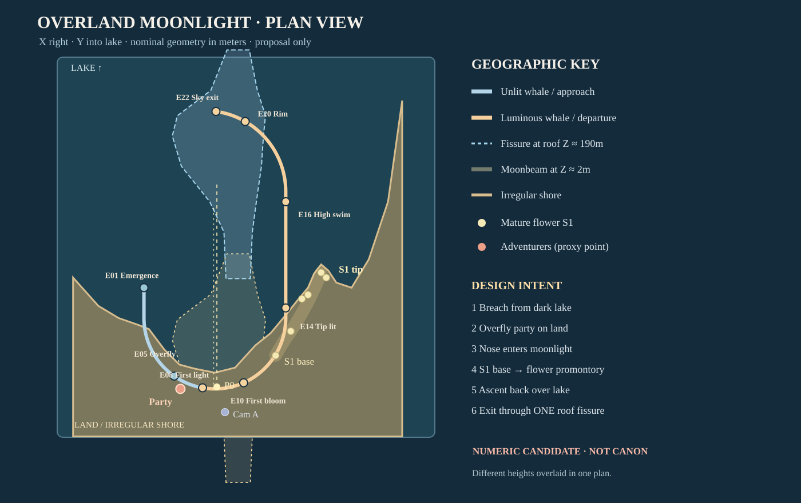
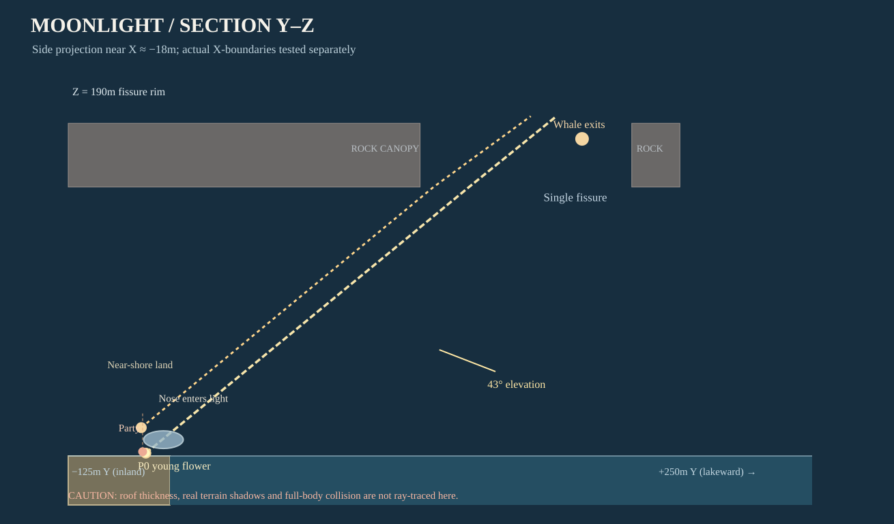
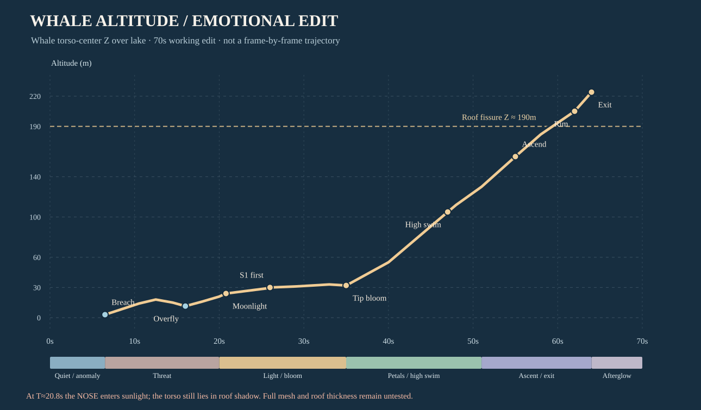

# 『空に降る雪』地底湖・陸地・月光・空雪花・年渡の鯨：統一空間 v0.2（2026-11-22）

> **DM専用・プレイヤー閲覧禁止。2026-11-22再設計第一案。** 本稿は、作者の新しい方針「**鯨が冒険者の上空を横切り、その先の陸地上空で月光を浴び、光り輝き、空雪花の花吹雪とともに去る**」を成立させるための**同一XYZ座標系の技術仕様案**。細かな地理・光の角度・身体軌道はまだ**作者未承認**。**70秒は感情設計からの暫定第一編集案で、完成尺の決定ではない。**
>
> **現行候補の入口**：本稿（空間・光・動線）＋[感情設計（70秒の仮ビート）](emotion-line-v9.md)＋[既存の採用原画一覧](keyframe-contact-2026-11-22.md)。[旧v0.1飛行検証](c04-c18-flight-spatial-verification-2026-11-22.md)の座標・[100秒v11](retiming-v11-100s-review-2026-11-22.md)は**制作履歴／比較資料**であり、この新しい陸地上空演出へ無変更で継承しない。

## 1. 決まっていることと、まだ数値化しただけのこと

| 内容 | 確度 |
|---|---|
| 洞窟450×650m程度・湖300×500m程度、天井160〜220m・裂け目縁190m程度 | 作者採用済みの概略規模 |
| 非対称の一本の長い裂け目（狭→広→狭）、S1のさらに突出した花の岬 | 作者採用済みの形状と配置方向 |
| 空飛ぶ鯨が冒険者の上空を通り、陸地上空で月光を受けて光り、花吹雪とともに去る | 今回の演出上の第一方針。具体的な航跡と秒数は仮 |
| すべてのXYZ・月角・S1の個々の花位置・鯨の各時刻と旋回半径 | この文書の新規検証値。作者未承認 |
| 一瞥・背面ロール・C01〜C19の編集番号・正確な70秒 | 完成映像の必須条件にしない。旧原画は削除しない |

## 2. どの空間で何が起きるか

[平面図のSVGを原寸で開く](diagrams/overland-moonbeam-plan-v02.svg)

**地上での出来事**は次の順序にする。

1. ほぼ暗い地底湖。冒険者側の陸地のP0（若い一輪）には、斜めの自然月光が既に届く。**任務達成の安堵は卓上から引き継ぐ**ので、湖を長く見せすぎない。
2. 湖の南側・少し左寄りの水面から、**自発光していない24m級の鯨**が浮上する。最初は水と暗い身体の一部だけが見える。
3. 鯨は湖から陸地方向（−Y）へ近づく。冒険者がいる付近で**低空をかすめて通過**する。鯨は目線合わせや威嚇のために止まらない。
4. 陸地上空へそのまま進み、**冒険者の向こう側の月光にまず吻先が入る**。身体の前から後ろへ光が広がり、鯨自身が移動光源となる。**初めからS1全体へ自然月光を当てない。**
5. 鯨は陸地上空で**半径70mほどのなだらかな弧**をたどり、右手の岸から湖へ戻る。途中で光がS1群落の基部に届き、さらに湖へ突出した**花の岬の先端**まで段階的に照らす。**花を咲かせるために急にUターンしない**。
6. 鯨は光を保ったまま湖上を上昇し、約100〜160mの高度へ入る。空雪花の白基調・淡金の花吹雪が上空へ広がるが、全花弁が鯨を追尾するわけではない。
7. 湖上で大きく向きを変え、**天井の非対称な一本の裂け目**の広い部分から夜空へ出ていく。地底湖の遠岸や空洞全景は最後まで暗い。
8. 映像は**C01と同じ固定Cam A**の静けさへ帰り、花弁一枚を残して終わる。エンドカードなし。

**この場面で描くべき感情は、鯨の性格が変わったことではなく、観客の認識が「巨大で怖い」から「この世界の神秘」へ変わったこと。** 一瞥と大きな背面ロールを足さなくても成り立つ構成とする。

## 3. 洞窟、湖、水際、人物の座標

原点／軸は**X＝岸に立ち湖を見たとき右、Y＝湖の奥が正、Z＝上、湖面Z=0（m）**。座標は**舞台制作向けの暫定較正値**であり世界設定の確定座標ではない。

| 地物 | 配置・数値（未承認の詳細） | 意味 |
|---|---|---|
| 洞窟の外形 | X≈−225〜225、Y≈−140〜510 | 作者採用の概略450×650m。実地形は矩形の箱にしない |
| 湖の主水面 | Xおおむね−150〜150、Yおおむね−30〜470 | 採用済み約300×500m。南側に自然な入り込みがあるため単純楕円にしない |
| 南側の岸線 | [JSON制御点](diagrams/overland-moonbeam-spatial-v02.json)にある不規則な曲線 | 「Y＜岸線Y(X)」なら陸地。x=+70〜95m付近で陸地がさらに湖へ突き出す |
| 冒険者の観測代表点 | **(−54, −85, 2.5)** | 水際から概略20mほど陸地内側。実際のPC人数・外見・動作・密集配置は固定しない |
| 冒頭／終幕Cam A | **(−10, −108, 5)** | 両方とも同じ位置・向き・レンズという方針を継続。**PCの実際の視点と同一ではない** |
| P0（若い花） | **(−18, −83, 2)** | 初期から自然月光に咲く。成熟群落と違い種子・花弁は散布しない |
| S1成熟群落の基部 | **(40, −52, 3)** | 岸辺の陸地に沿って不規則に分布。月の直射には入らない |
| S1成熟群落の岬先端 | **(85, 30, 3)** | 陸地が湖側へ張り出す中でもさらに突出した地形。先端にも花が密生 |
| 天井岩縁の基準高度 | **Z≈190m** | 周囲の天蓋はおおむね160〜220m、自然な厚みと凹凸を持つ |

特に**Cam Aと冒険者の位置の違い**に注意。今回のCam AはP0と月を同時に入れやすいよう地上に仮配置した**映画撮影上の定点**であり、PCを43mほど横へ移動させた物語設定ではない。PCから見た近接感をそのままCam Aから撮影できると決めつけない。冒頭・終幕の20mm想定も、両被写体の画角と実原画で再検査する。

## 4. 月・天井の裂け目・光の角度

[断面図を原寸で開く](diagrams/overland-moonbeam-ray-section-v02.svg)

**今回の最重要点は、月が湖の奥（+Y方向）に見えていても、光は天井の裂け目を斜めに通って湖岸より内側の地面へ届く**こと。裂け目そのものを陸地の真上に移動する必要はない。

- **仮の月方向**：方位は湖の奥（+Y、X方向成分なし）、**仰角約43°**。天体は遠方にあり、光は平行光とみなす。月へ向かうにつれて、高さ1mにつきYが約**+1.072m**増える。
- 天井の開口は、既定の**一本の非対称な狭→広→狭の長い裂け目**を維持。仮の制御断面はY=24〜250mに分布し、湖奥寄りの中央区間で**左側の岩縁が大きく後退**する。これは以前の形状方針を保持しつつ、新しい月光を照合したもの。
- **光路の一次計算**：点(X,Y,Z)を月の方向へ延長し、Z=190mの開口面上の**(X, Y+1.072×(190−Z), 190)**が裂け目の輪郭内かどうかを判定する。これは**岩盤の厚み・散乱・岩影を省略した幾何判定**であり最終レンダリングとは異なる。
- P0には自然月光が届く。一方、冒険者の代表点と**検証したS1の6地点**は光路が岩の外側に当たり、直接月光の影に入る。
- 点灯前の鯨の胴体も基本的には影。**吻先だけが先に光を拾う**ため、そこから全身への発光を演出できる。
- 自然の月光は暗い地底湖に薄い散乱光を作るが、**鯨自身が発光する前に全身が美しく見えない**ようにする。光った鯨の明瞭な撮影用照明領域**約65m**、微弱約140mは、開花の魔法的な照度閾値と同一視しない。

### 月光の数値検査

| 対象 | 自然月光の直射判定（簡略モデル） | 設計上の意味 |
|---|---|---|
| 冒険者代表点 | **影** | 頭上通過の緊張を暗く保てる |
| P0 若い花 | **直射** | C01・C19に静かな月光を示す |
| Cam A | **月への視線が開口内** | 冒頭と終幕で同一の月を見られる候補 |
| S1成熟群落・基部〜岬先端の6地点 | **すべて影** | **鯨の自発光が届いて初めて咲く**という因果が成立し得る |
| 鯨の吻先・通過後の直前候補 | **影（境界の約2.49m外）** | 月光を早く浴びすぎない |
| 鯨の吻先・接触候補 | **直射（境界の約1.99m内）** | 陸地上空でC11相当の発光が始まる |
| 同時点の鯨の胴体中心 | **影** | 吻先→胴→尾の光の伝播を演出しやすい |

**重要な残課題：吻先の直射境界への余裕が約2mしかない**。鯨の解剖学的な頭部形状、光の方向、3Dの岩縁を数m動かすだけで初点灯時刻が変化する。したがって**「約43°を正式採用」「厳密に20.8秒で点灯」とは言わない**。レンダリング前に月・開口・頭部メッシュを同時調整する必要がある。

## 5. 鯨の一筆書きの航跡と高度

[高度図を原寸で開く](diagrams/overland-moonbeam-altitude-v02.svg)

鯨の全長**24m**、胸びれを広げた全幅**14.8m**。頭部下面と眼の高さは**胴中心Zと同じではない**。

水平の中心軌道は**水面から岸へ直進→R70mで陸地の上を連続旋回→岸とS1の岬沿いに湖へ戻る→湖奥へ直進→R80mで裂け目へ上昇**。移動中に停止して180°反転する場面は置かない。ただし**全体としての進路は湖側→陸側→湖側へ約180°曲がる**ので、「折り返しが存在しない」わけではない。長い大円弧が自然に見えるかはアニマティックで確認する。

- 第一の円弧：中心**(−20,−15)**、半径**70m**、角度180°→360°。通常旋回70〜90mの下限で、陸地上空の一続きの湾曲を作る。
- 第二の円弧：中心**(−30,110)**、半径**80m**、角度0°→82°。高空で左へ寄って裂け目の広部に入る。
- 二つの円弧を直線でつないで**位置と平面方向の接線は連続**とする。曲率は円弧／直線の境界で不連続なので、完成用の動線では曲率を丸める。
- この案の**平面中心線全長は約489m**、浮上の仮時刻6.5秒から全身退場の仮時刻64秒までの平均水平移動は**約8.51m/s**。旧v0.1の約456mより**経路は短くなっていない**。70秒案は「鯨を短距離移動させることで省略する」のではなく、**場面を分かりやすくし、必要な運動を編集で要約する**設計。

### 検証上の主要地点（全22地点はJSON参照）

| ID | 仮時刻(s) | X(m) | Y(m) | 胴Z(m) | 動作 |
|---|---:|---:|---:|---:|---|
| E01 | 6.5 | -90.0 | 15.0 | 3.0 | breach above lake |
| E02 | 10.5 | -90.0 | -15.0 | 14.0 | approach tangent near waterline (still lake-side) |
| E03 | 12.5 | -85.8 | -38.9 | 18.0 | near-shore approach |
| E05 | 16.0 | -60.1 | -72.3 | 11.5 | head passes over party |
| E07 | 20.0 | -38.1 | -82.6 | 21.0 | last shadow before moonlight |
| E08 | 20.8 | -32.2 | -83.9 | 24.0 | nose touches moonbeam |
| E09 | 25.5 | 3.9 | -80.8 | 29.0 | glow spreads through body |
| E10 | 26.0 | 8.5 | -78.9 | 30.0 | S1 base begins bloom |
| E11 | 29.0 | 37.3 | -55.1 | 31.0 | bloom along protruding shore |
| E12 | 31.0 | 45.8 | -38.9 | 32.0 | flower expansion |
| E14 | 35.0 | 50.0 | -5.0 | 32.0 | S1 tip illuminated moving offshore |
| E15 | 40.0 | 50.0 | 30.0 | 55.0 | petals rise over lake |
| E16 | 47.0 | 50.0 | 100.0 | 105.0 | high free swim |
| E18 | 51.0 | 42.5 | 143.8 | 130.0 | higher lake arc |
| E19 | 55.0 | 21.4 | 171.3 | 160.0 | approaching fissure |
| E20 | 58.0 | 10.0 | 179.3 | 182.0 | fissure entry; front body |
| E21 | 62.0 | -2.6 | 185.2 | 205.0 | center above rim; body in opening |
| E22 | 64.0 | -18.9 | 189.2 | 224.0 | entire whale above rim; final tail clearance |

**時間は演出の検証用**。初めて月光を浴びるE08は仮に20.8秒、S1基部の開花開始E10は26秒、先端が照らされるE14は35秒、裂け目へ入るE20は58秒、完全退場E22は64秒。70秒の編集案に合わせて場面を置いたのであり、**動画生成機能・実速度・カット境界を確定するものではない**。

### 近接・花・天井の概算検査

| 検査項目 | 今回の結果 | 解釈 |
|---|---|---|
| 冒険者と鯨の頭部の最接近 | **約3.46m**（吻先の代理表面までのXY距離） | 採用済みの約3〜5mに整合。ただし実頭部メッシュでの距離ではない |
| 冒険者地面と頭部下面／眼 | **約2.95m／4.5m** | 採用済みの地上高2.5〜3m／4〜5mに整合。頭部の下げ角と形状は仮 |
| 冒険者地面から胴体中心 | **約9m** | 採用済みの8〜10mの目安と整合 |
| E10発光鯨→S1基部 | **約49.5m** | 撮影用明瞭照明の65m内、先行開花が可能 |
| E14発光鯨→S1岬先端 | **約57.4m** | 岬の先端に開花が波及する時間差が作れる |
| E20天井付近の水平代理包絡 | **最小余裕約5.4m** | 24×14.8mの大まかな投影箱。**実胸びれ／岩縁形状では厳しい可能性** |
| E21・E22の同代理包絡 | **最小余裕約17.9m／9.8m** | 開口は通る候補だが、岩の厚み・3D姿勢の検査が必要 |
| E22全身の暫定最低Z | **約209m** | 胴Z224mから全長方向12m・半厚2.85mを差し引く粗い下限。岩縁Z190mより上 |

**数値の検査が通過しても「衝突なし」を証明したことにはならない**。特に天井への入口E20では代理の余裕5.4mしかなく、尾・胸びれの実メッシュ、回転、岩盤厚、曲率平滑化によって破綻しうる。

## 6. 空雪花の分布と開花・飛散

**花の位置は映像の都合で湖上へ移動させない。** 作者が認めた「湖側へ張り出した岸、そのさらに突出した場所がS1花の岬」を維持する。

- **P0**は冒険者側の地面にある若い一輪。最初から月光で開いているが**花弁の散布源にはならない**。終幕でも同じ場所に残る。
- **S1基部**はX≈40m、Y≈−52mにあり、そこから不均一な岩の割れ目・小さな起伏をたどって、S1中腹X≈55〜72m／Y≈−28〜+8mへ続く。
- **岬先端**はX≈85m、Y≈30m。S1の成熟花が点在する**自然な舌状の地形**で、矩形の花畑や人工の階段棚ではない。花は場所ごとに密度が違い、闇の岩も残す。
- **光る鯨→S1基部→中腹→岬先端**の順に照らされて開花する。S1全体を同時に完璧な円形で咲かせない。開花し始める時刻と明瞭照明距離は魔法的なしきい値が未定なので、**演出の順序として仮採用する**。
- 開花した**白系・金系の花弁と淡金の果実**が雪のように舞う。花弁全体は自発光しない。舞い上がりは鯨の不思議な力と自然な拡散で成立し、**大渦・全花弁の追走・ピンク色**は避ける。
- S1から数十〜100mの高度へ花弁を移動させるには、演出上の魔法による上昇を明示する。**花が上空に瞬間発生する映像にはしない**。花の先端が開く仮35秒から高空を泳ぐ47秒まで12秒あり、Z≈100mの花吹雪を描くなら**平均上昇速度おおむね8m/s以上**の演出が必要。すべての花弁に強制しない。

## 7. カメラ・感情・70秒の接続

この再設計では**一瞥・フル背面ロールは必須ではない**。頭上を通過した後の短い安心と、月光での畏敬、開花による美の増幅を演出の主役にする。

| 感情設計上の帯域（作業仮案） | 空間・鯨の動き |
|---|---|
| 0〜6.5秒：安堵を継承し異変を感じる | Cam A、P0、月光、水面の影。3D鯨は水中を見せる必要はない |
| 6.5〜20秒：予測不能な巨大生物 | 水面浮上→岸→冒険者付近の低空通過。全身を常時明るく見せない |
| 20〜26秒：畏敬への変容 | 陸地上空の吻先が月光へ入り、頭から尾へ発光 |
| 26〜35秒：奇跡の波及 | 鯨が岸沿いに弧を描く途中、成熟S1基部→岬先端へ開花が広がる |
| 35〜51秒：花吹雪と自由遊泳 | 鯨は自発光して湖の奥へ泳ぎ、**C15相当の画角に花畑を入れない** |
| 51〜64秒：別れ | 湖上の大きな上昇弧で、単一の非対称裂け目へ進み全身退場 |
| 64〜70秒：静寂 | C01と同じCam A、P0と最後の花弁、エンドカードなし |

**旧C01〜C19番号をこの時刻へ機械的に再割り当てしない。** まず感情ビートとカメラの画を検証し、採用原画を残したまま、必要であれば画面を増減する。

## 8. 検証の到達点・未解決事項

**今回できたこと**：概略の空間、近接条件、月光の一方向、S1の直射回避、鯨の連続軌道、花への照射、裂け目の出口を**単一XYZモデル**へ入れ、**基礎20条件に矛盾がないことを簡略判定**。さらに出口E20/E21/E22の平面代理包絡は追加の3地点で暫定確認した。

**今回できていないこと**：岩盤を含む3Dレイトレーシング／レンズによる画面上の投影／鯨リグと岸・天井の完全衝突判定／光量に依存する実際の開花半径／花弁の3D飛翔／全フレームの速度・加速度の滑らかさ。**20条件の通過を実3Dの完成証明と呼ばない**。

### 次の制作ゲート

1. **月光境界の余裕**：吻先の射線が約2mしか入っていない。厚い岩と鯨の頭部まで含め、早期点火が起きない位置に数m単位で再較正する。
2. **カメラAの整合**：P0の位置、月の43°、固定カメラの20mmの上下画角と原画の見え方を実際に投影する。Cam AはPCの代理点から離れているので、近接カットは地上の別撮影点へ切り返すか再配置する。
3. **E20の胸びれ余裕**：天井の厚み・頭尾・胸びれ・尾びれ・姿勢を含む3Dメッシュの安全距離を数フレーム刻みで確認する。明らかに窮屈なら裂け目の幅広部分の**詳細輪郭だけ**を修正する。一本の裂け目という正史は変えない。
4. **速度と自然な運動**：R70mの陸上旋回とR80mの湖上旋回の継ぎ目を緩和し、頭部の俯仰・尾の上下周期・カメラ見切れを検証する。速度が不自然ならアニメーションの尺を70秒に押し込まない。
5. **花吹雪の伝播**：S1から飛び立った粒子が高空ショットへ届く時間、白・金の形態と自然な散らばりを先に低解像度で試す。
6. **採用済み原画との対応**：旧C03〜C08などの作者採用イラストはGitHubに残す。今回の位置と合わなければ**新案との違いを明示してから差し替え検討**し、黙って旧PNGを削除しない。

### 再現用ファイル

- [座標・岸線・花・月光と22地点のJSON](diagrams/overland-moonbeam-spatial-v02.json)
- [地底湖／岸／S1／鯨の飛行平面図](diagrams/overland-moonbeam-plan-v02.svg)
- [月光仰角43°の概念断面図](diagrams/overland-moonbeam-ray-section-v02.svg)
- [高度と70秒作業ビートの対応図](diagrams/overland-moonbeam-altitude-v02.svg)
- [Python検証スクリプト](scripts/verify_overland_moonbeam_v02.py)（標準ライブラリのみ。実行：`python3 dm/episode-01/ending/v8/scripts/verify_overland_moonbeam_v02.py`）

> **運用**：本稿はGitHubのDM用資料。**公開Pagesへ掲載しない**。Public GitHubでのDM閲覧禁止文言はアクセス制御ではない。
