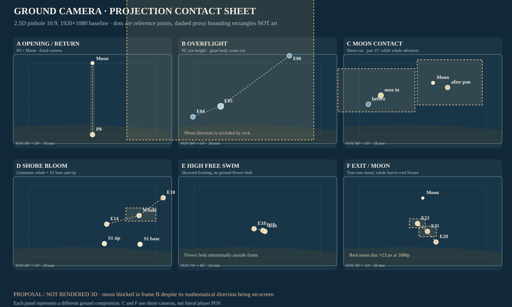

# 地上カメラ撮影検証 v0.3｜頭上通過・陸地の月光・岬の開花・裂け目退場（2026-11-22）

> **2026-11-22 後続修正v0.4**：[冒険者のほぼ真上を通過する修正軌道・再カメラ投影](overhead-moonbeam-flight-camera-review-v04-2026-11-22.md)。ここでの約56°の斜め上通過問題を踏まえ、**偏差約0.18m・仰角約88.8°**の新候補に変更して再評価した。旧v0.3は比較履歴、**v0.4の数値も作者未承認**。

> **DM専用／プレイヤー閲覧禁止。作者未承認のカメラ較正候補。** この報告は[統一空間v0.2](cavern-overland-moonlight-layout-v02-2026-11-22.md)の座標を基に、**地上から観客が本当に何を見るか**を、16:9ピンホールカメラの投影と薄い天井の射線で調べた。**実際の3Dレンダリングや採用原画の投影較正は未実施**。数値は検証案であり世界設定の確定値や完成カット割りではない。
>
> **結論**：感情曲線に必要な「近接で恐怖→カットを替えて月光による美への反転→岸の開花→高空の群舞→裂け目からの退場」は、**6種の撮影用途**を分担すれば画面上の主要被写体を成立させられる。**一台で全経路を追う構成は不向き**。特に、冒険者近くの頭上通過では鯨が**画面をはみ出す**ことが巨大さを作る。一方、月光接触は地上の別位置のカメラで鯨と月の位置関係を見せる。

## 1. 6構図の試算比較

[投影比較図を開く](diagrams/overland-camera-contact-v03.svg)

> この図は**実際の絵ではない**。カラーポイントは異なる時刻の被写体中心位置を同じカメラ枠へ投影した撮影設計ラフ。黄色の点線枠は**鯨24×14.8mなどを粗く投影した外接代理矩形**で、アニメーション中の動的形状ではない。Cの後半の点は**ゆっくりパンした後**の画角で、同一瞬間の写真ではない。月・花・鯨の原画を変更していない。

| 用途 | 地上カメラ候補 XYZ (m) | 撮影パラメータ候補 | 狙い・計算上の結果 |
|---|---|---|---|
| A 冒頭と最後 | **(−18,−93,3)** | **18mm、向き+Y、仰角18.5°、完全固定** | 若いP0と月の方向を両方フレーム内・上下それぞれ約10%弱の余裕。C01とC19相当で**全く同じカメラを再利用** |
| B 頭上通過 | **(−54,−85,4.1)** | 20mm、方位0°、仰角35° | 体の大部分がフレームからはみ出す近接ショット。E04・E05・E06の**中心点**は全て画面内。**月そのものは天井に隠れる** |
| C 月光接触 | **(−10,−108,5)** | 18mm、方位−10°→+5°に約5秒でパン、仰角32° | 別の岸辺の撮影点。月と鯨のE08〜E10中心が画面内。光への突入は部分的な頭部から見せ、後半に全身が読める |
| D 開花 | **(−54,−85,4.1)** | 20mm、方位43°、仰角14° | 鯨E11〜E14とS1基部・岬先端を同じフレームで見られる。**月自体は画面外**でよい。光源としての鯨が分かる |
| E 高空遊泳 | **(−54,−85,4.1)** | 24mm、方位25°、仰角31° | E16〜E18中心が画面内、S1の基部と先端は共に画面外。**花畑を映さず、高空の光る鯨と花吹雪**を撮れる |
| F 退場 | **(−10,−108,5)** | 50mm、方位0°、仰角37° | E20〜E22と月が同一画面内。天井より上のE21/E22への視線も、平面モデルでは裂け目内を通る |

**方位0°＝+Y（湖奥）を見る。方位正＝右へ向く。** Aの位置と18mmは**旧Cam Aの変更提案**であり、作者採用の座標へ自動上書きしない。B/D/Eは冒険者代表地点の地表Z=2.5mに対して**眼高+1.6m**の仮の地上カメラ。PC本人を描く必要はない。

## 2. A固定カメラの問題は焦点距離だけでなく、花の見かけの小ささ

対象：旧A (−10,−108,5)・20mm・仰角18°、新A候補 (−18,−93,3)・18mm・仰角18.5°。1920×1080、フルサイズ相当36×20.25mmの**仮想センサー**を用いる。

| 対象 | 旧Cam A候補 | 新Cam A候補 |
|---|---:|---:|
| P0までの距離 | 約26.4m | 約10.0m |
| P0の中心のスクリーン座標 | **587, 1034 px** | **960, 972 px** |
| 月の方向のスクリーン座標 | **960, 43 px** | **960, 103 px** |
| 月の上側の余白（1080p） | 約43px | 約103px |
| P0の下側の余白（1080p） | 約46px | 約108px |
| 0.5mの仮想的な花の投影幅 | 約20px | 約48px |
| 天体月の直径（角直径約0.5°） | 約9px | 約8px |

**判断**：旧20mmでも被写体の中心は形式上画面内だが、上下の端まで約4%しかない。原画のわずかなレイアウト変更・自然なカメラ揺れ・映像トリミングに弱い。新18mm・近接Aなら月とP0の余白が約9〜10%、花の仮の見かけサイズも約2倍以上になるため、**現段階では新Aを優先して原画と較正する価値がある**。

ただし花の物理的な0.5mは**見え方を比較するだけの仮寸法**。花の正式な寸法ではない。月は天体であり洞窟の天井上に巨大な球を置かない。月が**8〜9px程度なら「小さな光点」であり、はっきりした満月の円盤を強調できるとは限らない**。画の演出要件で月の判読性と天体サイズを分けて考える。

## 3. B→Cで「頭上通過」と「美への転換」を切り替える

**B：冒険者の眼高カメラ。** E05約16秒の鯨の胴体中心は20mmで画面内に入るが、24m全長と胸びれを矩形プロキシにすると、左右は正規化座標**−1.65〜+0.71**、上下は**−0.92〜+3.23**に及び、**全身は画面外**。ここでは頭部・腹・胸びれの一部と巨体の動きだけで、プレイヤーの近くを通過する圧迫感を作る。無理に全身を収めない。

- E04→E05→E06の投影中心は同じBフレームで、それぞれ(−0.82,−0.40)、(−0.47,−0.16)、(+0.40,+0.97)。E06で上縁から消えていく演出が可能。
- Bの月方向はレンズの画角内に見えるよう計算できても、**その地面の位置からの月への射線は厚さを省いた天井平面ですら開口の外**。**画面内に満月を安易に描いてはならない。**
- 接近音・風圧で緊張を作る。鯨は**止まらず、牙・威嚇・人間的な表情を加えない**。一瞥の専用カットも必須ではない。

**C：別の岸辺の月光接触カメラ**へカット。E07約20秒は画面左寄り、E08約20.8秒には吻先が月光境界へ。画面に月の方向も入り、E09〜E10までにゆっくり右へパンすれば鯨の胴体を収められる。

| Cの対象 | 画面中心の規格化X/Y（−1〜+1） | 注 |
|---|---|---|
| 月の方向（方位−10°の時） | +0.131, +0.360 | 開口の中。鯨の光との因果を画面に置ける |
| E08 胴体中心（パン前） | −0.528, +0.081 | 全身包絡はやや左で切れる。**吻先を主役にすればよい** |
| E09 胴体中心（パン後+5°） | +0.313, +0.258 | 正規化矩形包絡もおおむね−0.07〜+0.75, −0.13〜+0.88 |
| E10 胴体中心（パン後+5°） | +0.405, +0.228 | 正規化矩形包絡は+0.04〜+0.81, −0.14〜+0.82 |

**注意**：Cカメラと冒険者代表点は約**50m**離れている。Cを**冒険者の肉眼そのもの**と説明すると人物が瞬間移動したことになる。**同じ岸から撮る映画的な切り返しショット**と明記し、鯨の運動方向と光をマッチさせる。PC本人の姿は不要。パンは試算では約15°/5秒＝**約3°/秒**で、大きなホイップパンは不要。

## 4. 鯨とS1の開花を同じ画に収める

Dカメラを(−54,−85,4.1)、20mm、右向き約43°・仰角14°とすると、

- **S1基部**は正規化座標(+0.60,−0.52)／**S1岬先端**は(+0.15,−0.51)。両方地面側に見える。
- **鯨E11**は(+0.59,+0.13)、**E14**は(+0.18,−0.06)。花に光を落とす鯨が上側の画面で動き、下側の花が反応する構図にできる。
- 月の円盤はこの画面に入れない。月光を浴びた後の鯨が自発光源になったと観客が理解できれば十分。
- 鯨の移動にあわせてS1基部→岬先端へ開花が波及する。花の実寸や明瞭照明範囲約65mは**撮影用の指標**で、開花しきい値そのものを証明したわけではない。

**Cの発光とDの開花は、観客にとって一本の因果であり、別の奇跡として切り離さない。**

## 5. 高空と退場の撮影

**E 高空自由遊泳**：B/Dと同じ地上のカメラ位置から、24mm・方位25°・仰角31°へ切り替えると、鯨E16〜E18が見え、S1基部と岬先端は共に下端の外（正規化Y約−1.45〜−1.48）になる。花畑を画面に入れないという作者方針を満たす。高いところに見える花吹雪は、S1から舞い上がった粒子という因果を映像で接続する必要がある。

**F 裂け目からの退場**：岸側の旧Cam A位置に50mm・仰角37°で別途構えると、E20→E22の胴体中心は画面下方から中央へ向かい、月の中心は画面上方に入る。さらに、E21・E22の各点への視線が**Z=190mの2D天井開口内**を通ることを一次検証済み。ただし**実際の厚い岩盤と鯨の衝突は未検証**。

**満月との重なりには重大な画面上の制約がある**：月の真の見かけ直径を約0.5°とすると、50mm・1920×1080でも直径**約23px**。一方E22の鯨の全長24mを距離約369mで横から見れば角度は約**3.72°**となり、月の約**7.4倍**の長さに相当する。つまり、**巨大な満月の円盤の中へ鯨の全身が収まる構図は、現行の地上カメラと自然な月の大きさでは成立しない**。

選択肢は**小さな月と鯨の影が近づく／部分的に重なる**自然な演出、または象徴的な合成画として**天体の見かけサイズを意図的に変える**非自然な演出。現段階では、作者がC19の月を小さくした経緯を尊重し、**自然な小さな月＋裂け目に消える鯨**を第一候補にする。

## 6. 重要な発見：初点灯の身体包絡が先行する

v0.2の月光計算は主に吻先中心（進行方向11m・Z−4m）を使い、E07=20.0秒で吻先は岩影の外側**−2.49m**、E08=20.8秒で月光側**+1.99m**とした。

しかし**頭部に仮の左右幅各3m**を与え、右側の外縁を同じ光路へ投影すると、**E07の右縁は既に約+0.60m月光側**へ入ってしまう。E06→E07の仮時刻と位置を滑らかに補間すると、この一部分の初接触は**約19.8秒**になり得る。ここでは右側の胸びれ付け根・先端はまだ影の候補だが、実際の頭部・ひれ形状は未実装。

**今後は「鯨の中心と吻先だけ」で点灯順を証明しない。** 修正選択肢は①月光境界を数m再調整する、②頭とひれの姿勢を変えて局所的な入射順を調整する、③撮影では頭部の局所反射を先に見せ、**自発光の魔法的な変容は次の画で始める**ことを明確にする、など。いずれも原画の造形を勝手に変えない。

## 7. 重要な追加監査：「頭上通過」は本当に真上か

上記Bカメラは、**鯨が非常に近くを通過する迫力ある画**としては成立する。しかし、v0.2の第一円弧の中心(−20,−15)、R70mと冒険者の代表点(−54,−85)を**真上通過の位置関係**として検査すると、鯨の胴体中心線の**最短水平距離は約7.82m**。その地点の鯨中心高を仮キーフレーム間で補間し、眼高Z=4.1mから見ると**最大仰角の近似は約56°**になる。

したがって、旧v0.2は厳密には**「真上を通る」より「斜め上をかすめる近接通過」**。頭部は近づくものの、作者の新しい映像意図「冒険者の頭上を通過」を十分強調できるとは限らない。**以前の20条件PASSは、中心線が頭上を通るかを検査していなかった**ので、これを新しい検証ゲートに加える。

### 対案（作者未承認／新しい空間の数値候補）

| 判定 | 現行v0.2 | 試験的な修正候補 |
|---|---|---|
| 第一円弧中心 | (−20,−15) | **(−20,−23)：陸側へ8m** |
| 円弧半径 | 70m | 70mを維持 |
| 冒険者代表点のXY | (−54,−85) | **(−58,−85)：左へ4m** |
| 鯨中心線の最近水平偏位 | 約7.82m | **約2.72m** |
| 地上眼高からの推定最大仰角 | 約56° | **約73°** |
| 代表頭部のXY代理表面までの距離 | 約3.46m | **約3.56m** |
| E07の仮頭部右縁と月光境界 | **+0.60m**（早期直射の可能性） | **−4.10m**（まだ影） |
| E08の吻先中心と月光境界 | +1.99m（直射） | −1.74m（まだ影） |

この変更なら、**「頭上を大きな鯨が通る」見え方へ近づけながら、頭部近接約3〜5mの既存目安を維持できる可能性**がある。月光への接触は旧E08より少し後へ移るので、20〜26秒の発光ビート内で光の閾値と身体進入を再較正する。**変更を適用した新軌道の全身衝突、各地上カメラ画角、花の照射、海岸・地形の遮蔽はまだ全件再実行していない**。

よって**この8m/4mの移動をv0.2正本データへ反映する判断は保留**し、現行B構図の「すぐ近くを通る」画を比較基準として残す。映像の意図に忠実かどうかを作者が決められるよう、両案の数字を保持する。

## 8. 検証と限界

- **実施**：七つのカメラ候補に対し各ターゲットをピンホール投影し、候補の採否を決める**12件の構図／一次天井射線チェック**は全件満たした。鯨の簡略矩形包絡もE05/E08/E09/E10/E11/E14/E21/E22の複数点で計算。
- **未実施**：Blender等での実レンダリング、実地形・厚い岩盤の遮蔽、鯨の実3Dリグ／動き、胸びれ・尾の回転・岩との衝突、実際の採用PNGとのカメラ投影一致、被写体の輝度・散乱、観客への上映試写。計算が成立したからといって**作品が完成できる、必ず感動する**とは保証しない。
- **創作上の未承認事項**：新Cam Aの移動／18mm化、B〜Fの地上撮影点、Cのパン、Fの50mm画角、月と鯨の重なりの演出方針。70秒も第一編集仮案で、固定しない。
- **追試**：Pythonスクリプトは[こちら](scripts/verify_overland_camera_v03.py)。原稿の数値チェックは別途JavaScriptで計算しているが、**Pythonスクリプト自体の実行はまだ確認していない**。リアル3Dの検証とは独立に、この数値モデルから追試できるよう保存する。

### この先の具体的制作判断

1. **固定Cam A**を旧(-10,-108,5)20mmで維持するか、新(-18,-93,3)18mmでカメラを近づけるかを原画で比較する。C01とC19の完全同一構図は維持。
2. **BとCを別アングルにする編集**で、頭上通過から月光接触までの方向が見失われないか静止画アニマティックで確認する。原画C07〜C11は「採用原画」≠「最終カット固定」として扱う。
3. **初点灯と鯨の頭部幅**を実メッシュで再較正する。未発光の段階で身体の一部が先に光を浴びるなら、自発光開始条件の芝居を統一。
4. **Fの満月と鯨**は自然な寸法を優先するか、象徴的な構図を優先するか明示して決める。月を巨大化させずに十分な退場演出が成立する可能性がある。

## ファイルと改訂方針

- [画面比較SVG（6構図）](diagrams/overland-camera-contact-v03.svg)
- [カメラ位置・投影ピクセル・屋根・スクリーン判定JSON](camera-overland-projection-audit-v03.json)
- [投影の再現用Python](scripts/verify_overland_camera_v03.py)
- [原点となる洞窟／光／鯨／花のv0.2数値モデル](diagrams/overland-moonbeam-spatial-v02.json)

既存PNGの採用判定と旧空間設定の履歴は維持。**未承認の新カメラを作者決定として上書きしない**。DM専用資料でありPages非掲載。