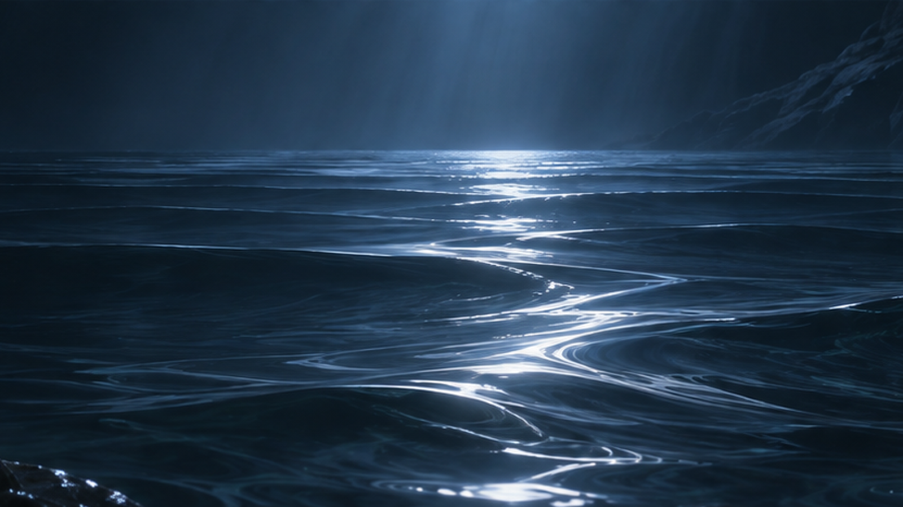
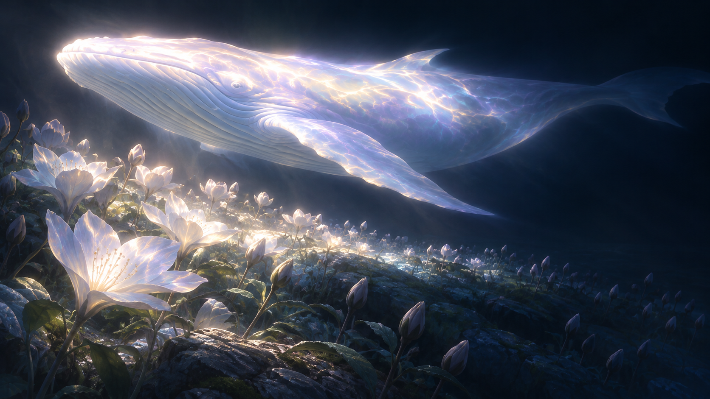
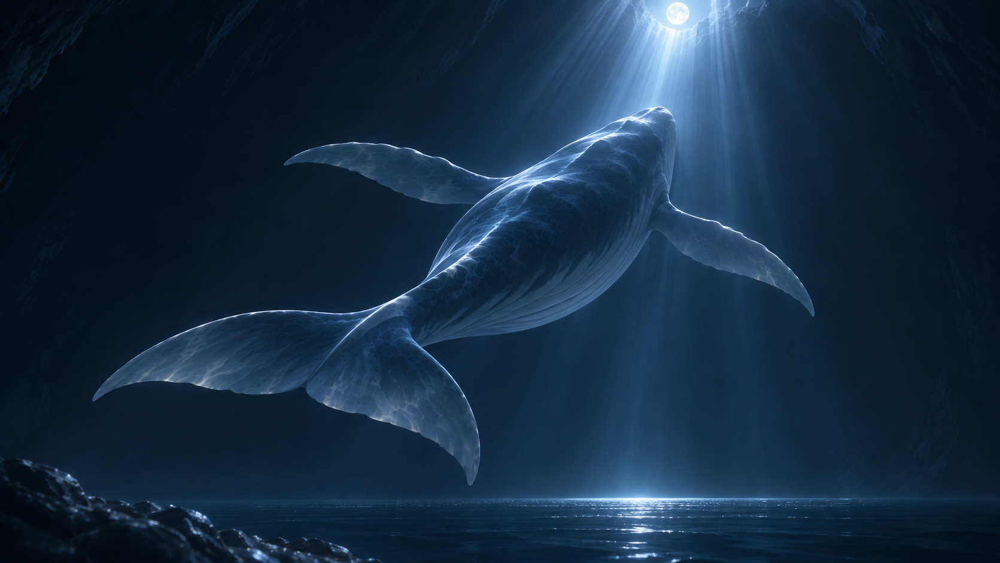
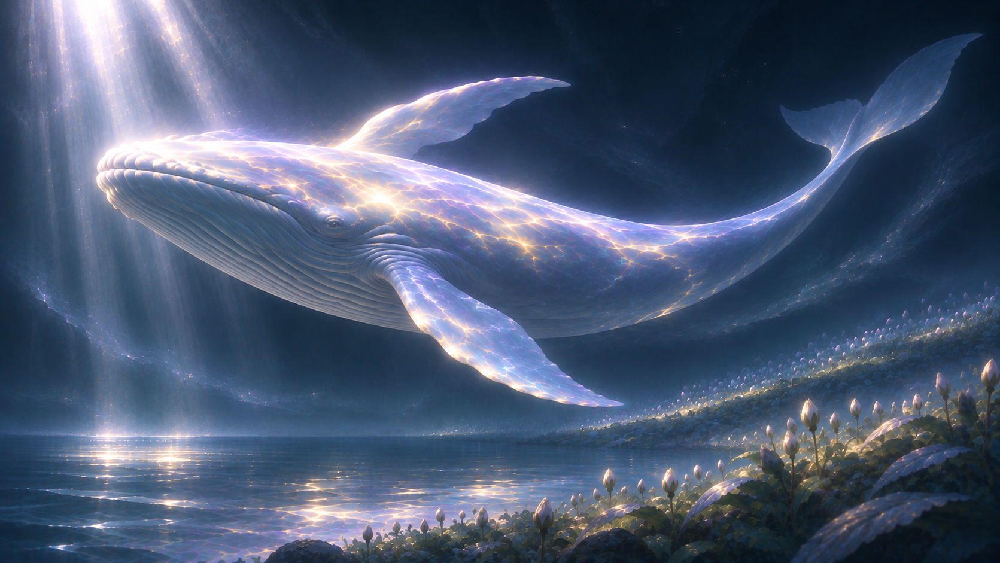
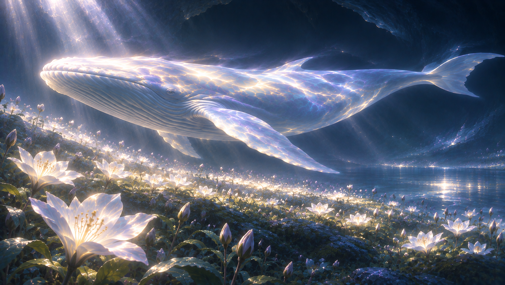
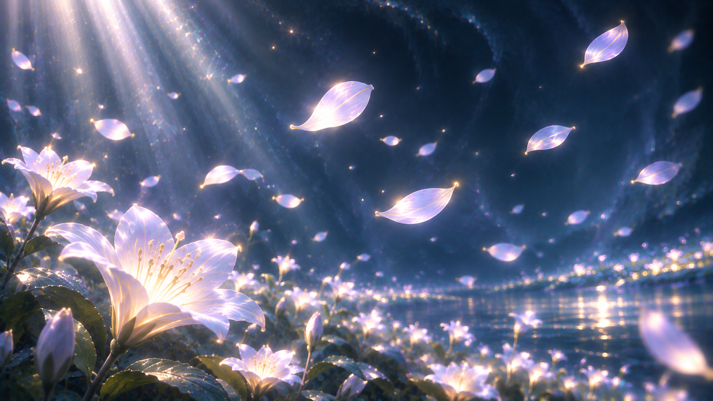
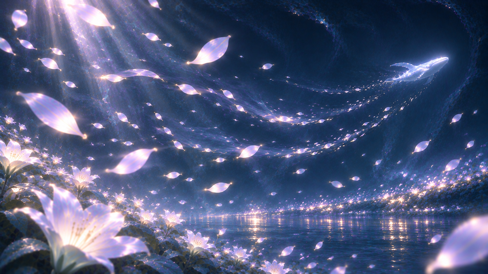
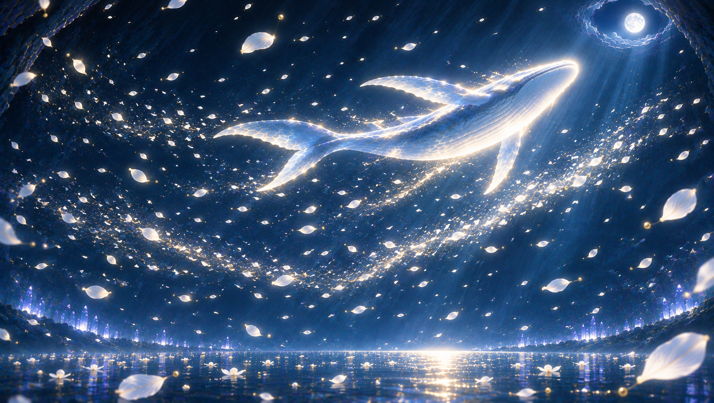
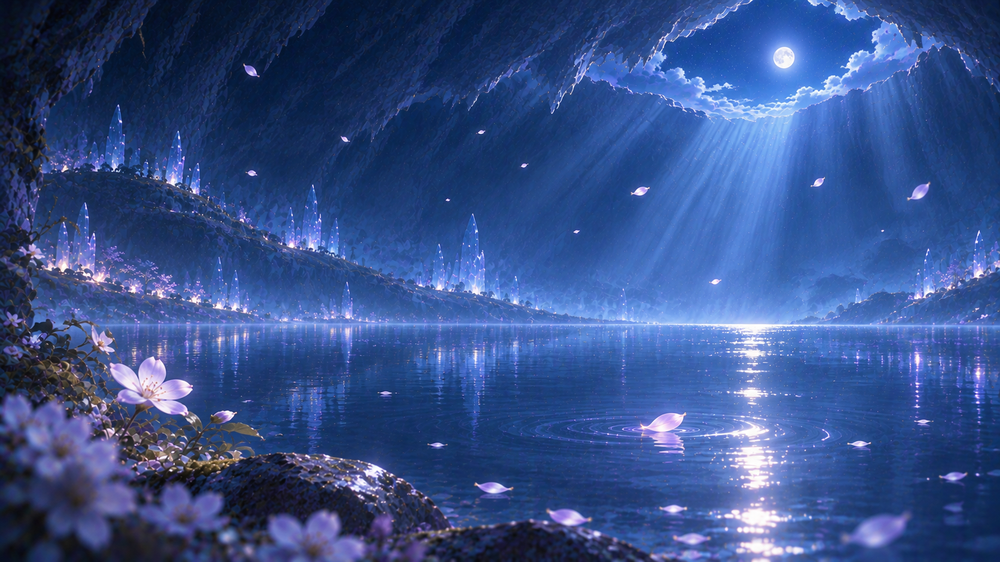

# 『空に降る雪』原画付きカット一覧｜2026-11-22時点

**DM専用・プレイヤー閲覧禁止。公開GitHub上の警告はアクセス制限ではない。**

この一覧は制作素材の棚卸しであり、完成映像のカット確定でも、画像に描かれた地形や器官の設定承認でもない。カット順・秒数・画意は [v10仮カット割り](v10-shotlist.md) を出発点とし、原画はGitHub mainに**実体が確認できたPNGだけ**を貼る。画像の登録＝作者の採用判定、ではない。C02.5とC11.5は追加原画の便宜的番号で、v10の正式な20番目・21番目のカットと決めたものではない。

- **判定の区別**：採用＝作者による原画選定／暫定＝修正前提の一旦採用／候補＝原本はあるが承認不明／参考＝古い試作／未照合＝会話に画・判定があっても、この時点のmainに対応PNGを特定できない。
- **優先する証拠**：[2026-11-21 C11–C19台帳](keyframe-test/results/C11-C19-2026-11-21/README.md)、[2026-11-22 原本6枚台帳](keyframe-test/results/C01-C16-2026-11-22/README.md)、[試作判定台帳](keyframe-test/results/README.md)。
- この表にない過去のV7・60秒案のスチルは現行原画に自動昇格しない。旧C16は Old に保存した。

## 全カットと原画

| カット・v10仮時間 | GitHub上で確認できた原画 | 原画・絵の状況と作業論点 |
| --- | --- | --- |
| **C01** 0–6秒 静かな地底湖 |  [原本](keyframe-test/results/C01-C16-2026-11-22/originals/C01.png) | **2026-11-22 原本保全／最終採否未記録**。終幕C19と同じCam Aにするか、月の見え方・花の配置を確認。 |
| **C02** 6–10秒 湖面の波紋 |  [原本](keyframe-test/results/C01-C16-2026-11-22/originals/C02.png) | **原本保全／最終採否未記録**。前後の低照度と連続性を確認。 |
| **C02.5** 追加素材 |  [原本](keyframe-test/results/C01-C16-2026-11-22/originals/C02.5.png) | **追加案／本編への挿入位置・時間未確定**。C02とC03の間に使うか再検討。 |
| **C03** 10–14秒 水中の影 | **今回のv10原画をmainで未照合** | 作者の会話では原画が進んでいるが、現行番号のPNGへの照合は未完了。V7画像の自動転用は禁止。 |
| **C04** 14–18秒 浮上 | **今回のv10原画をmainで未照合** | 会話上では一旦採用の言及あり。水の幕・未発光・鯨の浮上角度を確認。 |
| **C05** 18–21秒 螺旋上昇 | **今回のv10原画をmainで未照合** | 以前のC05は描き直し指示があり、旧版の採用扱いはしない。 |
| **C06** 21–25秒 頭上から接近 | **今回のv10原画をmainで未照合** | 会話上は**修正前提の暫定**。冒険者から見上げる巨大さと月光遮蔽を確認。 |
| **C07** 25–28秒 巨大な頭部 | **今回のv10原画をmainで未照合** | 表情を作りすぎず、頭部と胸びれの位置関係を確認。 |
| **C08** 28–32秒 読めない一瞥 |  [試作](keyframe-test/results/C08_t01.png) | **旧試作・条件付き参考**。暗すぎる問題あり。会話で作成した新しい絵との対応は未照合。 |
| **C09** 32–35秒 背面ロール |  [原本](keyframe-test/results/C01-C16-2026-11-22/originals/C09.png) | **2026-11-22 原本保全・会話上は暫定**。カメラをもっと右へ、腹の可視量、胴・尾の連続性は修正課題。 |
| **C10** 35–37秒 月光へ向かう後ろ姿 | **対応する現行PNGをmainで未照合** | 会話で「2案目を一旦採用」。顔は見せない。画面右の胸びれ位置と腹側の畝が顔まで延びて見える問題は未解決。 |
| **C11** 37–41秒 月光への接触と点火 |  [11/21暫定原画](keyframe-test/results/C11-C19-2026-11-21/selected/C11.png)  [11/22別原本](keyframe-test/results/C01-C16-2026-11-22/originals/C11.png) | **11/21版は暫定採用、11/22版は別原本として保全**。同じC11でも同一画像・差替え決定と断定しない。点火順と解剖学的整合を確認。 |
| **C11.5** 追加素材 |  [原本](keyframe-test/results/C11-C19-2026-11-21/selected/C11_5.png) | **暫定採用**。胸びれ数の誤描画を修正した版。C11→C12間の挿入をまだ固定しない。 |
| **C12** 41–44.5秒 開花の波 |  [原本](keyframe-test/results/C11-C19-2026-11-21/selected/C12.png) | **暫定採用**。月光と鯨の移動光で開く花の範囲を再確認。 |
| **C13** 44.5–47秒 花びらの空中静止 |  [原本](keyframe-test/results/C11-C19-2026-11-21/selected/C13.png) | **原画採用**。鯨は画外でよい。種子付きの本物の花弁が浮く描写を維持。 |
| **C14** 47–52秒 花びらの呼応 |  [原本](keyframe-test/results/C11-C19-2026-11-21/candidate/C14_latest_test.png) | **候補・作者承認未確認**。銀白の波の新案。C13の静止からの動作、螺旋過剰表現を評価。 |
| **C15** 52–57秒 高空の自由遊泳 |  [原本](keyframe-test/results/C11-C19-2026-11-21/selected/C15.png) | **原画採用**。花畑を画面に出さず、鯨は再び湖上の高い空間を泳ぐ。造形連続性を検証。 |
| **C16** 57–63秒 高密度の群舞 |  [11/22提出原本](keyframe-test/results/C01-C16-2026-11-22/originals/C16.png) | **新しい原本保全／採否要再照合**。**旧版を代用しない**。旧C16 Bは[Old](keyframe-test/results/Old/C16_B_petals_dense_no_flower.png)に移管済み。自然な高密度花吹雪、闇の保持を重視。 |
| **C17** 63–68秒 昇天への転換 |  [原本](keyframe-test/results/C11-C19-2026-11-21/selected/C17.png) | **原画採用**。花吹雪は高密度かつ自然に散らばり、C18につながる上昇角度。 |
| **C18** 68–73秒 裂け目の上方へ |  [原本](keyframe-test/results/C11-C19-2026-11-21/selected/C18.png) | **原画採用**。鯨は遠景で小さめ。裂け目と月・鯨の空間整合が今後の検討対象。 |
| **C19** 73–80秒 静かな地底湖 |  [原本](keyframe-test/results/C11-C19-2026-11-21/selected/C19.png) | **原画最終採用**（月を小さくした2枚目）。最後の花びらが湖面に見える点は、既存の「P0そばに落ちる」と映像上どうつなぐか未決。 |

## 複数バージョンと照合待ち

- C11の**別バージョン**：2026-11-21の暫定版と2026-11-22提出版は別Git blob。採用優先順位を決めずに双方を表示した。
- C16の**旧版**：[以前の高密度B案](keyframe-test/results/Old/C16_B_petals_dense_no_flower.png)・[初稿](keyframe-test/results/Old/C16_t01.png)は **Old**。2026-11-22のC16に混ぜない。
- [C11–C19の比較試作34枚](keyframe-test/results/C11-C19-2026-11-21/variants/)は試行履歴。ファイル名が turnXX 形式のため、切り分け可能な対応証拠なしに個々をカットへ割り当てない。
- C03–C07・C10、C08最新版などは**チャット内に原画が存在したこと**と**GitHub上で対応するPNGが照合済みであること**を分けて扱う。ここでは欠落ファイルを他の絵で埋めない。
- [初期時代のCUT02–CUT10アーカイブ](../images/transfer-status.md)は**別番号体系**。現在のC02やC10に数字だけで割り当てない。

## 次の判定

1. C01とC19の位置・画角・月の見かけサイズ、P0の若い花の同一性を比較。
2. C09・C10の連続した360度姿勢と胸びれ、尾、腹側の畝を通しで確認。
3. C11の二版・C11.5、C16の最新版を作者判断と照合。
4. C03〜C08・C10の最新原画の保管先を確定（原本を捏造・置換しない）。
5. 設定とカメラを検討した後、**採用原画も含めたカット構成そのものを再評価**する。

関連：[鯨の総合設定](whale-setting-current.md)／[洞窟・裂け目・月と光](cavern-moonlight-current.md)／[カメラ・構成検討](camera-shot-review.md)。
