# 『空に降る雪』原画付きカット一覧｜2026-11-22時点

**DM専用・プレイヤー閲覧禁止。公開GitHub上の警告はアクセス制限ではない。**

> **2026-11-22 制作判断**：『空に降る雪』は第一話の**依頼にかかわらず共通する唯一のエンディング映像**。**この原画一覧を出発点に、まず描かれたものから世界・空間・鯨・花・光の設定を再検討し、その後あらためて原画／カットを再評価する**。すでに確定した原画は無条件に廃棄せず、反対に原画の偶発的な描写を無検討で設定化しない。

**2026-11-22作者決定（空間）**：裂け目は**「長い亀裂が途中で広くなる非対称の複合型」一形状に統一**する。原画ごとに輪郭が異なっていても、それぞれを別の地形として採用しない。**今は原画を描き直さず、後で統一形状に修正する**。**C19に描かれた湖の対岸・複数の岩棚・結晶状の物体は採用せず、後のC19修正時に削除する**。参照：[空間・月光の整理](cavern-moonlight-current.md)。

この一覧は制作素材の棚卸しであり、完成映像のカット確定でも、画像に描かれた地形や器官の設定承認でもない。カット順・秒数・画意は [v10仮カット割り](v10-shotlist.md) を出発点とし、原画はGitHub mainに実体があるもの、及び**作者が採用確定したPR #27の実在するPNG（コミットSHA固定）**だけを貼る。画像の登録＝作者の採用判定、ではない。C02.5とC11.5は追加原画の便宜的番号で、v10の正式な20番目・21番目のカットと決めたものではない。

- **判定の区別**：採用＝作者による原画選定／暫定＝修正前提の一旦採用／候補＝原本はあるが承認不明／参考＝古い試作／未照合＝会話に画・判定があっても、この時点のmainに対応PNGを特定できない。
- **作者判定の優先資料**：[v10原画レビュー（PR #33、2026-11-22）](https://github.com/Makeinu1/DaD_Ruosuen/pull/33)と今回の追加指定。実体・過去の台帳は[2026-11-21 C11–C19](keyframe-test/results/C11-C19-2026-11-21/README.md)、[2026-11-22 原本6枚](keyframe-test/results/C01-C16-2026-11-22/README.md)、[試作台帳](keyframe-test/results/README.md)。PR #27の6画像は**原画確定**で、未マージでも固定SHAから表示する。
- この表にない過去のV7・60秒案のスチルは現行原画に自動昇格しない。旧C16は Old に保存した。

## 全カットと原画

| カット・v10仮時間 | GitHub上で確認できた原画 | 原画・絵の状況と作業論点 |
| --- | --- | --- |
| **C01** 0–6秒 静かな地底湖 | 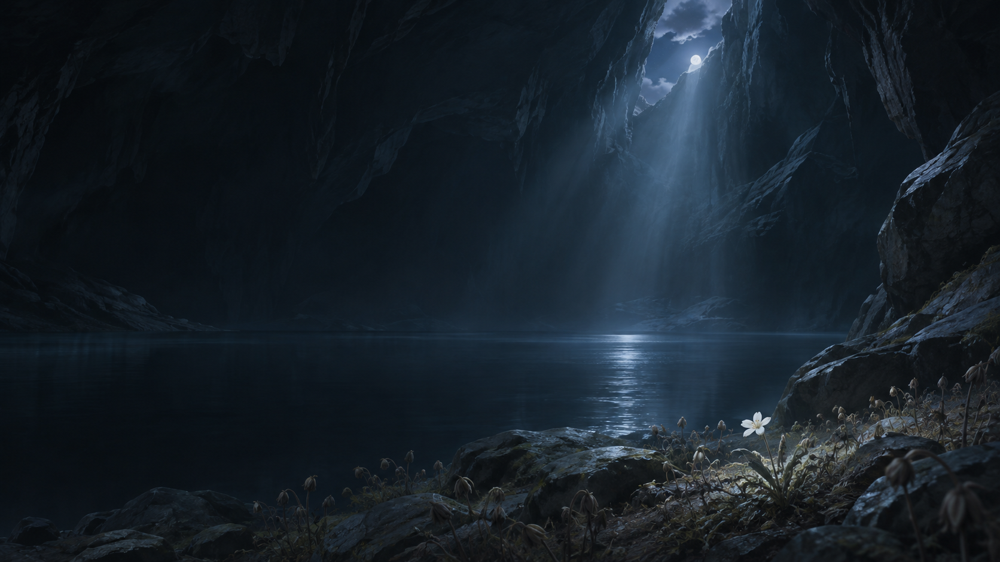 [原本](keyframe-test/results/C01-C16-2026-11-22/originals/C01.png) | **作者採用済み／この提出原本と採用画の同一性未照合**。終幕C19と同じCam Aにするか、月の見え方・花の配置を確認。 |
| **C02** 6–10秒 湖面の波紋 |  [原本](keyframe-test/results/C01-C16-2026-11-22/originals/C02.png) | **C02-A/Bの2枚は作者採用済み／提出済みのC02・C02.5との対応は未照合**。A静止→B波紋を尊重し、前後の低照度と連続性を確認。 |
| **C02.5** 追加素材 |  [原本](keyframe-test/results/C01-C16-2026-11-22/originals/C02.5.png) | **追加案／本編への挿入位置・時間未確定**。C02とC03の間に使うか再検討。 |
| **C03** 10–14秒 水中の影 |  [原本（PR #27）](https://raw.githubusercontent.com/Makeinu1/DaD_Ruosuen/b0322124b9bedf5e3233934d4879148bac671d53/dm/episode-01/ending/v8/keyframe-test/results/C03-C08-2026-11-21/C03.png) | **採用確定（2026-11-22）**。作者が**原画確定**。水面下の影。C02/C04との連続性は動画化時に検証。 |
| **C04** 14–18秒 浮上 |  [原本（PR #27）](https://raw.githubusercontent.com/Makeinu1/DaD_Ruosuen/b0322124b9bedf5e3233934d4879148bac671d53/dm/episode-01/ending/v8/keyframe-test/results/C03-C08-2026-11-21/C04.png) | **採用確定（2026-11-22）**。作者が**原画確定**。鯨の無発光と水面の連続性を映像化時に検証。 |
| **C05** 18–21秒 空への上昇 |  [原本（PR #27）](https://raw.githubusercontent.com/Makeinu1/DaD_Ruosuen/b0322124b9bedf5e3233934d4879148bac671d53/dm/episode-01/ending/v8/keyframe-test/results/C03-C08-2026-11-21/C05.png) | **採用確定（2026-11-22）**。作者が**描き直し版を原画確定**。先行する旧C05は不採用。 |
| **C06** 21–25秒 頭上から接近 |  [原本（PR #27）](https://raw.githubusercontent.com/Makeinu1/DaD_Ruosuen/b0322124b9bedf5e3233934d4879148bac671d53/dm/episode-01/ending/v8/keyframe-test/results/C03-C08-2026-11-21/C06.png) | **採用確定（2026-11-22）**。作者が**原画確定**。旧修正課題は映像制作上の確認であり、原画の暫定扱いに戻さない。 |
| **C07** 25–28秒 巨大な頭部 | 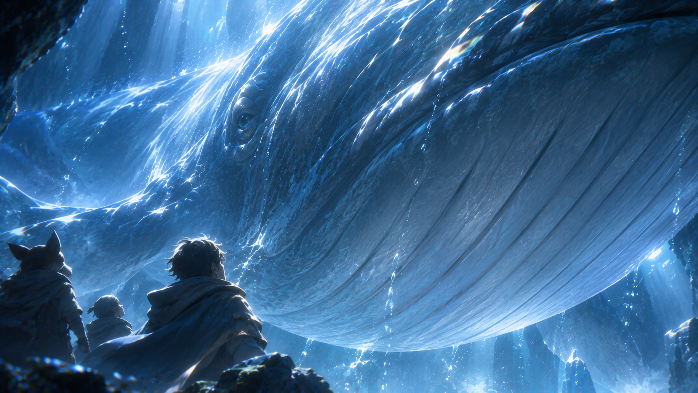 [原本（PR #27）](https://raw.githubusercontent.com/Makeinu1/DaD_Ruosuen/b0322124b9bedf5e3233934d4879148bac671d53/dm/episode-01/ending/v8/keyframe-test/results/C03-C08-2026-11-21/C07.png) | **採用確定（2026-11-22）**。作者が**原画確定**。C06との距離感と眼の位置を映像化時にチェック。 |
| **C08** 28–32秒 読めない一瞥 | 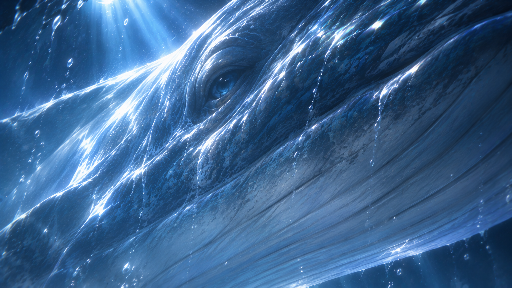 [原本（PR #27）](https://raw.githubusercontent.com/Makeinu1/DaD_Ruosuen/b0322124b9bedf5e3233934d4879148bac671d53/dm/episode-01/ending/v8/keyframe-test/results/C03-C08-2026-11-21/C08.png) | **採用確定（2026-11-22）**。作者が**原画確定**。旧試作は[不採用の履歴](keyframe-test/results/C08_t01.png)。 |
| **C09** 32–35秒 背面ロール | 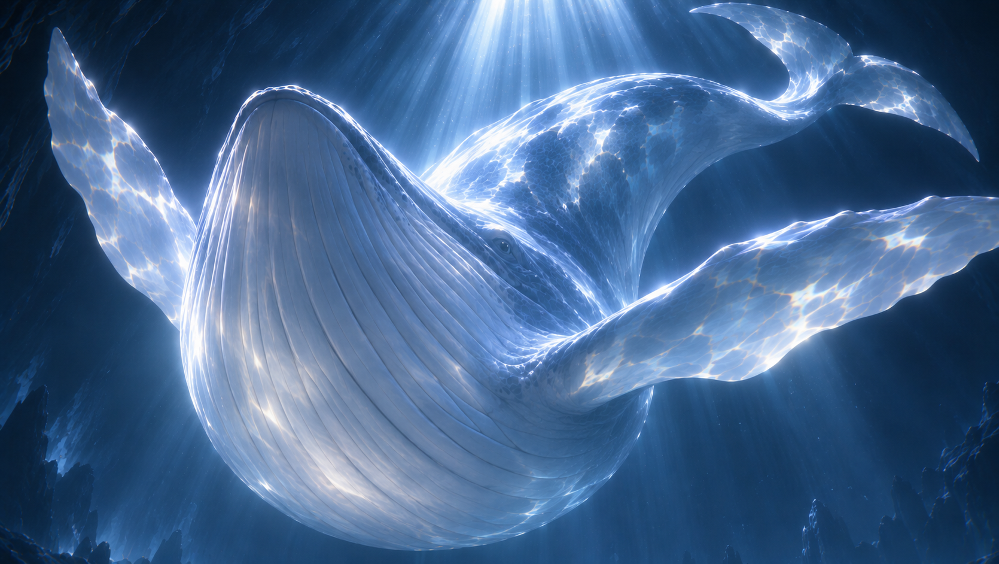 [原本](keyframe-test/results/C01-C16-2026-11-22/originals/C09.png) | **作者は11/22生成のC09を暫定採用／この提出原本との同一性未照合**。カメラ右寄り視点、腹の可視量、胴・尾の連続性は動画化時の検証課題。 |
| **C10** 35–37秒 月光へ向かう後ろ姿 |  [原本（旧保存名C11.png）](keyframe-test/results/C01-C16-2026-11-22/originals/C11.png) | **作者による原画確定・割当て訂正**。11/22提出原本のC11.pngは現行カットでは**C10**。ファイル名だけ歴史的な旧ラベルとして維持する。発光前のC10からC11の点火への連続性は動画化時に検証。 |
| **C11** 37–41秒 月光への接触と点火 |  [11/21原本](keyframe-test/results/C11-C19-2026-11-21/selected/C11.png) | **11/21版のみ暫定採用**。11/22保存名C11.pngの画像はC10なので**この欄では重複しない**。吻先からの点火順とC10との姿勢接続を確認。 |
| **C11.5** 追加素材 |  [原本](keyframe-test/results/C11-C19-2026-11-21/selected/C11_5.png) | **暫定採用**。胸びれ数の誤描画を修正した版。C11→C12間の挿入をまだ固定しない。 |
| **C12** 41–44.5秒 開花の波 |  [原本](keyframe-test/results/C11-C19-2026-11-21/selected/C12.png) | **暫定採用**。月光と鯨の移動光で開く花の範囲を再確認。 |
| **C13** 44.5–47秒 花びらの空中静止 |  [原本](keyframe-test/results/C11-C19-2026-11-21/selected/C13.png) | **原画採用**。鯨は画外でよい。種子付きの本物の花弁が浮く描写を維持。 |
| **C14** 47–52秒 花びらの呼応 |  [原本](keyframe-test/results/C11-C19-2026-11-21/candidate/C14_latest_test.png) | **作者採用（2026-11-22）**。PNGは元のcandidateフォルダに存在するが、採用判断はフォルダ名より後のもの。C13からC15の接続を検証。 |
| **C15** 52–57秒 高空の自由遊泳 |  [原本](keyframe-test/results/C11-C19-2026-11-21/selected/C15.png) | **原画採用**。花畑を画面に出さず、鯨は再び湖上の高い空間を泳ぐ。造形連続性を検証。 |
| **C16** 57–63秒 高密度の群舞 |  [原本](keyframe-test/results/C01-C16-2026-11-22/originals/C16.png) | **作者は11/22新規生成の2枚目を採用**（[詳細はPR #33](https://github.com/Makeinu1/DaD_Ruosuen/pull/33)）。この原本ファイルが採用2枚目と同一かは未照合。旧Bは[履歴](keyframe-test/results/Old/C16_B_petals_dense_no_flower.png)。 |
| **C17** 63–68秒 昇天への転換 |  [原本](keyframe-test/results/C11-C19-2026-11-21/selected/C17.png) | **原画採用**。花吹雪は高密度かつ自然に散らばり、C18につながる上昇角度。 |
| **C18** 68–73秒 裂け目の上方へ |  [原本](keyframe-test/results/C11-C19-2026-11-21/selected/C18.png) | **原画採用（現存する原本は維持）**。鯨は遠景で小さめ。**裂け目の輪郭は統一形状に合わせて後で修正**する。月・鯨の空間整合も検証対象。 |
| **C19** 73–80秒 静かな地底湖 |  [原本](keyframe-test/results/C11-C19-2026-11-21/selected/C19.png) | **当時の原画採用（後日の背景修正対象）**。月を小さくした2枚目という採用履歴は維持。**対岸・複数の岩棚・結晶状の物体を削除**し、**裂け目の形を共通地形に統一**する。最後の花びらが湖面に見える点と「P0そばに落ちる」旧演出の関係は未決。 |

## 複数バージョンと照合待ち

- **C01・C02・C09・C16**：作者採用の判断は記録済み。ただし2026-11-22提出原本のうち採用画と同一かの実体照合は未完了。**採用済み・同一性未照合**という二軸を混同しない。
- **C10/C11の誤登録名を訂正**：11/22提出原本 originals/C11.png の**現行カットはC10**。C11の現行原画は11/21版 selected/C11.png。別カットなので「C11二版」とは分類しない。元の原本保存名は来歴として変更しない。
- C16の**旧版**：[以前の高密度B案](keyframe-test/results/Old/C16_B_petals_dense_no_flower.png)・[初稿](keyframe-test/results/Old/C16_t01.png)は **Old**。2026-11-22のC16に混ぜない。
- [C11–C19の比較試作34枚](keyframe-test/results/C11-C19-2026-11-21/variants/)は試行履歴。ファイル名が turnXX 形式のため、切り分け可能な対応証拠なしに個々をカットへ割り当てない。
- **C03〜C08は作者確定**。画像はPR #27（main未マージ）のSHA固定URLから掲示。C10は11/22原本を現行番号に訂正済み。その他の新規生成画の採用判断とGitHub原本の同一性は個別に照合する。
- [初期時代のCUT02–CUT10アーカイブ](../images/transfer-status.md)は**別番号体系**。現在のC02やC10に数字だけで割り当てない。

## 次の判定

1. C01とC19の位置・画角・月の見かけサイズ、P0の若い花の同一性を比較。**C19では対岸・多段の岩棚・結晶状物体を削除し、全カットの裂け目を一つの固定形状に統一する**（原画の修正自体は設定決定後）。
2. C09・C10の連続した360度姿勢と胸びれ、尾、腹側の畝を通しで確認。
3. C10（11/22保存名C11.png）→C11（11/21版）→C11.5の接続を検証し、C01・C02-A/B・C09・C16の作者採用画と保存原本の同一性を照合。
4. 作者確定のC03〜C08をPR #27からmainへ取り込む。C10の原本保存名とカット対応を台帳に明示する。
5. 設定とカメラを検討した後、**採用原画も含めたカット構成そのものを再評価**する。

関連：[鯨の総合設定](whale-setting-current.md)／[洞窟・裂け目・月と光](cavern-moonlight-current.md)／[カメラ・構成検討](camera-shot-review.md)。

---
## 付録：GitHubに存在する全画像一覧（未整理・旧版を含む）

**収録範囲**：このリポジトリの画像ファイル全 **275点**（『空に降る雪』関連 **105点**／その他のPages素材 **170点**）。2026-11-22確認。PNG・JPG・WebP・SVGなどのファイル単位で列挙し、同じ絵の複製・サイズ違い・技術用テクスチャも**省略しない**。

画像の掲載は**GitHubに実在することの確認**であり、作者採用、映像使用決定、最新設定としての承認を意味しない。ファイル名から別カットに推定割当てしない。旧稿・診断・Webサイト画像は現行原画とは明確に分離した。

各分類をクリックすると、すべての画像のプレビューと元ファイルへのリンクを展開できる。画像は本リポジトリの相対パスを用いるため、ブランチ上の確認とマージ後の閲覧の両方で表示できる。

### A. 『空に降る雪』関連（105点）

**最新原画だけでなく、比較試作・Old・旧カット・診断・設定画像・テクスチャを含む。**
 

<strong>A1｜2026-11-22提出原本（原本ファイル名と現行カット番号を区別）（6点）</strong>

**注意**：ここに旧ファイル名 C11.png のまま保管されているPNGは、作者による現行カット割当てでは**C10原画**。C11の二枚目ではない。

| プレビュー／GitHub画像ファイル | プレビュー／GitHub画像ファイル |
| :--- | :--- |
|  [`C01.png`](keyframe-test/results/C01-C16-2026-11-22/originals/C01.png) `dm/episode-01/ending/v8/keyframe-test/results/C01-C16-2026-11-22/originals/C01.png` |  [`C02.5.png`](keyframe-test/results/C01-C16-2026-11-22/originals/C02.5.png) `dm/episode-01/ending/v8/keyframe-test/results/C01-C16-2026-11-22/originals/C02.5.png` |
|  [`C02.png`](keyframe-test/results/C01-C16-2026-11-22/originals/C02.png) `dm/episode-01/ending/v8/keyframe-test/results/C01-C16-2026-11-22/originals/C02.png` |  [`C09.png`](keyframe-test/results/C01-C16-2026-11-22/originals/C09.png) `dm/episode-01/ending/v8/keyframe-test/results/C01-C16-2026-11-22/originals/C09.png` |
|  [`C11.png`](keyframe-test/results/C01-C16-2026-11-22/originals/C11.png) `dm/episode-01/ending/v8/keyframe-test/results/C01-C16-2026-11-22/originals/C11.png` |  [`C16.png`](keyframe-test/results/C01-C16-2026-11-22/originals/C16.png) `dm/episode-01/ending/v8/keyframe-test/results/C01-C16-2026-11-22/originals/C16.png` |

<strong>A2｜2026-11-21選定原画（採用・暫定を含む）（8点）</strong>

| プレビュー／GitHub画像ファイル | プレビュー／GitHub画像ファイル |
| :--- | :--- |
|  [`C11_5.png`](keyframe-test/results/C11-C19-2026-11-21/selected/C11_5.png) `dm/episode-01/ending/v8/keyframe-test/results/C11-C19-2026-11-21/selected/C11_5.png` |  [`C11.png`](keyframe-test/results/C11-C19-2026-11-21/selected/C11.png) `dm/episode-01/ending/v8/keyframe-test/results/C11-C19-2026-11-21/selected/C11.png` |
|  [`C12.png`](keyframe-test/results/C11-C19-2026-11-21/selected/C12.png) `dm/episode-01/ending/v8/keyframe-test/results/C11-C19-2026-11-21/selected/C12.png` |  [`C13.png`](keyframe-test/results/C11-C19-2026-11-21/selected/C13.png) `dm/episode-01/ending/v8/keyframe-test/results/C11-C19-2026-11-21/selected/C13.png` |
|  [`C15.png`](keyframe-test/results/C11-C19-2026-11-21/selected/C15.png) `dm/episode-01/ending/v8/keyframe-test/results/C11-C19-2026-11-21/selected/C15.png` |  [`C17.png`](keyframe-test/results/C11-C19-2026-11-21/selected/C17.png) `dm/episode-01/ending/v8/keyframe-test/results/C11-C19-2026-11-21/selected/C17.png` |
|  [`C18.png`](keyframe-test/results/C11-C19-2026-11-21/selected/C18.png) `dm/episode-01/ending/v8/keyframe-test/results/C11-C19-2026-11-21/selected/C18.png` |  [`C19.png`](keyframe-test/results/C11-C19-2026-11-21/selected/C19.png) `dm/episode-01/ending/v8/keyframe-test/results/C11-C19-2026-11-21/selected/C19.png` |

<strong>A3｜元のcandidateフォルダに保管された採用済みC14（1点）</strong>

**2026-11-22の作者決定で採用確定**。`candidate/` は保存時の旧分類名であり、現在の採否を意味しない。

| プレビュー／GitHub画像ファイル | プレビュー／GitHub画像ファイル |
| :--- | :--- |
|  [`C14_latest_test.png`](keyframe-test/results/C11-C19-2026-11-21/candidate/C14_latest_test.png) `dm/episode-01/ending/v8/keyframe-test/results/C11-C19-2026-11-21/candidate/C14_latest_test.png` |   |

<strong>A4｜比較試作・未整理の生成原画（turn番号のまま保持）（34点）</strong>

| プレビュー／GitHub画像ファイル | プレビュー／GitHub画像ファイル |
| :--- | :--- |
|  [`turn09_01.png`](keyframe-test/results/C11-C19-2026-11-21/variants/turn09_01.png) `dm/episode-01/ending/v8/keyframe-test/results/C11-C19-2026-11-21/variants/turn09_01.png` |  [`turn10_01.png`](keyframe-test/results/C11-C19-2026-11-21/variants/turn10_01.png) `dm/episode-01/ending/v8/keyframe-test/results/C11-C19-2026-11-21/variants/turn10_01.png` |
| 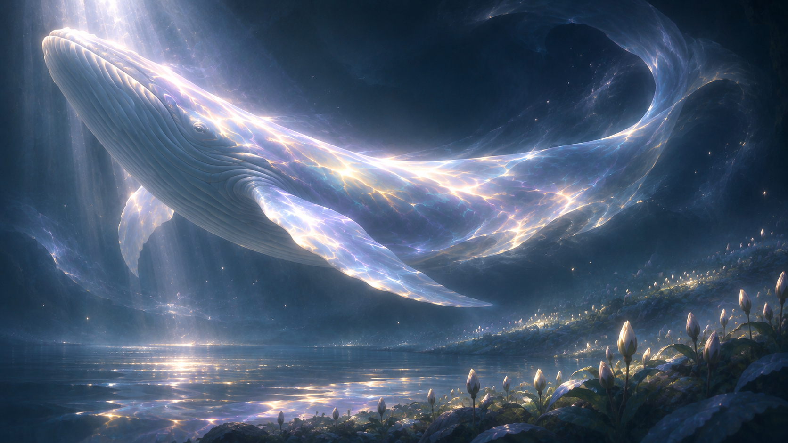 [`turn12_01.png`](keyframe-test/results/C11-C19-2026-11-21/variants/turn12_01.png) `dm/episode-01/ending/v8/keyframe-test/results/C11-C19-2026-11-21/variants/turn12_01.png` | 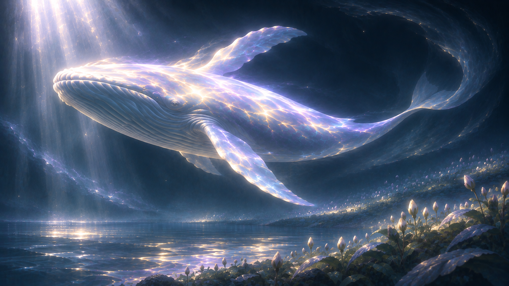 [`turn15_01.png`](keyframe-test/results/C11-C19-2026-11-21/variants/turn15_01.png) `dm/episode-01/ending/v8/keyframe-test/results/C11-C19-2026-11-21/variants/turn15_01.png` |
|  [`turn15_02.png`](keyframe-test/results/C11-C19-2026-11-21/variants/turn15_02.png) `dm/episode-01/ending/v8/keyframe-test/results/C11-C19-2026-11-21/variants/turn15_02.png` |  [`turn16_01.png`](keyframe-test/results/C11-C19-2026-11-21/variants/turn16_01.png) `dm/episode-01/ending/v8/keyframe-test/results/C11-C19-2026-11-21/variants/turn16_01.png` |
|  [`turn17_01.png`](keyframe-test/results/C11-C19-2026-11-21/variants/turn17_01.png) `dm/episode-01/ending/v8/keyframe-test/results/C11-C19-2026-11-21/variants/turn17_01.png` |  [`turn17_02.png`](keyframe-test/results/C11-C19-2026-11-21/variants/turn17_02.png) `dm/episode-01/ending/v8/keyframe-test/results/C11-C19-2026-11-21/variants/turn17_02.png` |
|  [`turn19_01.png`](keyframe-test/results/C11-C19-2026-11-21/variants/turn19_01.png) `dm/episode-01/ending/v8/keyframe-test/results/C11-C19-2026-11-21/variants/turn19_01.png` | 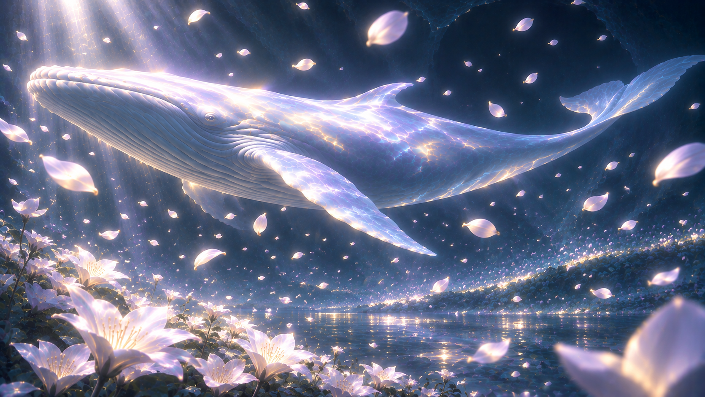 [`turn19_02.png`](keyframe-test/results/C11-C19-2026-11-21/variants/turn19_02.png) `dm/episode-01/ending/v8/keyframe-test/results/C11-C19-2026-11-21/variants/turn19_02.png` |
|  [`turn19_03.png`](keyframe-test/results/C11-C19-2026-11-21/variants/turn19_03.png) `dm/episode-01/ending/v8/keyframe-test/results/C11-C19-2026-11-21/variants/turn19_03.png` |  [`turn21_01.png`](keyframe-test/results/C11-C19-2026-11-21/variants/turn21_01.png) `dm/episode-01/ending/v8/keyframe-test/results/C11-C19-2026-11-21/variants/turn21_01.png` |
|  [`turn23_01.png`](keyframe-test/results/C11-C19-2026-11-21/variants/turn23_01.png) `dm/episode-01/ending/v8/keyframe-test/results/C11-C19-2026-11-21/variants/turn23_01.png` |  [`turn25_01.png`](keyframe-test/results/C11-C19-2026-11-21/variants/turn25_01.png) `dm/episode-01/ending/v8/keyframe-test/results/C11-C19-2026-11-21/variants/turn25_01.png` |
|  [`turn26_01.png`](keyframe-test/results/C11-C19-2026-11-21/variants/turn26_01.png) `dm/episode-01/ending/v8/keyframe-test/results/C11-C19-2026-11-21/variants/turn26_01.png` |  [`turn26_02.png`](keyframe-test/results/C11-C19-2026-11-21/variants/turn26_02.png) `dm/episode-01/ending/v8/keyframe-test/results/C11-C19-2026-11-21/variants/turn26_02.png` |
| 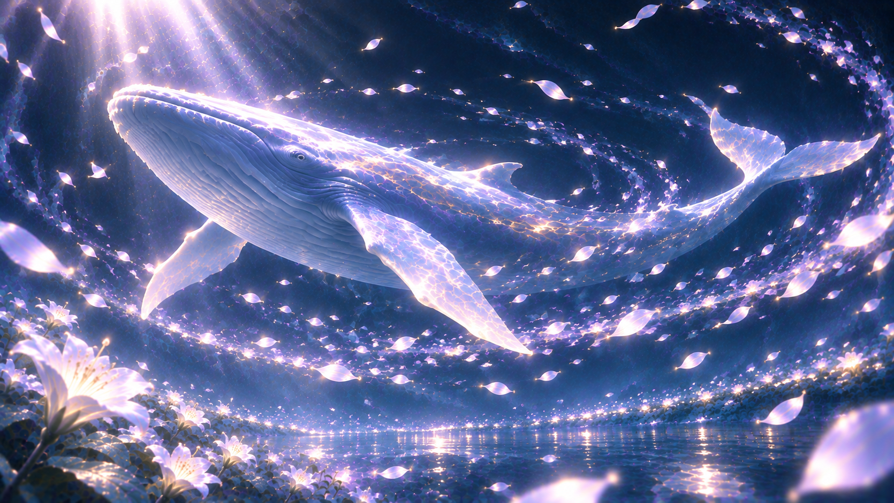 [`turn28_01.png`](keyframe-test/results/C11-C19-2026-11-21/variants/turn28_01.png) `dm/episode-01/ending/v8/keyframe-test/results/C11-C19-2026-11-21/variants/turn28_01.png` | 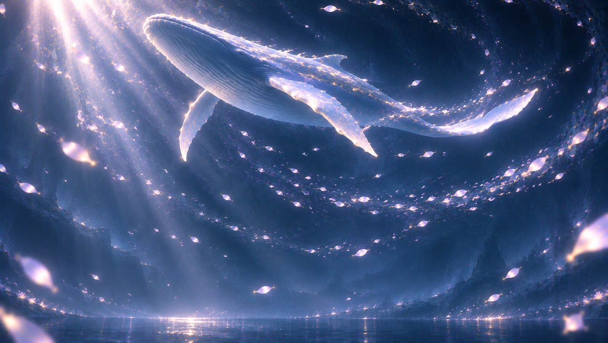 [`turn29_01.png`](keyframe-test/results/C11-C19-2026-11-21/variants/turn29_01.png) `dm/episode-01/ending/v8/keyframe-test/results/C11-C19-2026-11-21/variants/turn29_01.png` |
| 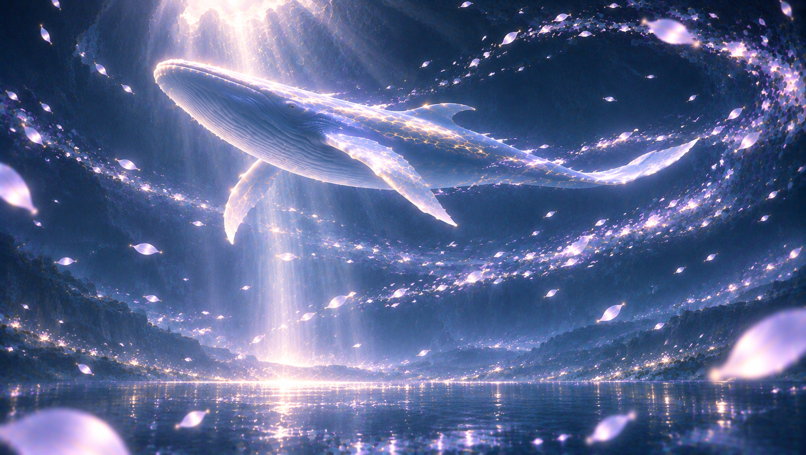 [`turn30_01.png`](keyframe-test/results/C11-C19-2026-11-21/variants/turn30_01.png) `dm/episode-01/ending/v8/keyframe-test/results/C11-C19-2026-11-21/variants/turn30_01.png` | 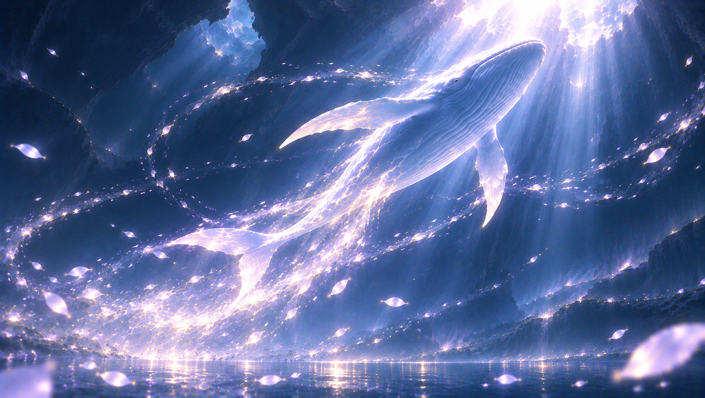 [`turn31_01.png`](keyframe-test/results/C11-C19-2026-11-21/variants/turn31_01.png) `dm/episode-01/ending/v8/keyframe-test/results/C11-C19-2026-11-21/variants/turn31_01.png` |
|  [`turn32_01.png`](keyframe-test/results/C11-C19-2026-11-21/variants/turn32_01.png) `dm/episode-01/ending/v8/keyframe-test/results/C11-C19-2026-11-21/variants/turn32_01.png` | 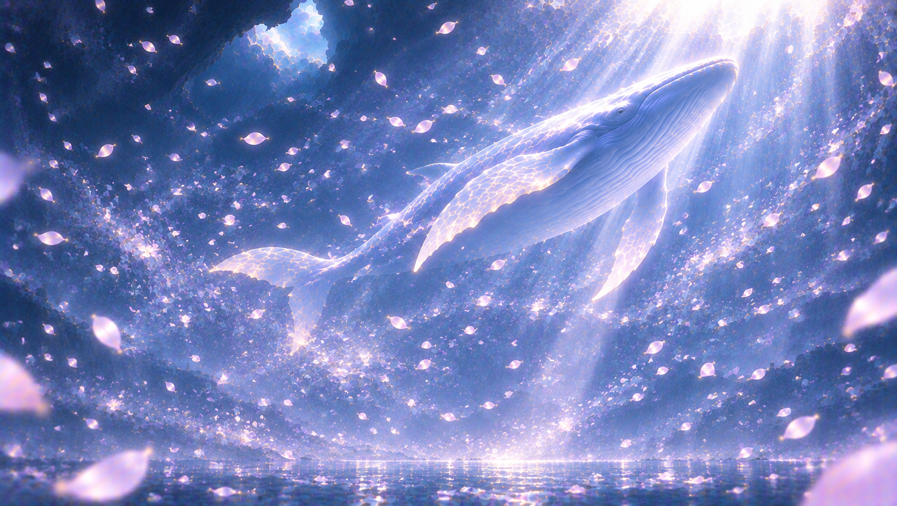 [`turn33_01.png`](keyframe-test/results/C11-C19-2026-11-21/variants/turn33_01.png) `dm/episode-01/ending/v8/keyframe-test/results/C11-C19-2026-11-21/variants/turn33_01.png` |
| 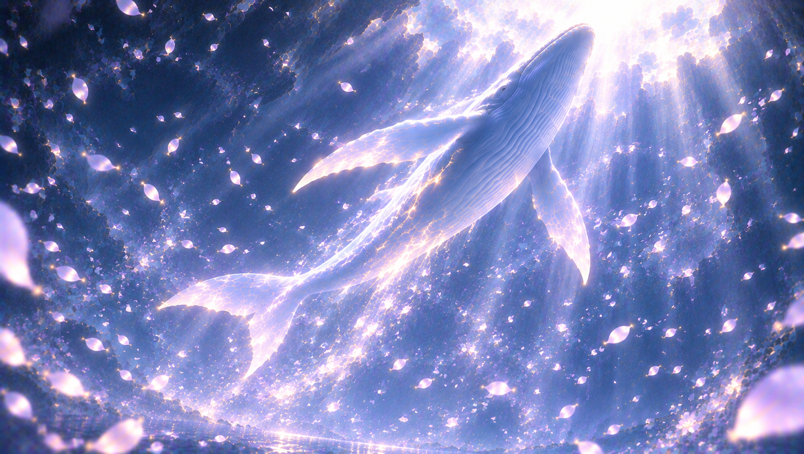 [`turn34_01.png`](keyframe-test/results/C11-C19-2026-11-21/variants/turn34_01.png) `dm/episode-01/ending/v8/keyframe-test/results/C11-C19-2026-11-21/variants/turn34_01.png` | 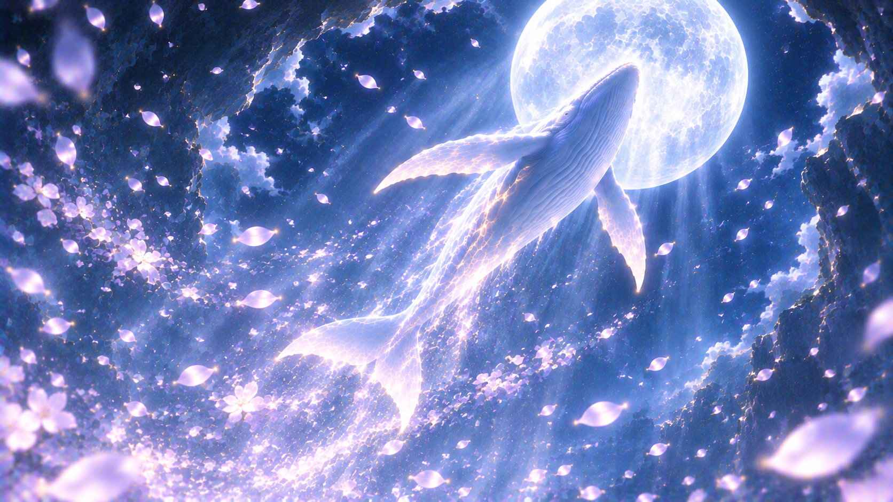 [`turn36_01.png`](keyframe-test/results/C11-C19-2026-11-21/variants/turn36_01.png) `dm/episode-01/ending/v8/keyframe-test/results/C11-C19-2026-11-21/variants/turn36_01.png` |
| 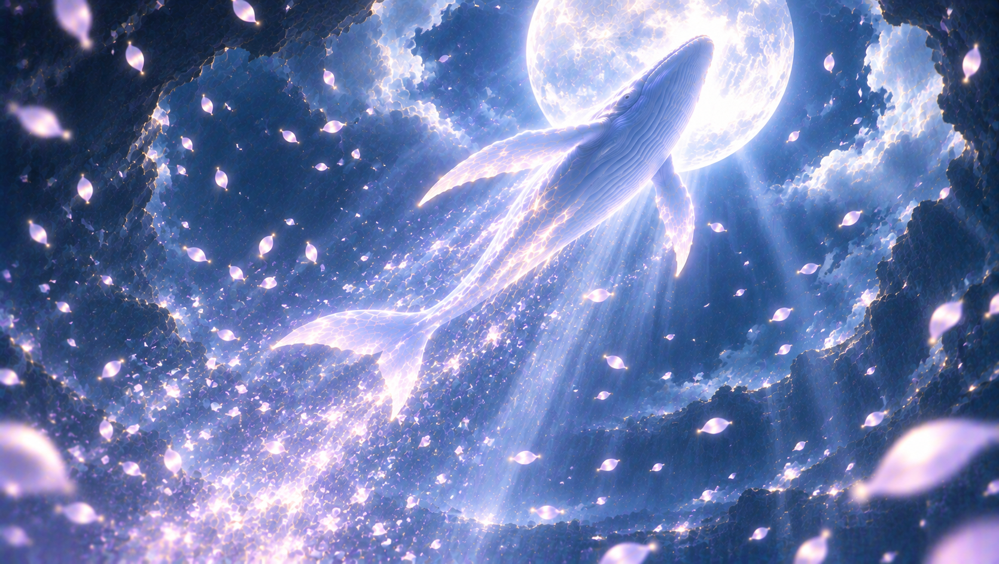 [`turn36_02.png`](keyframe-test/results/C11-C19-2026-11-21/variants/turn36_02.png) `dm/episode-01/ending/v8/keyframe-test/results/C11-C19-2026-11-21/variants/turn36_02.png` |  [`turn36_03.png`](keyframe-test/results/C11-C19-2026-11-21/variants/turn36_03.png) `dm/episode-01/ending/v8/keyframe-test/results/C11-C19-2026-11-21/variants/turn36_03.png` |
| 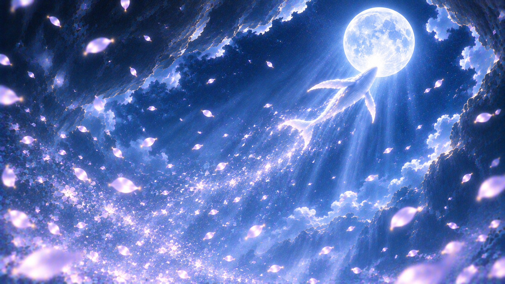 [`turn37_01.png`](keyframe-test/results/C11-C19-2026-11-21/variants/turn37_01.png) `dm/episode-01/ending/v8/keyframe-test/results/C11-C19-2026-11-21/variants/turn37_01.png` |  [`turn39_01.png`](keyframe-test/results/C11-C19-2026-11-21/variants/turn39_01.png) `dm/episode-01/ending/v8/keyframe-test/results/C11-C19-2026-11-21/variants/turn39_01.png` |
| 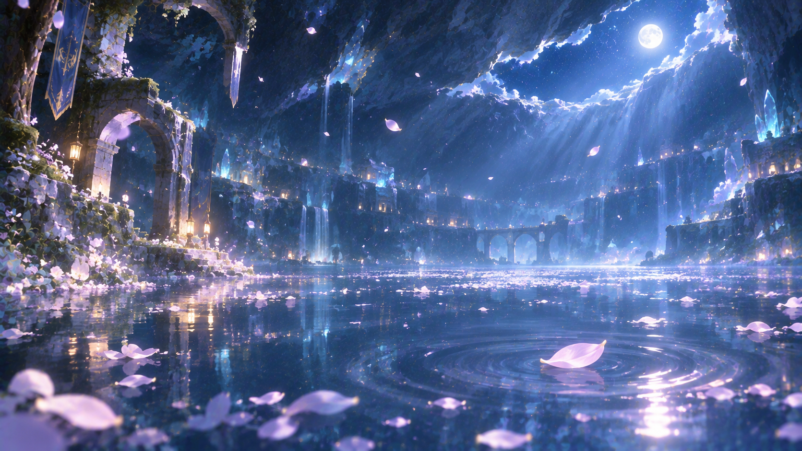 [`turn39_02.png`](keyframe-test/results/C11-C19-2026-11-21/variants/turn39_02.png) `dm/episode-01/ending/v8/keyframe-test/results/C11-C19-2026-11-21/variants/turn39_02.png` |  [`turn39_03.png`](keyframe-test/results/C11-C19-2026-11-21/variants/turn39_03.png) `dm/episode-01/ending/v8/keyframe-test/results/C11-C19-2026-11-21/variants/turn39_03.png` |
| 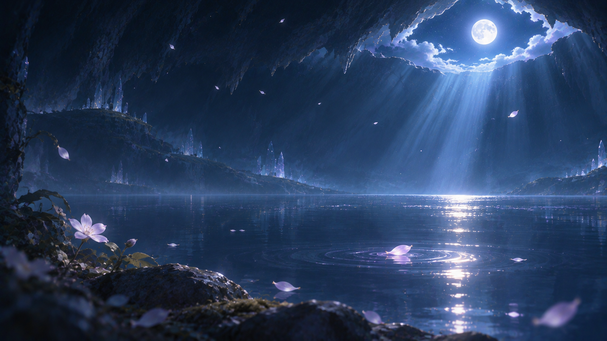 [`turn40_01.png`](keyframe-test/results/C11-C19-2026-11-21/variants/turn40_01.png) `dm/episode-01/ending/v8/keyframe-test/results/C11-C19-2026-11-21/variants/turn40_01.png` |  [`turn40_02.png`](keyframe-test/results/C11-C19-2026-11-21/variants/turn40_02.png) `dm/episode-01/ending/v8/keyframe-test/results/C11-C19-2026-11-21/variants/turn40_02.png` |
| 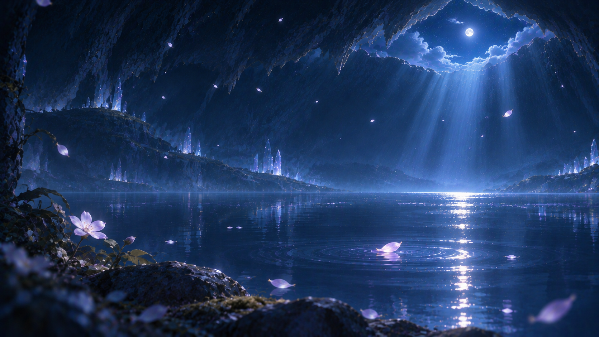 [`turn41_01.png`](keyframe-test/results/C11-C19-2026-11-21/variants/turn41_01.png) `dm/episode-01/ending/v8/keyframe-test/results/C11-C19-2026-11-21/variants/turn41_01.png` |  [`turn41_02.png`](keyframe-test/results/C11-C19-2026-11-21/variants/turn41_02.png) `dm/episode-01/ending/v8/keyframe-test/results/C11-C19-2026-11-21/variants/turn41_02.png` |

<strong>A5｜旧C16のアーカイブ（Old）（2点）</strong>

| プレビュー／GitHub画像ファイル | プレビュー／GitHub画像ファイル |
| :--- | :--- |
|  [`C16_B_petals_dense_no_flower.png`](keyframe-test/results/Old/C16_B_petals_dense_no_flower.png) `dm/episode-01/ending/v8/keyframe-test/results/Old/C16_B_petals_dense_no_flower.png` |  [`C16_t01.png`](keyframe-test/results/Old/C16_t01.png) `dm/episode-01/ending/v8/keyframe-test/results/Old/C16_t01.png` |

<strong>A6｜原画試作と旧パスに残る画像（旧C16複製を含む）（4点）</strong>

| プレビュー／GitHub画像ファイル | プレビュー／GitHub画像ファイル |
| :--- | :--- |
| 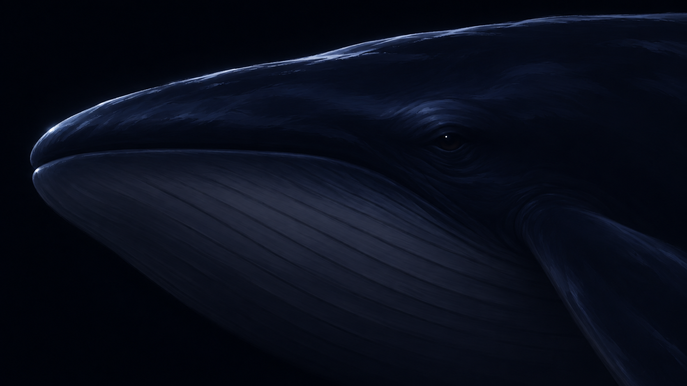 [`C08_t01.png`](keyframe-test/results/C08_t01.png) `dm/episode-01/ending/v8/keyframe-test/results/C08_t01.png` |  [`C16_B_petals_dense_no_flower.png`](keyframe-test/results/C16_B_petals_dense_no_flower.png) `dm/episode-01/ending/v8/keyframe-test/results/C16_B_petals_dense_no_flower.png` |
| 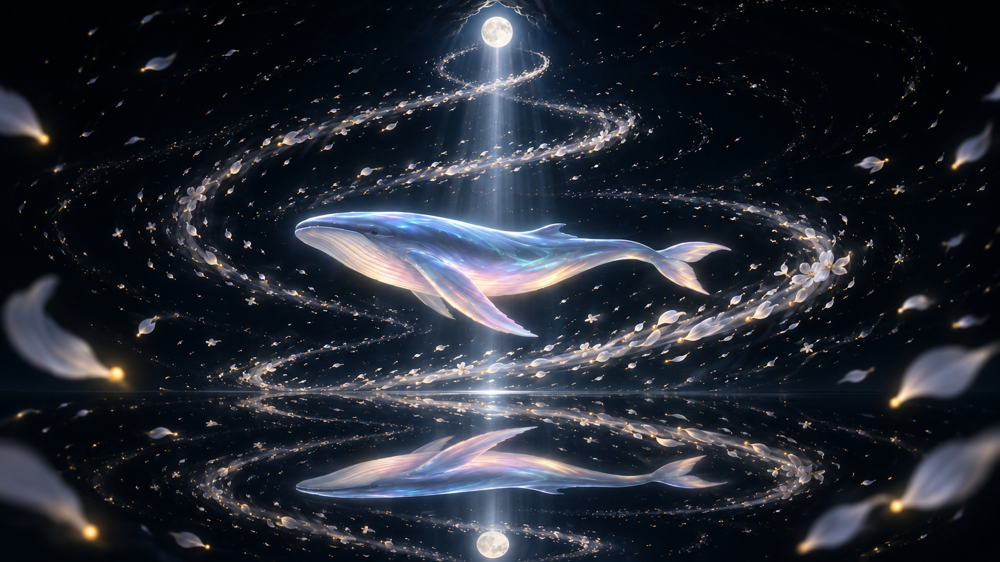 [`C16_t01.png`](keyframe-test/results/C16_t01.png) `dm/episode-01/ending/v8/keyframe-test/results/C16_t01.png` | 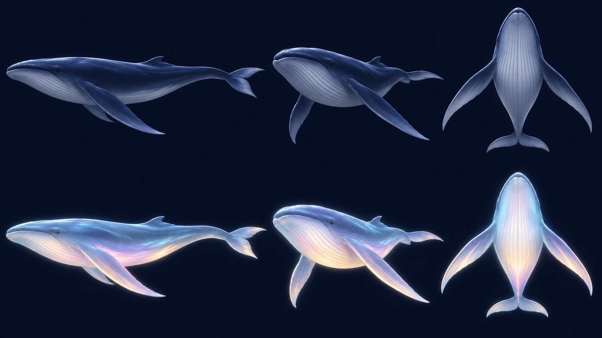 [`sheet_t01.png`](keyframe-test/results/sheet_t01.png) `dm/episode-01/ending/v8/keyframe-test/results/sheet_t01.png` |

<strong>A7｜鯨・C08・C16の画角と画風の参照画像（5点）</strong>

| プレビュー／GitHub画像ファイル | プレビュー／GitHub画像ファイル |
| :--- | :--- |
| 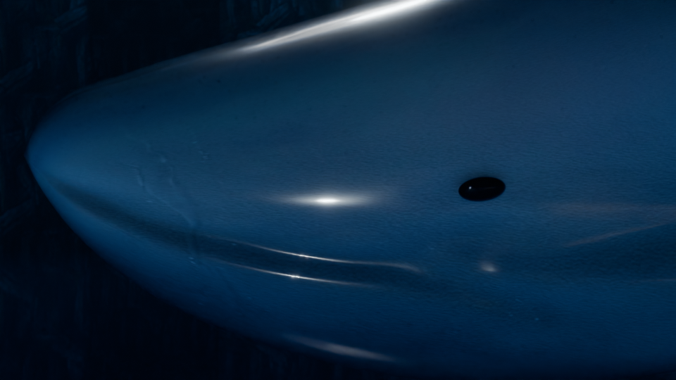 [`G_C08_glance.png`](keyframe-test/refs/G_C08_glance.png) `dm/episode-01/ending/v8/keyframe-test/refs/G_C08_glance.png` | 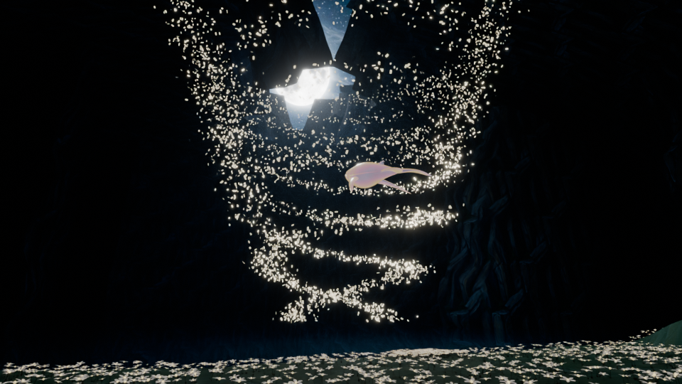 [`G_C16_alt_shore_high.png`](keyframe-test/refs/G_C16_alt_shore_high.png) `dm/episode-01/ending/v8/keyframe-test/refs/G_C16_alt_shore_high.png` |
| 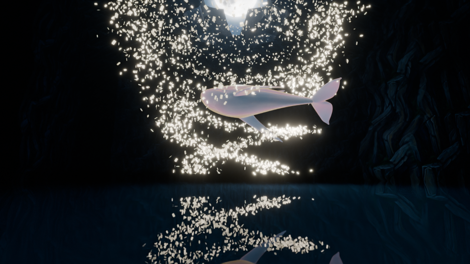 [`G_C16_mirror.png`](keyframe-test/refs/G_C16_mirror.png) `dm/episode-01/ending/v8/keyframe-test/refs/G_C16_mirror.png` | 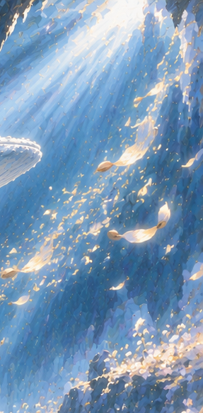 [`style_ref_painterly.png`](keyframe-test/refs/style_ref_painterly.png) `dm/episode-01/ending/v8/keyframe-test/refs/style_ref_painterly.png` |
| 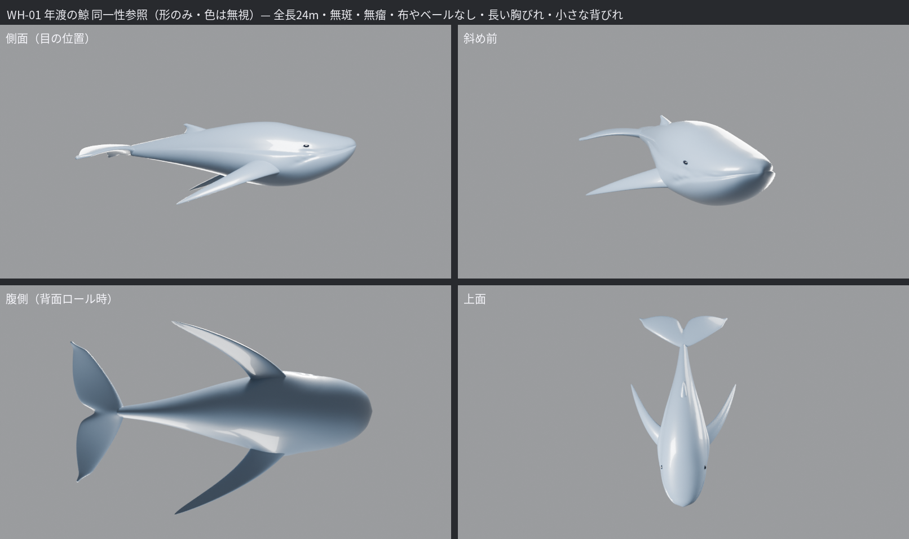 [`WH01_identity_sheet.png`](keyframe-test/refs/WH01_identity_sheet.png) `dm/episode-01/ending/v8/keyframe-test/refs/WH01_identity_sheet.png` |   |

<strong>A8｜診断画像・比較レンダー（3点）</strong>

| プレビュー／GitHub画像ファイル | プレビュー／GitHub画像ファイル |
| :--- | :--- |
| 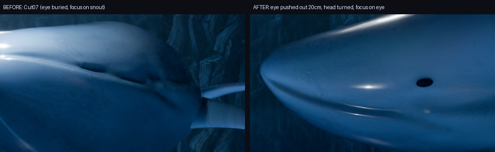 [`cmp_cut07.png`](diagnosis/cmp_cut07.png) `dm/episode-01/ending/v8/diagnosis/cmp_cut07.png` | 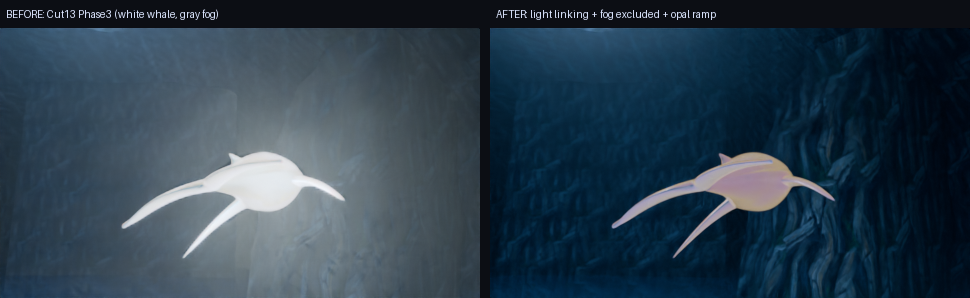 [`cmp_phase3_final.png`](diagnosis/cmp_phase3_final.png) `dm/episode-01/ending/v8/diagnosis/cmp_phase3_final.png` |
| 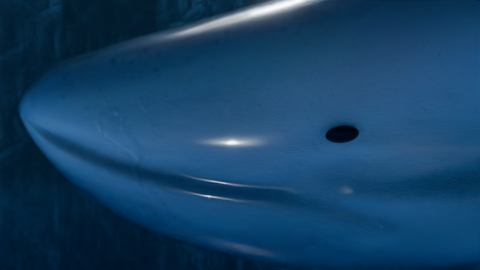 [`eye_glance_probe.png`](diagnosis/eye_glance_probe.png) `dm/episode-01/ending/v8/diagnosis/eye_glance_probe.png` |   |

<strong>A9｜初期アーカイブの当時採用画像（現行C番号とは別系統）（10点）</strong>

| プレビュー／GitHub画像ファイル | プレビュー／GitHub画像ファイル |
| :--- | :--- |
| 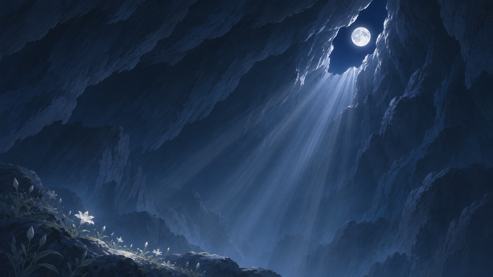 [`CUT02_KEY_moon.png`](../images/adopted/CUT02_KEY_moon.png) `dm/episode-01/ending/images/adopted/CUT02_KEY_moon.png` |  [`CUT03_KEY_flower.png`](../images/adopted/CUT03_KEY_flower.png) `dm/episode-01/ending/images/adopted/CUT03_KEY_flower.png` |
| 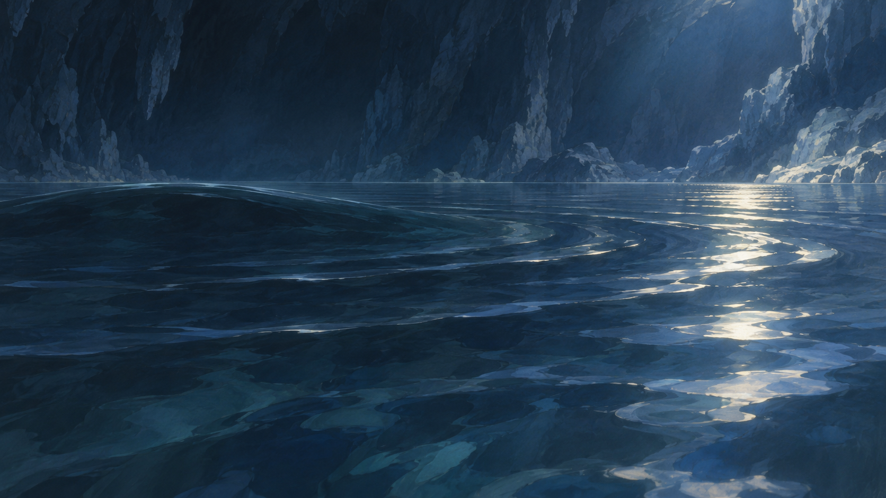 [`CUT04_KEY_water_shadow.png`](../images/adopted/CUT04_KEY_water_shadow.png) `dm/episode-01/ending/images/adopted/CUT04_KEY_water_shadow.png` | 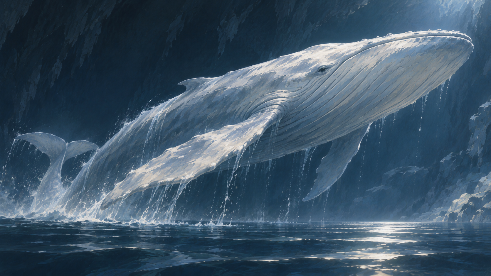 [`CUT05_KEY_whale_emerges.png`](../images/adopted/CUT05_KEY_whale_emerges.png) `dm/episode-01/ending/images/adopted/CUT05_KEY_whale_emerges.png` |
| 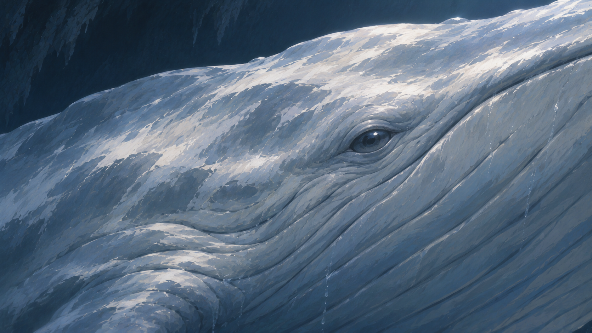 [`CUT06_KEY_eye.png`](../images/adopted/CUT06_KEY_eye.png) `dm/episode-01/ending/images/adopted/CUT06_KEY_eye.png` |  [`CUT07_END.png`](../images/adopted/CUT07_END.png) `dm/episode-01/ending/images/adopted/CUT07_END.png` |
| 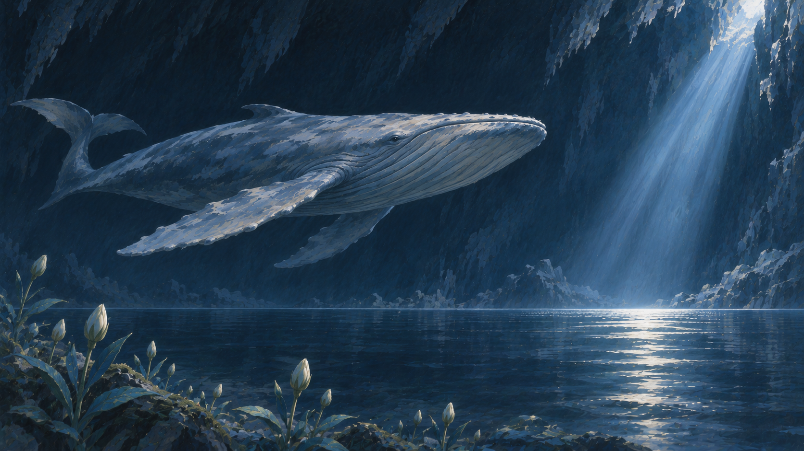 [`CUT07_START.png`](../images/adopted/CUT07_START.png) `dm/episode-01/ending/images/adopted/CUT07_START.png` | 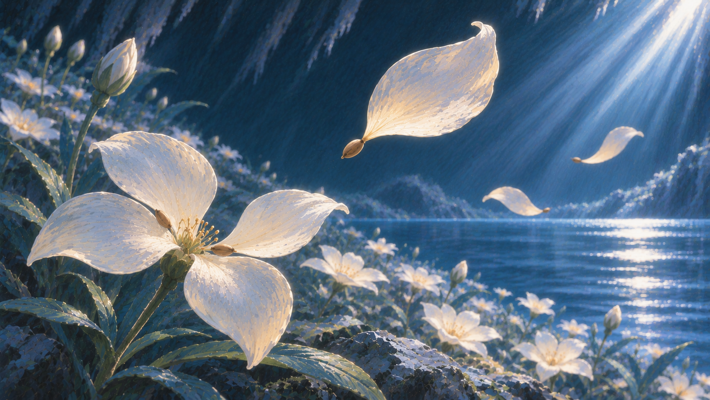 [`CUT08_KEY_petal_release.png`](../images/adopted/CUT08_KEY_petal_release.png) `dm/episode-01/ending/images/adopted/CUT08_KEY_petal_release.png` |
| 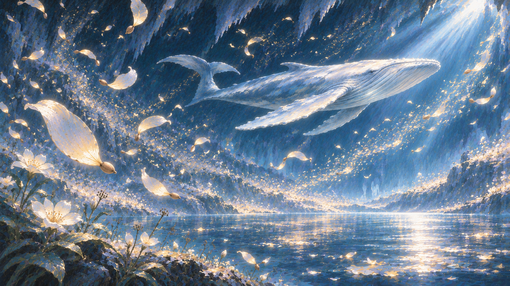 [`CUT09_KEY_climax.png`](../images/adopted/CUT09_KEY_climax.png) `dm/episode-01/ending/images/adopted/CUT09_KEY_climax.png` | 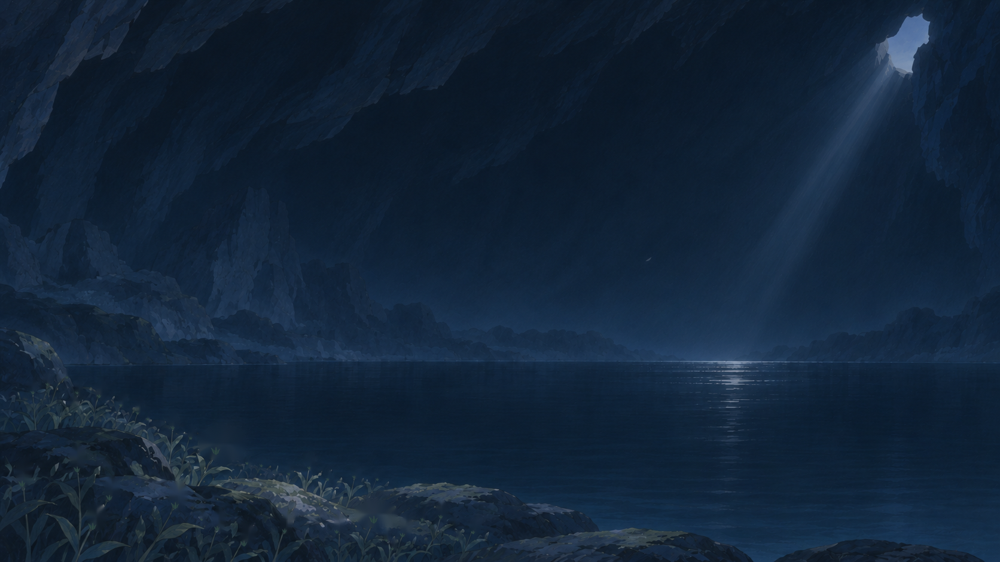 [`CUT10_END_moonlight_dimmed.png`](../images/adopted/CUT10_END_moonlight_dimmed.png) `dm/episode-01/ending/images/adopted/CUT10_END_moonlight_dimmed.png` |

<strong>A10｜初期アーカイブの別案・候補（現行C番号とは別系統）（3点）</strong>

| プレビュー／GitHub画像ファイル | プレビュー／GitHub画像ファイル |
| :--- | :--- |
| 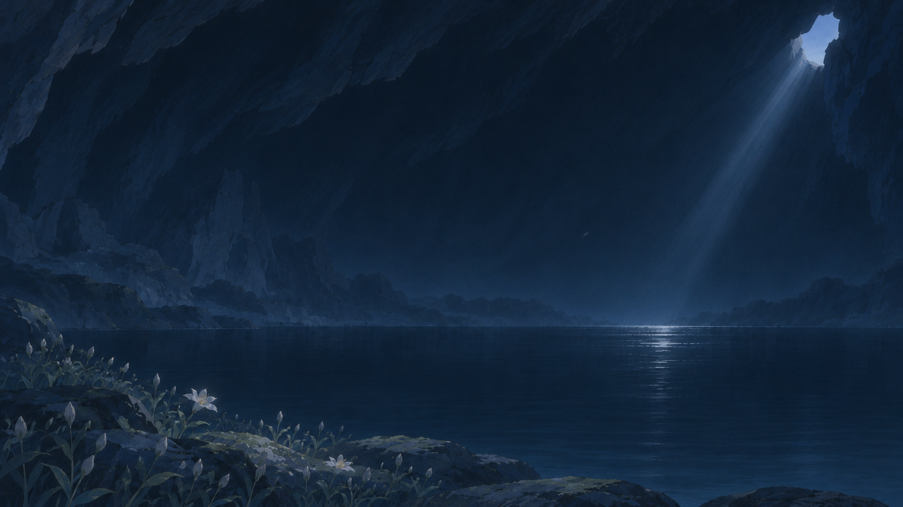 [`CUT01_END_matching_source_candidate.png`](../images/alternate/CUT01_END_matching_source_candidate.png) `dm/episode-01/ending/images/alternate/CUT01_END_matching_source_candidate.png` | 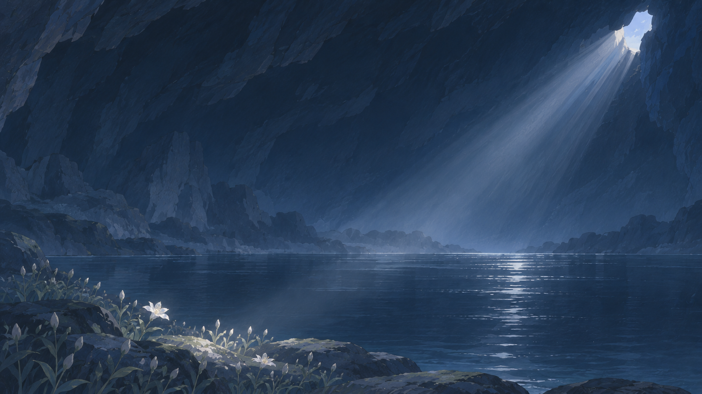 [`CUT01_ENV_opening_candidate.png`](../images/alternate/CUT01_ENV_opening_candidate.png) `dm/episode-01/ending/images/alternate/CUT01_ENV_opening_candidate.png` |
| 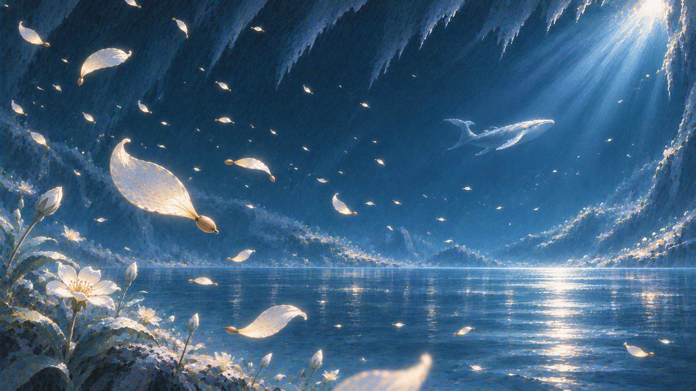 [`CUT10_START_departure.png`](../images/alternate/CUT10_START_departure.png) `dm/episode-01/ending/images/alternate/CUT10_START_departure.png` |   |

<strong>A11｜旧V7・90秒案の16カット静止画（16点）</strong>

| プレビュー／GitHub画像ファイル | プレビュー／GitHub画像ファイル |
| :--- | :--- |
| 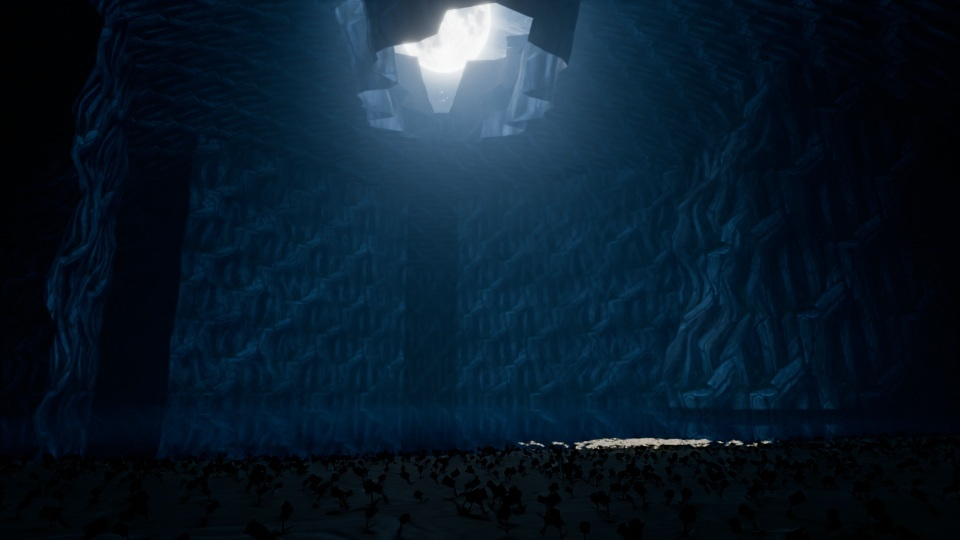 [`cut01_02s_open_cam_a.jpg`](../video-pipeline/v7_blender_cycles/out/cuts_16_90s/cut01_02s_open_cam_a.jpg) `dm/episode-01/ending/video-pipeline/v7_blender_cycles/out/cuts_16_90s/cut01_02s_open_cam_a.jpg` | 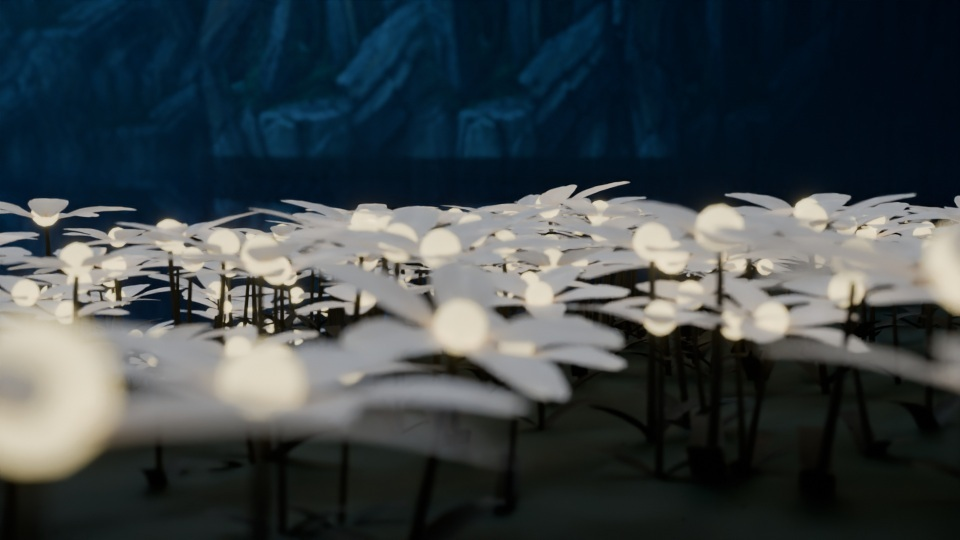 [`cut02_08s_p0_flower_macro.jpg`](../video-pipeline/v7_blender_cycles/out/cuts_16_90s/cut02_08s_p0_flower_macro.jpg) `dm/episode-01/ending/video-pipeline/v7_blender_cycles/out/cuts_16_90s/cut02_08s_p0_flower_macro.jpg` |
| 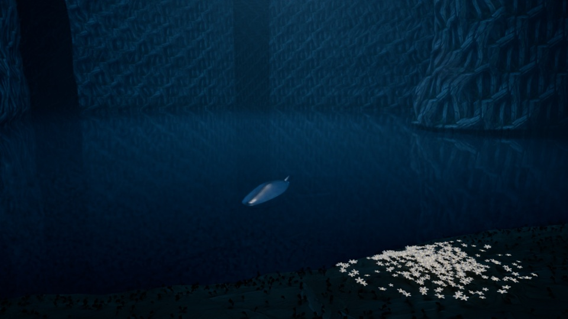 [`cut03_16s_lake_ripples_shadow.jpg`](../video-pipeline/v7_blender_cycles/out/cuts_16_90s/cut03_16s_lake_ripples_shadow.jpg) `dm/episode-01/ending/video-pipeline/v7_blender_cycles/out/cuts_16_90s/cut03_16s_lake_ripples_shadow.jpg` | 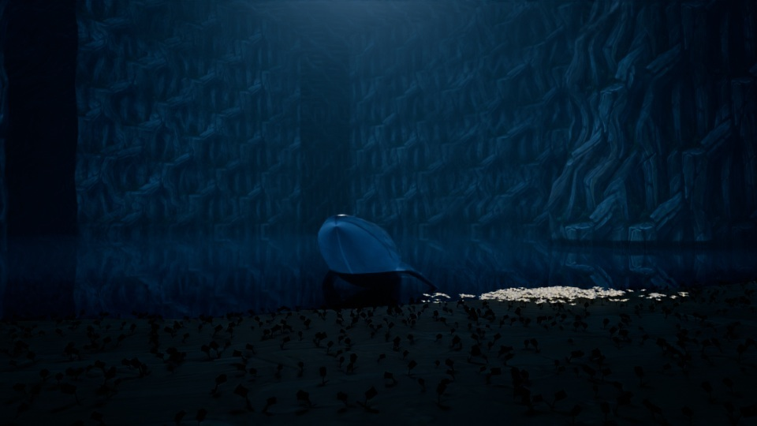 [`cut04_21s_silent_breach.jpg`](../video-pipeline/v7_blender_cycles/out/cuts_16_90s/cut04_21s_silent_breach.jpg) `dm/episode-01/ending/video-pipeline/v7_blender_cycles/out/cuts_16_90s/cut04_21s_silent_breach.jpg` |
| 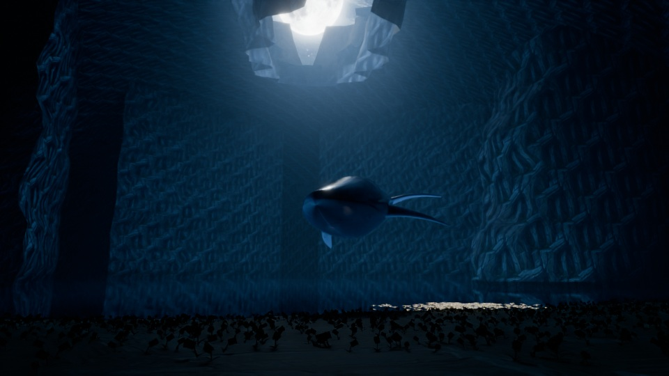 [`cut05_25s_foreground_approach.jpg`](../video-pipeline/v7_blender_cycles/out/cuts_16_90s/cut05_25s_foreground_approach.jpg) `dm/episode-01/ending/video-pipeline/v7_blender_cycles/out/cuts_16_90s/cut05_25s_foreground_approach.jpg` | 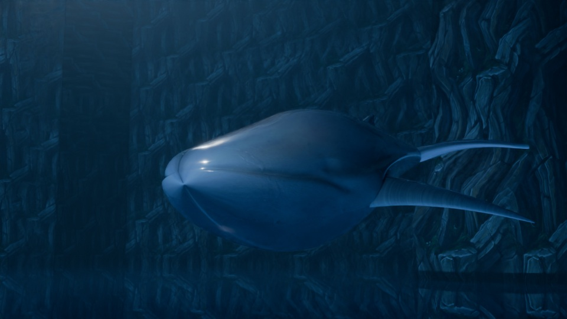 [`cut06_28s_heigei_closeup.jpg`](../video-pipeline/v7_blender_cycles/out/cuts_16_90s/cut06_28s_heigei_closeup.jpg) `dm/episode-01/ending/video-pipeline/v7_blender_cycles/out/cuts_16_90s/cut06_28s_heigei_closeup.jpg` |
| 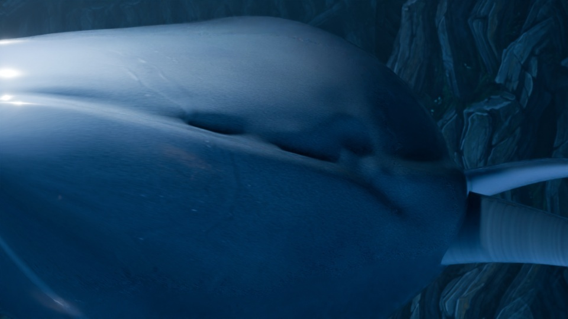 [`cut07_30s_serene_eye_hold.jpg`](../video-pipeline/v7_blender_cycles/out/cuts_16_90s/cut07_30s_serene_eye_hold.jpg) `dm/episode-01/ending/video-pipeline/v7_blender_cycles/out/cuts_16_90s/cut07_30s_serene_eye_hold.jpg` | 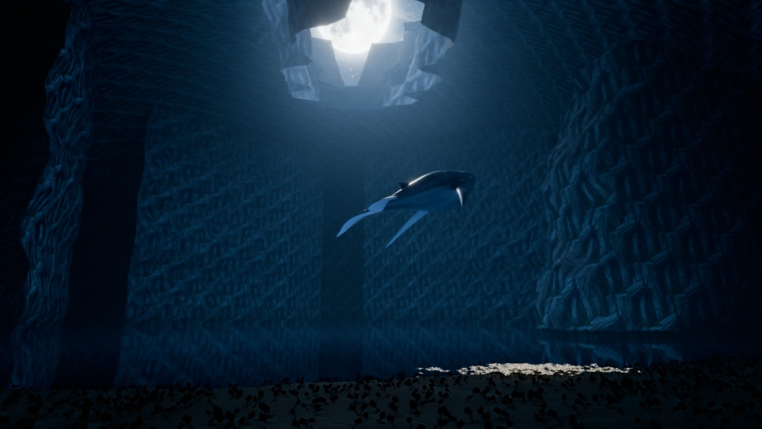 [`cut08_34s_graceful_turnback.jpg`](../video-pipeline/v7_blender_cycles/out/cuts_16_90s/cut08_34s_graceful_turnback.jpg) `dm/episode-01/ending/video-pipeline/v7_blender_cycles/out/cuts_16_90s/cut08_34s_graceful_turnback.jpg` |
| 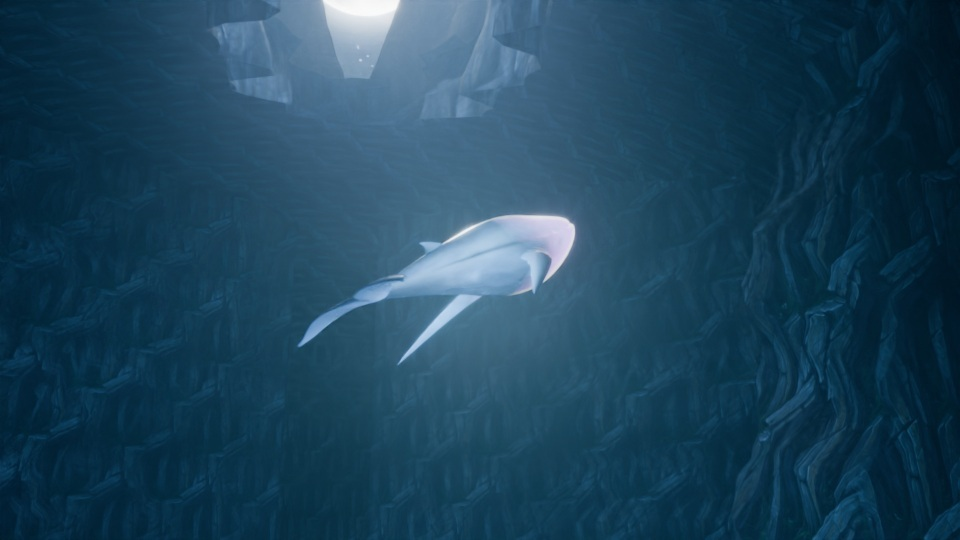 [`cut09_38s_first_spark_snout.jpg`](../video-pipeline/v7_blender_cycles/out/cuts_16_90s/cut09_38s_first_spark_snout.jpg) `dm/episode-01/ending/video-pipeline/v7_blender_cycles/out/cuts_16_90s/cut09_38s_first_spark_snout.jpg` |  [`cut10_41s_phase1_ignition_wave.jpg`](../video-pipeline/v7_blender_cycles/out/cuts_16_90s/cut10_41s_phase1_ignition_wave.jpg) `dm/episode-01/ending/video-pipeline/v7_blender_cycles/out/cuts_16_90s/cut10_41s_phase1_ignition_wave.jpg` |
|  [`cut11_43s_mirror_lake_symmetry.jpg`](../video-pipeline/v7_blender_cycles/out/cuts_16_90s/cut11_43s_mirror_lake_symmetry.jpg) `dm/episode-01/ending/video-pipeline/v7_blender_cycles/out/cuts_16_90s/cut11_43s_mirror_lake_symmetry.jpg` |  [`cut12_45s_title_golden_snow_rise.jpg`](../video-pipeline/v7_blender_cycles/out/cuts_16_90s/cut12_45s_title_golden_snow_rise.jpg) `dm/episode-01/ending/video-pipeline/v7_blender_cycles/out/cuts_16_90s/cut12_45s_title_golden_snow_rise.jpg` |
|  [`cut13_51s_airborne_tracking.jpg`](../video-pipeline/v7_blender_cycles/out/cuts_16_90s/cut13_51s_airborne_tracking.jpg) `dm/episode-01/ending/video-pipeline/v7_blender_cycles/out/cuts_16_90s/cut13_51s_airborne_tracking.jpg` |  [`cut14_59s_grand_cavern_panorama.jpg`](../video-pipeline/v7_blender_cycles/out/cuts_16_90s/cut14_59s_grand_cavern_panorama.jpg) `dm/episode-01/ending/video-pipeline/v7_blender_cycles/out/cuts_16_90s/cut14_59s_grand_cavern_panorama.jpg` |
|  [`cut15_73s_exit_c_behind_r1.jpg`](../video-pipeline/v7_blender_cycles/out/cuts_16_90s/cut15_73s_exit_c_behind_r1.jpg) `dm/episode-01/ending/video-pipeline/v7_blender_cycles/out/cuts_16_90s/cut15_73s_exit_c_behind_r1.jpg` |  [`cut16_86s_aftermath_cam_a.jpg`](../video-pipeline/v7_blender_cycles/out/cuts_16_90s/cut16_86s_aftermath_cam_a.jpg) `dm/episode-01/ending/video-pipeline/v7_blender_cycles/out/cuts_16_90s/cut16_86s_aftermath_cam_a.jpg` |

<strong>A12｜旧V7の一覧シート・設計・Lookdev画像（7点）</strong>

| プレビュー／GitHub画像ファイル | プレビュー／GitHub画像ファイル |
| :--- | :--- |
|  [`v7_master_16cut_90s_sheet.png`](../video-pipeline/v7_blender_cycles/out/v7_master_16cut_90s_sheet.png) `dm/episode-01/ending/video-pipeline/v7_blender_cycles/out/v7_master_16cut_90s_sheet.png` |  [`v7_master_90s_storyboard_sheet.png`](../video-pipeline/v7_blender_cycles/out/v7_master_90s_storyboard_sheet.png) `dm/episode-01/ending/video-pipeline/v7_blender_cycles/out/v7_master_90s_storyboard_sheet.png` |
|  [`v7_step2_camera_whale_curves.png`](../video-pipeline/v7_blender_cycles/out/v7_step2_camera_whale_curves.png) `dm/episode-01/ending/video-pipeline/v7_blender_cycles/out/v7_step2_camera_whale_curves.png` |  [`v7_step2_layout_plan_elevation.png`](../video-pipeline/v7_blender_cycles/out/v7_step2_layout_plan_elevation.png) `dm/episode-01/ending/video-pipeline/v7_blender_cycles/out/v7_step2_layout_plan_elevation.png` |
|  [`v7_step5_lookdev_5sheet.png`](../video-pipeline/v7_blender_cycles/out/v7_step5_lookdev_5sheet.png) `dm/episode-01/ending/video-pipeline/v7_blender_cycles/out/v7_step5_lookdev_5sheet.png` |  [`v7_step5b_director_cuts_4sheet.png`](../video-pipeline/v7_blender_cycles/out/v7_step5b_director_cuts_4sheet.png) `dm/episode-01/ending/video-pipeline/v7_blender_cycles/out/v7_step5b_director_cuts_4sheet.png` |
|  [`v7_step5c_new8_sheet.png`](../video-pipeline/v7_blender_cycles/out/v7_step5c_new8_sheet.png) `dm/episode-01/ending/video-pipeline/v7_blender_cycles/out/v7_step5c_new8_sheet.png` |   |

<strong>A13｜旧V7の素材テクスチャ・背景素材（5点）</strong>

| プレビュー／GitHub画像ファイル | プレビュー／GitHub画像ファイル |
| :--- | :--- |
|  [`anime_cliff_albedo.jpg`](../video-pipeline/v7_blender_cycles/textures/anime_cliff_albedo.jpg) `dm/episode-01/ending/video-pipeline/v7_blender_cycles/textures/anime_cliff_albedo.jpg` |  [`anime_cliff_normal.png`](../video-pipeline/v7_blender_cycles/textures/anime_cliff_normal.png) `dm/episode-01/ending/video-pipeline/v7_blender_cycles/textures/anime_cliff_normal.png` |
|  [`moon_sky.jpg`](../video-pipeline/v7_blender_cycles/textures/moon_sky.jpg) `dm/episode-01/ending/video-pipeline/v7_blender_cycles/textures/moon_sky.jpg` |  [`petal_rgba.png`](../video-pipeline/v7_blender_cycles/textures/petal_rgba.png) `dm/episode-01/ending/video-pipeline/v7_blender_cycles/textures/petal_rgba.png` |
|  [`whale_skin_albedo.jpg`](../video-pipeline/v7_blender_cycles/textures/whale_skin_albedo.jpg) `dm/episode-01/ending/video-pipeline/v7_blender_cycles/textures/whale_skin_albedo.jpg` |   |

<strong>A14｜旧退場経路のSVG検討図（1点）</strong>

| プレビュー／GitHub画像ファイル | プレビュー／GitHub画像ファイル |
| :--- | :--- |
|  [`exit-c-study.svg`](../exit-c-study.svg) `dm/episode-01/ending/exit-c-study.svg` |   |

### B. ルオスエンの公開Webサイト素材（170点）

**本編『空に降る雪』の原画ではない。** リポジトリ全画像の網羅のため、別分類で収録する。

<strong>B1｜GitHub Pages用の世界観・街・シナリオ画像（原寸／元ファイル）（82点）</strong>

| プレビュー／GitHub画像ファイル | プレビュー／GitHub画像ファイル |
| :--- | :--- |
|  [`free-city-map-white.webp`](../../../../assets/free-city-map-white.webp) `assets/free-city-map-white.webp` |  [`free-city-map.svg`](../../../../assets/free-city-map.svg) `assets/free-city-map.svg` |
|  [`reuna-history-civilization-past.webp`](../../../../assets/reuna-history-civilization-past.webp) `assets/reuna-history-civilization-past.webp` |  [`reuna-history-fracture.webp`](../../../../assets/reuna-history-fracture.webp) `assets/reuna-history-fracture.webp` |
|  [`reuna-history-reflow.webp`](../../../../assets/reuna-history-reflow.webp) `assets/reuna-history-reflow.webp` |  [`reuna-story-civilization.webp`](../../../../assets/reuna-story-civilization.webp) `assets/reuna-story-civilization.webp` |
|  [`reuna-story-dualport.webp`](../../../../assets/reuna-story-dualport.webp) `assets/reuna-story-dualport.webp` |  [`reuna-story-freedom.webp`](../../../../assets/reuna-story-freedom.webp) `assets/reuna-story-freedom.webp` |
|  [`reuna-story-stone.webp`](../../../../assets/reuna-story-stone.webp) `assets/reuna-story-stone.webp` |  [`reuna-story-threshold.webp`](../../../../assets/reuna-story-threshold.webp) `assets/reuna-story-threshold.webp` |
|  [`reuna-story-underground.webp`](../../../../assets/reuna-story-underground.webp) `assets/reuna-story-underground.webp` |  [`reuna-story-upheaval.webp`](../../../../assets/reuna-story-upheaval.webp) `assets/reuna-story-upheaval.webp` |
|  [`reuna-turn-01.webp`](../../../../assets/reuna-turn-01.webp) `assets/reuna-turn-01.webp` |  [`reuna-turn-02.webp`](../../../../assets/reuna-turn-02.webp) `assets/reuna-turn-02.webp` |
|  [`reuna-turn-03.webp`](../../../../assets/reuna-turn-03.webp) `assets/reuna-turn-03.webp` |  [`reuna-turn-04.webp`](../../../../assets/reuna-turn-04.webp) `assets/reuna-turn-04.webp` |
|  [`reuna-turn-05.webp`](../../../../assets/reuna-turn-05.webp) `assets/reuna-turn-05.webp` |  [`reuna-turn-06.webp`](../../../../assets/reuna-turn-06.webp) `assets/reuna-turn-06.webp` |
|  [`reuna-turn-07.webp`](../../../../assets/reuna-turn-07.webp) `assets/reuna-turn-07.webp` |  [`reuna-turn-08.webp`](../../../../assets/reuna-turn-08.webp) `assets/reuna-turn-08.webp` |
|  [`reuna-turn-09-crop.webp`](../../../../assets/reuna-turn-09-crop.webp) `assets/reuna-turn-09-crop.webp` |  [`reuna-turn-09.webp`](../../../../assets/reuna-turn-09.webp) `assets/reuna-turn-09.webp` |
|  [`reuna-turn-10.webp`](../../../../assets/reuna-turn-10.webp) `assets/reuna-turn-10.webp` |  [`ruosuen-concept-city-03.webp`](../../../../assets/ruosuen-concept-city-03.webp) `assets/ruosuen-concept-city-03.webp` |
|  [`ruosuen-depths.svg`](../../../../assets/ruosuen-depths.svg) `assets/ruosuen-depths.svg` |  [`ruosuen-film-airfleet-muted.webp`](../../../../assets/ruosuen-film-airfleet-muted.webp) `assets/ruosuen-film-airfleet-muted.webp` |
|  [`ruosuen-film-airfleet.webp`](../../../../assets/ruosuen-film-airfleet.webp) `assets/ruosuen-film-airfleet.webp` |  [`ruosuen-film-airharbor.webp`](../../../../assets/ruosuen-film-airharbor.webp) `assets/ruosuen-film-airharbor.webp` |
|  [`ruosuen-film-departure.webp`](../../../../assets/ruosuen-film-departure.webp) `assets/ruosuen-film-departure.webp` |  [`ruosuen-film-manastones.webp`](../../../../assets/ruosuen-film-manastones.webp) `assets/ruosuen-film-manastones.webp` |
|  [`ruosuen-film-possibility.webp`](../../../../assets/ruosuen-film-possibility.webp) `assets/ruosuen-film-possibility.webp` |  [`ruosuen-film-riverport.webp`](../../../../assets/ruosuen-film-riverport.webp) `assets/ruosuen-film-riverport.webp` |
|  [`ruosuen-film-rumor.webp`](../../../../assets/ruosuen-film-rumor.webp) `assets/ruosuen-film-rumor.webp` |  [`ruosuen-film-survey.webp`](../../../../assets/ruosuen-film-survey.webp) `assets/ruosuen-film-survey.webp` |
|  [`ruosuen-film-vista.webp`](../../../../assets/ruosuen-film-vista.webp) `assets/ruosuen-film-vista.webp` |  [`ruosuen-first-adventure-1200.webp`](../../../../assets/ruosuen-first-adventure-1200.webp) `assets/ruosuen-first-adventure-1200.webp` |
|  [`ruosuen-first-adventure-1672.webp`](../../../../assets/ruosuen-first-adventure-1672.webp) `assets/ruosuen-first-adventure-1672.webp` |  [`ruosuen-first-adventure-800.webp`](../../../../assets/ruosuen-first-adventure-800.webp) `assets/ruosuen-first-adventure-800.webp` |
|  [`ruosuen-first-adventure-b.webp`](../../../../assets/ruosuen-first-adventure-b.webp) `assets/ruosuen-first-adventure-b.webp` |  [`ruosuen-garan-concept.webp`](../../../../assets/ruosuen-garan-concept.webp) `assets/ruosuen-garan-concept.webp` |
|  [`ruosuen-manastone-discovery.webp`](../../../../assets/ruosuen-manastone-discovery.webp) `assets/ruosuen-manastone-discovery.webp` |  [`ruosuen-manastone-frontier.webp`](../../../../assets/ruosuen-manastone-frontier.webp) `assets/ruosuen-manastone-frontier.webp` |
|  [`ruosuen-manastone-life.webp`](../../../../assets/ruosuen-manastone-life.webp) `assets/ruosuen-manastone-life.webp` |  [`ruosuen-manastone-shortage.webp`](../../../../assets/ruosuen-manastone-shortage.webp) `assets/ruosuen-manastone-shortage.webp` |
|  [`ruosuen-seiro-oil.webp`](../../../../assets/ruosuen-seiro-oil.webp) `assets/ruosuen-seiro-oil.webp` |  [`ruosuen-seled-etching.webp`](../../../../assets/ruosuen-seled-etching.webp) `assets/ruosuen-seled-etching.webp` |
|  [`ruosuen-shinsei-concept.webp`](../../../../assets/ruosuen-shinsei-concept.webp) `assets/ruosuen-shinsei-concept.webp` |  [`ruosuen-sokozora-gouache.webp`](../../../../assets/ruosuen-sokozora-gouache.webp) `assets/ruosuen-sokozora-gouache.webp` |
|  [`ruosuen-street-cargo-etching.webp`](../../../../assets/ruosuen-street-cargo-etching.webp) `assets/ruosuen-street-cargo-etching.webp` |  [`ruosuen-street-market-gouache.webp`](../../../../assets/ruosuen-street-market-gouache.webp) `assets/ruosuen-street-market-gouache.webp` |
|  [`ruosuen-street-night-oil.webp`](../../../../assets/ruosuen-street-night-oil.webp) `assets/ruosuen-street-night-oil.webp` |  [`ruosuen-street-tavern-watercolor.webp`](../../../../assets/ruosuen-street-tavern-watercolor.webp) `assets/ruosuen-street-tavern-watercolor.webp` |
|  [`ruosuen-tavern-watercolor.webp`](../../../../assets/ruosuen-tavern-watercolor.webp) `assets/ruosuen-tavern-watercolor.webp` |  [`ruosuen-underground-world.webp`](../../../../assets/ruosuen-underground-world.webp) `assets/ruosuen-underground-world.webp` |
|  [`ruosuen-walk-church-20261117.webp`](../../../../assets/ruosuen-walk-church-20261117.webp) `assets/ruosuen-walk-church-20261117.webp` |  [`ruosuen-walk-church.webp`](../../../../assets/ruosuen-walk-church.webp) `assets/ruosuen-walk-church.webp` |
|  [`ruosuen-walk-labyrinth-battle-v2.webp`](../../../../assets/ruosuen-walk-labyrinth-battle-v2.webp) `assets/ruosuen-walk-labyrinth-battle-v2.webp` |  [`ruosuen-walk-labyrinth-discovery-20261117.webp`](../../../../assets/ruosuen-walk-labyrinth-discovery-20261117.webp) `assets/ruosuen-walk-labyrinth-discovery-20261117.webp` |
|  [`ruosuen-walk-labyrinth-exploration-v3.webp`](../../../../assets/ruosuen-walk-labyrinth-exploration-v3.webp) `assets/ruosuen-walk-labyrinth-exploration-v3.webp` |  [`ruosuen-walk-labyrinth-fleet-v2.webp`](../../../../assets/ruosuen-walk-labyrinth-fleet-v2.webp) `assets/ruosuen-walk-labyrinth-fleet-v2.webp` |
|  [`ruosuen-walk-labyrinth-panorama-20261117.webp`](../../../../assets/ruosuen-walk-labyrinth-panorama-20261117.webp) `assets/ruosuen-walk-labyrinth-panorama-20261117.webp` |  [`ruosuen-walk-labyrinth-ruins-v2.webp`](../../../../assets/ruosuen-walk-labyrinth-ruins-v2.webp) `assets/ruosuen-walk-labyrinth-ruins-v2.webp` |
|  [`ruosuen-walk-labyrinth-survey-20261117.webp`](../../../../assets/ruosuen-walk-labyrinth-survey-20261117.webp) `assets/ruosuen-walk-labyrinth-survey-20261117.webp` |  [`ruosuen-walk-maps-20261117-crop.webp`](../../../../assets/ruosuen-walk-maps-20261117-crop.webp) `assets/ruosuen-walk-maps-20261117-crop.webp` |
|  [`ruosuen-walk-maps-20261117.webp`](../../../../assets/ruosuen-walk-maps-20261117.webp) `assets/ruosuen-walk-maps-20261117.webp` |  [`ruosuen-walk-maps.webp`](../../../../assets/ruosuen-walk-maps.webp) `assets/ruosuen-walk-maps.webp` |
|  [`ruosuen-walk-matenrou-20261117-crop.webp`](../../../../assets/ruosuen-walk-matenrou-20261117-crop.webp) `assets/ruosuen-walk-matenrou-20261117-crop.webp` |  [`ruosuen-walk-matenrou-20261117.webp`](../../../../assets/ruosuen-walk-matenrou-20261117.webp) `assets/ruosuen-walk-matenrou-20261117.webp` |
|  [`ruosuen-walk-mole-inn-20261117-crop.webp`](../../../../assets/ruosuen-walk-mole-inn-20261117-crop.webp) `assets/ruosuen-walk-mole-inn-20261117-crop.webp` |  [`ruosuen-walk-mole-inn-20261117.webp`](../../../../assets/ruosuen-walk-mole-inn-20261117.webp) `assets/ruosuen-walk-mole-inn-20261117.webp` |
|  [`ruosuen-walk-mole-trading-20261117-crop.webp`](../../../../assets/ruosuen-walk-mole-trading-20261117-crop.webp) `assets/ruosuen-walk-mole-trading-20261117-crop.webp` |  [`ruosuen-walk-mole-trading-20261117.webp`](../../../../assets/ruosuen-walk-mole-trading-20261117.webp) `assets/ruosuen-walk-mole-trading-20261117.webp` |
|  [`ruosuen-walk-quentha-20261117.webp`](../../../../assets/ruosuen-walk-quentha-20261117.webp) `assets/ruosuen-walk-quentha-20261117.webp` |  [`ruosuen-walk-quentha-forest-20261117.webp`](../../../../assets/ruosuen-walk-quentha-forest-20261117.webp) `assets/ruosuen-walk-quentha-forest-20261117.webp` |
|  [`ruosuen-walk-shipyard-20261117.webp`](../../../../assets/ruosuen-walk-shipyard-20261117.webp) `assets/ruosuen-walk-shipyard-20261117.webp` |  [`ruosuen-walk-shipyard.webp`](../../../../assets/ruosuen-walk-shipyard.webp) `assets/ruosuen-walk-shipyard.webp` |
|  [`ruosuen-walk-tavern-20261117.webp`](../../../../assets/ruosuen-walk-tavern-20261117.webp) `assets/ruosuen-walk-tavern-20261117.webp` |  [`ruosuen-walk-tavern.webp`](../../../../assets/ruosuen-walk-tavern.webp) `assets/ruosuen-walk-tavern.webp` |
|  [`ruosuen-walk-tower-20261117.webp`](../../../../assets/ruosuen-walk-tower-20261117.webp) `assets/ruosuen-walk-tower-20261117.webp` |  [`ruosuen-walk-tower.webp`](../../../../assets/ruosuen-walk-tower.webp) `assets/ruosuen-walk-tower.webp` |
|  [`ruosuen-walk-workshop-20261117.webp`](../../../../assets/ruosuen-walk-workshop-20261117.webp) `assets/ruosuen-walk-workshop-20261117.webp` |  [`ruosuen-walk-workshop.webp`](../../../../assets/ruosuen-walk-workshop.webp) `assets/ruosuen-walk-workshop.webp` |

<strong>B2｜GitHub Pages用のレスポンシブ画像（解像度違い・トリミングを含む）（88点）</strong>

| プレビュー／GitHub画像ファイル | プレビュー／GitHub画像ファイル |
| :--- | :--- |
|  [`reuna-story-threshold-1200.webp`](../../../../assets/responsive/reuna-story-threshold-1200.webp) `assets/responsive/reuna-story-threshold-1200.webp` |  [`reuna-story-threshold-800.webp`](../../../../assets/responsive/reuna-story-threshold-800.webp) `assets/responsive/reuna-story-threshold-800.webp` |
|  [`reuna-turn-01-1200.webp`](../../../../assets/responsive/reuna-turn-01-1200.webp) `assets/responsive/reuna-turn-01-1200.webp` |  [`reuna-turn-01-800.webp`](../../../../assets/responsive/reuna-turn-01-800.webp) `assets/responsive/reuna-turn-01-800.webp` |
|  [`reuna-turn-02-1200.webp`](../../../../assets/responsive/reuna-turn-02-1200.webp) `assets/responsive/reuna-turn-02-1200.webp` |  [`reuna-turn-02-800.webp`](../../../../assets/responsive/reuna-turn-02-800.webp) `assets/responsive/reuna-turn-02-800.webp` |
|  [`reuna-turn-03-1200.webp`](../../../../assets/responsive/reuna-turn-03-1200.webp) `assets/responsive/reuna-turn-03-1200.webp` |  [`reuna-turn-03-800.webp`](../../../../assets/responsive/reuna-turn-03-800.webp) `assets/responsive/reuna-turn-03-800.webp` |
|  [`reuna-turn-04-1200.webp`](../../../../assets/responsive/reuna-turn-04-1200.webp) `assets/responsive/reuna-turn-04-1200.webp` |  [`reuna-turn-04-800.webp`](../../../../assets/responsive/reuna-turn-04-800.webp) `assets/responsive/reuna-turn-04-800.webp` |
|  [`reuna-turn-05-1200.webp`](../../../../assets/responsive/reuna-turn-05-1200.webp) `assets/responsive/reuna-turn-05-1200.webp` |  [`reuna-turn-05-800.webp`](../../../../assets/responsive/reuna-turn-05-800.webp) `assets/responsive/reuna-turn-05-800.webp` |
|  [`reuna-turn-06-1200.webp`](../../../../assets/responsive/reuna-turn-06-1200.webp) `assets/responsive/reuna-turn-06-1200.webp` |  [`reuna-turn-06-800.webp`](../../../../assets/responsive/reuna-turn-06-800.webp) `assets/responsive/reuna-turn-06-800.webp` |
|  [`reuna-turn-07-1200.webp`](../../../../assets/responsive/reuna-turn-07-1200.webp) `assets/responsive/reuna-turn-07-1200.webp` |  [`reuna-turn-07-800.webp`](../../../../assets/responsive/reuna-turn-07-800.webp) `assets/responsive/reuna-turn-07-800.webp` |
|  [`reuna-turn-08-1200.webp`](../../../../assets/responsive/reuna-turn-08-1200.webp) `assets/responsive/reuna-turn-08-1200.webp` |  [`reuna-turn-08-800.webp`](../../../../assets/responsive/reuna-turn-08-800.webp) `assets/responsive/reuna-turn-08-800.webp` |
|  [`reuna-turn-09-1200.webp`](../../../../assets/responsive/reuna-turn-09-1200.webp) `assets/responsive/reuna-turn-09-1200.webp` |  [`reuna-turn-09-800.webp`](../../../../assets/responsive/reuna-turn-09-800.webp) `assets/responsive/reuna-turn-09-800.webp` |
|  [`reuna-turn-09-crop-800.webp`](../../../../assets/responsive/reuna-turn-09-crop-800.webp) `assets/responsive/reuna-turn-09-crop-800.webp` |  [`reuna-turn-10-1200.webp`](../../../../assets/responsive/reuna-turn-10-1200.webp) `assets/responsive/reuna-turn-10-1200.webp` |
|  [`reuna-turn-10-800.webp`](../../../../assets/responsive/reuna-turn-10-800.webp) `assets/responsive/reuna-turn-10-800.webp` |  [`ruosuen-film-airfleet-1200.webp`](../../../../assets/responsive/ruosuen-film-airfleet-1200.webp) `assets/responsive/ruosuen-film-airfleet-1200.webp` |
|  [`ruosuen-film-airfleet-800.webp`](../../../../assets/responsive/ruosuen-film-airfleet-800.webp) `assets/responsive/ruosuen-film-airfleet-800.webp` |  [`ruosuen-film-airfleet-muted-1200.webp`](../../../../assets/responsive/ruosuen-film-airfleet-muted-1200.webp) `assets/responsive/ruosuen-film-airfleet-muted-1200.webp` |
|  [`ruosuen-film-airfleet-muted-800.webp`](../../../../assets/responsive/ruosuen-film-airfleet-muted-800.webp) `assets/responsive/ruosuen-film-airfleet-muted-800.webp` |  [`ruosuen-film-departure-1200.webp`](../../../../assets/responsive/ruosuen-film-departure-1200.webp) `assets/responsive/ruosuen-film-departure-1200.webp` |
|  [`ruosuen-film-departure-800.webp`](../../../../assets/responsive/ruosuen-film-departure-800.webp) `assets/responsive/ruosuen-film-departure-800.webp` |  [`ruosuen-film-manastones-1200.webp`](../../../../assets/responsive/ruosuen-film-manastones-1200.webp) `assets/responsive/ruosuen-film-manastones-1200.webp` |
|  [`ruosuen-film-manastones-800.webp`](../../../../assets/responsive/ruosuen-film-manastones-800.webp) `assets/responsive/ruosuen-film-manastones-800.webp` |  [`ruosuen-film-possibility-1200.webp`](../../../../assets/responsive/ruosuen-film-possibility-1200.webp) `assets/responsive/ruosuen-film-possibility-1200.webp` |
|  [`ruosuen-film-possibility-800.webp`](../../../../assets/responsive/ruosuen-film-possibility-800.webp) `assets/responsive/ruosuen-film-possibility-800.webp` |  [`ruosuen-film-rumor-1200.webp`](../../../../assets/responsive/ruosuen-film-rumor-1200.webp) `assets/responsive/ruosuen-film-rumor-1200.webp` |
|  [`ruosuen-film-rumor-800.webp`](../../../../assets/responsive/ruosuen-film-rumor-800.webp) `assets/responsive/ruosuen-film-rumor-800.webp` |  [`ruosuen-film-survey-1200.webp`](../../../../assets/responsive/ruosuen-film-survey-1200.webp) `assets/responsive/ruosuen-film-survey-1200.webp` |
|  [`ruosuen-film-survey-800.webp`](../../../../assets/responsive/ruosuen-film-survey-800.webp) `assets/responsive/ruosuen-film-survey-800.webp` |  [`ruosuen-film-vista-1200.webp`](../../../../assets/responsive/ruosuen-film-vista-1200.webp) `assets/responsive/ruosuen-film-vista-1200.webp` |
|  [`ruosuen-film-vista-800.webp`](../../../../assets/responsive/ruosuen-film-vista-800.webp) `assets/responsive/ruosuen-film-vista-800.webp` |  [`ruosuen-first-adventure-b-1200.webp`](../../../../assets/responsive/ruosuen-first-adventure-b-1200.webp) `assets/responsive/ruosuen-first-adventure-b-1200.webp` |
|  [`ruosuen-first-adventure-b-800.webp`](../../../../assets/responsive/ruosuen-first-adventure-b-800.webp) `assets/responsive/ruosuen-first-adventure-b-800.webp` |  [`ruosuen-manastone-discovery-1200.webp`](../../../../assets/responsive/ruosuen-manastone-discovery-1200.webp) `assets/responsive/ruosuen-manastone-discovery-1200.webp` |
|  [`ruosuen-manastone-discovery-800.webp`](../../../../assets/responsive/ruosuen-manastone-discovery-800.webp) `assets/responsive/ruosuen-manastone-discovery-800.webp` |  [`ruosuen-manastone-life-1200.webp`](../../../../assets/responsive/ruosuen-manastone-life-1200.webp) `assets/responsive/ruosuen-manastone-life-1200.webp` |
|  [`ruosuen-manastone-life-800.webp`](../../../../assets/responsive/ruosuen-manastone-life-800.webp) `assets/responsive/ruosuen-manastone-life-800.webp` |  [`ruosuen-manastone-shortage-1200.webp`](../../../../assets/responsive/ruosuen-manastone-shortage-1200.webp) `assets/responsive/ruosuen-manastone-shortage-1200.webp` |
|  [`ruosuen-manastone-shortage-800.webp`](../../../../assets/responsive/ruosuen-manastone-shortage-800.webp) `assets/responsive/ruosuen-manastone-shortage-800.webp` |  [`ruosuen-street-night-oil-1200.webp`](../../../../assets/responsive/ruosuen-street-night-oil-1200.webp) `assets/responsive/ruosuen-street-night-oil-1200.webp` |
|  [`ruosuen-street-night-oil-800.webp`](../../../../assets/responsive/ruosuen-street-night-oil-800.webp) `assets/responsive/ruosuen-street-night-oil-800.webp` |  [`ruosuen-street-tavern-watercolor-1200.webp`](../../../../assets/responsive/ruosuen-street-tavern-watercolor-1200.webp) `assets/responsive/ruosuen-street-tavern-watercolor-1200.webp` |
|  [`ruosuen-street-tavern-watercolor-800.webp`](../../../../assets/responsive/ruosuen-street-tavern-watercolor-800.webp) `assets/responsive/ruosuen-street-tavern-watercolor-800.webp` |  [`ruosuen-underground-world-1200.webp`](../../../../assets/responsive/ruosuen-underground-world-1200.webp) `assets/responsive/ruosuen-underground-world-1200.webp` |
|  [`ruosuen-underground-world-800.webp`](../../../../assets/responsive/ruosuen-underground-world-800.webp) `assets/responsive/ruosuen-underground-world-800.webp` |  [`ruosuen-walk-church-20261117-1200.webp`](../../../../assets/responsive/ruosuen-walk-church-20261117-1200.webp) `assets/responsive/ruosuen-walk-church-20261117-1200.webp` |
|  [`ruosuen-walk-church-20261117-800.webp`](../../../../assets/responsive/ruosuen-walk-church-20261117-800.webp) `assets/responsive/ruosuen-walk-church-20261117-800.webp` |  [`ruosuen-walk-labyrinth-battle-v2-1200.webp`](../../../../assets/responsive/ruosuen-walk-labyrinth-battle-v2-1200.webp) `assets/responsive/ruosuen-walk-labyrinth-battle-v2-1200.webp` |
|  [`ruosuen-walk-labyrinth-battle-v2-800.webp`](../../../../assets/responsive/ruosuen-walk-labyrinth-battle-v2-800.webp) `assets/responsive/ruosuen-walk-labyrinth-battle-v2-800.webp` |  [`ruosuen-walk-labyrinth-discovery-20261117-1200.webp`](../../../../assets/responsive/ruosuen-walk-labyrinth-discovery-20261117-1200.webp) `assets/responsive/ruosuen-walk-labyrinth-discovery-20261117-1200.webp` |
|  [`ruosuen-walk-labyrinth-discovery-20261117-800.webp`](../../../../assets/responsive/ruosuen-walk-labyrinth-discovery-20261117-800.webp) `assets/responsive/ruosuen-walk-labyrinth-discovery-20261117-800.webp` |  [`ruosuen-walk-labyrinth-exploration-v3-1200.webp`](../../../../assets/responsive/ruosuen-walk-labyrinth-exploration-v3-1200.webp) `assets/responsive/ruosuen-walk-labyrinth-exploration-v3-1200.webp` |
|  [`ruosuen-walk-labyrinth-exploration-v3-800.webp`](../../../../assets/responsive/ruosuen-walk-labyrinth-exploration-v3-800.webp) `assets/responsive/ruosuen-walk-labyrinth-exploration-v3-800.webp` |  [`ruosuen-walk-labyrinth-fleet-v2-800.webp`](../../../../assets/responsive/ruosuen-walk-labyrinth-fleet-v2-800.webp) `assets/responsive/ruosuen-walk-labyrinth-fleet-v2-800.webp` |
|  [`ruosuen-walk-labyrinth-panorama-20261117-1200.webp`](../../../../assets/responsive/ruosuen-walk-labyrinth-panorama-20261117-1200.webp) `assets/responsive/ruosuen-walk-labyrinth-panorama-20261117-1200.webp` |  [`ruosuen-walk-labyrinth-panorama-20261117-800.webp`](../../../../assets/responsive/ruosuen-walk-labyrinth-panorama-20261117-800.webp) `assets/responsive/ruosuen-walk-labyrinth-panorama-20261117-800.webp` |
|  [`ruosuen-walk-labyrinth-ruins-v2-1200.webp`](../../../../assets/responsive/ruosuen-walk-labyrinth-ruins-v2-1200.webp) `assets/responsive/ruosuen-walk-labyrinth-ruins-v2-1200.webp` |  [`ruosuen-walk-labyrinth-ruins-v2-800.webp`](../../../../assets/responsive/ruosuen-walk-labyrinth-ruins-v2-800.webp) `assets/responsive/ruosuen-walk-labyrinth-ruins-v2-800.webp` |
|  [`ruosuen-walk-labyrinth-survey-20261117-1200.webp`](../../../../assets/responsive/ruosuen-walk-labyrinth-survey-20261117-1200.webp) `assets/responsive/ruosuen-walk-labyrinth-survey-20261117-1200.webp` |  [`ruosuen-walk-labyrinth-survey-20261117-800.webp`](../../../../assets/responsive/ruosuen-walk-labyrinth-survey-20261117-800.webp) `assets/responsive/ruosuen-walk-labyrinth-survey-20261117-800.webp` |
|  [`ruosuen-walk-maps-20261117-1200.webp`](../../../../assets/responsive/ruosuen-walk-maps-20261117-1200.webp) `assets/responsive/ruosuen-walk-maps-20261117-1200.webp` |  [`ruosuen-walk-maps-20261117-800.webp`](../../../../assets/responsive/ruosuen-walk-maps-20261117-800.webp) `assets/responsive/ruosuen-walk-maps-20261117-800.webp` |
|  [`ruosuen-walk-maps-20261117-crop-800.webp`](../../../../assets/responsive/ruosuen-walk-maps-20261117-crop-800.webp) `assets/responsive/ruosuen-walk-maps-20261117-crop-800.webp` |  [`ruosuen-walk-matenrou-20261117-1200.webp`](../../../../assets/responsive/ruosuen-walk-matenrou-20261117-1200.webp) `assets/responsive/ruosuen-walk-matenrou-20261117-1200.webp` |
|  [`ruosuen-walk-matenrou-20261117-800.webp`](../../../../assets/responsive/ruosuen-walk-matenrou-20261117-800.webp) `assets/responsive/ruosuen-walk-matenrou-20261117-800.webp` |  [`ruosuen-walk-matenrou-20261117-crop-800.webp`](../../../../assets/responsive/ruosuen-walk-matenrou-20261117-crop-800.webp) `assets/responsive/ruosuen-walk-matenrou-20261117-crop-800.webp` |
|  [`ruosuen-walk-mole-inn-20261117-1200.webp`](../../../../assets/responsive/ruosuen-walk-mole-inn-20261117-1200.webp) `assets/responsive/ruosuen-walk-mole-inn-20261117-1200.webp` |  [`ruosuen-walk-mole-inn-20261117-800.webp`](../../../../assets/responsive/ruosuen-walk-mole-inn-20261117-800.webp) `assets/responsive/ruosuen-walk-mole-inn-20261117-800.webp` |
|  [`ruosuen-walk-mole-inn-20261117-crop-800.webp`](../../../../assets/responsive/ruosuen-walk-mole-inn-20261117-crop-800.webp) `assets/responsive/ruosuen-walk-mole-inn-20261117-crop-800.webp` |  [`ruosuen-walk-mole-trading-20261117-1200.webp`](../../../../assets/responsive/ruosuen-walk-mole-trading-20261117-1200.webp) `assets/responsive/ruosuen-walk-mole-trading-20261117-1200.webp` |
|  [`ruosuen-walk-mole-trading-20261117-800.webp`](../../../../assets/responsive/ruosuen-walk-mole-trading-20261117-800.webp) `assets/responsive/ruosuen-walk-mole-trading-20261117-800.webp` |  [`ruosuen-walk-mole-trading-20261117-crop-800.webp`](../../../../assets/responsive/ruosuen-walk-mole-trading-20261117-crop-800.webp) `assets/responsive/ruosuen-walk-mole-trading-20261117-crop-800.webp` |
|  [`ruosuen-walk-quentha-20261117-1200.webp`](../../../../assets/responsive/ruosuen-walk-quentha-20261117-1200.webp) `assets/responsive/ruosuen-walk-quentha-20261117-1200.webp` |  [`ruosuen-walk-quentha-20261117-800.webp`](../../../../assets/responsive/ruosuen-walk-quentha-20261117-800.webp) `assets/responsive/ruosuen-walk-quentha-20261117-800.webp` |
|  [`ruosuen-walk-quentha-forest-20261117-1200.webp`](../../../../assets/responsive/ruosuen-walk-quentha-forest-20261117-1200.webp) `assets/responsive/ruosuen-walk-quentha-forest-20261117-1200.webp` |  [`ruosuen-walk-quentha-forest-20261117-800.webp`](../../../../assets/responsive/ruosuen-walk-quentha-forest-20261117-800.webp) `assets/responsive/ruosuen-walk-quentha-forest-20261117-800.webp` |
|  [`ruosuen-walk-shipyard-20261117-1200.webp`](../../../../assets/responsive/ruosuen-walk-shipyard-20261117-1200.webp) `assets/responsive/ruosuen-walk-shipyard-20261117-1200.webp` |  [`ruosuen-walk-shipyard-20261117-800.webp`](../../../../assets/responsive/ruosuen-walk-shipyard-20261117-800.webp) `assets/responsive/ruosuen-walk-shipyard-20261117-800.webp` |
|  [`ruosuen-walk-tower-20261117-1200.webp`](../../../../assets/responsive/ruosuen-walk-tower-20261117-1200.webp) `assets/responsive/ruosuen-walk-tower-20261117-1200.webp` |  [`ruosuen-walk-tower-20261117-800.webp`](../../../../assets/responsive/ruosuen-walk-tower-20261117-800.webp) `assets/responsive/ruosuen-walk-tower-20261117-800.webp` |

