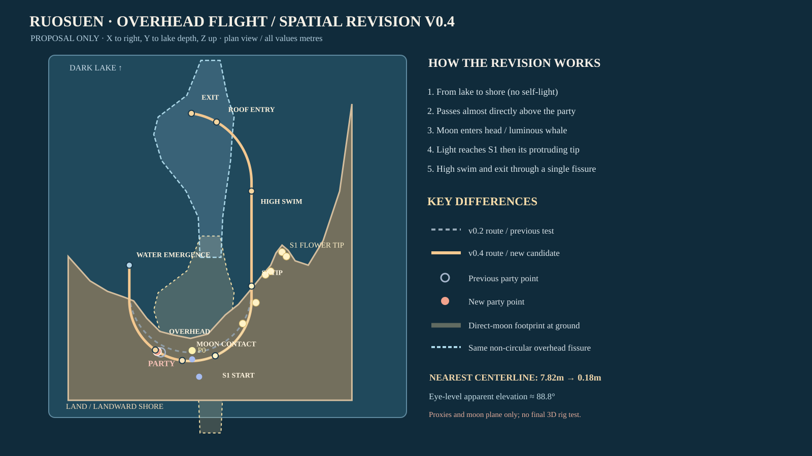
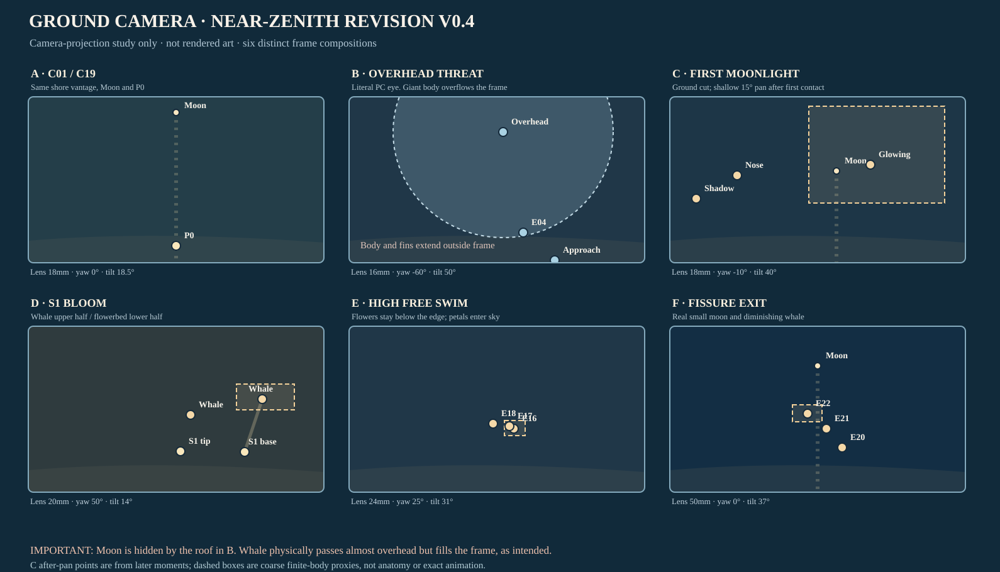

# 『空に降る雪』頭上通過の修正軌道と地上カメラ再較正 v0.4（2026-11-22）

> **DM専用・プレイヤー閲覧禁止。作者未承認の最新の設計候補。** [統一空間v0.2](cavern-overland-moonlight-layout-v02-2026-11-22.md)／[地上カメラv0.3](ground-camera-overland-projection-review-v03-2026-11-22.md)で検出した **「鯨が冒険者の真上ではなく斜め上を飛ぶ」**問題を解決する設計。**作者が決めたのは「頭上通過後、陸地上空で月光を受ける」演出上の方向**であり、ここにあるXYZ、角度、70秒、採用するカメラはまだ作者の最終決定ではない。原画・造形・正式カット割り・公開Pagesは変更しない。100秒v11案は未承認・保留。

## 結論と比較

- **旧v0.2**：PC代表点(−54,−85)、第一旋回の中心(−20,−15)、R70m。PCから鯨中心軌道への最近の水平偏差**約7.82m**、見上げる鯨中心の仮最大仰角**約56°**。近くは通るが、物語の意図である「ほぼ真上」には弱かった。
- **新v0.4**：PC代表点**(−58,−84,2.5)**、第一旋回中心**(−20,−25)**、R70m。PCの水平位置に対して鯨の胴体軌道の最近偏差は**約0.18m**、眼高1.6mからの仮最大仰角は**約88.8°**。鯨は実質真上を通る。
- **近接距離**：24mの鯨の頭部を単純な球相当代理とする連続標本（0.1°刻み）で、**頭部代理表面とPC代表地面の最短3D距離は約2.99m**（進路角約229.3°）。胸部代理表面は約6.56m、代表胸びれ先端代理は約9.18m。**PCの身体サイズや高さは固定せず、プレイヤーキャラクターが長身なら実安全距離はさらに小さくなる**。全身メッシュ・反り・胸びれのアニメーションの衝突判定ではない。
- **速度**：水平軌道長は**約509m**、浮上6.5秒→代理的な退場64秒の平均**約8.86m/s**。旧v0.2の約489mから約20m増えた。代表点間の平均3D速度は6〜13m/s台だが、**瞬時速度・加速度・舵の曲率連続性は未実証**。70秒という尺に無理に固定しない。

[平面図を原寸で開く](diagrams/overland-moonbeam-plan-v04.svg)／[高度と70秒作業案の対応図](diagrams/overland-moonbeam-altitude-v04.svg)

## 月光のタイミング：「頭を先に照らす」は維持できるか

月光の仰角約43°、方位+Y、一つの非対称裂け目という**従来の幾何候補を保ったまま**、鯨の低空円弧だけを陸地側へ10m移した。影の判定は**Z=190mの薄い屋根開口との2D射線交差**であり、自然な厚い岩壁を含む本物の3D光線追跡ではない。

| 項目 | 修正後の仮値 | 解釈 |
|---|---|---|
| 鯨・右頭部側面の初入射 | **約20.93秒／旋回角260.8°** | 月光の最初の微かな縁取り。胴はまだ暗い |
| 吻先の中心 | **約21.17秒／262.4°** | 画としての「月光を浴びる」主要タイミング |
| 頭部の反対側 | **約21.40秒／263.8°** | 頭部全幅へ自然光が広がる |
| 右胸びれ先端 | **約21.71秒／265.5°** | まだ自発光の伝播中でもよい |
| 胴の中心 | **約22.89秒／273.3°** | 鯨全身が段階的に照らされていく |
| 尾の代理点 | **約24.59秒／284.1°** | 尾まで自然月光が達する候補 |

**撮影上の結論**：以前のv0.3で発見された**E07（20秒前後）で頭の端が予定より早く月光に入る問題は改善**し、E07・E08の代表頭部位置は影に留まる。E08aで吻先が境界へ達する。ただし**実形状にはない24×14.8mの外接直方体前端の角**を光路判定すると、約257.2°で先に光を拾う。これは**代理箱の角が実際に鯨の表面に存在するという証拠ではない**が、胸びれ・頭部の真实3Dメッシュによる先行入射のリスクを示す。

そこで発光演技は**「月光の最初の縁取り（約21秒）→吻先から自発光の有機的な波が始まる→24〜26秒で尾まで輝く」**と組み立てる。**受光**と**自発光の開始**を同一物理イベントと断定しない。元の作者方針「月光の後は鯨自身が光源」を維持。実メッシュ上の一番早い月光接触点が頭部であることは未確定。

S1の成熟花の代表6地点は依然として自然月光の影にあり、P0の若い花は直射下。**E10（約26秒）で鯨→S1基部約55.6m**、**E14（約35.7秒）で鯨→花の岬先端約59.9m**。いずれも撮影上の明瞭照明候補65m以内。ただしこれは**開花の魔法的な照度しきい値ではない**。実際の照明体積・花の数・地形の遮蔽はレンダリングへ持ち越す。

## 地上カメラでの6構図を再検証

[六構図の画面比較図](diagrams/overland-camera-contact-v04.svg)

1920×1080、仮想フルサイズ36×20.25mmのピンホール投影で各座標を計算した。**以下のレンズとカメラ点は未承認の候補**。

| 撮影用途 | 仮カメラ位置XYZ | 仮レンズ・向き | 重要な画面成立条件 |
|---|---|---|---|
| **A 冒頭と終幕** | (−18,−93,3) | 18mm・+Y・仰角18.5°固定 | P0と小さな月を上下とも画面内へ。C01/C19は同一カメラ設定。旧20mm・(-10,-108,5)は比較履歴 |
| **B 頭上通過** | **PC眼高(−58,−84,4.1)** | **16mm・方位−60°・仰角50°** | 先行接近E03/E04→真上に迫るE05を撮る。**鯨の全身は収まらず、E06で画面から消える**。これが巨大さを示す |
| **C 月光へ入る** | (−10,−113,5) | 18mm・方位−10°→+5°ゆっくりパン・仰角40° | 月とE08/E08aの吻先が見え、発光後E09/E10では**ひれを含む粗い全身代理像がフレームに収まる** |
| **D 花の岬** | PC眼高(−58,−84,4.1) | 20mm・方位+50°・仰角14° | 発光鯨E11/E14と成熟花S1の基部・先端を同画面で見せる。自然の月は画面外 |
| **E 高空** | PC眼高(−58,−84,4.1) | 24mm・方位+25°・仰角31° | S1花畑は画面外、高空の鯨だけを見せ、S1から昇った**白金の花吹雪**を空へ |
| **F 裂け目退場** | (−10,−108,5) | 50mm・方位0°・仰角37° | 月と鯨、同一の非対称な裂け目を撮る。実際の月は小さく、全身は月円盤内に入らない |

**カメラ投影の12条件を確認して全件成立**。Bの全身がフレーム外へ出ることは故障ではなく意図した演出。C/D/Fでは後半の全身代理像のフレーム収まりも別途確認した。光線そのものが天井岩を貫通するかは理想的な薄い屋根を用いた試算。CとFは**PCの肉眼そのものではなく同じ岸の別撮影点**であり、PCが瞬間移動する物語演出ではない。B→Cは**連続音と鯨の進行方向**を合わせたカットつなぎが必要。

## 70秒の編集ビートとの照合

| 仮時刻 | 鯨の経路・カメラ | 観客の感情 |
|---|---|---|
| 0〜6.5秒 | A→水面異変の別画。鯨は湖内にいる | 任務後の安堵→違和感 |
| 6.5〜14秒 | 湖上の浮上→岸への接近 | 「こんなに大きいのか」 |
| 14〜18秒 | **B、体積の一部だけで画面を占めながら真上を通る** | 「ボスか!?」「近い！」 |
| 18〜20秒 | 背後へ抜け、攻撃しないことが分かる | 「襲わない？」 |
| 20〜26秒 | **C、月へ向かう鯨→頭の側面・吻先→全身発光** | 警戒と神秘が入れ替わる |
| 26〜35.7秒 | **D、発光鯨の光がS1基部→岬先端に届く** | 開花の因果を見て驚く |
| 35.7〜51秒 | D→E、花吹雪の広がりと高空遊泳 | 美しさを味わう |
| 51〜64秒 | E→F、裂け目からの退場 | 名残惜しさ |
| 64〜70秒 | **Aと全く同じカメラ設定** | 静寂と最後の花弁 |

この70秒表は**カット表ではなく演出段階**。本検証はカット数・編集点の正式承認を意味しない。

## 数値検証結果と未解決事項

- **改修した地形・花・頭上・月光・速度の代表条件：22件を検査し22件成立**。航跡の各代表地点は23点（E08a含む）。旧v0.2の関連する条件は引用するだけでなく、更新した座標で再計算した。
- **撮影条件：12件中12件成立**。Cの全身は仰角を旧34°候補から**40°**に上げ、Dは方位を旧43°候補から**50°**に調整した結果、粗い全身代理矩形を画内へ収めた。
- **低空は一層近い**。PCの眼から鯨の頭部代理まで約1.4m相当の瞬間も起こり得る。PC種族の身長・姿勢・頭の上下・胸びれの運動でクリアランスが変わるので、本当に安全かは**3D全身リグとプレイヤーの身体寸法を限定しない空間余裕の追加検証**が必要。
- **月光境界の誤差は数mで変化**。吻先中心が境界上にある約21.16秒のE08aは、綺麗に点灯する瞬間を求めて構成した**計算用キーフレーム**。現実の厚い岩盤・頭部の曲面・首振りで前後する。
- **出口の安全性は未確定**。後半の湖上R80m上昇軌道は旧v0.2のまま。旧簡易包絡ではE20の天井縁への平面余裕**約5.4m**。厚い岩盤と尾びれが入れば干渉する可能性があり、単にE22胴中心がZ224mだから完全退場できたとは言えない。
- **花弁はS1の実際の陸地から離れ、魔法的な上昇で高空へ**。空中に突然花を出さず、桃色や画一的な大渦にせず、白基調・淡金を守る。
- **最終未検証**：Blenderなどの3Dレンダリング、地形・月光の体積遮蔽、メッシュ衝突、光量と開花閾値、鯨のアニメーション加速度、カメラ視野と既存の採用原画の照合、プレイヤー向け試写。
- **再現用**：[新空間JSON](diagrams/overland-moonbeam-spatial-v04.json)／[地上カメラJSON](camera-overland-projection-audit-v04.json)／[Python検証](scripts/verify_overland_camera_v04.py)。上記の**JavaScriptで数値チェックは実施済み**。後者のPythonファイルはGitHubへ保存したが、**この環境ではGitHub rawへ直接アクセスできず、ファイルからの実行追試は未実施**。Pythonを実行したとは報告しない。

## 次の3D制作ゲート

1. **B真上通過の立体シルエット**：Bの16mmで頭が何秒、どの方向から入ってどこへ抜けるか、実際の24m鯨メッシュの頭・胸びれ・腹・尾を少なくとも3時点の低解像度プレビューで確認。
2. **C月光への初接触と発光**：月の光路と厚みのある単一亀裂、実メッシュの頭部曲率の組み合わせで初点灯を較正。20.9〜24.6秒の光の移動と、本体の有機的な自発光波を分ける。
3. **Dの開花因果**：S1基部・舌状の岬先端・鯨の照明体積が同じ画面でつながるか。開花は自発光鯨の光を原因とする。
4. **F退場**：天井岩縁の立体的な厚み、鯨全長と左右胸びれの回転姿勢の衝突判定。
5. **Aの原画と新画角の比較**：採用済みC01/C19背景は保持し、最新の撮影パラメータへ物理的に置き換え可能かを見て作者が判断する。

**この文書はPR #35の作業ブランチに保存し、main未マージ・Pages非公開とする。**
