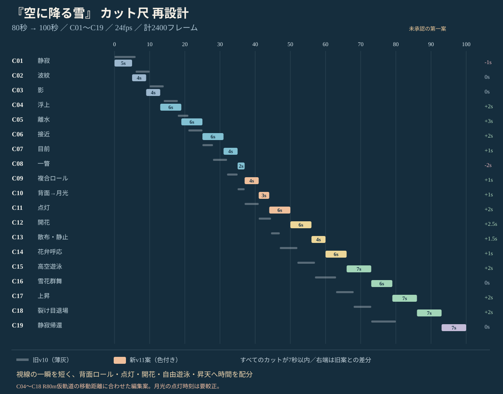

# 『空に降る雪』カット尺再設計 v11 — 100秒・19カット第一案（2026-11-22）

> **DM専用・プレイヤー閲覧禁止。作者未承認の編集第一案。** 原画の採用状態、物語の採用事項およびC12の花の岬は維持し、**尺だけを再設計**した。厳密な3D原画検証・音楽の最終マスター・完成映像の編集指示ではない。  
> 技術根拠：[C04〜C18図入り空間・動線検証v0.1](c04-c18-flight-spatial-verification-2026-11-22.md)／[検証用経路JSON](diagrams/c04-c18-geometry-v01.json)／[旧v10ショットリスト](v10-shotlist.md)／[原画一覧](keyframe-contact-2026-11-22.md)。
>
> **結論：80秒 → 100秒（+20秒、+25%）。C01〜C19の19カットは維持し、各カットを最大7秒に収める。** C08の視線の交差は4→2秒。C09のロール、C11の点火、C12の花の岬、C15〜C18の高空遊泳・昇天へ時間を回す。現行の正本を無断で置き換えない。

## 全カットの時間割

[比較図を開く](diagrams/timing-v11-100s-comparison.svg)

| カット | 新開始–終了 | 新尺 | 旧尺 | 差分 | 意図・運動の役割 |
|:--|:--|--:|--:|--:|:--|
| C01 | 00–05 | 5秒 | 6秒 | -1秒 | 月光のP0、静かな湖。反復するC19用同一Cam A |
| C02 | 05–09 | 4秒 | 4秒 | 0秒 | 水面に波紋。違和感を導入 |
| C03 | 09–13 | 4秒 | 4秒 | 0秒 | 水面下の巨大な影。姿はまだ明かさない |
| C04 | 13–19 | 6秒 | 4秒 | +2秒 | 左沖から水面を割って静かに浮上。浅い離水 |
| C05 | 19–25 | 6秒 | 3秒 | +3秒 | 助走し、尾を残して浮上。乾かぬ巨体が岸へ進む |
| C06 | 25–31 | 6秒 | 4秒 | +2秒 | 巨大な影が岸へ接近。月光を遮る表現は別途遮蔽チェック |
| C07 | 31–35 | 4秒 | 3秒 | +1秒 | 鼻先が冒険者の目前へ。危険な近さを体感 |
| C08 | 35–37 | 2秒 | 4秒 | -2秒 | 完全停止しない。0.5〜0.8秒ほど視線が交わる。音楽の全休止 |
| C09 | 37–41 | 4秒 | 3秒 | +1秒 | 身体の長軸ロール＋ヨー旋回＋上昇。腹と胸びれを提示 |
| C10 | 41–44 | 3秒 | 2秒 | +1秒 | 湖側へ抜ける後ろ姿。月光の直前を短くつなぐ |
| C11 | 44–50 | 6秒 | 4秒 | +2秒 | 吻先→胴→尾へ順に自発光。月光の縁に入る |
| C12 | 50–56 | 6秒 | 3.5秒 | +2.5秒 | S1の突出した花の岬を照らし、先端→基部へ波状開花 |
| C13 | 56–60 | 4秒 | 2.5秒 | +1.5秒 | 花弁と淡金の果実が離れ、空中で約1秒ためを作る |
| C14 | 60–66 | 6秒 | 5秒 | +1秒 | 花弁が鯨へ呼応して向き直り、自然な流れに変わる |
| C15 | 66–73 | 7秒 | 5秒 | +2秒 | 湖上の高空へ上昇。岸の花畑はフレームに入れない |
| C16 | 73–79 | 6秒 | 6秒 | 0秒 | 白基調・淡金の高密度で自然に広がる花吹雪と鯨 |
| C17 | 79–86 | 7秒 | 5秒 | +2秒 | 泳ぎながら旋回・上昇し、裂け目の広部を目指す |
| C18 | 86–93 | 7秒 | 5秒 | +2秒 | 天井の厚い裂け目をくぐり、尾まで夜空へ消える |
| C19 | 93–100 | 7秒 | 7秒 | 0秒 | C01と同一Cam A。花びら一枚、静寂へ戻る |
| **合計** | **0–100** | **100秒** | **80秒** | **+20秒** | **19カット／24fps・計2400フレーム** |

**カットの終端は次カットの始端と同一**で、尺が重複したり欠けたりしない。開始・終了時刻は整数秒、24fpsにすべて正確に置ける。エンドカードなし。C02.5/C11.5などの追加原画挿入は現時点で行わず、必要性を後で判定する。

## 時間を増減した根拠（場面単位）

| 場面 | 旧v10 | 新v11案 | 増減 | 役割 |
|---|---:|---:|---:|---|
| C01〜C03：静寂・違和感 | 14秒 | 13秒 | −1秒 | 初見の予感を残しつつ冒頭を絞る |
| C04〜C08：浮上・近接遭遇 | 18秒 | 24秒 | +6秒 | 約168mの水平助走・接近を短縮せず、C08の一瞥自体は半分に |
| C09〜C11：ロール・月光接触 | 9秒 | 13秒 | +4秒 | 長軸回転＋水平旋回・背中の後ろ姿・頭から尾への点火をつなぐ |
| C12〜C14：花の岬・散布・呼応 | 11秒 | 16秒 | +5秒 | 発光鯨が沖へ離れながらS1先端→基部へ波状開花、続いて自然な花吹雪 |
| C15〜C18：自由遊泳・上昇・退場 | 21秒 | 27秒 | +6秒 | 高さ約105→195mと全身退場を無理に圧縮しない |
| C19：余韻 | 7秒 | 7秒 | 0秒 | 冒頭と同一Cam A・最後の一枚・静寂を維持 |

**最重要の交換**：C08の4秒のアップを2秒に短縮しても、近接の緊張そのものを失わない。緊張はC06とC07の前段で十分に積み、C08では約**0.5〜0.8秒だけ眼が合う**。残る時間は巨大な頭部が画面を横切る速度と水滴・音の急停止で見せる。**鯨の実際の泳速はゼロにしない**。

## C04〜EXITの座標モデルから見た移動時間

採用済みの大枠（全長24m、C08近接条件、湖岸の張り出し、月光接触→花の開花→上昇）に対して、[暫定R80m幾何モデル](c04-c18-flight-spatial-verification-2026-11-22.md)の**各カット代表点**を編集案の以下の時刻に割り当てている。

| カット | 代表点到達時刻 | 水平軌道累積距離 | 胴体中心の湖面上高度 |
|---|---:|---:|---:|
| C04 | 16.0秒 | 0.0m | 4.0m |
| C05 | 22.2秒 | 42.0m | 14.0m |
| C06 | 28.0秒 | 96.5m | 19.0m |
| C07 | 33.0秒 | 138.3m | 13.0m |
| C08 | 36.2秒 | 167.7m | 9.0m |
| C09 | 39.0秒 | 188.6m | 14.0m |
| C10 | 41.6秒 | 198.4m | 20.0m |
| C11 | 47.5秒 | 234.7m | 25.0m |
| C12 | 53.0秒 | 261.2m | 30.0m |
| C13 | 58.4秒 | 293.3m | 42.0m |
| C14 | 63.0秒 | 323.3m | 70.0m |
| C15 | 69.5秒 | 358.3m | 105.0m |
| C16 | 76.1秒 | 383.5m | 133.0m |
| C17 | 82.5秒 | 414.2m | 164.0m |
| C18 | 89.4秒 | 442.1m | 195.0m |
| EXIT※ | 93.0秒 | 456.1m | 222.0m |

※EXITはC18の後で**全長24mの鯨が天蓋の上へ完全に抜ける瞬間**を示す補助運動点。新規カットは作らない。C18中盤（約89.4秒）では胴中心が岩縁190mの高さを越え、**93秒のカットアウトまでに尾が抜ける**。C19は93秒で元の地上画面へ戻る。

### 各代表点間の平均移動（円弧・直線＋高度差の簡略距離）

| 区間 | 経過 | 水平移動 | 高度差 | 簡略3D平均速度 |
|---|---:|---:|---:|---:|
| C04→C05 | 6.2秒 | 42.0m | +10m | 7.0m/s |
| C05→C06 | 5.8秒 | 54.5m | +5m | 9.4m/s |
| C06→C07 | 5.0秒 | 41.9m | -6m | 8.5m/s |
| C07→C08 | 3.2秒 | 29.3m | -4m | 9.3m/s |
| C08→C09 | 2.8秒 | 20.9m | +5m | 7.7m/s |
| C09→C10 | 2.6秒 | 9.8m | +6m | 4.4m/s |
| C10→C11 | 5.9秒 | 36.3m | +5m | 6.2m/s |
| C11→C12 | 5.5秒 | 26.5m | +5m | 4.9m/s |
| C12→C13 | 5.4秒 | 32.1m | +12m | 6.3m/s |
| C13→C14 | 4.6秒 | 30.0m | +28m | 8.9m/s |
| C14→C15 | 6.5秒 | 35.0m | +35m | 7.6m/s |
| C15→C16 | 6.6秒 | 25.1m | +28m | 5.7m/s |
| C16→C17 | 6.4秒 | 30.7m | +31m | 6.8m/s |
| C17→C18 | 6.9秒 | 27.9m | +31m | 6.0m/s |
| C18→EXIT | 3.6秒 | 14.0m | +27m | 8.4m/s |

- **運動検査**：各点間の3D平均速度は**約4.4〜9.4m/s**。C04代表点からEXITまでの**水平距離約456m／77秒＝平均約5.9m/s**。低空の接近では比較的速く、花の点灯後から高空ではゆったり移動する想定。**停止や瞬間的な位置移動を要求しない。**
- **制約**：これはキーポーズ間の平均で、各フレームの瞬間速度・加速度を検証したものではない。**C09→C10だけ仮座標が近く、平均4.4m/sまで低下**する。鯨が止まって見えないよう速度補間／ポーズ位置を再調整する。ロールは**C09の4秒全体＋C10へ連続**させるので、C09代表点が短距離でも身体全体の芝居は続けられる。
- **上昇勾配**：C13→C14は高度+28m／水平30m、C14→C15は高度+35m／水平35m。**傾斜約43〜45°**に達し、当初の「緩やかな上昇」とは異なる可能性がある。尺を延ばしても**勾配そのものは変わらない**ため、最終運動で湖上の水平距離を増やすか上昇高度を分散して修正する。今回の100秒はこれを解決済みとは扱わない。

## 感情と音の設計：尺から逆算した候補時刻

| 時刻 | ビート | 映像と音 |
|---|---|---|
| 0–13秒 | 静けさ→違和感 | P0の一輪、波紋、闇の水面下の巨大な影。台詞なし |
| 13秒 | 浮上の衝撃 | 水面を破る。「跳ねる」ではなく質量を伴う静かな離水 |
| 25–37秒 | 巨体への警戒 | 左から迫り、冒険者の前を右にかすめる。36秒前後に一瞥、**約0.5〜0.8秒の音の断絶** |
| 37–44秒 | 脅威→驚異 | C09で強い尾の一漕ぎと大きなロール。C10はカメラから顔を見せない後ろ姿で月へ |
| 44–50秒 | 月光接触・点灯 | 吻先→胴→尾へ自発光が伝わる。点灯後は消灯しない |
| 50–56秒 | 花の目覚め | 岸の右手、**さらに突出したS1の岬**。花の先端を鯨が照らし、基部へ開花が続く |
| 56–66秒 | 時間の停止→呼応 | 花弁と淡金の果実が舞い、約1秒の静止を挟む。花弁は花の形にならず、過度に規則的な渦にしない |
| 66–79秒 | 神秘の最高潮 | C15は花畑をフレームに入れない高空遊泳。C16は白基調・淡金の高密度な自然の花吹雪 |
| 79–93秒 | 名残惜しい昇天 | 鯨は大きく弧を描いて昇り、C18で裂け目を抜ける。満月の見かけサイズは大きくしすぎない |
| 93–100秒 | 静寂への帰還 | C01と同じCam A。96〜98秒ごろに最後の一枚が舞い降り、無音で終える |

音楽の拍子・BPMをまだ固定しない。**先に運動とカット境界の接続を確かめ、後から楽曲の構造をこのビートに合わせる**。

## 最終制作前に残す時間・空間の接続ゲート

1. **C10→C11の月光進入時刻**：前のv0.1幾何では吻先が光へ入るのは**約t41.8〜42.1秒相当**、今回のC11開始は**44秒**。差が約2秒ある。吻先がC10で先に発光してしまわないよう、**月光の入射角・裂け目の影境界とC10/C11の編集点を同時再較正**する。P0の初期点灯、S1の成熟花が暗いことを犠牲にしてはならない。
2. **C06の月光遮蔽**：鯨が月光を遮ると見える旧C06画面が、今回の「C11までは暗い」という射線配置に本当に一致するか3Dで確認。見えない位置なら水面反射・逆光などに置き換える。
3. **C09の複合ロール**：−80°は検証用の一例であり、**80°バンクか180°反転かは未確定**。ロールの最大角・符号・ピッチと進路のヨーを連成してC10の背面ショットにつなぐ。
4. **C12からC16の花弁の到達時間**：空雪花は鯨が照らしたS1から放出され、自然な広がりと不思議な力によって空へ上がる。**別地点で突然大量の花弁を発生させない**。光量・地形陰・高空に達する速度と拡散を別途検証。
5. **C18の全身退場とカメラ**：仮のEXIT=93秒は既存の略体積モデルによる。太い尾と胸びれの実形状と、厚い岩縁を貫通しないか確認。月面重なりのために冒険者を別位置へ瞬間移動させない。
6. **速度とピッチの連続性**：R80m円弧の接続はC1連続であり、曲率変化・バンク角速度・尾の周期約6秒・3D加速度は未確認。**秒数が決まっても運動が物理的に完成したわけではない**。
7. **制作規格**：旧v10にあった「8秒以内の単一生成クリップ」を想定し、全カット最大7秒。各カットを24fps整数フレームで作り、編集でつなぐ。映像自体の制作・既存PNG更新は未実施。

## 作者確認を待つ項目

- **作品総尺100秒**、特にC08を2秒に短縮することを採用するか。
- 上記のビートごとの時間配分と、C09ロールの最大角／C11点灯の位置関係を次の技術較正に回してよいか。

**この文書の100秒と19カットの配分は、現時点では編集上の第一案。作者承認の世界観・原画・舞台規模を上書きしない。**

## 対応ファイル

- [フレーム精度のカット表JSON](timing-v11-100s-proposal-2026-11-22.json)
- [80秒→100秒の比較図](diagrams/timing-v11-100s-comparison.svg)
- [100秒の検証スクリプト](scripts/verify_timing_v11_100s.py)
- [C04〜C18の空間・光の検証資料](c04-c18-flight-spatial-verification-2026-11-22.md)
