# 第一話エンディング『空に降る雪』｜C01–C19 原画付きカットレビュー（2026-11-22・改訂版）

> **DM専用・プレイヤー閲覧禁止。シナリオの重大なネタバレを含む。** GitHubリポジトリは公開設定であり、この注意書きはアクセス制御ではない。公開Pagesやプレイヤー向け文書には掲載しない。

このファイルは**作者が絵を見比べ、残す画像を決めるための棚卸し**。カット割り・時間・設定・原画の採用を新たに確定するものではない。比較原画は一切削除しない。**番号が同じでも旧10カット構成の「CUTxx」と現行19カット構成の「Cxx」は別物**として扱う。

## 作者の今回の決定（2026-11-22）

- **旧構成の原画は現時点ですべて不採用**。以前の台帳やGitHubの `adopted/` というフォルダ名は**過去の判定**であり、現在の採用を意味しない。旧構成の画像は現行カットの直下には表示せず、末尾に記録用リンクとして残す。
- **例外：C16はOldフォルダの旧Bパターン `C16_B_petals_dense_no_flower.png` を現状の採用原画とする**。以前に作者が承認した、花吹雪を高密度化し丸ごとの花を除いたB版を指す。**`C16_t01.png`（旧初稿）は不採用**。
- C16のOld B採用は**現在の原画選別に関する決定**。今後の空間・鯨・花・カメラ・感情ラインの見直しで変更され得る。旧原画台帳や過去の判断は履歴として残し、今回の決定をこのレビューで優先する。

- 基準： [v10・19カットの仮決め](v10-shotlist.md)、[感情ラインv9](emotion-line-v9.md)、[鯨の動線v10](whale-motion-v10.md)。
- **PR #27 の C03–C08** は画像原本が存在するが2026-11-22確認時点では**未マージ**。本書では当該PRのコミットSHA固定の画像URLで表示する（後のマージで相対リンクに統一可能）。[PR #27](https://github.com/Makeinu1/DaD_Ruosuen/pull/27)。
- **PR #28 の C09・C10** はメタデータのみでPNGのGitHub転送が未完了。会話で仮採用したPNGをここでは表示できない。[PR #28](https://github.com/Makeinu1/DaD_Ruosuen/pull/28)。
- C11–C19の採用・候補・比較原画の所在は [原画台帳](keyframe-test/results/C11-C19-2026-11-21/README.md) を参照。ただし**C16の採否は今回の作者判断を優先**し、台帳ではOldと分類されたBパターンを現状採用とする。
- 比較用の `turnXX_YY.png` 34枚は全点末尾に掲載し、画像のGit blob SHAが一致する選定版9件は確定対応とした。残りは**生成順からの仮分類**であり、内容・カット対応は作者確認が必要。

## 一覧・レビュー記録

| カット | 仮タイム | 内容 | 現在の取り扱い | 作者の再判定 |
|---|---|---|---|---|
| [C01](#c01) | 0–6.0秒 | 月光と最初の一輪 | 現行原画未確定／旧構成原画は不採用 | 未記入 |
| [C02](#c02) | 6.0–10.0秒 | 水際の波紋 | 現行原画未確認 | 未記入 |
| [C03](#c03) | 10.0–14.0秒 | 水面下の巨大な影 | 暫定決定／PR #27（未マージ） | 未記入 |
| [C04](#c04) | 14.0–18.0秒 | 静かな浮上 | 暫定決定／PR #27（未マージ） | 未記入 |
| [C05](#c05) | 18.0–21.0秒 | 空への上昇 | 描き直し版／採否要確認 | 未記入 |
| [C06](#c06) | 21.0–25.0秒 | 空中から頭上へ接近 | 仮採用・後日修正／PR #27 | 未記入 |
| [C07](#c07) | 25.0–28.0秒 | 目前に迫る巨大な頭部 | 原画あり／採否要確認 | 未記入 |
| [C08](#c08) | 28.0–32.0秒 | 読めない瞳の一瞥 | 原画あり／採否要確認 | 未記入 |
| [C09](#c09) | 32.0–35.0秒 | 背面ロール | 仮採用・PNG未転送／PR #28 | 未記入 |
| [C10](#c10) | 35.0–37.0秒 | 光へ遠ざかる背中 | 2案目仮採用・PNG未転送／PR #28 | 未記入 |
| [C11](#c11) | 37.0–41.0秒 | 月光接触・鯨の点火 | 暫定採用 | 未記入 |
| [C12](#c12) | 41.0–44.5秒 | 光を受ける花 | 暫定採用 | 未記入 |
| [C13](#c13) | 44.5–47.0秒 | 花びらの静止 | 採用 | 未記入 |
| [C14](#c14) | 47.0–52.0秒 | 花びらの呼応・集合 | 最新候補あり／作者未承認 | 未記入 |
| [C15](#c15) | 52.0–57.0秒 | 高空で自由遊泳 | 採用 | 未記入 |
| [C16](#c16) | 57.0–63.0秒 | 高密度の群舞と水鏡 | **Old Bパターンを現状採用（作者決定）** | 採用（2026-11-22） |
| [C17](#c17) | 63.0–68.0秒 | 花吹雪と上昇 | 採用 | 未記入 |
| [C18](#c18) | 68.0–73.0秒 | 裂け目と遠ざかる鯨 | 採用 | 未記入 |
| [C19](#c19) | 73.0–80.0秒 | 静かな湖、最後の一枚 | 最終採用 | 未記入 |

**再判定の候補**：残す／別案を採用／要修正／再制作／カット自体を再検討。画像への採用は映像全体の構成確定を意味しない。

## C01–C19：カット内容と原画

### C01
**月光と最初の一輪／0–6秒**。現行C01として確認できる原画PNGは未特定。以前の冒頭用候補2点は**旧構成のため現状不採用**とし、本文には掲出しない（末尾の履歴参照）。

確認：C01の新しい母版とC19の終幕のカメラが一致するか、月光と花の位置が設定に合うか。

### C02
**水際の波紋／6–10秒**。**現行C02のPNGは確認できていない。** 旧CUT02は月の画なので、このカットの代わりにはしない。

### C03
**水面下の巨大な影／10–14秒**。作者暫定決定、[PR #27](https://github.com/Makeinu1/DaD_Ruosuen/pull/27) の画像原本。

### C04
**静かな浮上／14–18秒**。作者暫定決定、PR #27。

<a href="https://raw.githubusercontent.com/Makeinu1/DaD_Ruosuen/b0322124b9bedf5e3233934d4879148bac671d53/dm/episode-01/ending/v8/keyframe-test/results/C03-C08-2026-11-21/C04.png">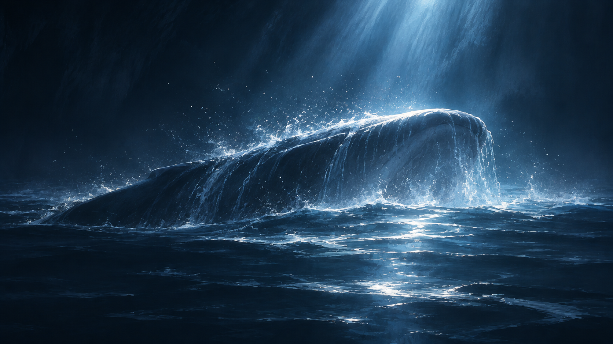</a>

### C05
**水面から完全に離れた上昇／18–21秒**。旧C05はまだ浮上中であったため不採用。下は新しい描き直し版（明示的な最終採用記録は未確認）。

### C06
**上空から冒険者へ接近／21–25秒**。仮採用・要修正。人物を画面に入れず、鯨の胴体を見せ、月光を遮る動きを明瞭に。C07の巨大頭部との段階差を確保する。

### C07
**目前に迫る巨大な頭部／25–28秒**。PR #27の原画あり。採否の最終判定は再確認。

### C08
**瞳の一瞥／28–32秒**。PR #27版を現行候補として示す。感情の読めない一瞥が狙い。

旧試作 `C08_t01.png` は**現状不採用**。比較の必要があれば[旧試作画像](keyframe-test/results/C08_t01.png)を履歴として参照する。

### C09
**背面ロール／32–35秒**。作者が「これを仮として進めよう」としたPNGは**GitHub未登録**（[PR #28／画像登録準備](https://github.com/Makeinu1/DaD_Ruosuen/pull/28)）。仮採用の決定だけをここに残す。

**修正点**：カメラをより右側に置き、白い腹がもっと見える角度にする。頭と胴体、胴体と尾のねじれを連続した運動にする。既存画像を別原画として誤代用しない。

### C10
**光へ向かう後ろ姿／35–37秒**。独立プロンプトの**2案目を暫定採用**。そのPNG本体はGitHub未登録（[PR #28](https://github.com/Makeinu1/DaD_Ruosuen/pull/28)）。

**修正点**：顔を映さない／後ろ姿で月光へ遠ざかる／画面右の胸びれ付け根と位置／腹の畝が顔まで続いているように見える問題。

### C11
**月光接触・点火／37–41秒**。暫定採用。

**C11.5（正式な19カット内の独立カットではない中間構図）**：余剰胸びれの修正を経た暫定採用画。C11とC12の間に挿入するかは未決。

<a href="keyframe-test/results/C11-C19-2026-11-21/selected/C11_5.png">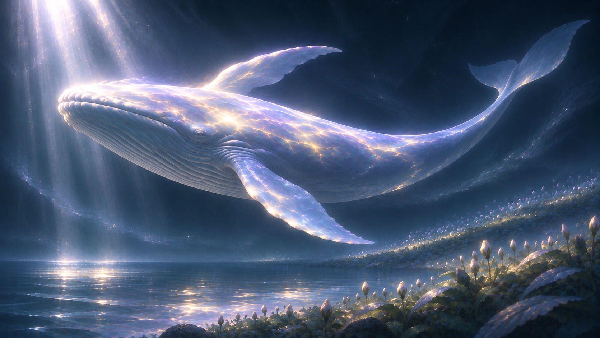</a>

### C12
**岸の花が光を受ける／41–44.5秒**。暫定採用。

### C13
**花びらが離れ、静止する／44.5–47秒**。採用。鯨は画面外で、光だけが届く。

<a href="keyframe-test/results/C11-C19-2026-11-21/selected/C13.png">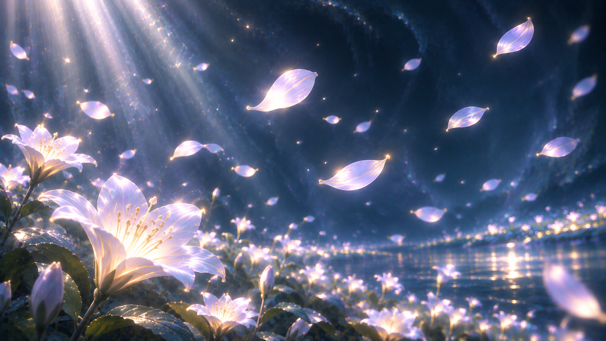</a>

### C14
**花びらの一斉の呼応／47–52秒**。銀白の波を描いた最新候補。**作者の明示的承認なし**。

### C15
**湖上高空の自由遊泳／52–57秒**。作者採用。花畑を画面に入れない、より高い位置で泳ぐ案。

### C16
**鏡面湖と高密度の花吹雪／57–63秒**。

**現在採用：Oldに格納されているBパターン**（作者決定、2026-11-22）。高密度の花吹雪・丸ごと飛ぶ花の除去・螺旋を強制しない自然な群舞を狙った、以前に承認済みの画像。フォルダ名は `Old/` のまま保存し、ファイルを移動・複製しない。

<a href="keyframe-test/results/Old/C16_B_petals_dense_no_flower.png">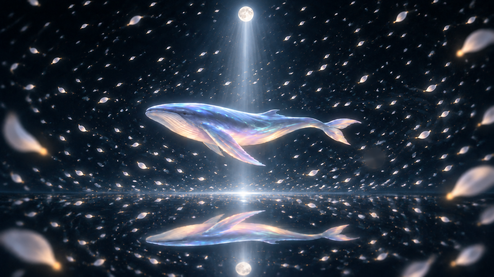</a>

**不採用：Oldの初稿**。大きな渦や丸ごとの花などに問題があり、現在の採用画ではない。[旧初稿を見る](keyframe-test/results/Old/C16_t01.png)。

今後の見直し項目：花びら・微光する種子の見え方、遠景の暗さ、水面への反射、周囲のカットとの接続。現在のBパターンを映像の最終画として固定するものではない。

### C17
**花びらとともに上昇／63–68秒**。採用。花吹雪の自然な散らばりとC18への上向きの接続を重視。

### C18
**裂け目と遠景の鯨／68–73秒**。採用。鯨を遠景に小さくした版。

### C19
**静かな湖に戻る／73–80秒**。月を小さくした「最後の2枚目」が最終採用。

**映像化時の要確認**：一枚の花びらは旧演出ではP0の近くへ舞い降りるが、選定画では湖面側に見える。どちらを最終画面にするかは未決。

## 比較原画34枚：候補一覧（すべて残す）

**重要**：これは制作履歴の比較原画（現在選定されていない版を含む）であり、旧構成原画を再採用する意図はない。下記の組分けは生成順に基づく暫定配置。現行カットとの対応は後で目視確認する。ただし「★同一画像」はGit blob SHAで一致した現行選定版／C14候補を示す。画像はクリックすると原寸が開く。

### C11周辺（C11.5前）

| 候補 | 候補 | 候補 |
|---|---|---|
| <a href="keyframe-test/results/C11-C19-2026-11-21/variants/turn09_01.png">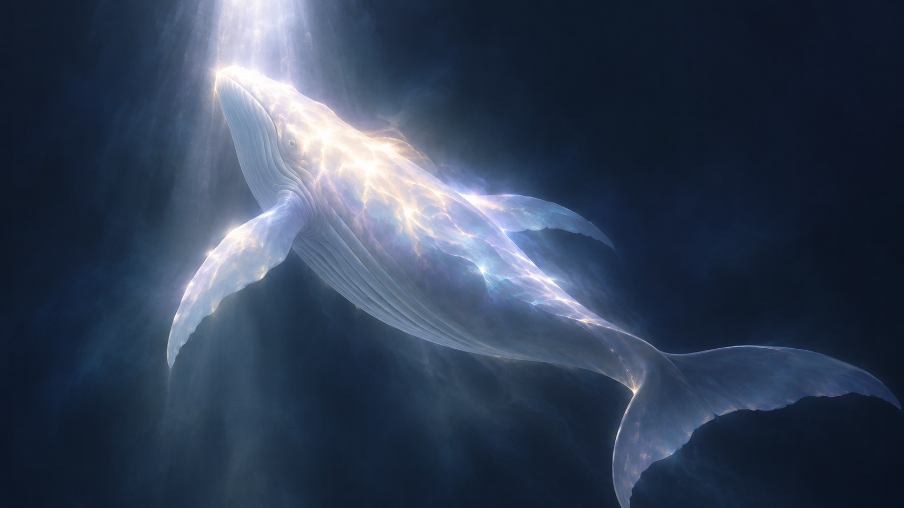</a> turn09_01 **★ C11選定と同一** | <a href="keyframe-test/results/C11-C19-2026-11-21/variants/turn10_01.png">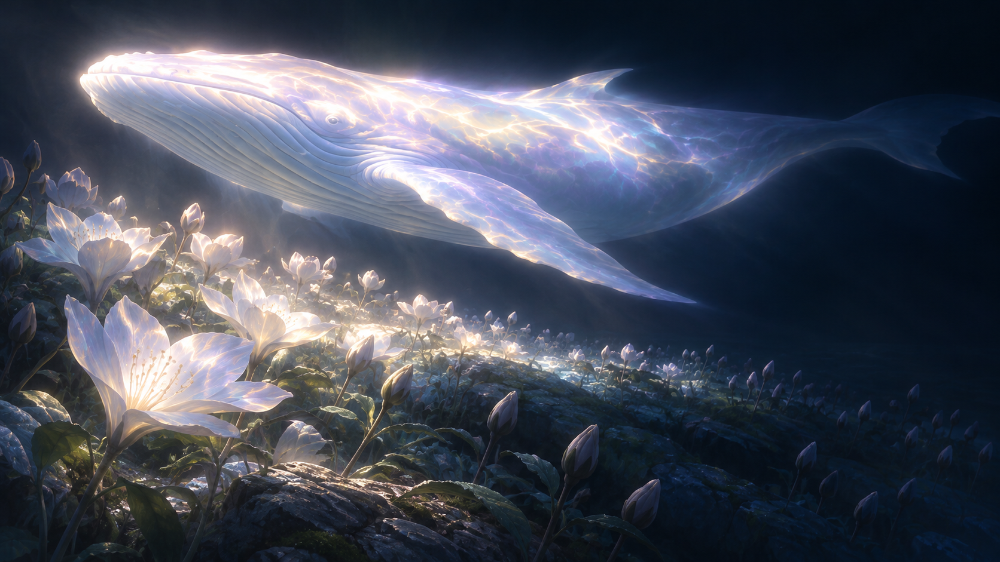</a> turn10_01 割当は暫定 |  turn12_01 割当は暫定 |
|  turn15_01 割当は暫定 | <a href="keyframe-test/results/C11-C19-2026-11-21/variants/turn15_02.png">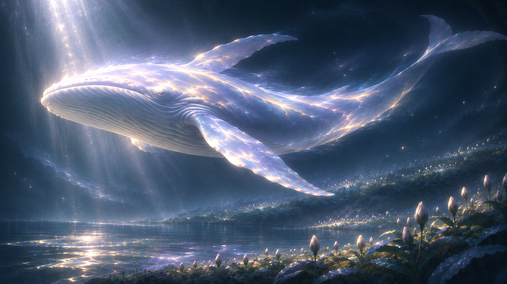</a> turn15_02 割当は暫定 |   |

### C11.5

| 候補 | 候補 | 候補 |
|---|---|---|
|  turn16_01 **★ C11.5選定と同一** |   |   |

### C12周辺

| 候補 | 候補 | 候補 |
|---|---|---|
| <a href="keyframe-test/results/C11-C19-2026-11-21/variants/turn17_01.png">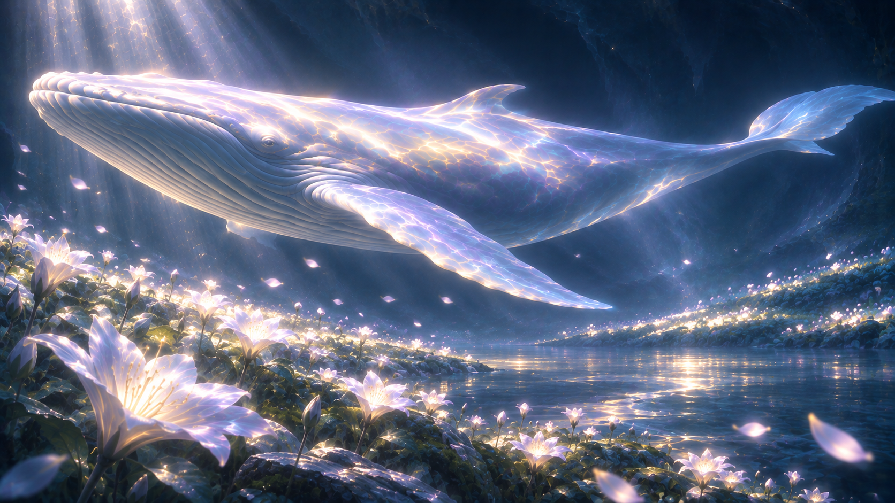</a> turn17_01 割当は暫定 | <a href="keyframe-test/results/C11-C19-2026-11-21/variants/turn17_02.png">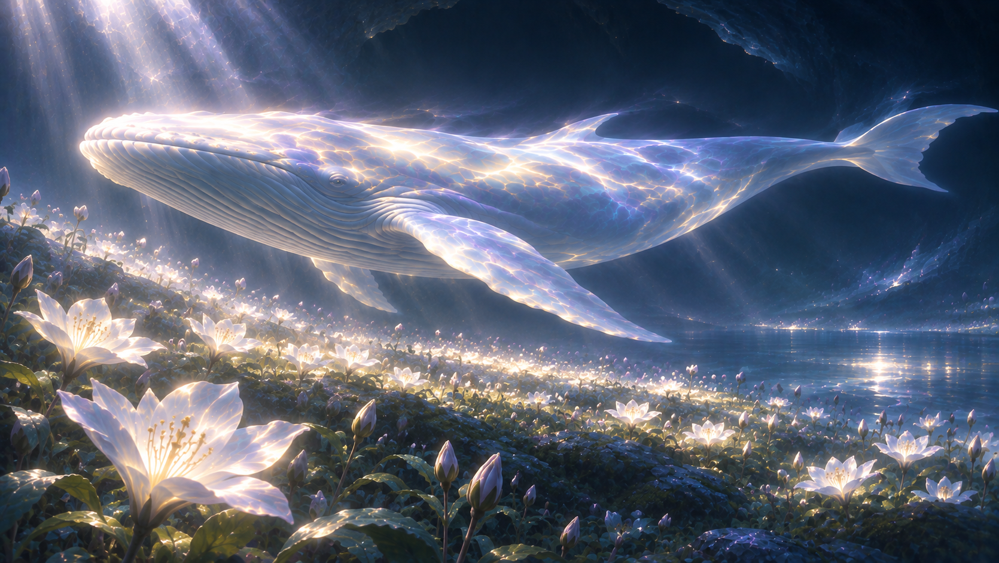</a> turn17_02 **★ C12選定と同一** | <a href="keyframe-test/results/C11-C19-2026-11-21/variants/turn19_01.png">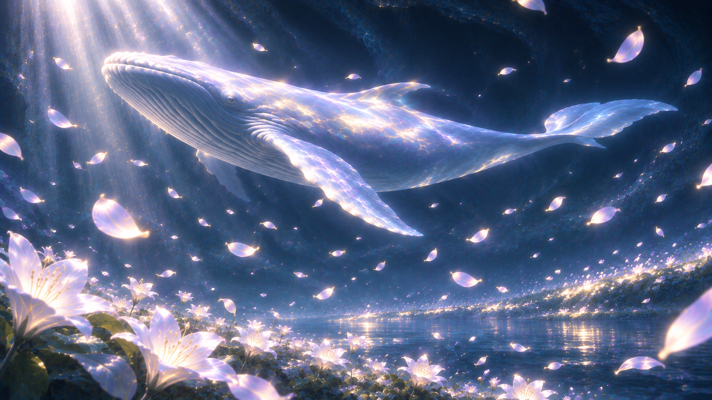</a> turn19_01 割当は暫定 |
|  turn19_02 割当は暫定 | <a href="keyframe-test/results/C11-C19-2026-11-21/variants/turn19_03.png">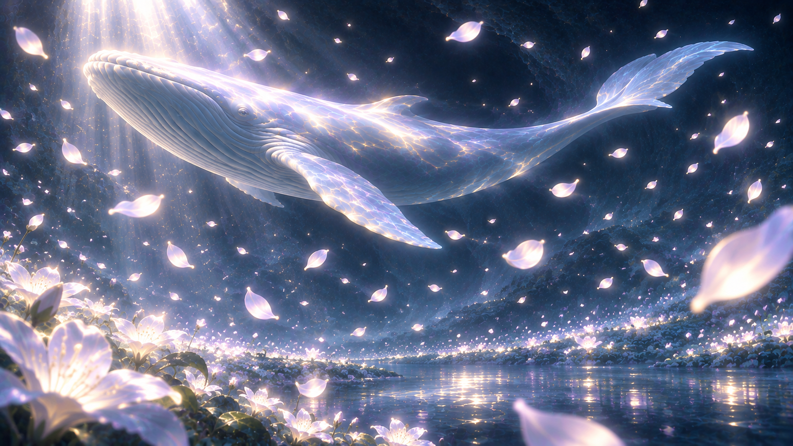</a> turn19_03 割当は暫定 |   |

### C13

| 候補 | 候補 | 候補 |
|---|---|---|
|  turn21_01 **★ C13選定と同一** |   |   |

### C14周辺

| 候補 | 候補 | 候補 |
|---|---|---|
| <a href="keyframe-test/results/C11-C19-2026-11-21/variants/turn23_01.png">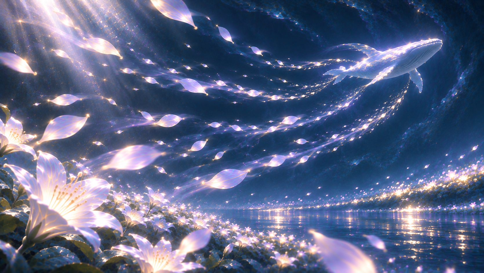</a> turn23_01 割当は暫定 |  turn25_01 **★ C14候補と同一** | <a href="keyframe-test/results/C11-C19-2026-11-21/variants/turn26_01.png">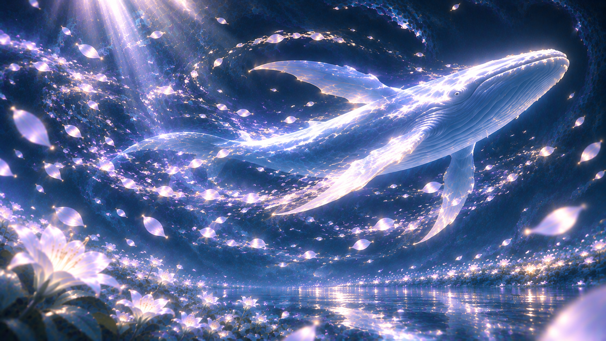</a> turn26_01 割当は暫定 |
| <a href="keyframe-test/results/C11-C19-2026-11-21/variants/turn26_02.png">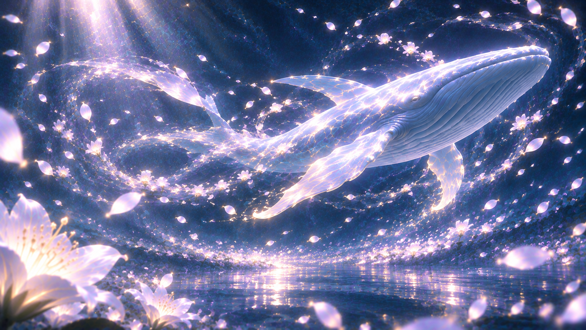</a> turn26_02 割当は暫定 |   |   |

### C15周辺

| 候補 | 候補 | 候補 |
|---|---|---|
|  turn28_01 割当は暫定 |  turn29_01 **★ C15選定と同一** |   |

### C17周辺

| 候補 | 候補 | 候補 |
|---|---|---|
|  turn30_01 割当は暫定 |  turn31_01 割当は暫定 | <a href="keyframe-test/results/C11-C19-2026-11-21/variants/turn32_01.png">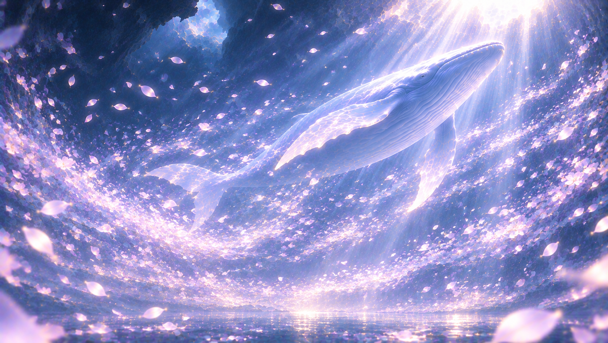</a> turn32_01 割当は暫定 |
|  turn33_01 割当は暫定 |  turn34_01 **★ C17選定と同一** |   |

### C18周辺

| 候補 | 候補 | 候補 |
|---|---|---|
|  turn36_01 割当は暫定 |  turn36_02 割当は暫定 | <a href="keyframe-test/results/C11-C19-2026-11-21/variants/turn36_03.png">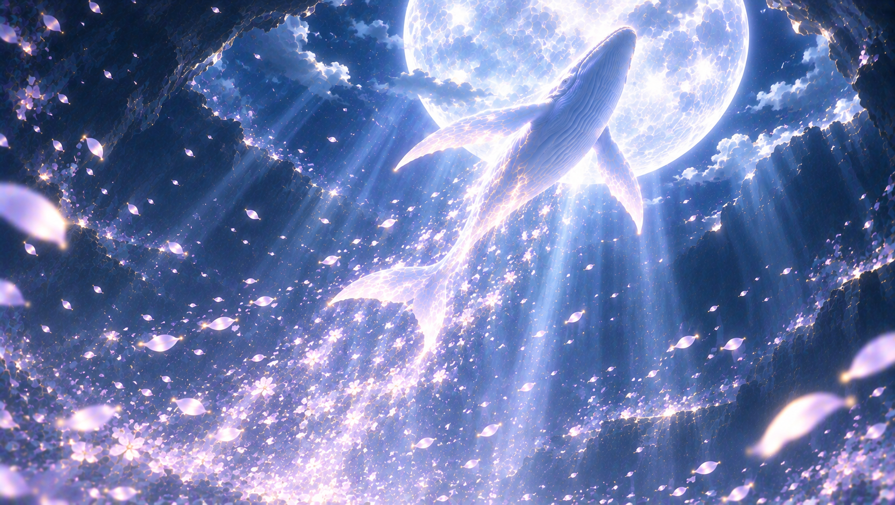</a> turn36_03 割当は暫定 |
|  turn37_01 **★ C18選定と同一** |   |   |

### C19周辺

| 候補 | 候補 | 候補 |
|---|---|---|
| <a href="keyframe-test/results/C11-C19-2026-11-21/variants/turn39_01.png">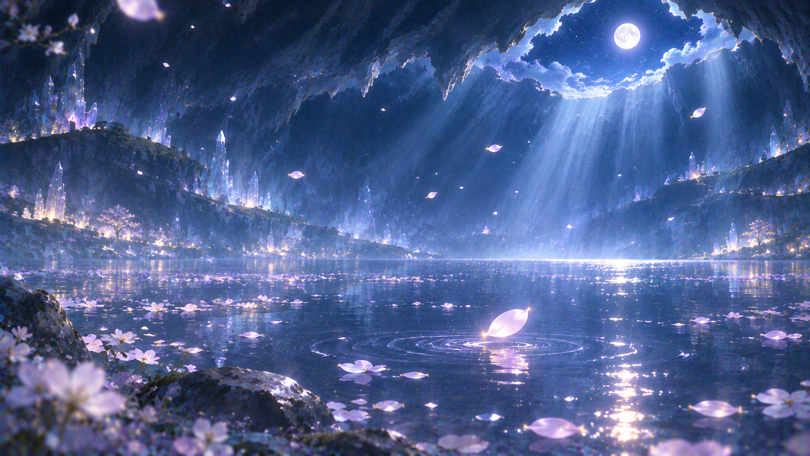</a> turn39_01 割当は暫定 |  turn39_02 割当は暫定 | <a href="keyframe-test/results/C11-C19-2026-11-21/variants/turn39_03.png">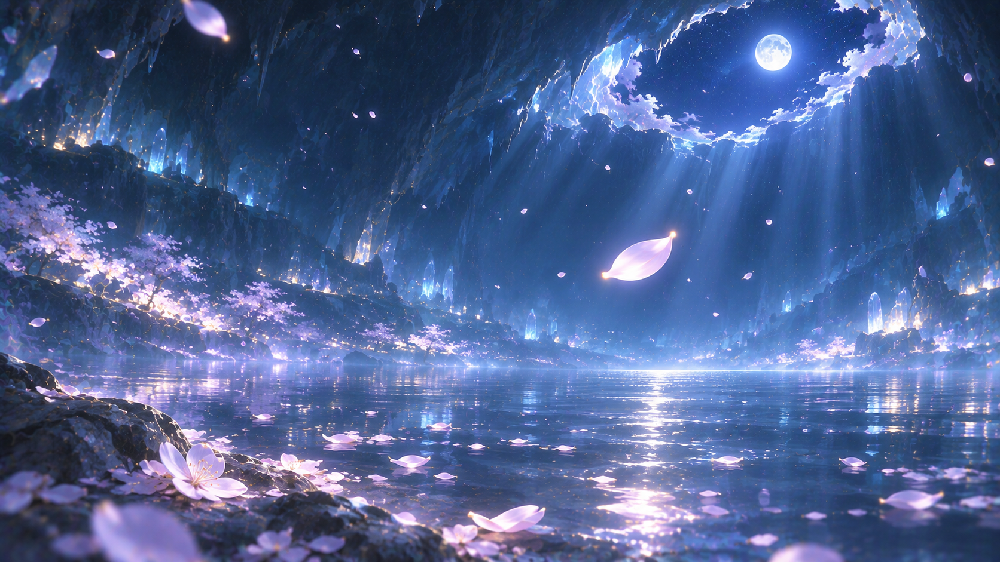</a> turn39_03 割当は暫定 |
|  turn40_01 割当は暫定 | <a href="keyframe-test/results/C11-C19-2026-11-21/variants/turn40_02.png">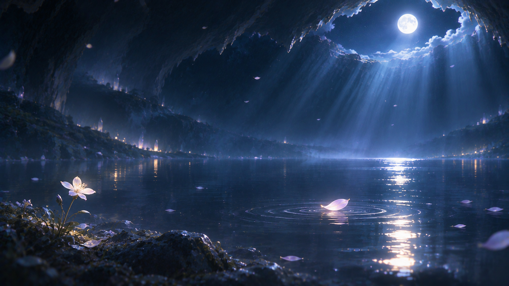</a> turn40_02 割当は暫定 |  turn41_01 割当は暫定 |
| <a href="keyframe-test/results/C11-C19-2026-11-21/variants/turn41_02.png">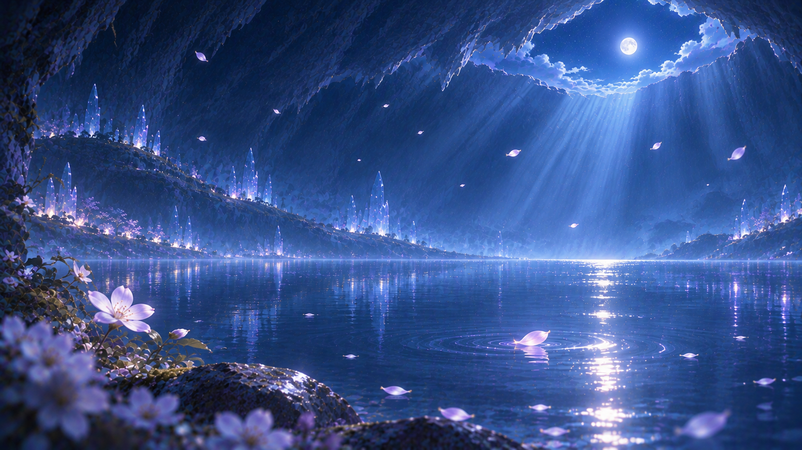</a> turn41_02 **★ C19選定と同一** |   |   |

## 旧10カット構成の原画（**現状すべて不採用／履歴のみ**）

**作者決定（2026-11-22）：この節の旧原画はすべて現状不採用。** 2026-11-19時点の旧10カット構成であり、現行v10のC01–C19に番号だけで割り振らない。旧原画保存フォルダ名の `adopted/` は過去の意味で、今回の採用とは無関係。削除せず、履歴リンクだけ残す。**C16のOld B例外はここには含めず、C16欄に現状採用として掲出した。**

| 旧ファイル | 旧題材 |
|---|---|
| [CUT02_KEY_moon.png](../images/adopted/CUT02_KEY_moon.png) | 月 |
| [CUT03_KEY_flower.png](../images/adopted/CUT03_KEY_flower.png) | 一輪の花 |
| [CUT04_KEY_water_shadow.png](../images/adopted/CUT04_KEY_water_shadow.png) | 水面下の影 |
| [CUT05_KEY_whale_emerges.png](../images/adopted/CUT05_KEY_whale_emerges.png) | 浮上 |
| [CUT06_KEY_eye.png](../images/adopted/CUT06_KEY_eye.png) | 瞳 |
| [CUT07_START.png](../images/adopted/CUT07_START.png) | 発光前 |
| [CUT07_END.png](../images/adopted/CUT07_END.png) | 発光後 |
| [CUT08_KEY_petal_release.png](../images/adopted/CUT08_KEY_petal_release.png) | 花びらの散布 |
| [CUT09_KEY_climax.png](../images/adopted/CUT09_KEY_climax.png) | 花吹雪の頂点 |
| [CUT10_END_moonlight_dimmed.png](../images/adopted/CUT10_END_moonlight_dimmed.png) | 終端の減光 |

補助（いずれも現状不採用）：[旧冒頭ENV](../images/alternate/CUT01_ENV_opening_candidate.png)／[旧冒頭終幕一致候補](../images/alternate/CUT01_END_matching_source_candidate.png)／[旧退場開始候補](../images/alternate/CUT10_START_departure.png)。最新のv10では鯨は岩岬裏ではなく天井の裂け目へ昇るため、旧退場経路は不一致。

## 確認時の優先事項

1. C01・C02の現行原画を特定し、C01の冒頭構図をC19と比較。
2. 未マージPR #27のC03–C08を目視評価し、採否を記録。
3. PR #28のC09・C10原本PNGを転送・検証したうえで、仮採用を再評価。
4. C11–C15・C17–C19の比較原画から残す版を選び、C11.5を独立カットにする必要があるか検討。
5. C16は**Old Bパターンを現状採用**として他カットとの接続を確認。Old初稿と、旧10カット構成の原画は不採用を維持する。
6. すべての暫定採用が済んだ後、鯨・花・洞窟・裂け目・月・光・鯨の動き・感情ライン・カメラワークを再設計。**この棚卸しは構成変更を妨げない**。

## 履歴と参照

- [PR #26：C03–C06旧試作の台帳（PNG未転送、旧C05/C06は不採用）](https://github.com/Makeinu1/DaD_Ruosuen/pull/26)
- [PR #27：C03–C08の実画像6枚（未マージ）](https://github.com/Makeinu1/DaD_Ruosuen/pull/27)
- [PR #28：C09–C10仮採用画像の台帳のみ（PNG未転送）](https://github.com/Makeinu1/DaD_Ruosuen/pull/28)
- [PR #29：C11–C19比較原画の登録](https://github.com/Makeinu1/DaD_Ruosuen/pull/29)
- [C11–C19登録台帳](keyframe-test/results/C11-C19-2026-11-21/README.md)
- [旧原画台帳](../art-manifest.md)

2026-11-22改訂。**今回の作者判断を最優先**し、旧構成は不採用、C16はOld Bを採用とした。他カットの原画判定は当時の作者判断とファイル実在確認を分けて記載。未確認・未転送を採用済みと表記しない。
