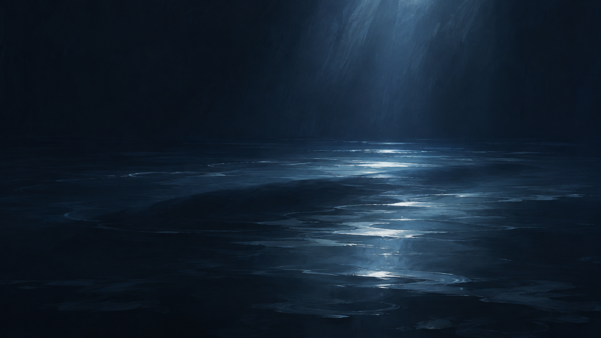
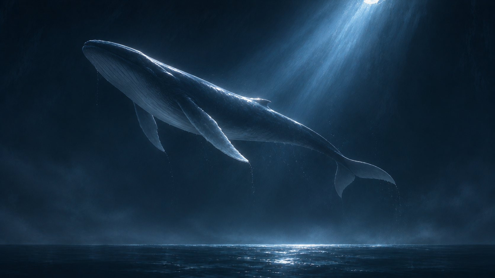
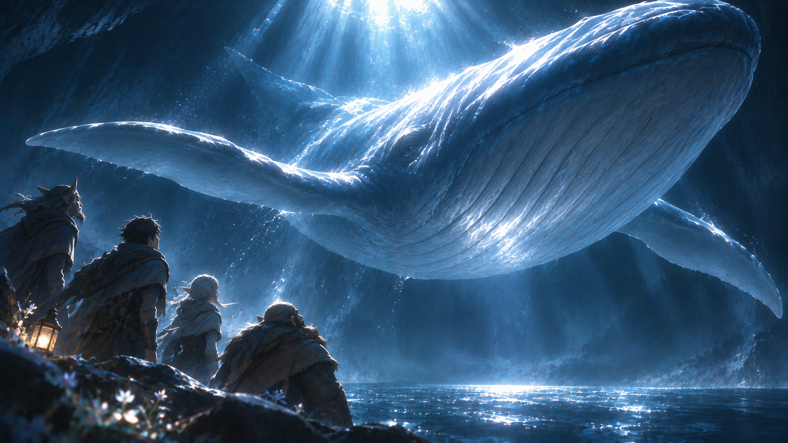
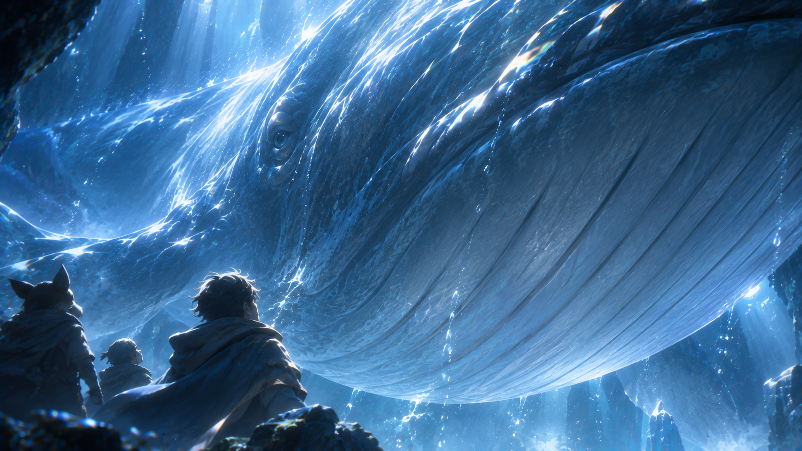
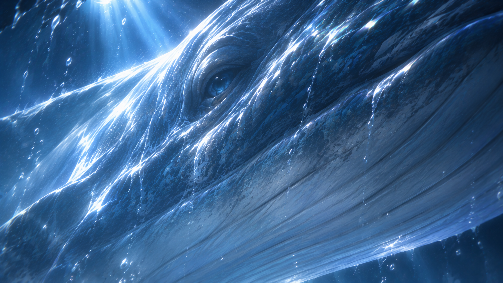
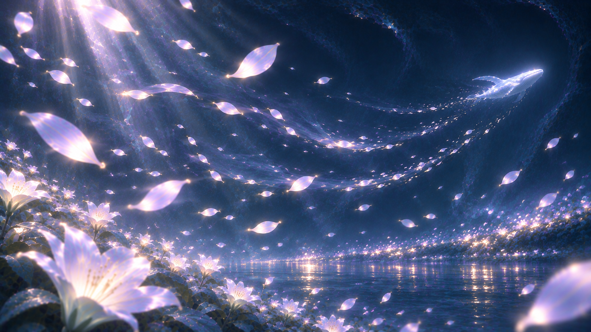
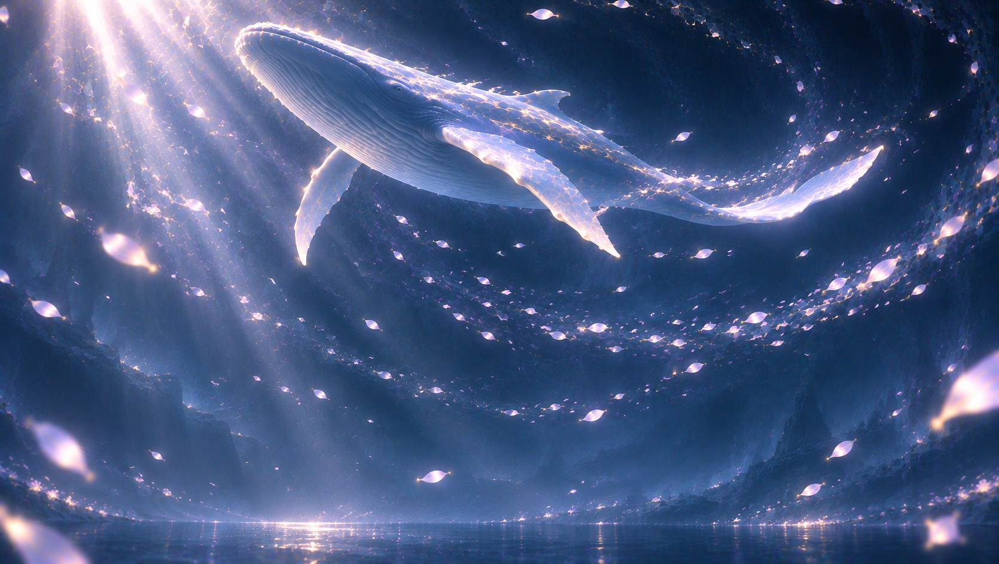
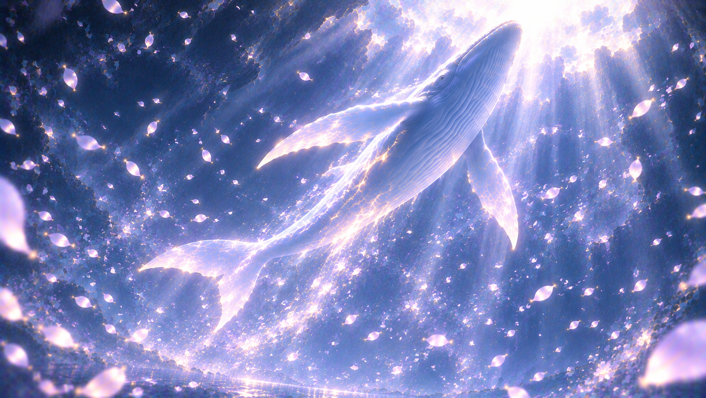
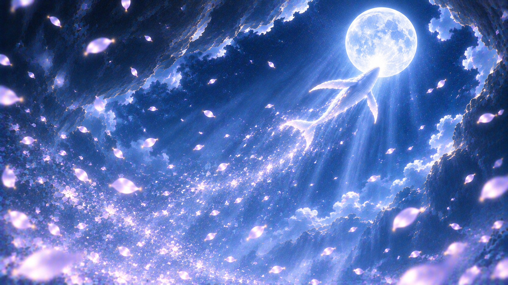

# 第一話エンディング『空に降る雪』｜C01–C19 原画付きカットレビュー（2026-11-22・改訂版）

> **DM専用・プレイヤー閲覧禁止。シナリオの重大なネタバレを含む。** GitHubリポジトリは公開設定であり、この注意書きはアクセス制御ではない。公開Pagesやプレイヤー向け文書には掲載しない。

このファイルは**作者が絵を見比べ、残す画像を決めるための棚卸し**。カット割り・時間・設定・原画の採用を新たに確定するものではない。比較原画34枚の比較一覧は今回の整理対象から外した（既存の原本PNGは今回の更新では削除しない）。**番号が同じでも旧10カット構成の「CUTxx」と現行19カット構成の「Cxx」は別物**として扱う。

## 作者の今回の決定（2026-11-22）

- **旧構成の原画は現時点ですべて不採用**。以前の台帳やGitHubの `adopted/` というフォルダ名は**過去の判定**であり、現在の採用を意味しない。旧構成の画像は現行カットの直下には表示せず、末尾に記録用リンクとして残す。
- **例外：C16はOldフォルダの旧Bパターン `C16_B_petals_dense_no_flower.png` を現状の採用原画とする**。以前に作者が承認した、花吹雪を高密度化し丸ごとの花を除いたB版を指す。**`C16_t01.png`（旧初稿）は不採用**。
- C16のOld B採用は**現在の原画選別に関する決定**。今後の空間・鯨・花・カメラ・感情ラインの見直しで変更され得る。旧原画台帳や過去の判断は履歴として残し、今回の決定をこのレビューで優先する。

- 基準： [v10・19カットの仮決め](v10-shotlist.md)、[感情ラインv9](emotion-line-v9.md)、[鯨の動線v10](whale-motion-v10.md)。
- **PR #27 の C03–C08** は画像原本が存在するが2026-11-22確認時点では**未マージ**。本書では当該PRのコミットSHA固定の画像URLで表示する（後のマージで相対リンクに統一可能）。[PR #27](https://github.com/Makeinu1/DaD_Ruosuen/pull/27)。
- **PR #28 の C09・C10** はメタデータのみでPNGのGitHub転送が未完了。会話で仮採用したPNGをここでは表示できない。[PR #28](https://github.com/Makeinu1/DaD_Ruosuen/pull/28)。
- C11–C19の原画の所在は [原画台帳](keyframe-test/results/C11-C19-2026-11-21/README.md) を参照。ただし**C16の採否は今回の作者判断を優先**し、台帳ではOldと分類されたBパターンを現状採用とする。
- **2026-11-22追加決定**：`比較原画34枚：候補一覧` は本レビューから削除。今後は各カットの現行候補に集中する。過去の比較画像の原本PNGはこのPRでは削除しない。

## 一覧・レビュー記録

| カット | 仮タイム | 内容 | 現在の取り扱い | 作者の再判定 |
|---|---|---|---|---|
| [C01](#c01) | 0–6.0秒 | 月光と最初の一輪 | **新原画を作者採用**・PNG未転送／旧構成は不採用 | 採用（2026-11-22） |
| [C02](#c02) | 6.0–10.0秒 | 水際の波紋 | **A静止→B波紋の2枚を作者採用**・PNG未転送 | 採用（2026-11-22） |
| [C03](#c03) | 10.0–14.0秒 | 水面下の巨大な影 | 暫定決定／PR #27（未マージ） | 未記入 |
| [C04](#c04) | 14.0–18.0秒 | 静かな浮上 | 暫定決定／PR #27（未マージ） | 未記入 |
| [C05](#c05) | 18.0–21.0秒 | 空への上昇 | 描き直し版／採否要確認 | 未記入 |
| [C06](#c06) | 21.0–25.0秒 | 空中から頭上へ接近 | 仮採用・後日修正／PR #27 | 未記入 |
| [C07](#c07) | 25.0–28.0秒 | 目前に迫る巨大な頭部 | 原画あり／採否要確認 | 未記入 |
| [C08](#c08) | 28.0–32.0秒 | 読めない瞳の一瞥 | 原画あり／採否要確認 | 未記入 |
| [C09](#c09) | 32.0–35.0秒 | 背面ロール | **新規生成版を暫定採用・PNG未転送**／以前のPR #28版は履歴 | 暫定採用（2026-11-22） |
| [C10](#c10) | 35.0–37.0秒 | 光へ遠ざかる背中 | **新規生成版を採用・PNG未転送**／旧2案目は履歴 | 採用（2026-11-22） |
| [C11](#c11) | 37.0–41.0秒 | 月光接触・鯨の点火 | 暫定採用 | 未記入 |
| [C12](#c12) | 41.0–44.5秒 | 光を受ける花 | 暫定採用 | 未記入 |
| [C13](#c13) | 44.5–47.0秒 | 花びらの静止 | 採用 | 未記入 |
| [C14](#c14) | 47.0–52.0秒 | 花びらの呼応・集合 | **既存候補を作者承認** | 採用（2026-11-22） |
| [C15](#c15) | 52.0–57.0秒 | 高空で自由遊泳 | 採用 | 未記入 |
| [C16](#c16) | 57.0–63.0秒 | 高密度の群舞と水鏡 | **Old Bパターンを現状採用（作者決定）** | 採用（2026-11-22） |
| [C17](#c17) | 63.0–68.0秒 | 花吹雪と上昇 | 採用 | 未記入 |
| [C18](#c18) | 68.0–73.0秒 | 裂け目と遠ざかる鯨 | 採用 | 未記入 |
| [C19](#c19) | 73.0–80.0秒 | 静かな湖、最後の一枚 | 最終採用 | 未記入 |

**再判定の候補**：残す／別案を採用／要修正／再制作／カット自体を再検討。画像への採用は映像全体の構成確定を意味しない。

## C01–C19：カット内容と原画

### C01
**月光と最初の一輪／0–6秒**。**2026-11-22に新規生成した原画を作者が『C01を採用』と承認**。本書へのPNG転送は未実施であり、旧構成の画像を代用しない。以前の冒頭用候補2点は不採用（末尾の履歴参照）。

今後の課題：採用PNGのGitHub原本登録、C19の採用画と比較した月・裂け目・岸・花・カメラ整合の確認。採用判断と幾何学的整合検証は別扱い。

### C02
**水際の波紋／6–10秒**。**2026-11-22に作者が2枚とも採用**。同一固定カメラ・水際の低い視点で、**C02-A：月光を静かに映す湖面 → C02-B：奥から届くうねりで反射が歪む**。生成物を16:9でそれぞれ切り出した原画2枚。**採用PNGのGitHub原本登録は未実施**。旧CUT02（月の画）は現状不採用。

### C03
**水面下の巨大な影／10–14秒**。作者暫定決定、[PR #27](https://github.com/Makeinu1/DaD_Ruosuen/pull/27) の画像原本。**次回の作画確認ポイント（2026-11-22、未採用の検討案）**：C02の波が発する奥へ目を向け、岸から24mm相当の広角で月光に接する水面下のさらに暗い巨大な影をほんの一部分だけ見せる。影の移動に伴うごく小さなパン。輪郭を鯨と認識できるほど明示せず、C04の浮上で初めて正体が分かる余白を残す。暗闇の壁面・広大な全景・花吹雪は描かない。

### C04
**静かな浮上／14–18秒**。作者暫定決定、PR #27。

### C05
**水面から完全に離れた上昇／18–21秒**。旧C05はまだ浮上中であったため不採用。下は新しい描き直し版（明示的な最終採用記録は未確認）。

### C06
**上空から冒険者へ接近／21–25秒**。仮採用・要修正。人物を画面に入れず、鯨の胴体を見せ、月光を遮る動きを明瞭に。C07の巨大頭部との段階差を確保する。

### C07
**目前に迫る巨大な頭部／25–28秒**。PR #27の原画あり。採否の最終判定は再確認。

### C08
**瞳の一瞥／28–32秒**。PR #27版を現行候補として示す。感情の読めない一瞥が狙い。

旧試作 `C08_t01.png` は**現状不採用**。比較の必要があれば[旧試作画像](keyframe-test/results/C08_t01.png)を履歴として参照する。

### C09
**背面ロール／32–35秒**。**作者が2026-11-22に新しいC09原画を『一旦これで採用』と暫定承認**。2026-11-22の会話で、作者が『これが一番近い』として提示した参考画を踏まえ、最後に一から生成した**低い右寄りカメラ、手前に迫る白い腹、奥へ大きく反る胴体、右上の尾びれ、前後に広がる胸びれ**の原画が対象。採用原画はその最後の生成画像（生成ID `06a91356-1c67-47e3-aa6b-fd523b0d3d56`）で、**GitHubにPNGは未転送**。以前のPR #28の仮採用PNG（`C09_20261121_provisional.png`）とは別物であり、取り違えない。

**今後の動画化での整合チェック**：C07の冒険者側からの低いカメラ位置を引き継ぐこと、C08の一瞥から反り返りに移りC10の後ろ姿へ連続すること。鯨はすでに空中にいて、水しぶきなし。全身の発光は月光接触後のC11まで起こさない。**現行原画は作者の暫定採用を優先**し、残る光表現・解剖学上の気になる点は動画化時の修正候補とする。

### C10
**光へ向かう後ろ姿／35–37秒**。**2026-11-22、作者がこの会話で新規生成したC10原画を「いいね採用する」と正式採用。** 対象は生成ID `7ed1e14a-0bc2-45db-ab08-56213f6a4a59` の**最後に提示した画像**。地上の低いカメラから、すでに空中にいる白鯨の**右寄りの斜め後方**を捉え、尾が手前左下、胴体と暗い背中が中央から奥の右上へ伸び、広げた左右の胸びれ、進行先の月光柱を描く。湖面は画面下端。**顔は見えず、鯨はまだ自発光しない**。

**採用状態とファイル実体を区別**：上記の採用は作者による画の承認であり、**PNG原本のGitHub転送は未実施**。旧PR #28の `C10_20261121_alt02_provisional.png`（別画像・2案目仮採用・形態修正待ち）とは混同しない。旧版への指摘（右胸びれの不自然な位置・腹の畝が顔に続いて見える点）は履歴として保持する。

**C09〜C11の接続確認は未完了**：C09の採用画で示された腹側の背面ロールからC10の後ろ姿への自然な遷移、C10の月光柱への進行方向からC11の吻先接触・吻先→尾の発光への自然な遷移を、動画化に先立ち確認すること。月光柱の位置・カメラの左右・スケール・胸びれと尾びれの配置を既存C11のPNGと**目視照合**する必要がある。**採用したC10の構図を優先しつつ、未検証のC11との完全一致を主張しない**。

### C11
**月光接触・点火／37–41秒**。暫定採用。

**C11.5（正式な19カット内の独立カットではない中間構図）**：余剰胸びれの修正を経た暫定採用画。C11とC12の間に挿入するかは未決。

### C12
**岸の花が光を受ける／41–44.5秒**。暫定採用。

### C13
**花びらが離れ、静止する／44.5–47秒**。採用。鯨は画面外で、光だけが届く。

### C14
**花びらの一斉の呼応／47–52秒**。銀白の波を描いた既存候補 `C14_latest_test.png` を、**作者が2026-11-22に『C14は既存のもの承認で良い』と正式採用**。画像の実体や保存パスは変更しない。候補フォルダ名より新しい作者判定を優先する。

### C15
**湖上高空の自由遊泳／52–57秒**。作者採用。花畑を画面に入れない、より高い位置で泳ぐ案。

### C16
**鏡面湖と高密度の花吹雪／57–63秒**。

**現在採用：Oldに格納されているBパターン**（作者決定、2026-11-22）。高密度の花吹雪・丸ごと飛ぶ花の除去・螺旋を強制しない自然な群舞を狙った、以前に承認済みの画像。フォルダ名は `Old/` のまま保存し、ファイルを移動・複製しない。

**不採用：Oldの初稿**。大きな渦や丸ごとの花などに問題があり、現在の採用画ではない。[旧初稿を見る](keyframe-test/results/Old/C16_t01.png)。

今後の見直し項目：花びら・微光する種子の見え方、遠景の暗さ、水面への反射、周囲のカットとの接続。現在のBパターンを映像の最終画として固定するものではない。

**2026-11-22 作画再検討（未採用の新C16試作への指摘）**：C15から湖上高空の自由遊泳を維持し、花畑・近景の花株を画面に出さず、C17の上昇動線へ連続させる。花吹雪は乳白色を基調に、鯨の自発光による透過光で柔らかな金色を含ませる。月光の照度は抑え、鯨の光を主役にする。**FL-01 v0.8 の散布体**は「実際の花弁1枚（約2cm、繊細な脈・緩やかな波打ち）＋付け根の小果実1個（約2–3mm）」で、**果実だけが微光**する。独立種翼・丸ごと飛ぶ五弁花・花弁全体の自発光・綿毛や光球への変形は禁止。直近の新C16生成画には、空中と湖面に丸ごとの花や独立種翼風の粒子が多く描かれ、現行設定と不整合があるため**未承認の検討画**として扱う。採用済みOld Bは、新しいC16に作者が承認を出すまでは現状採用のまま。資料正本：[FL-01 v0.8](../../flower.md)、[制作台帳](../production/flower/README.md)。

### C17
**花びらとともに上昇／63–68秒**。採用。花吹雪の自然な散らばりとC18への上向きの接続を重視。

### C18
**裂け目と遠景の鯨／68–73秒**。採用。鯨を遠景に小さくした版。

### C19
**静かな湖に戻る／73–80秒**。月を小さくした「最後の2枚目」が最終採用。

**映像化時の要確認**：一枚の花びらは旧演出ではP0の近くへ舞い降りるが、選定画では湖面側に見える。どちらを最終画面にするかは未決。

## 旧10カット構成の原画（**現状すべて不採用／履歴のみ**）

**作者決定（2026-11-22）：この節の旧原画はすべて現状不採用。** 2026-11-19時点の旧10カット構成であり、現行v10のC01–C19に番号だけで割り振らない。旧原画保存フォルダ名の `adopted/` は過去の意味で、今回の採用とは無関係。削除せず、履歴リンクだけ残す。**C16のOld B例外はここには含めず、C16欄に現状採用として掲出した。**

| 旧ファイル | 旧題材 |
|---|---|
| [CUT02_KEY_moon.png](../images/adopted/CUT02_KEY_moon.png) | 月 |
| [CUT03_KEY_flower.png](../images/adopted/CUT03_KEY_flower.png) | 一輪の花 |
| [CUT04_KEY_water_shadow.png](../images/adopted/CUT04_KEY_water_shadow.png) | 水面下の影 |
| [CUT05_KEY_whale_emerges.png](../images/adopted/CUT05_KEY_whale_emerges.png) | 浮上 |
| [CUT06_KEY_eye.png](../images/adopted/CUT06_KEY_eye.png) | 瞳 |
| [CUT07_START.png](../images/adopted/CUT07_START.png) | 発光前 |
| [CUT07_END.png](../images/adopted/CUT07_END.png) | 発光後 |
| [CUT08_KEY_petal_release.png](../images/adopted/CUT08_KEY_petal_release.png) | 花びらの散布 |
| [CUT09_KEY_climax.png](../images/adopted/CUT09_KEY_climax.png) | 花吹雪の頂点 |
| [CUT10_END_moonlight_dimmed.png](../images/adopted/CUT10_END_moonlight_dimmed.png) | 終端の減光 |

補助（いずれも現状不採用）：[旧冒頭ENV](../images/alternate/CUT01_ENV_opening_candidate.png)／[旧冒頭終幕一致候補](../images/alternate/CUT01_END_matching_source_candidate.png)／[旧退場開始候補](../images/alternate/CUT10_START_departure.png)。最新のv10では鯨は岩岬裏ではなく天井の裂け目へ昇るため、旧退場経路は不一致。

## 次に作る原画（現状の不足分）

この段階では**現行の19カットを仮の作業単位**とし、空間設定・鯨の運動・感情ライン・カメラワークの再設計で後から大幅に変更してよい。制作の優先度と原画の**実在／採用状態**を区別する。

| Cut | 区分 | 作成・修正すべき画 | 制作時の特に重要な点 |
|---|---|---|---|
| **C01** | **作者採用済み／PNG未転送** | 新原画のGitHub原本登録 | C19と同じ視点・画角かは後日照合。旧構成のENV候補は不採用 |
| **C02** | **A/Bの2枚を作者採用済み／PNG未転送** | A：静止した湖面と月光反射、B：奥から届く波で歪んだ反射 | 固定カメラの連続2フレームとして扱い、原本PNGをGitHub登録する |
| **C09** | **新規原画を暫定採用済み／PNG未転送** | 採用されたC09のPNG原本登録とC07・C08・C10との接続検証 | 低い右寄りの視点、手前に迫る腹、奥に反る胴体。鯨は空中、発光前 |
| **C10** | **新原画を作者採用済み／PNG未転送** | 採用PNGの原本登録、C09・C11との接続の確認 | 月光へ向かう斜め後ろ姿、未発光、顔は見せない。既存C11との実画像照合は未完了 |
| **C14** | **既存候補を作者採用済み** | 現在の画像を保持し、C13→C15との動画接続を確認 | 元PNGは `candidate/C14_latest_test.png` に保存済み（ファイル名・配置は未変更） |

**C01・C02（A/B）・C09・C10は新規原画を作者採用済み（C09は暫定採用）。いずれもPNGのGitHub転送は未完了。C10と既存C11との実画面接続確認は必要。C14は既存候補を作者承認済み。C16は旧Bを現状採用しつつ、C15・C17への接続を基準に再構成を議論する。C03は既存原画とC02/C04のつながりを再点検する。**

- C03・C04は暫定決定、C05は改稿画あり、C06は仮採用・要修正、C07・C08は原画あり（いずれもPR #27で未マージ）。
- C11・C11.5・C12は暫定採用、C13・C15・C17・C18・C19は採用済み。C16は作者指示により**Old Bを現状採用**。
- 「GitHub未転送」は「過去に一度も描いていない」という意味ではない。C09・C10を今回作り直す場合も、以前の判断と修正意図を保持する。
- 新しい絵の採用は、後続の世界設定・感情ライン・カメラ設計の再評価を制限しない。

## 確認時の優先事項

1. 採用済みのC01とC02-A/Bの原本PNGをGitHubに登録する。C01はC19との冒頭／終幕のカメラ整合を後で検証し、C02-A/Bは同一視点の2枚として維持する。
2. 未マージPR #27のC03–C08を目視評価し、採否を記録。
3. C09は2026-11-22の新規原画を暫定採用、C10は同日新原画を作者採用。両PNGの原本登録と、**C07・C08→C09→C10→C11のカメラ・解剖学・動線の整合性**を確認する。PR #28の旧PNG未転送状況は履歴として記録する。
4. C11–C15・C17–C19は現在の選定画を確認する。C14の既存候補は2026-11-22に採用確定。C11.5を独立カットにするかは映像構成検討時に判断する。
5. C16は**Old Bパターンを現状採用**するが、作者が2026-11-22に**C15とC17の間を自然につなぐ表現への書き直しを要求**。C15の高空自由遊泳→C16の鏡面湖と群舞の頂点→C17の花びらの上昇を検討し、作者の追加承認なしに新C16の採用に切り替えない。Old初稿と旧10カット構成の原画は不採用を維持する。
6. すべての暫定採用が済んだ後、鯨・花・洞窟・裂け目・月・光・鯨の動き・感情ライン・カメラワークを再設計。**この棚卸しは構成変更を妨げない**。

## 履歴と参照

- [PR #26：C03–C06旧試作の台帳（PNG未転送、旧C05/C06は不採用）](https://github.com/Makeinu1/DaD_Ruosuen/pull/26)
- [PR #27：C03–C08の実画像6枚（未マージ）](https://github.com/Makeinu1/DaD_Ruosuen/pull/27)
- [PR #28：C09–C10仮採用画像の台帳のみ（PNG未転送）](https://github.com/Makeinu1/DaD_Ruosuen/pull/28)
- [PR #29：C11–C19比較原画の登録](https://github.com/Makeinu1/DaD_Ruosuen/pull/29)
- [C11–C19登録台帳](keyframe-test/results/C11-C19-2026-11-21/README.md)
- [旧原画台帳](../art-manifest.md)

2026-11-22再改訂。**今回の作者判断を最優先**し、旧構成は不採用、C16はOld Bを採用。比較原画34枚の候補一覧は削除した。他カットの原画判定は当時の作者判断とファイル実在確認を分けて記載し、未確認・未転送を採用済みと表記しない。
