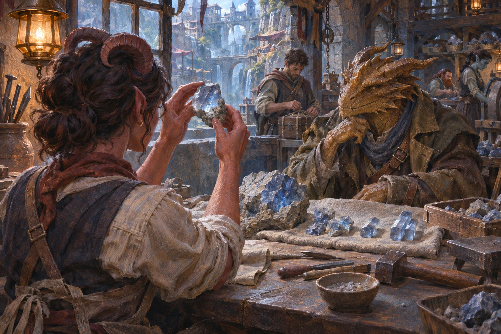

# レウナの世界

この街の灯りも、地下を飛ぶ船も。まずは、レウナで暮らす人々が知っていることを。

## 魔法が、暮らしの中にある

> 灯りをともし、工房の設備を動かし、人や荷を運ぶ。
> レウナでは、魔術と魔導技術が暮らしを支えてきた。
> その力が、**マナ**だ。利用しやすさは、土地によって違う。

## その力を、石に蓄えて運ぶ

> **魔石**は、マナを蓄えた燃料だ。
> 設備や魔導具に使えば消耗するため、人々は新しい石を必要とする。
> 品質を表す言葉は**純度**。良質な魔石は、高く買い求められる。

## かつて、船は地上の空を飛んでいた

> 約三百年前に始まった**大転流**は、各地の地形とマナの環境を変えた。
> 地上では魔石の供給が減り、魔導船も飛べなくなった。
> 暮らしは続いたが、以前と同じように力を使うことは難しくなった。

## 地下には、資源も、道も、暮らしもある

> 地下には良質な魔石が眠り、豊かなマナのある大空洞では魔導船が飛ぶ。
> 人の通う道と、その先の未踏の世界がつながっている。
> 鉱脈を探す。通れる道を確かめる。帰らない人を迎えに行く。
> **見つけたものと、知り得たこと。その両方を持ち帰るのが探索だ。**

## 暮らしのために潜る者も、願いを託す者もいる

> 「迷宮の最下層へ辿り着けば、願いが叶う」
> ルオスエンでは、そんな噂が語られている。
> 信じる者も、笑い飛ばす者もいる。その先を確かめに行く者もいる。

## その交わる場所が、ルオスエン

> 地上からは、食料や日用品を積んだ川船が着く。
> 地下からは、高価な魔石を運ぶ魔導船が着く。
> 二つの港を結ぶ街に、品物、仕事、知識、そして人々の願いが集まる。

[ルオスエンを歩く](04_自由迷宮都市と組織.md)
