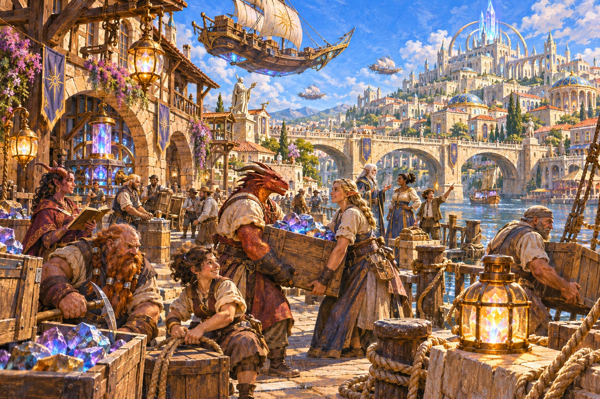
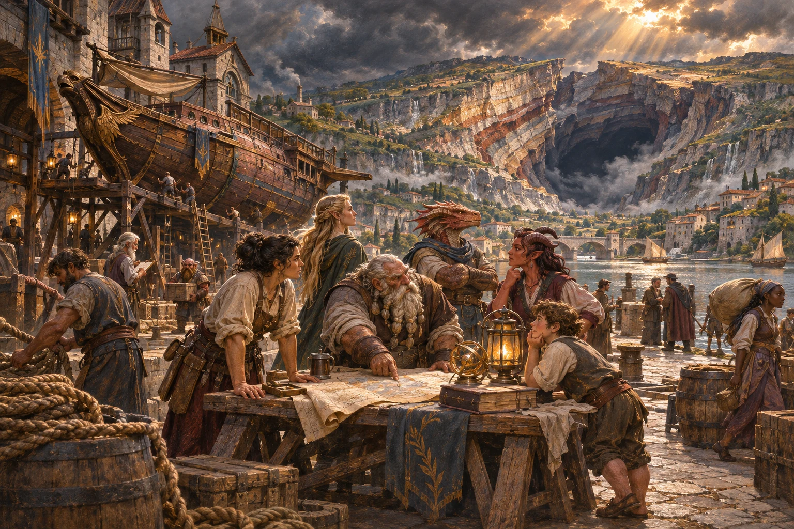
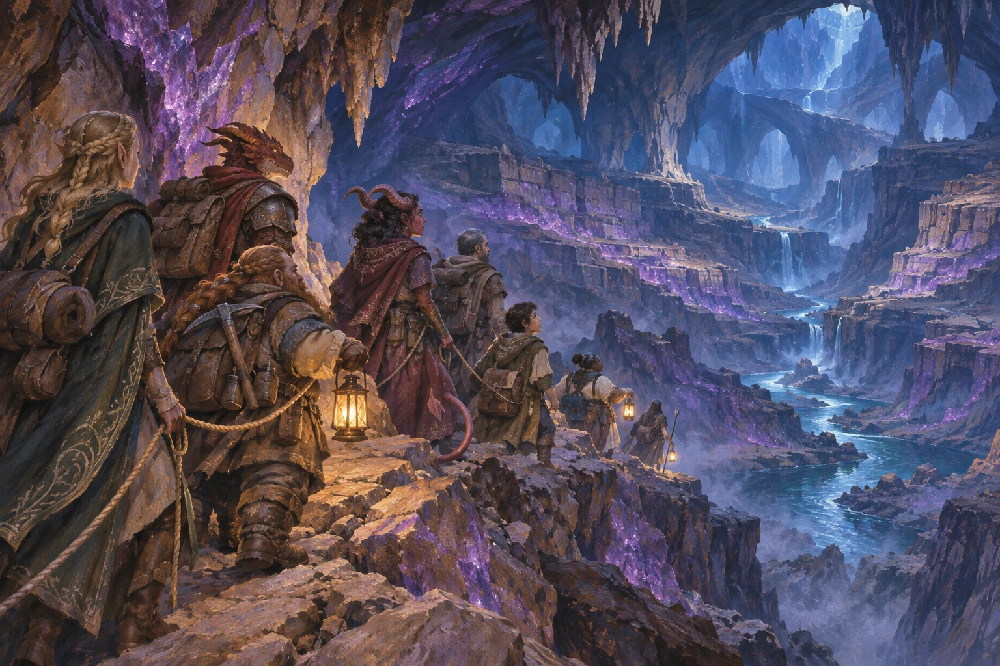
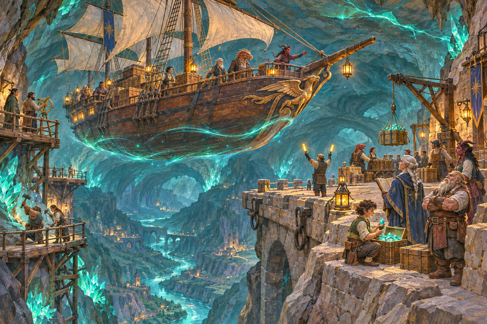
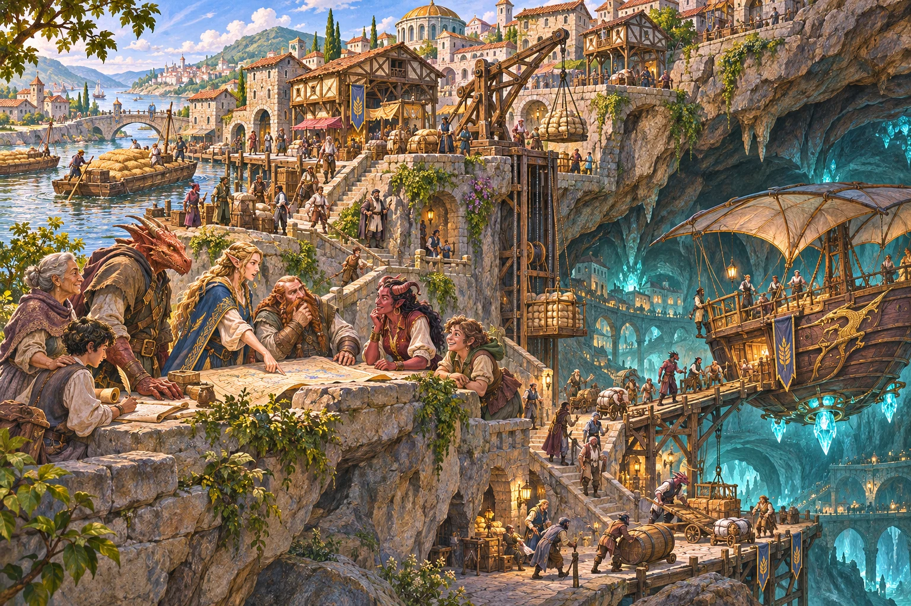
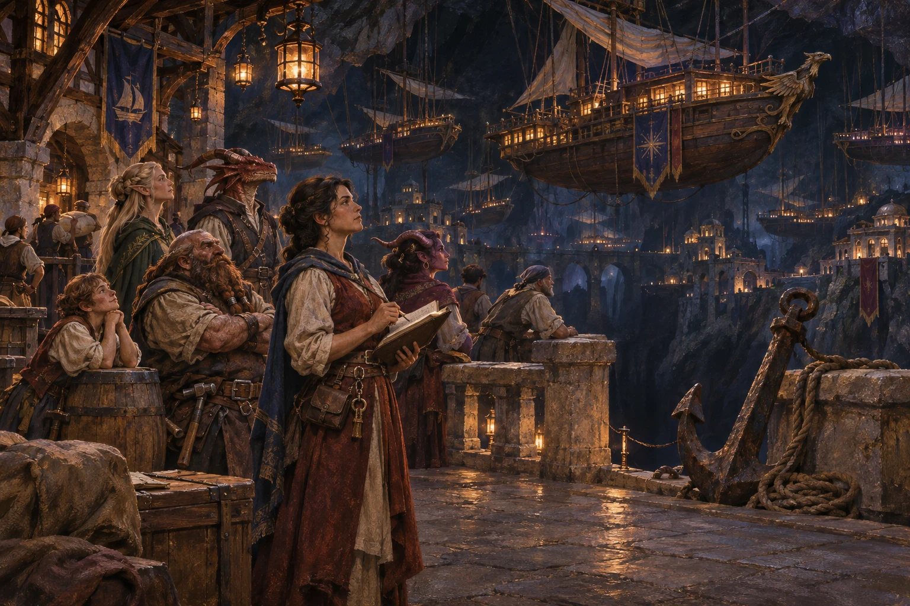

# この世界と、ルオスエンの始まり

ルオスエンがある世界の名は、レウナ。街の灯りも、地下を飛ぶ船も、長い歴史の先にある。まずは、この世界を支えてきた一つの石から。

## 魔石という、暮らしの力

> 魔術や魔導技術に使う力を、**マナ**という。そのマナを蓄え、燃料として持ち運べる石が**魔石**だ。
>
> 灯りをともし、工房の設備を動かす。使えば消耗するため、人々は新しい魔石を必要とする。品質を表す言葉は**純度**。良質な石は、暮らしも交易も支える大切な資源だった。

## 船が、地上の空を飛んでいた時代

> かつて地表には、低純度の魔石が大量にあった。各地の国や都市は、魔石と土地のマナを利用し、暮らし、産業、交通を発達させてきた。
>
> 魔導船は地上の空を行き交い、人と品物を運んでいた。今の人々が受け継ぐ技術も、その時代から続いている。

## 大転流が、世界を変えた

> 約三百年前、**大転流**が始まった。地形とマナの環境が変わり、各地で約三十年にわたって変化が連鎖した。地上の魔石供給は減り、魔導船も空を飛べなくなっていった。
>
> そして約二百七十年前、巨大地震**「大断裂」**が大地を裂いた。資源を失った国々は衰え、再編されていく。それでも人々の暮らしと、川や海、街道を使う交易は続いた。

## 裂けた大地の先に、古い世界があった

> 大断裂は、それまで届かなかった地下空洞や、古い鉱床への道を開いた。地上では乏しくなった魔石が、その先には眠っていた。
>
> 迷宮は、自然洞窟、断層、地下水脈、人の築いた施設が重なる広大な地下世界だ。鉱脈を探す者、道を測る者、資源を採る者たちが、少しずつ未知の先へ踏み出していった。

## 船は、地下の空へ

> マナの豊かな地下の大空洞では、魔導船を再び飛ばすことができた。人々は受け継いだ技術を使い、新しい航路をひらいていった。
>
> 船の維持と運航には、多くの費用がかかる。地下の船は主に高価な魔石などを運び、食料や日用品の大量輸送は地上の川船や街道が担う。二つの流れを結ぶ場所に、人と仕事が集まり始めた。

## 小さな川港から、二つの港の街へ

> ルオスエンは、もとは**セレド王国**の辺境にある小さな川港だった。大断裂と地下航路の発見を機に、地上と地下をつなぐ交易都市へ育っていく。
>
> 地上からは食料や木材が、地下からは魔石が届く。荷を運ぶ人、船を造る人、石を見立てる人、道を記録する人。その営みが、いまの街を築いた。

## そして、自由迷宮都市ルオスエンへ

> 港が栄えるにつれ、王国と外国商会の権益争いが深まった。約百五十年前、衝突寸前の港で船が一斉に動きを止めたという**「停船の夜」**。黒い錨を持ち帰った謎の帰還者の話とともに、今も街で語られる伝説だ。
>
> 自治を築いたのは、その後も交渉を重ねた人々だった。港湾書記ミラら住民の働きかけを経て、約百四十年前に**自由港協約**が成立する。セレド王国が滅びた今も、この街は自治と通商を守り続けている。

仕事のために。まだ知らない世界を確かめるために。「迷宮の最下層へ辿り着けば、願いが叶う」という噂を追って。生まれも目的も異なる人々が、今日もルオスエンへやって来る。

次は、その街を歩いてみよう。君の人物が関わる相手も、そこで見つかるかもしれない。

[ルオスエンを歩く](04_自由迷宮都市と組織.md)
