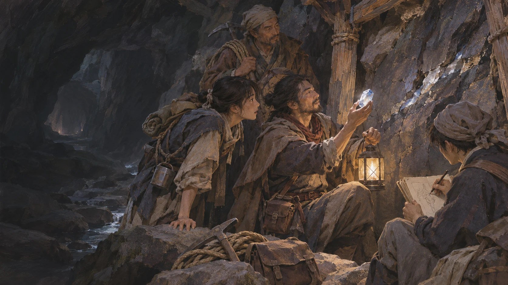

# 世界を知る

魔石が支えてきた文明は、大転流を経て姿を変えた。その歴史の先に、君が歩くルオスエンがある。

## 魔石――暮らしを動かす石

> この世界、**レウナ**では、魔術や魔導技術に使う力を**マナ**という。**魔石**は、そのマナを蓄えた特殊な結晶鉱物だ。使えば消耗するが、必要な場所へ運んで使える。
>
> かつて地表には魔石が豊富にあり、人々は灯りをともし、工房を動かし、船を空へ飛ばしていた。小さな石に蓄えられた力が、街の暮らしを支えていた。

## 大転流――かつてのようには得られない

> 約三百年前、**大転流**が始まった。地形とマナの環境の変化は約三十年にわたり、各地へ連鎖した。地上の魔石は、かつてのようには得られなくなった。
>
> 人々の日々の営みは続いた。灯りや工房、運送を支える力が乏しくなり、国も都市も変化を迫られた。暮らしをつなぐため、人々は新しい供給源を探し始めた。

## 大断裂――地下で見つかった可能性

> 約二百七十年前、巨大地震**「大断裂」**が大地を裂いた。セレド王国の辺境にあった小さな川港、**ルオスエン**の傍らにも、古い地下空洞へ続く道が開いた。
>
> その地下で、**高純度の魔石**が見つかった。暮らしを動かす力が、ここには眠っている。その知らせが人々の目をルオスエンへ向け、鉱脈を確かめ、道を拓く仕事を生んでいく。

## 人が集まり、街が育つ

> 富を求める者。技を携える者。未知を確かめたい者。山師、鉱夫、職人、荷運び、商人たちが、それぞれの理由と道具を持って、開拓の始まるルオスエンへ集まった。
>
> 人が集まり、仕事が生まれ、道と街が少しずつ育っていく。世代を重ねて築かれた**いまのルオスエン**にも、新たな仕事や未知を求める人々が集まる。君が歩くのは、その街だ。

君は、何を求めて、この街へ？

まずは、この街で暮らす人々を訪ねてみよう。

[ルオスエンを歩く](04_自由迷宮都市と組織.md)
