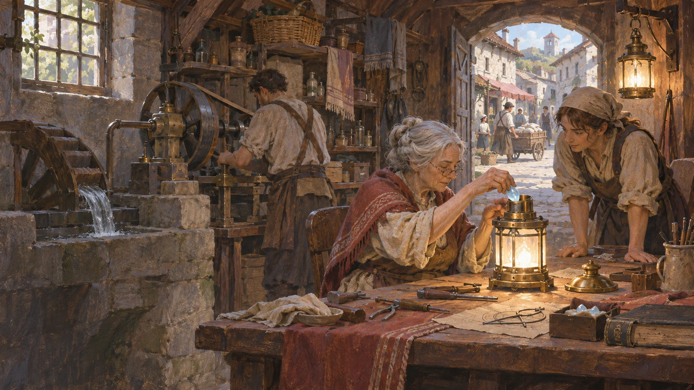
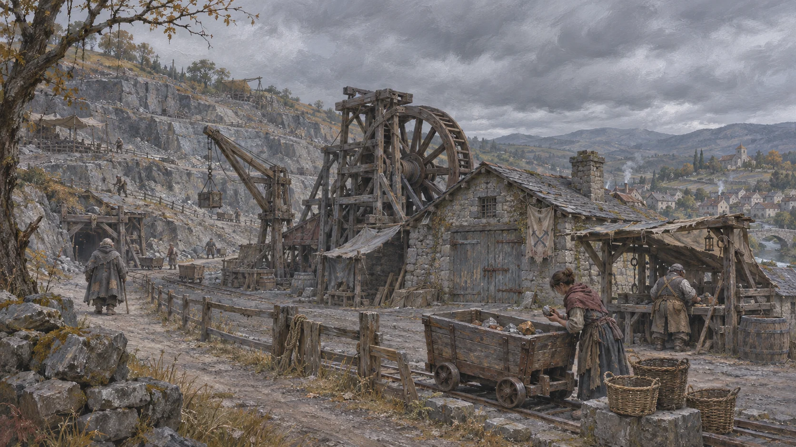
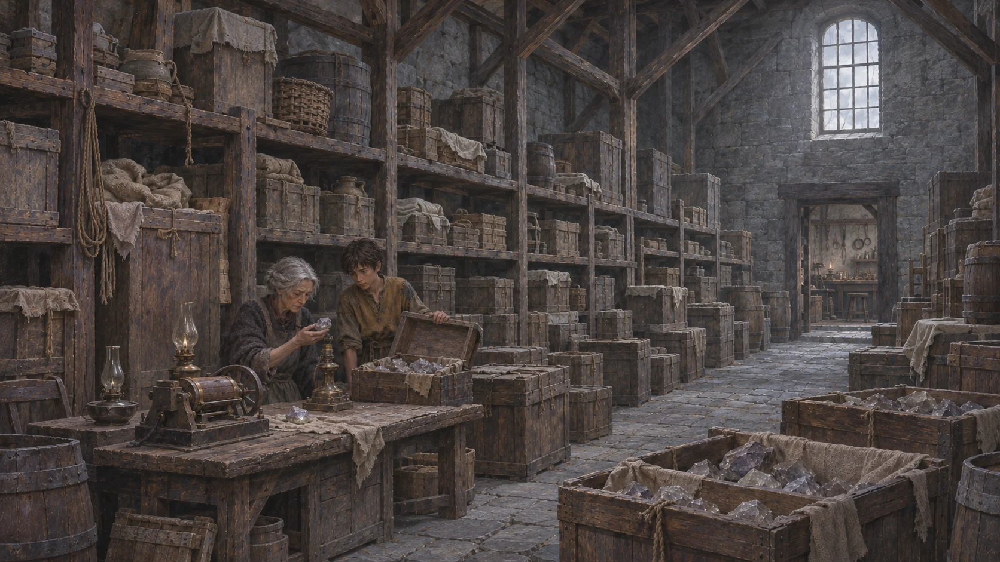
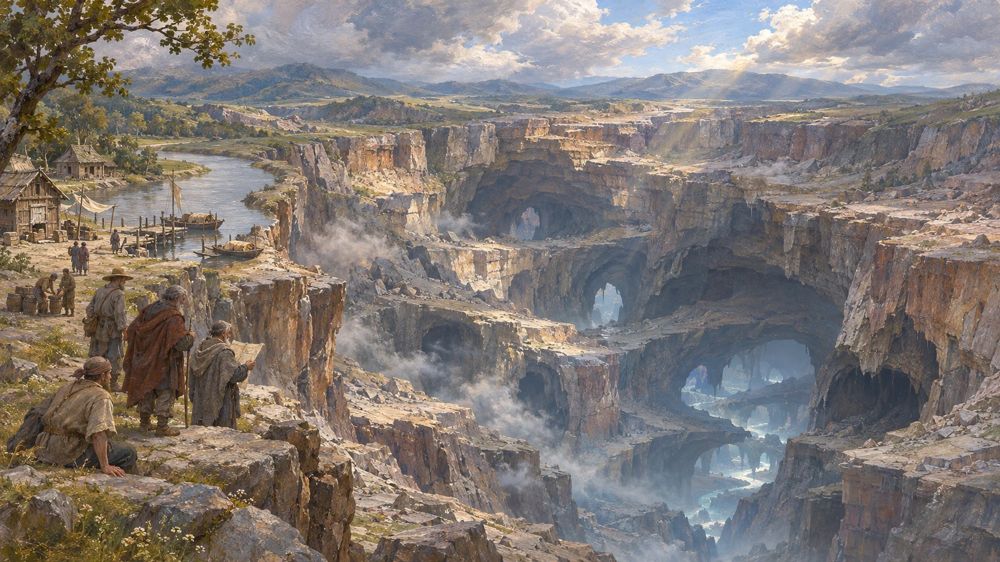
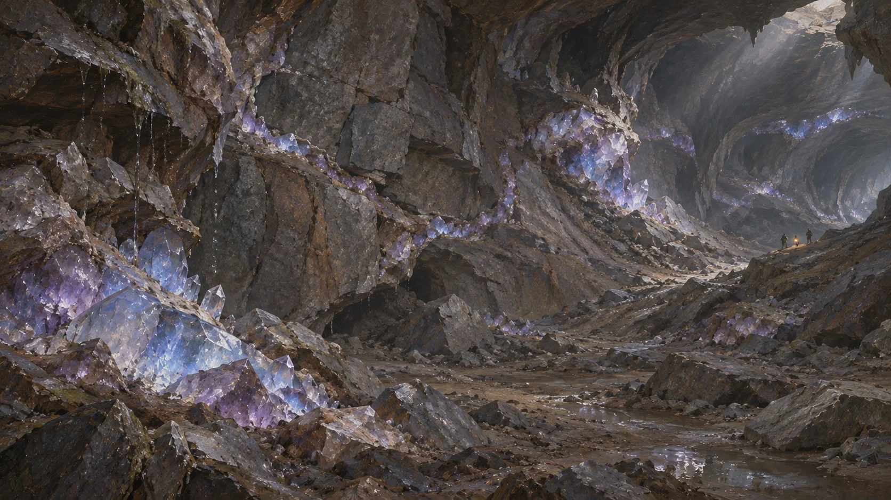

# 世界を知る

ルオスエンで見た魔導船は、なぜ地上では飛ばないのだろう。地下の魔石がこれほど求められるのは、なぜだろう。もっと知りたくなった人へ、この街に至るレウナの歴史をたどろう。ここを全部読まなくても、冒険は始められる。

## 魔石とは

大転流以前。魔石の力が、暮らしから大空へ広がっていた時代。

### 小さな石が、暮らしを動かす

> この世界、**レウナ**では、魔術や魔導技術に使う力を**マナ**と呼ぶ。**魔石**は、その力を蓄えた結晶鉱物だ。必要な場所へ運び、道具の燃料にできる。
>
> 灯りをともし、暖を取り、工房の道具を動かす。身近な魔導具が人々の暮らしを支えていた。使うほど魔石のマナは減るため、新しい石の供給も欠かせなかった。

### 船が、大空を行く

> 大転流より前、**魔導船**は地上の大空を飛んでいた。豊かなマナと魔石を利用し、人々は街や港を空の航路でつないでいた。
>
> 港には荷物が集まり、船を整える職人や旅をする人々が行き交う。魔石の力は、手元の小さな道具から、人や物が遠くへ向かう交通へと広がっていた。

### 文明は、さらに高みへ

> 地表には大量の魔石があり、その力で生活も産業も発展していた。複数の大国や都市国家が栄え、魔導技術を使う人々の営みは、いっそう大きくなっていく。
>
> 灯りの増える街、新しい道具を作る工房、空を行く船。文明は、さらに高みへ向かおうとしていた。その豊かさを支えていたのが、マナと魔石だった。

## 大転流

約三百年前から、約三十年。豊かさを支えた資源が、少しずつ失われていく。

### 地上の富が、細っていく

> 約三百年前、**大転流**が始まった。地形やマナの環境の変化が各地へ連鎖し、魔石の産出量は少しずつ減っていった。変化は、約三十年にわたって続く。
>
> 使う石は必要なのに、採れる石は減っていく。以前と同じ規模で工房や設備を動かし、空の船を運航することは難しくなった。人々は暮らしと仕事の見直しを迫られた。

### 蓄えた力さえ、失われていく

> 採掘量の減少に加え、保管していた魔石も以前よりマナを失いやすくなった。使っていない石の蓄えまで減る。先の暮らしを支えるための備えも、頼りにしにくくなっていく。
>
> ここで失われるのは、石に蓄えられた力だ。新しい供給が細り、残る石も力を保ちにくい。灯り、工房、交通を支えた資源の不足が、国や都市の営みへ重くのしかかった。

### 大地が裂け、豊かさの時代が終わる

> 約二百七十年前、巨大地震**「大断裂」**が起こった。資源を失いつつあった地上に、さらに大きな打撃が加わる。地表の天然魔石鉱床は枯渇し、かつての豊かさは遠のいた。
>
> 魔導船が大空を行き、魔石を豊富に使えた時代は終わった。それでも、人々の暮らしは続く。残る道と資源を頼りに、これから生きていく方法を探さなければならなかった。

## 大断裂の谷

約二百七十年前。大地を裂いた災害の跡に、地下へ続く道が開いた。

### その谷の底に、世界が開いた

> 大断裂で開いた谷は、古い地下空洞へとつながっていた。セレド王国の辺境にある小さな川港、**ルオスエン**の傍らにも、地上から地下へ続く道が現れた。
>
> 岩の奥へ進むと、さらに空洞が続いている。そこには地形があり、水があり、生き物がいた。大きな災害が残した裂け目は、まだ知られていない世界への入口にもなっていた。

### 地上では見たこともない、魔石

> その地下で見つかったのは、**従来のものをはるかに上回る高純度の魔石**だった。地上で不足していた、暮らしを動かす力。その新しい供給源が、この谷の先に眠っていた。
>
> 価値ある鉱脈がある。だが、そこへ至る道も、地下の広さも、まだ十分には分かっていない。魔石を見つけた知らせは、危険を確かめ、道を拓く仕事と、新しい可能性を生んだ。

## ルオスエン

開拓期から現在へ。異なる目的を持つ人々が、世代を重ねて街を育ててきた。

### 人が集まり、道が拓かれる

> 富を求める者。技を携える者。未知を確かめたい者。山師や鉱夫に加え、職人、荷運び、商人、護衛たちも、それぞれの理由を持ってルオスエンへ集まり始めた。
>
> 掘る人には道具が要り、運ぶ人には道が要る。働く人には食事や宿も必要になる。地下へ向かう仕事と、それを支える暮らしが、小さな川港のまわりで少しずつ育っていった。

### 街は、いまも育っている

> 開拓から幾世代もの時が流れた。港と街並みが広がり、**自由迷宮都市ルオスエン**は、多くの人と物が行き交う大きな都市になった。地下へ続く仕事は、いまも街を動かしている。
>
> 街には新たな人が訪れ、仕事が生まれ、地図にない道が探されている。探すものも、持ち寄る技も、ここに来た理由もさまざまだ。君が歩くのは、いまも育ち続けるこの街だ。

君は、何を求めて、この街へ？

まずは、この街で暮らす人々を訪ねてみよう。

[ルオスエンを歩く](04_自由迷宮都市と組織.md)
