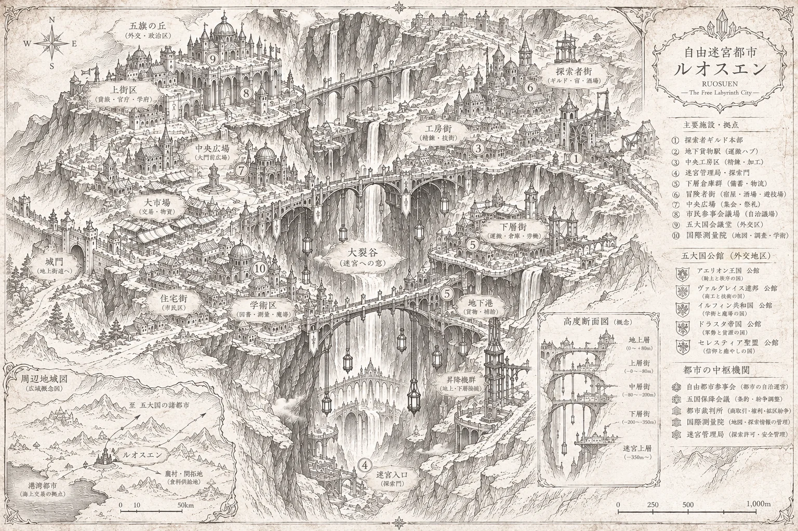

# 自由迷宮都市と組織

*都市の構想図：裂谷を渡る橋、地上と地下を結ぶ運搬施設、外交・自治・交易の街区を示すイメージです。図中の都市名・五大国名・施設名や距離・高さの数値は仮表記であり、正式な世界設定や実測値ではありません。*

## 裂谷の都市へ

初めて訪れる者は、石橋の向こうに続く建物の多さに驚くでしょう。商人の荷車、遠い国の言葉、鋳造の響き。街路が岩壁に突き当たるころ、その足元には幾層もの橋と街並みが重なり、青白い灯りが地下深くまで続いているのが見えます。

この都市は迷宮の入口に置かれただけの前哨地ではありません。地下の既知の交通網、地表の道と農地、遠方の海港を結ぶ交易・居住の拠点です。大部分の食料は地表の農地や遠隔地から運び込まれ、都市では荷役人、測量士、職人、役人、家族、冒険者たちが暮らしています。

### 街区と見どころ（配置・名称は構想段階）

- **裂谷と石橋**：もとの地形を活かした都市の象徴。橋には交易路も防衛上の役割もあり、異なる時代の増築が重なっています。
- **五国公館街**：五大国の使節・商務担当者などが活動する外交地区という構想。各国名、公館の正式な法的地位、個々の建築は未決です。
- **自治・調停地区**：都市住民の代表が集まる議場と、五大国間の条約問題を協議する場を分けて設ける案があります。具体的な制度は未確定です。
- **商業・登記地区**：地図の売買、鉱石の鑑定、契約や権益に関する記録が集まる場所。地図に記載された発見だけで所有権が決まるわけではありません。
- **ギルド街**：護衛、救助、測量、探索の仕事を引き受ける者たちの拠点。依頼を紹介するギルドは一つではありません。
- **工房・貨物地区**：精錬・修理・荷物の積み替えを担い、昇降機や運送路を介して地上と地下をつなぎます。
- **管理された探索門**：この先には警備済みの坑道、採掘区、さらに未踏の世界が続きます。街路が直接無防備な魔物の領域へ開いているわけではありません。

### この形になった理由（成立史の仮説）

都市の起源を、古い地殻変動で露出した地下通路を利用する鉱山前哨地と捉える案があります。地下交通の接続が進むにつれて商人や技師が集まり、五大国の利害衝突と停戦を経て住民自治が発達した、という歴史です。

ただし、**裂谷の具体的な成因、歴史上の年代、旧砦の位置、議場や外交公館の制度は検討中**です。都市の正式名称もまだ決まっていません。地図と街の噂は、この世界のすべてを説明するものではありません。

## 町で暮らす人々
自由迷宮都市は、冒険者だけが住む場所ではありません。鉱物を運ぶ荷役人、坑道を測る測量士、食堂や宿を営む人、魔導具の修理工、家族、旅商人などが暮らしています。

人々は迷宮から来る富に期待する一方、水や物価、治安、通路の安全、働き口といった日々の問題を抱えています。

## 五大国
迷宮への入口や輸送路、資源を巡って競い合う五つの大国があります。各国は軍、採掘会社、研究者、商会、探索部隊を持ち、自国の生活を守るために地下の情報を欲しがります。

五大国の正式な国名、文化、相互関係の詳細は未確定です。キャラクターの出身国は、プレイヤーとDMが相談して具体化できます。

## ギルドと契約
競い合う独立ギルドは、探索者に仕事を紹介し、装備、情報、救援、保険などの支援を提供することがあります。依頼は魔物討伐に限りません。

- 遭難者の救助
- 新しい水源や地下通路の調査
- 鉱物・薬草・標本の採集
- 危険な生物の縄張り調査、必要なら討伐
- 運送路や施設の安全確認

冒険の依頼と報酬は、その都度DMが示します。物を見つけたらその場所の所有権が自動的に得られるわけではありません。

## 自治と国境
この都市は五大国の利害が交わる独特の場所です。一国による完全支配を避ける仕組みや、ギルド・役所・調停組織の役割が構想されています。ただし、憲章・議会・警備権・国境線の詳細はまだ正式に確定していません。

**中立地帯だから争いがない、というわけではありません。** 合法的な競争、強引な商売、資源を巡る紛争、困っている市民の願いが同じ街に存在します。

## プレイヤーキャラクターの立場
君たちがギルドに所属するのか、契約だけを結ぶ独立パーティーなのかは、最初のセッションまでに決めます。いずれの場合も、**4人が協力して一つの仕事を引き受けられる理由**を作ってください。
