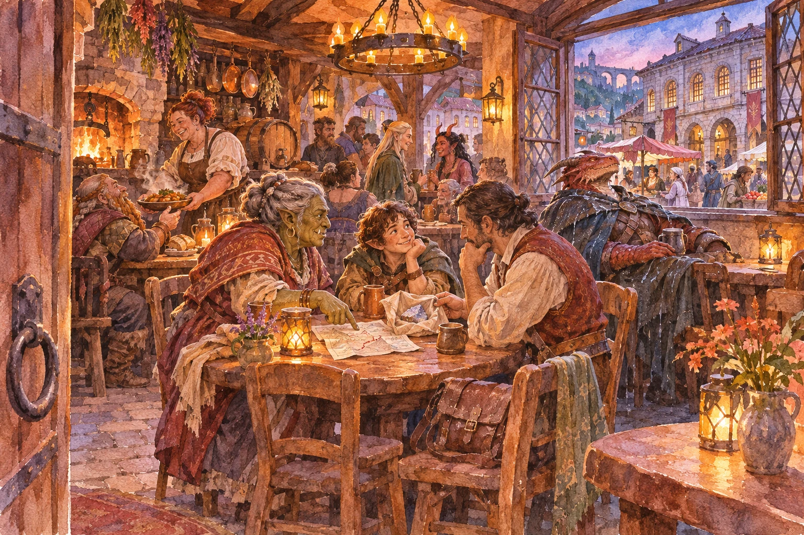
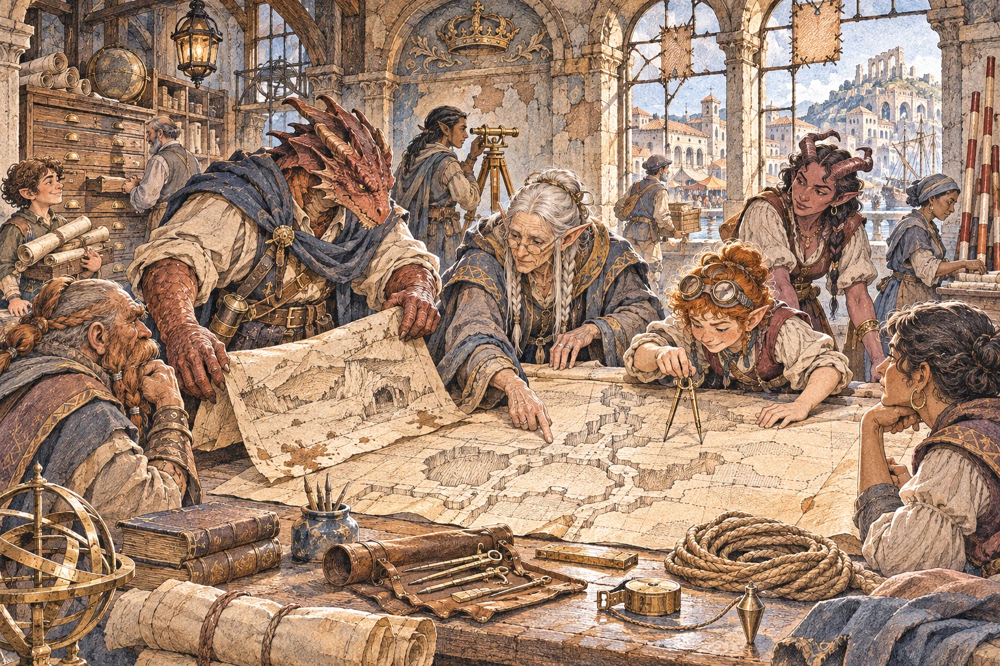
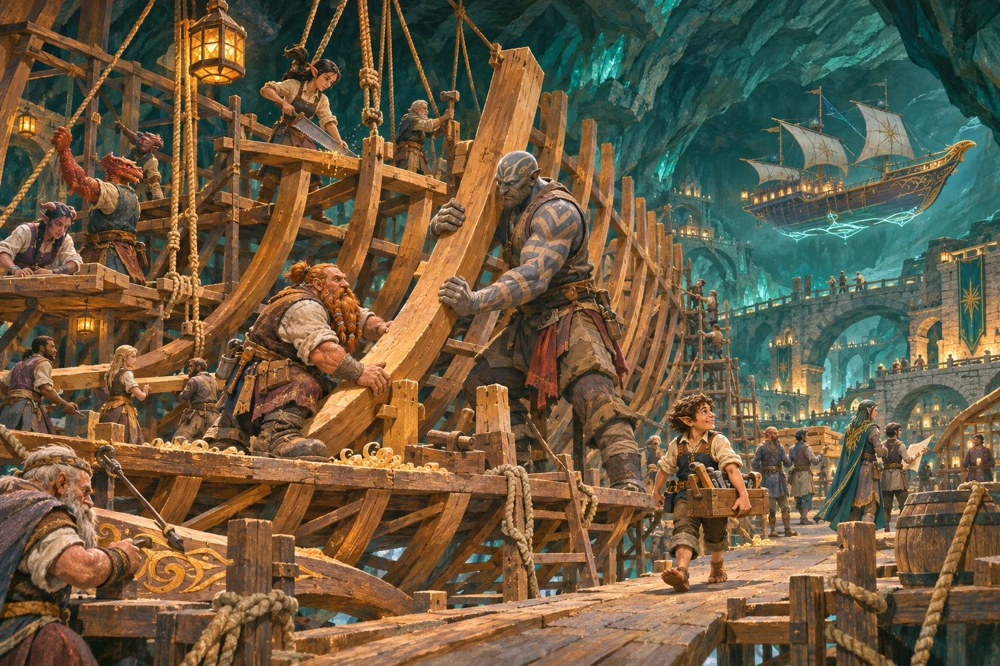
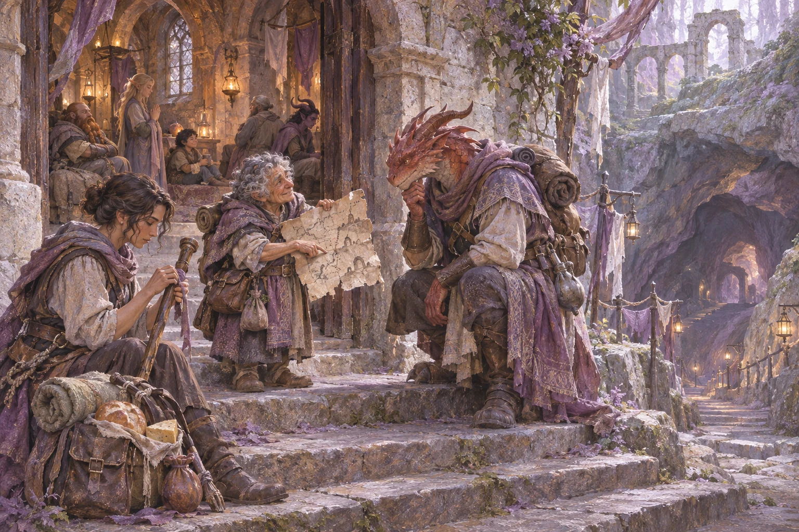
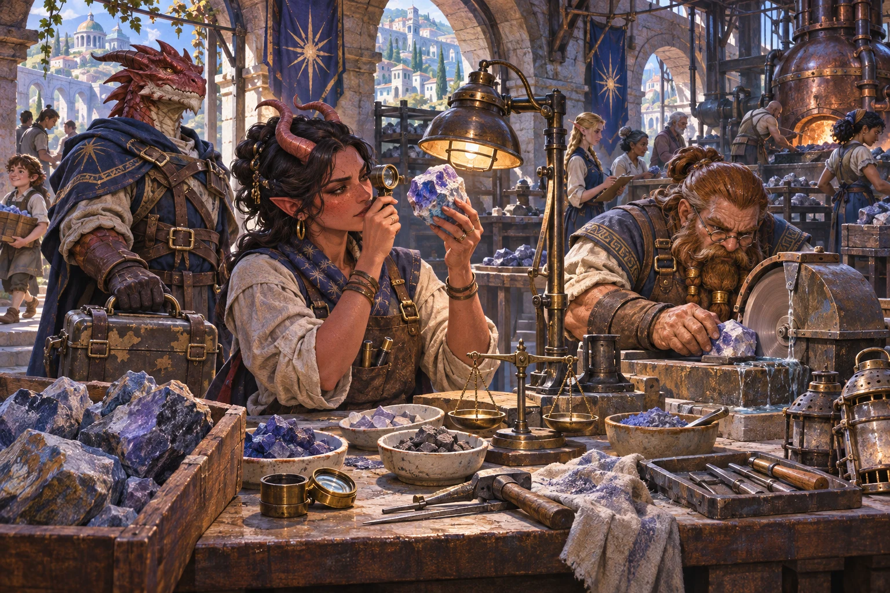

# ルオスエンを歩く

川船で着いた人も、地下の航路から来た人も、この街で誰かと出会う。仕事を探し、技を学び、次の旅を思い描く。ルオスエンを知る入口として、六つの場所を訪ねてみよう。

## 円環商館の酒場

> **円環商館**は、依頼の取次、契約や報酬の取扱い、地下で得た品の売買仲介を担う、歴史ある民間の商業機関だ。
>
> その周囲には独立した酒場が集まる。正式な取引は商館で、噂や仲間探し、帰還祝いは酒場で。山師も買付人も、同じ食卓につく。
>
> 次の仕事を探す人。誰かの帰りを待つ人。君も、ここに馴染みの席を持っているかもしれない。

## セレド王立地図院

> **セレド王立地図院**は、地下の道や土地を測量し、地図と記録を蓄える機関。セレド王国が滅びた今も、「王立」の名を継いでいる。
>
> 探索者が歩いて確かめた道、地下航路の発見、持ち帰られた測量の記録。そうした積み重ねが、次に向かう人の地図になる。
>
> 自分の手で地図の空白を埋めたい人も、古い記録の続きを確かめたい人も、この場所と縁を持てるだろう。

## 底空船廠

> **底空船廠（そこぞらせんしょう）**は、地下を飛ぶ魔導船を造り、修理する船匠たちの拠点だ。船を支える技術と人の手が、地下の港を動かしている。
>
> 地上の空を飛べなくなった船は、いま地下の大空洞を行く。未知の高純度魔石に、再び地上を飛ぶ可能性を期待する人々もいる。
>
> 船を造る職人、その船で働く人、修理の材料を持ち帰る人。船の旅に関わる道は、一つではない。

## 伽藍の塔

> **伽藍の塔（がらんのとう）**は、魔術の教育と研究を担う組織。地表から地下へ伸びる、逆さの塔がその象徴だ。
>
> 地下で見つかった現象や標本は、新しい問いになる。学ぶことと、自分の足で未知を確かめることが、この街では近くにある。
>
> 塔で学んだ人物も、研究に協力する採集人も考えられる。君が迷宮から持ち帰りたいのは、どんな答えだろう。

## 聖路教会

> **聖路教会（セイロ）**は、迷宮の深奥から帰り「神を見た」と語った、最初の帰還者に連なる信仰の組織だ。
>
> 開祖が歩いた道の全容は失われている。信徒や巡礼者たちは、受け継がれた伝承や記録を手がかりに聖路を探す。地下へ降り、道を求める旅そのものが祈りでもある。
>
> 聖路を求める巡礼者、旅を守る護衛、伝承を調べる人。信仰との距離も、その人物ごとに考えてよい。

## 深青の石工房

> **深青の石工房（シンセイ）**は、魔石の鑑定と加工を担う職人たちの工房。石の純度を見極め、利用できる部分を選び、使い手へ届ける。
>
> 山師が鉱脈を探し、鉱夫が掘り出した石は、ここで専門家の目と手を通る。地下での発見が、街の灯りや魔導具を支える力へ変わっていく。
>
> 工房で技を学んだ人、珍しい原石を探す人、馴染みの職人へ石を届ける人。小さな石から始まる縁もある。

**まだ、この街のほんの入口だ。** 市場の商人、宿屋の主人、川港の荷役人、地下の植物を持ち帰る採集人。ここで紹介した場所のほかにも、人の暮らしと仕事は続いている。

この街の出身だろうか。それとも、何かを求めて辿り着いたのだろうか。どこで暮らし、誰を知り、なぜ地下へ向かうのか。気になった場所や仕事から、君の人物を考えてみよう。特定の組織への所属は必要ない。

*情景画の人物・建築・内装は、街を想像するための表現です。正確な街区の配置や組織の制度を示すものではありません。*

[この街で生きる人物を考える](../players/キャラクター作成ガイド.md)
