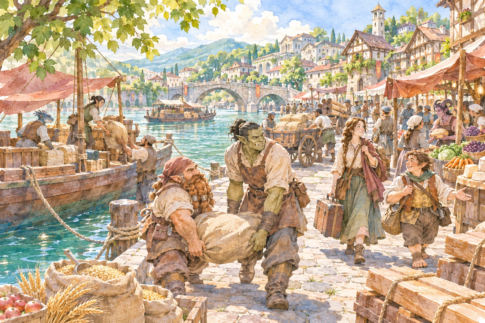
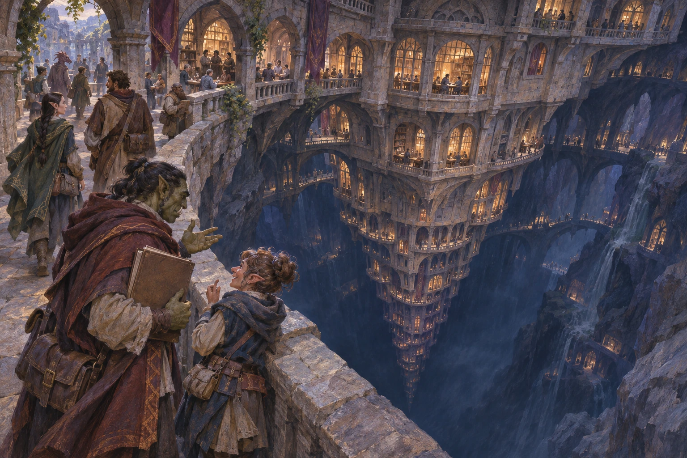

# ルオスエンを歩く

気になる場所で、足を止めよう。この街には、君が誰かと出会う場所がある。

### 川港から、街へ

> 川船が運ぶのは、食料と旅人。
> 荷を下ろす港から、賑わう市場へ。

## 円環商館の酒場

> **次の道は、隣の卓から始まるかもしれない。**
> 商館では、持ち帰った品と仕事の契約が交わされる。
> そのそばの独立した酒場には、買付人も探索者も集まり、噂と帰還の話が行き交う。

## セレド王立地図院

> **王国は滅びた。地図は、描き継がれている。**
> セレド王国の名を残す、測量と記録の機関。
> 地下を歩いた者たちの発見が、ここで地図になる。

### 橋の上で

> 行く人と、帰る人がすれ違う。

## 底空船廠

> **地上を飛べなくなった船を、地下の空へ。**
> 魔導船を造り、修理する船匠たちの拠点。
> いつか地上の空を再び飛びたい。その夢も、地下の船を造る人々の中にある。

## 伽藍の塔

> **塔は、空ではなく地の底へ伸びる。**
> 魔術を学び、研究する者たちの逆さの塔。
> 地下で出会った不思議を、問いとして持ち帰る者もいる。

### 荷が行き交う

> 地上と地下を、人の手がつなぐ。

## 聖路教会

> **失われた道を、今も歩こうとする人々がいる。**
> 深奥から帰り「神を見た」と語った、最初の帰還者。
> その信仰を継ぐ人々にとって、聖路を探す地下の旅は祈りでもある。

## 深青の石工房

> **掘り出した石を、暮らしの力に変える。**
> 魔石の純度を見極め、加工する職人たちの工房。
> 山師が探し、鉱夫が掘った石は、彼らの手を経て使い手へ届く。

### 夜の往来

> 明日の出発を待つ街にも、灯りがともる。

訪ねたい場所は、見つかっただろうか。次は、君たちの冒険が始まる。

*情景画の建築・内装・人物は構想表現です。街区の正確な配置や経路を示すものではありません。*

[次の冒険の始まりへ](../adventures/次の冒険.md)
