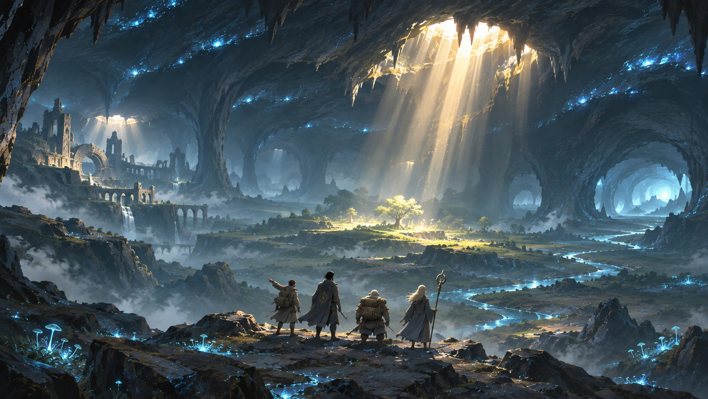
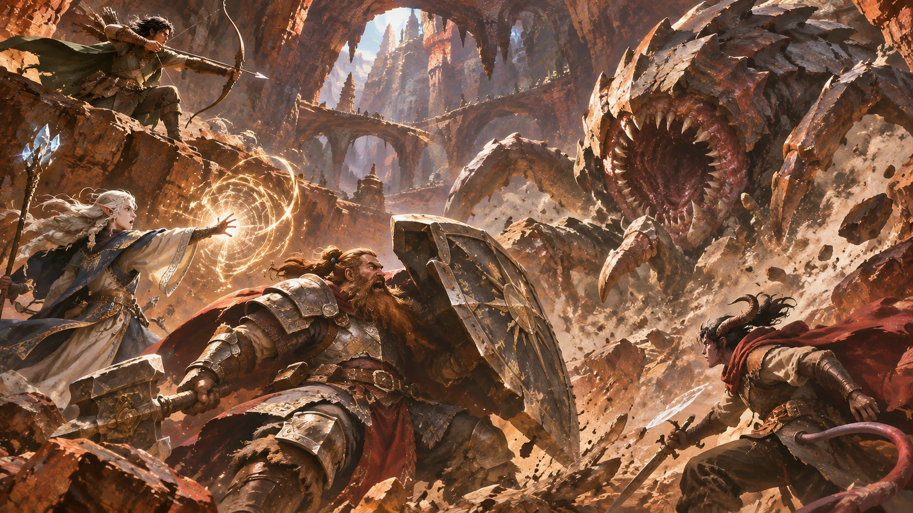
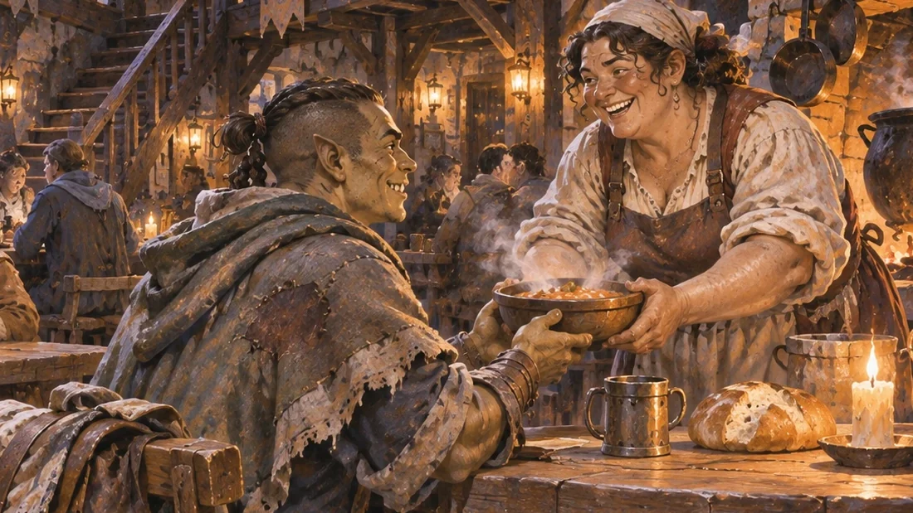
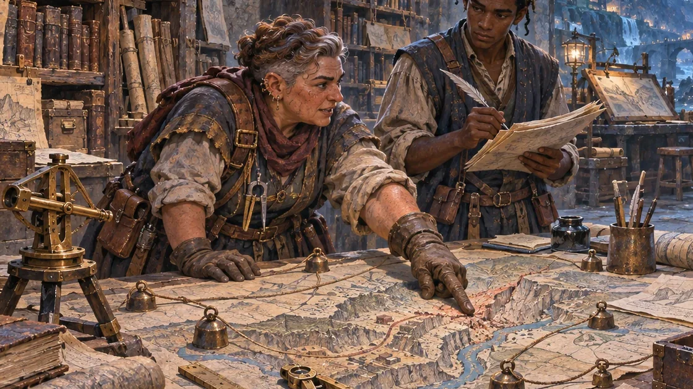
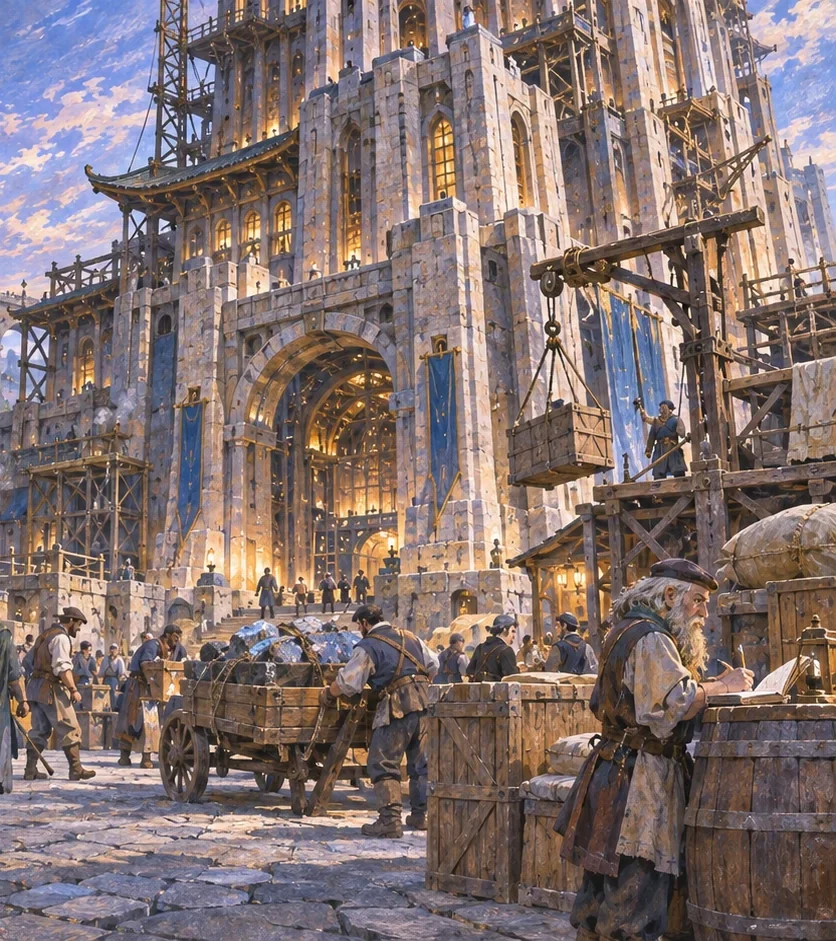

# ルオスエンを歩く

川船で来た旅人も、地下の魔導船を降りた人も、この街で誰かと出会う。市場には地下の産品が届き、酒場には帰還者の話が集まる。街を歩くなら、まずその足元に広がる世界から覗いてみよう。

## 街の下へ

*BENEATH THE CITY*

街の喧騒の、その下へ。  
まだ地図にない道があり、まだ名もない景色がある。  
ルオスエンの営みは、そこから始まる。

ルオスエンの足元には、地図に描かれた道の先に、いくつもの地下世界が広がっている。広大な空洞もあれば、狭い岩の裂け目もある。そこには未知の生き物が暮らし、古い時代の痕跡が残されている。どんな冒険になるかは、君たちがどこへ向かうかで変わる。

### どこまでも広がる、未知の景色

> 岩棚を抜けると、見渡す限りの大空洞が広がっていた。遥か頭上では光苔が星のように瞬き、天井の裂け目から降り注ぐ陽光の下には木々が育っている。左手には岩盤に埋もれた古い建物。右手には、地下河川が流れ込む巨大な洞穴。
>
> あの建物には何が残されているのだろう。陽光の下にはどんな生き物が暮らしているのだろう。川をたどれば、また別の地下世界に出会えるかもしれない。すべてを描き切った地図はない。君たちなら、どこへ向かうだろう。

### 探す、確かめる、生き延びる

> 赤褐色の岩肌が続く渓谷で、巨大な生き物が行く手を阻む。盾を構える者が仲間を守り、岩棚から矢が放たれ、呪文が暗がりを照らす。一人では越えられない危機も、仲間となら切り抜けられるかもしれない。
>
> 力で立ち向かうだけが冒険ではない。生き物の習性を調べ、地形を利用し、ときには退くこともある。知恵も魔法も、剣を振るう勇気も、地下を旅するための力になる。

### 見つけて、持ち帰る

> ランタンの灯りを掲げると、岩の隙間に青白く輝く魔石が見えた。誰も知らない鉱脈を探し当てる山師がいる。岩を削り、貴重な魔石を掘り出す鉱夫がいる。まだ見ぬ高純度の魔石を求めて、探索者たちは地図の空白へと足を踏み入れる。
>
> 持ち帰った一かけらの魔石が、街の灯りをともし、魔導具を生み、地下を行く船を動かす力になる。新たな鉱脈の発見が、街の未来を変えることさえあるだろう。「最下層へ辿り着けば願いが叶う」という噂もあるが、その真実は分からない。君たちは迷宮から何を持ち帰るだろう。

## この街に生きる人々

*PEOPLE OF RUOSUEN*

迷宮へ向かう者がいる。  
彼らを迎え、支え、その帰りを待つ者がいる。  
ルオスエンには、迷宮とともに生きる人々の営みがある。

## モグラの寝床

> 泥のついた荷物を下ろすと、煮込み料理の匂いがする。地下へ潜る者たちを「モグラ」と呼んでいた時代、その呼び名を面白がった初代店主、通称**モグラの大将**が開いた宿だ。
>
> 一度でも地下迷宮に潜った者なら、安価で寝床を借りられる。駆け出しの探索者の住まいと食事を支える習わしは、商館が大きくなった今も続いている。壁には仕事の知らせや、お尋ね者の手配書が張り出されることもある。帰還者の話とともに、次の冒険のきっかけになる。
>
> 君は初めてこの宿を訪れたのだろうか。それとも、いつもの席があるのだろうか。

## モグラ商館

> 一軒の宿から始まった商いは、今では**モグラ商館**へと発展した。依頼の取次、契約と報酬、地下で見つけた品の売買仲介を担う。駆け出しの頃に世話になった探索者たちが、長い年月をかけて築いた信用がある。
>
> 周囲の市場には買付人が集まり、独立した酒場では仲間探しや帰還祝いが続く。大きな商いのときには今でもモグラの大将の声がする、なんて与太話を聞くこともある。初代が持ち帰ったと伝わる魔法の品を超えるものが、迷宮の最下層に眠ると期待する人もいる。
>
> 君が持ち帰ったものに、どんな値をつける人がいるだろうか。

## 王立地図院

> **王立地図院**では、新しく確かめられた道が地図に書き加えられていく。セレド王国が滅びた今も、唯一「王立」の名を守る機関だ。そこで働く灯守（ひもり）は、地下に人々が行き交う主要な道を造る。利益のためだけではなく、次の世代が歩く道を拓く。
>
> 地図の空白には、まだ確かめられていない場所がある。王国時代の地図には閲覧を禁じられたものがある、という噂も聞く。ただし、その地図が本当に存在するか、何を記しているかは分からない。
>
> 君は古い道を辿りたいだろうか。それとも自分の手で新しい道を描きたいだろうか。

## 竜骨亭

> 高い岩天井の下を、船がゆっくり渡っていく。**竜骨亭（りゅうこつてい）**は地下を行く魔導船を造り、修理する人々の拠点だ。
>
> かつて魔導船は地上の空を飛んだ。今はマナに満ちた地下空洞が航路になっている。未知の高純度魔石があれば、また地上の空へ戻れるのではないか――そう期待する船匠もいる。ただし、実現するという証明はない。
>
> 船を造る者にも、その船で働く者にも、まだ知らない材料を探す者にも道がある。

## 伽藍の塔

> 地表から地下へ、今も日々伸び続ける逆さの塔。**伽藍の塔（がらんのとう）**では魔術の教育と研究、魔導具の開発・製作に加え、地下の生態系や未知の生物の研究も行われている。迷宮から持ち帰られた標本や観測の記録は、教室で新たな問いになる。
>
> 塔が日々伸びる仕組みはまだ分からない。説明できない現象があれば、学ぶ者も自分の足で確かめに行く。探索者の発見が研究を変え、研究が新しい探索の方法を生むこともあるだろう。
>
> 君が持ち帰りたいのは、珍しい物だろうか。それとも答えだろうか。

## 摩天楼

> 天を目指す高い塔の足元に、地下から持ち帰られた魔石が集まる。山師が見つけ、鉱夫が掘り出した石は、職人の目と手を通って使えるものになる。**摩天楼（まてんろう）**は、魔石の純度を鑑定・加工し、魔導具の開発・製作も担う技術者たちの組織だ。魔導具を巡っては伽藍の塔と競い合っている。
>
> 迷宮から持ち帰った一かけらの石が、街の灯りや道具、魔導船を動かす力へ変わる。限られた魔石をより有効に使い、技術を経済の力で育てる。合理性を重んじ、失われた文明を取り戻し、さらに高みへ――その野心を名前に感じさせる。だから、新しい産地や珍しい原石を見つけた者の話に、職人たちは耳を傾ける。
>
> 君には売りたい発見があるだろうか。それとも自分の手で作りたいものがあるだろうか。

## 星路教会

> 迷宮の最奥で、神に会った者がいるという。その帰還者を開祖とするのが**星路教会（セイロ）**だ。彼が歩んだ道は、星を巡る路――**星路**と呼ばれている。巡礼者は地下に点在するいくつかの場所を星の名で呼び、一つずつ訪れてゆく。
>
> 正確な地図はとうに失われ、頼れるのは開祖の口伝と、先人の巡礼の足跡ばかり。それでも人々は星を探す。彼らが目指すのは、開祖が神に会ったと伝わる最奥の聖地に、再び辿り着くことだ。
>
> 君にとって地下への旅は、祈りだろうか。調査だろうか。誰かとの約束だろうか。

## クェンサ

> ルオスエンで暮らす者なら、クェンサの名を知らない者はほとんどいない。表通りで話題に上ることは少ないが、この街の裏社会に生きる者たちを取りまとめているのが彼らだ。
>
> クェンサとは、古いエルフの言葉で「我らの青」を意味する。大断裂で森ごと地下へ沈んだエルフたちを母体とし、長い歳月を経て生まれた組織だという。今では種族を問わず、荒くれ者や表には出せない商いに携わる者たちが集う。彼らは彼らなりの掟を持ち、青い魔石がもたらす富を守っている。
>
> 彼らを恐れる者もいれば、世話になった者もいる。街との付き合いは古く、今ではクェンサの代表も、この街の顔役の一人に数えられている。この街の行く末を案じるのは、表通りに生きる者ばかりではないのだ。君の仲間にも、彼らをよく知る者がいるかもしれない。

## まだ、この街のほんの入口だ。

*BEYOND THESE PAGES*

ここに描かれていない人々がいる。  
まだ語られていない物語がある。  
君たちもまた、この街に生きる一人になる。

河港の荷役人、宿屋の主人、市場の商人、地下の植物を採る人々。ここで紹介した人々の外にも暮らしと仕事は続いている。

この街で育った人物も、昨日やって来た人物も、自分なりの理由で地下へ向かえる。特定の組織に所属する必要はない。街の衛兵は少数で、人々の暮らしの最低限の安寧を守る。それを超える仕事は、探索者や専門家に委託される。

[この街で冒険する](../adventures/次の冒険.md)
