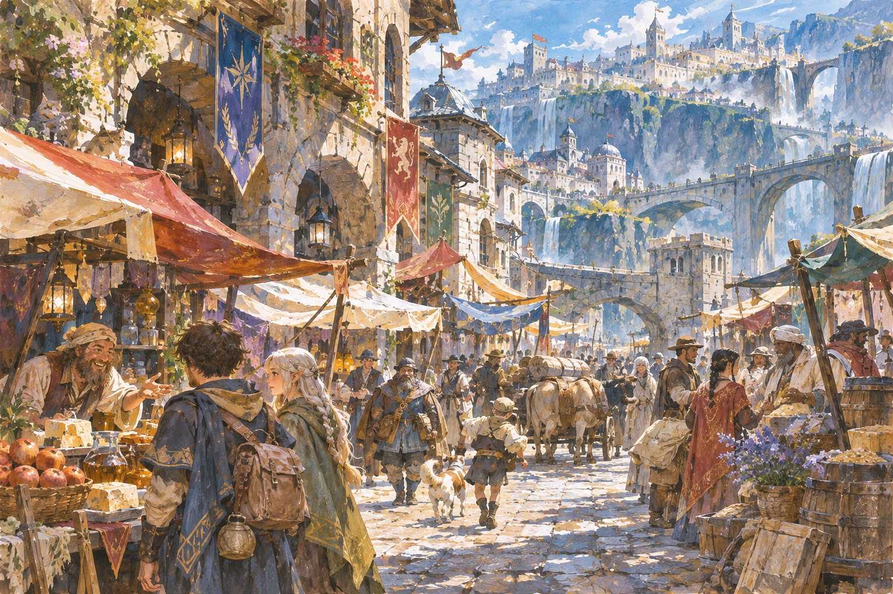
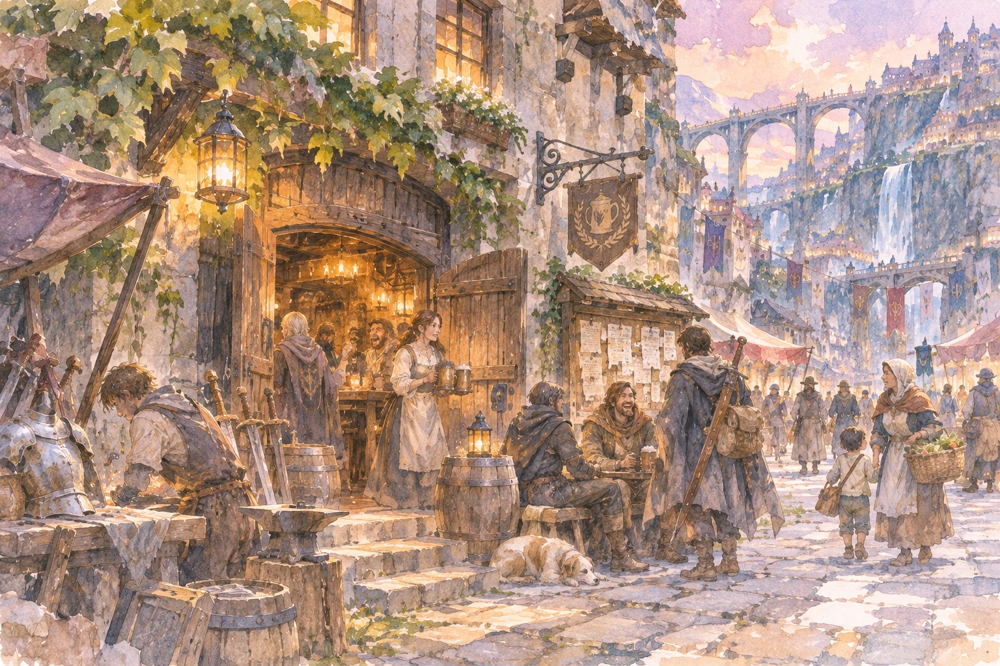
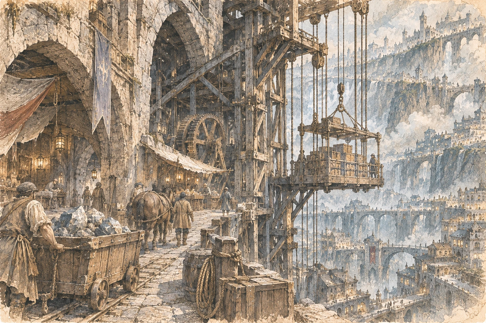
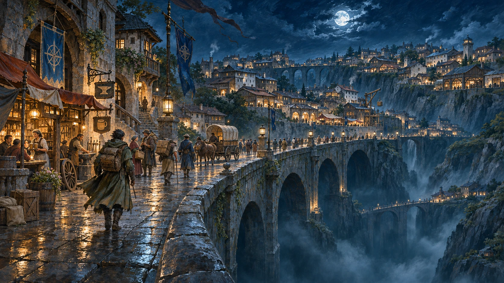

# 自由迷宮都市ルオスエン — 街角の風景

ルオスエンには、国々の交易を支える市場があり、探索から戻った者を迎える酒場があり、崖を上下する貨物の仕事があり、夜も止まらない橋があります。都市の全景だけでは見えない、そこで生きる人々の一日を描いたコンセプトアート集です。

水彩、銅版画、油彩、ガッシュ。それぞれの筆致から、街の一日を眺めてみてください。絵の中の旗や建物、街区の配置は、都市像を考えるための表現案です。

## 01｜五国の人々が集まる市場 — ガッシュ

絵具の重なった色彩のなかに、旅人と商人、荷車、子どもたちの声が混じります。露店で食べ物を買うことも、道具を揃えることも、街での冒険の一部です。毎日の食事と商売が、迷宮へ向かう日を支えています。

## 02｜日暮れの酒場通り — 水彩

酒場では誰かが新しい仕事を見つけ、誰かが無事に戻ったことを祝っています。店の外には武具を直す職人。壁の掲示板に、次の冒険のきっかけが紛れているかもしれません。

## 03｜崖に張りつく貨物昇降場 — 銅版画・淡彩

大きな昇降台は、人と物を岩壁の上下へ運びます。石畳には車輪の跡、梁には修理の痕跡。地下と地上をつなぐ仕事が、この都市を動かしています。

## 04｜夜の橋、帰還者たち — 油彩・夜景

夜になっても、橋の往来は絶えません。警備の灯り、帰りを急ぐ荷車、静かに歩く探索者。足元の裂谷を見下ろすと、ずっと下に別の灯りが続いています。

---

出発の前に立ち寄りたい場所。戻ったら、もう一度見たい灯り。君の人物なら、この街のどこに足を止めるでしょう。

[自由迷宮都市の設定・鳥瞰地図に戻る](./04_自由迷宮都市と組織.md)
