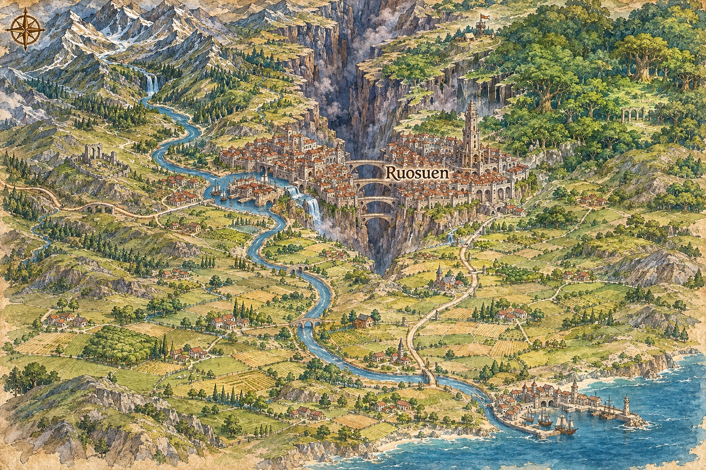

# ルオスエン地方地図 — 採用第一案（2026-11-22）

> **作者採用の第一ラフ／地域地図のビジュアル基準**
>
> 2026年11月22日に制作した地図候補3点のうち、**1枚目**を作者が採用。地図全体の構図・雰囲気の基準として保存する。地図の細部、距離、まだ名前を付けていない場所の歴史・配置は、**挿絵を根拠に公式設定へ自動確定しない**。

**[地図を原寸表示する](ruosuen-regional-map-20261122-v1.webp)**

## 採用した絵の要点

- **大断裂：** ルオスエンの北へ果てしなく続き、地方地図の画面外へ伸びる。都市の南側では比較的早く狭まり、海まで達しない。
- **ルオスエン：** 大断裂の東西両岸に屋根が密集し、断崖上の石造建築と複数の巨大なアーチ橋が都市の輪郭を作る。
- **摩天楼：** 都市の東岸に、周囲の建築より高くそびえる塔として表現する。
- **大河：** 西から流れ、都市近郊で南への水運路と大断裂への落水路に分かれる。
- **周辺地方：** 山地、古い森、農耕地帯、街道、周辺集落、南方の河口港が共存する。
- **文字表記：** 画面内の地名は **`Ruosuen` 一か所のみ**。それ以外の地名・地形名・建物名・説明文は表記しない。文字を入れる場合も英語に限る。

## 資料の区別

- **この画像は採用済みの地図ラフ**であり、ランドマークの厳密な位置・縮尺を確定する測量図ではない。
- 地理骨格の正本は [世界設定：マナ・魔石・迷宮と社会](../../world/02_マナ・魔石・迷宮と社会.md)。
- 地図の作画指示・未決事項は [ルオスエン地方地図 — 第一ラフ作図仕様](../ルオスエン地方地図_第一ラフ作図仕様_2026-11-22.md) を参照する。
- 当ページと画像は **GitHub内の作者・制作資料**。GitHub Pagesのプレイヤー向け公開メニューにはまだ掲載しない。

## 画像データ

- 選定：2026-11-22制作の**3案中1案目**。
- 掲載版：**1536 × 1024 px / 高品質WebP**（元のPNG原画から作成した表示・保管用変換版）。
- 画像内で唯一表示される地名：**Ruosuen**。
