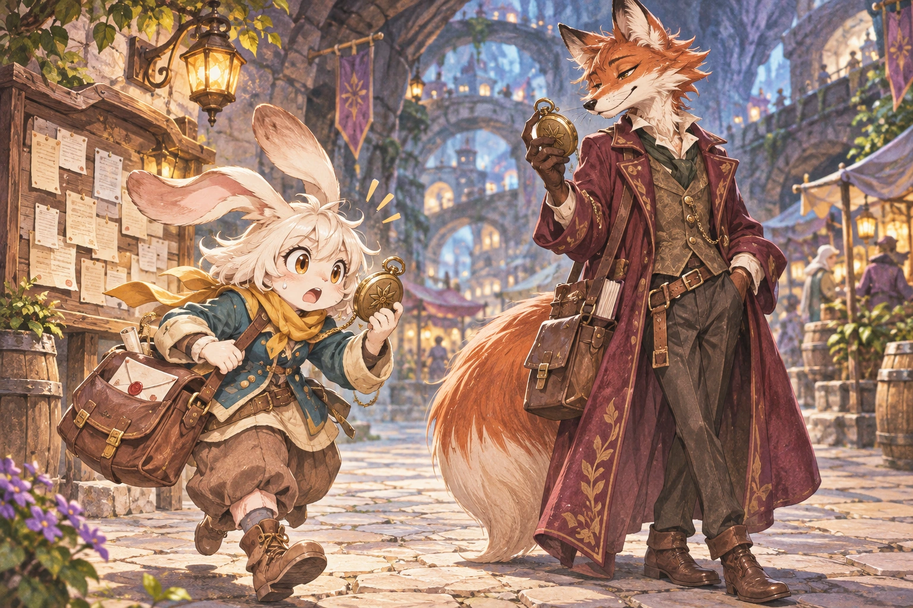

# ベルとタッカー — プレイヤー向けNPC紹介画（2026-11-25）

**状態：新規制作・作者レビュー待ち。** 2026-11-20に承認された[キャラクターシート](../../world/npcs/art/README.md)を踏まえ、プレイヤー配布用に制作した別構図。キャラクターの容姿・時計・衣装の基準は従来の承認済みシートと人物票を優先する。

- 画像配置：`assets/npc-bell-tucker-player-20261125.webp`
- 用途：[キャラクター作成ガイド](../../players/キャラクター作成ガイド.md)内の紹介画
- 生成日：2026-11-25
- 生成ID：`cbb0d1cb-f2a4-46bb-bdd9-3b32df843e78`
- データ：1536 × 1024 px。WebP（品質95）。生成PNGは会話内原本。
- 意図：小柄なベルは時計を見て焦り、背の高いタッカーは同型の時計を余裕をもって眺める。配達鞄・手帳・衣装で職能と対比を示す。
- 注意：背景の建築・街区・掲示の内容、時計の装飾の由来、細かな衣装の意匠は新たな世界設定として確定しない。
