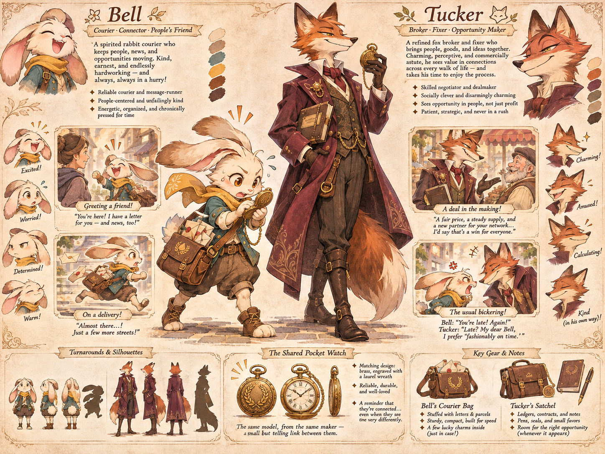

# ベルとタッカー — 採用済みキャラクターシート

**状態：採用（2026-11-20作者承認）**

- 制作日・承認日：2026-11-20
- 生成ID：59ba9009-7fa2-40e4-a945-118aa4833fad
- 登録ファイル：bell-tucker-character-sheet.webp（1448 × 1086、可逆圧縮、2,469,090 bytes）
- Git blob SHA：d8a8386c027dd5d078ad3ae212a6b26066641f7c
- SHA-256：1aac09b8d9f152e9caccce471dc4240a14e79363876b34d8213b7d0d05ac3190
- 元PNG：ベルとタッカーの幻想キャラクターシート.png（3,433,245 bytes、SHA-256 352c29a2a523dae5393de851df42547285b7462ef420b960353db4a858e9adec）。PNG原本のGitHub転送が失敗したため、無劣化WebPに変換。RGBの全画素一致を確認済み。PNG原本そのものではない。

ベルとタッカーの全身、表情、衣装、シルエット、鞄、同型の懐中時計を一枚にまとめた画。ベルは慌て、タッカーは余裕を持って同じ時計を見る。第一モチーフはエムル（兎姿）とフォックスグローブ氏。図中の台詞や補足は演技・作画の参考とし、時計の入手経緯や個別の事件を無断で確定しない。

今後の個別立ち絵、表情差分、描写の基準とする。プレイヤー向けPagesへの掲載は未実施。

人物票：[ベル](../bell.md)／[タッカー](../tucker.md)／[NPC台帳](../README.md)
